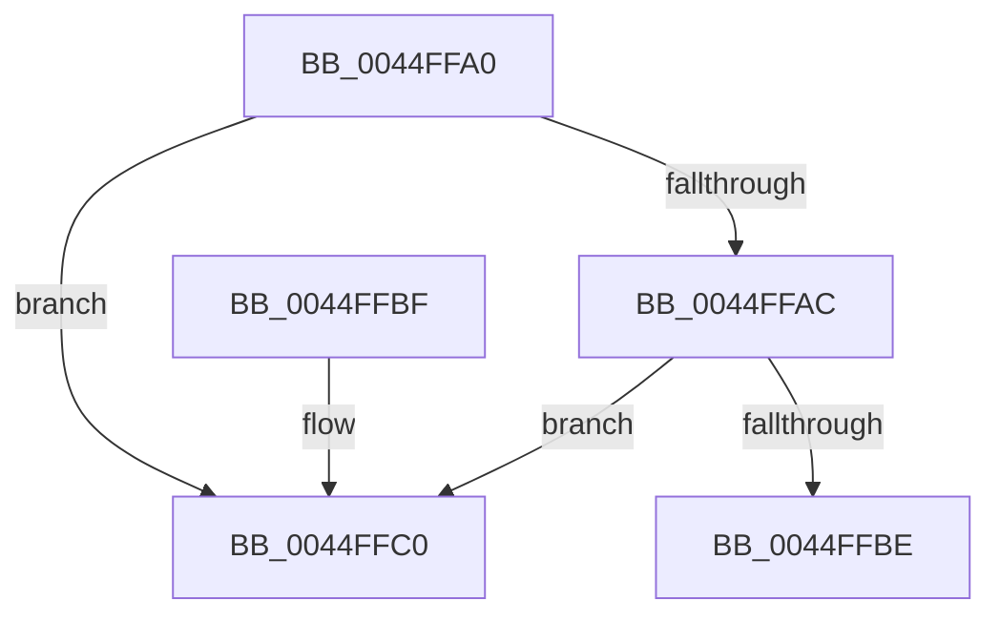

# HvlpGetLpcbByLpIndex

- RVA: `0x0044FFA0`–`0x0044FFD1` (길이 `49` bytes)
- VA: `0x000000014044FFA0`
- 실행 섹션: `.text`
- PDB 이름 있음: `예`; PDB Function 태그: `예`
- unwind 정보 RVA: `0x000DB714`
- 디코드: `14`개 명령, `49/49` bytes 표시
- 미해석 바이트: `0` (있으면 어셈블리에 `.byte`로 보존)

> 이 문서는 커널 이미지의 기계어와 PDB 기호를 분석해 생성했습니다. 4번과 5번은 함수 원형과 자료형을 바이너리 사용 방식에서 추정한 C 해석이며 원본 소스 복구 결과는 아닙니다.

## 1. Dependencies

- 직접 호출 지점: **0**; 고유 호출 대상: **0**
- 직접 호출자로 확인된 함수: **8**
- RIP 상대 이미지 참조: **2**

### Outgoing calls
- 직접 디코드된 call 명령이 없습니다.

### Direct callers
- [PpmHvSnapPerformanceAccumulation](PpmHvSnapPerformanceAccumulation_function_0044FA34.md) at `0x0044FAAB`
- [PpmHvSnapPerformanceAccumulation](PpmHvSnapPerformanceAccumulation_function_0044FA34.md) at `0x0044FAF2`
- [PpmHvSnapPerformanceAccumulation](PpmHvSnapPerformanceAccumulation_function_0044FA34.md) at `0x0044FBB9`
- [HvlEnlightenProcessor](../4D/HvlEnlightenProcessor_function_004DCD9C.md) at `0x004DCECF`
- [HvlGetApicIdFromLpIndex](../58/HvlGetApicIdFromLpIndex_function_00584610.md) at `0x00584624`
- [HvlGetVpSintMessagePage](../58/HvlGetVpSintMessagePage_function_00584760.md) at `0x0058476B`
- [HvlQueryHypervisorProcessorNodeNumber](../58/HvlQueryHypervisorProcessorNodeNumber_function_00584840.md) at `0x00584859`
- [HvlQueryProcessorTopologyEx](../58/HvlQueryProcessorTopologyEx_function_00584B60.md) at `0x00584B8C`
- [HvlpInitializeBootProcessor](../58/HvlpInitializeBootProcessor_function_00585964.md) at `0x00585A37`
- [HvlInitializeProcessor](../../page/71/HvlInitializeProcessor_function_0071804C.md) at `0x00718177`

### Static image references
- `0x0044FFA0` → RVA `0x00FC6BA0` (`ALMOSTRO`; read)
- `0x0044FFB2` → RVA `0x00FC6C40` (`ALMOSTRO`; read)

## 2. Other-region calls and transfers

- 다른 실행 섹션으로 향하는 call: **0**
- call이 아닌 외부 분기/꼬리 이동: **1**
  - `0x0044FFCC` → `0x006F1324` (`tail-transfer`)

## 3. Assembly (complete function range)

```asm
0044FFA0  44 8B 0D F9 6B B7 00            mov r9d, dword ptr [rip + 0xb76bf9]
0044FFA7  41 3B C9                        cmp ecx, r9d
0044FFAA  73 14                           jae 0x14044ffc0
0044FFAC  8B C1                           mov eax, ecx
0044FFAE  48 6B C0 68                     imul rax, rax, 0x68
0044FFB2  48 03 05 87 6C B7 00            add rax, qword ptr [rip + 0xb76c87]
0044FFB9  39 48 04                        cmp dword ptr [rax + 4], ecx
0044FFBC  75 02                           jne 0x14044ffc0
0044FFBE  C3                              ret
0044FFBF  CC                              int3
0044FFC0  48 8B 15 79 6C B7 00            mov rdx, qword ptr [rip + 0xb76c79]
0044FFC7  33 C0                           xor eax, eax
0044FFC9  44 8B C0                        mov r8d, eax
0044FFCC  E9 53 13 2A 00                  jmp 0x1406f1324
```

## 4. C-style interpretation (structured pseudocode)

```c
__int64 __fastcall HvlpGetLpcbByLpIndex(int a1)
{
    __int64 result;

    if (a1 >= ((unsigned int)((unsigned int)(*(unsigned int *)(v_rip + 12020729))))) goto loc_0044FFC0;
    result = ((unsigned int)(a1)) * ((unsigned int)(a1));
    result = (result) + (*(unsigned __int64 *)(v_rip + 12020871));
    if ((*(unsigned int *)(result + 4)) != a1) goto loc_0044FFC0;
    return result;
loc_0044FFC0:
    result = 0;
}
```

## 5. (Beta) C Style

```c
int64_t HvlpGetLpcbByLpIndex(int32_t Arg1)
{
    int64_t result;

    if (Arg1 >= ((uint32_t)((uint32_t)(*(uint32_t *)(v_rip + 0xB76BF9))))) goto loc_0044FFC0;
    result = ((uint32_t)(Arg1)) * ((uint32_t)(Arg1));
    result = (result) + (*(uint64_t *)(v_rip + 0xB76C87));
    if ((*(uint32_t *)(result + 0x4)) != Arg1) goto loc_0044FFC0;
    return result;
loc_0044FFC0:
    result = 0;
}
```

## 6. Execution-region graph

[열기: 2D/3D 그래프와 함수 탐색 컨트롤 패널](../../../control-panel.html?section=text&rva=0x0044FFA0&view=graph)

- 2D 그래프는 위에서 아래로 흐르고, 3D 그래프는 빈 공간을 드래그해 회전합니다. Shift+드래그는 이동, 휠은 확대·축소, 함수 노드 선택은 대상 보고서 이동입니다.

### Static fallback


