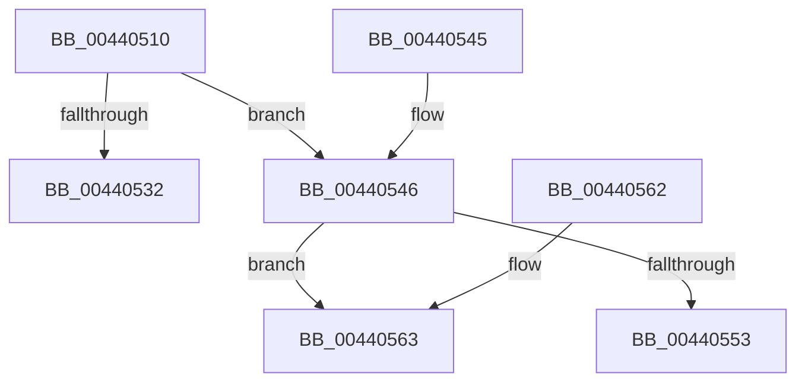

# HvlpPrepareFlushHeader

- RVA: `0x00440510`–`0x0044056F` (길이 `95` bytes)
- VA: `0x0000000140440510`
- 실행 섹션: `.text`
- PDB 이름 있음: `예`; PDB Function 태그: `예`
- unwind 정보 RVA: `0x000DB714`
- 디코드: `28`개 명령, `95/95` bytes 표시
- 미해석 바이트: `0` (있으면 어셈블리에 `.byte`로 보존)

> 이 문서는 커널 이미지의 기계어와 PDB 기호를 분석해 생성했습니다. 4번과 5번은 함수 원형과 자료형을 바이너리 사용 방식에서 추정한 C 해석이며 원본 소스 복구 결과는 아닙니다.

## 1. Dependencies

- 직접 호출 지점: **0**; 고유 호출 대상: **0**
- 직접 호출자로 확인된 함수: **1**
- RIP 상대 이미지 참조: **2**

### Outgoing calls
- 직접 디코드된 call 명령이 없습니다.

### Direct callers
- [HvlpSlowFlushAddressSpaceTb](HvlpSlowFlushAddressSpaceTb_function_004402C4.md) at `0x0044040B`

### Static image references
- `0x00440546` → RVA `0x00FC5007` (`ALMOSTRO`; read)
- `0x00440563` → RVA `0x00FCD263` (`ALMOSTRO`; read)

## 2. Other-region calls and transfers

- 다른 실행 섹션으로 향하는 call: **0**
- call이 아닌 외부 분기/꼬리 이동: **1**
  - `0x0044056A` → `0x006EF8DE` (`tail-transfer`)

## 3. Assembly (complete function range)

```asm
00440510  45 33 D2                        xor r10d, r10d
00440513  B8 04 00 00 00                  mov eax, 4
00440518  45 84 C9                        test r9b, r9b
0044051B  41 0F 45 C2                     cmovne eax, r10d
0044051F  44 8B C8                        mov r9d, eax
00440522  41 83 C9 02                     or r9d, 2
00440526  48 85 D2                        test rdx, rdx
00440529  44 0F 45 C8                     cmovne r9d, eax
0044052D  4D 85 C0                        test r8, r8
00440530  75 14                           jne 0x140440546
00440532  41 83 C9 01                     or r9d, 1
00440536  4C 89 51 10                     mov qword ptr [rcx + 0x10], r10
0044053A  41 8B C1                        mov eax, r9d
0044053D  48 89 41 08                     mov qword ptr [rcx + 8], rax
00440541  48 89 11                        mov qword ptr [rcx], rdx
00440544  C3                              ret
00440545  CC                              int3
00440546  44 38 15 BA 4A B8 00            cmp byte ptr [rip + 0xb84aba], r10b
0044054D  4D 8B 58 08                     mov r11, qword ptr [r8 + 8]
00440551  74 10                           je 0x140440563
00440553  4C 89 59 10                     mov qword ptr [rcx + 0x10], r11
00440557  41 8B C1                        mov eax, r9d
0044055A  48 89 41 08                     mov qword ptr [rcx + 8], rax
0044055E  48 89 11                        mov qword ptr [rcx], rdx
00440561  C3                              ret
00440562  CC                              int3
00440563  4C 8D 05 F9 CC B8 00            lea r8, [rip + 0xb8ccf9]
0044056A  E9 6F F3 2A 00                  jmp 0x1406ef8de
```

## 4. C-style interpretation (structured pseudocode)

```c
__int64 __fastcall HvlpPrepareFlushHeader(__int64 a1, __int64 a2, __int64 a3, unsigned __int8 a4)
{
    __int64 result;
    __int64 v_r10;

    v_r10 = 0;
    result = 4;
    if (a4 != 0) { result = 0; }
    a4 = (unsigned int)(((unsigned int)((unsigned int)(result))) | (2));
    if (a2 != 0) { a4 = (unsigned int)(result); }
    if (a3 != 0) goto loc_00440546;
    a4 = (unsigned int)((a4) | (1));
    *(unsigned __int64 *)(a1 + 16) = 0;
    *(unsigned __int64 *)(a1 + 8) = (unsigned int)(a4);
    *(unsigned __int64 *)(a1) = a2;
    return (unsigned int)(a4);
loc_00440546:
    if ((*(unsigned __int8 *)(v_rip + 12077754)) == 0) goto loc_00440563;
    *(unsigned __int64 *)(a1 + 16) = *(unsigned __int64 *)(a3 + 8);
    *(unsigned __int64 *)(a1 + 8) = (unsigned int)(a4);
    *(unsigned __int64 *)(a1) = a2;
    return (unsigned int)(a4);
loc_00440563:
}
```

## 5. (Beta) C Style

```c
int64_t HvlpPrepareFlushHeader(void *Arg1, int64_t Arg2, int64_t Arg3, uint8_t Arg4)
{
    uint8_t *arg1 = (uint8_t *)Arg1;

    int64_t result;
    int64_t local_r10;

    local_r10 = 0;
    result = 4;
    if (Arg4 != 0) { result = 0; }
    Arg4 = (uint32_t)(((uint32_t)((uint32_t)(result))) | (2));
    if (Arg2 != 0) { Arg4 = (uint32_t)(result); }
    if (Arg3 != 0) goto loc_00440546;
    Arg4 = (uint32_t)((Arg4) | (1));
    *(uint64_t *)(arg1 + 0x10) = 0;
    *(uint64_t *)(arg1 + 0x8) = (uint32_t)(Arg4);
    *(uint64_t *)(arg1) = Arg2;
    return (uint32_t)(Arg4);
loc_00440546:
    if ((*(uint8_t *)(v_rip + 0xB84ABA)) == 0) goto loc_00440563;
    *(uint64_t *)(arg1 + 0x10) = *(uint64_t *)(Arg3 + 0x8);
    *(uint64_t *)(arg1 + 0x8) = (uint32_t)(Arg4);
    *(uint64_t *)(arg1) = Arg2;
    return (uint32_t)(Arg4);
loc_00440563:
}
```

### 관측된 메모리 오프셋

구조체 형식이 확인되지 않은 접근은 인자 기준의 오프셋으로만 기록했습니다.

| 기준 인자 | 오프셋 표현 | 폭 (bit) | 접근 |
|---|---:|---:|---|
| `Arg1` | `+ 0x0` | `64` | `W` |
| `Arg1` | `+ 0x8` | `64` | `W` |
| `Arg1` | `+ 0x10` | `64` | `W` |

## 6. Execution-region graph

[열기: 2D/3D 그래프와 함수 탐색 컨트롤 패널](../../../control-panel.html?section=text&rva=0x00440510&view=graph)

- 2D 그래프는 위에서 아래로 흐르고, 3D 그래프는 빈 공간을 드래그해 회전합니다. Shift+드래그는 이동, 휠은 확대·축소, 함수 노드 선택은 대상 보고서 이동입니다.

### Static fallback


