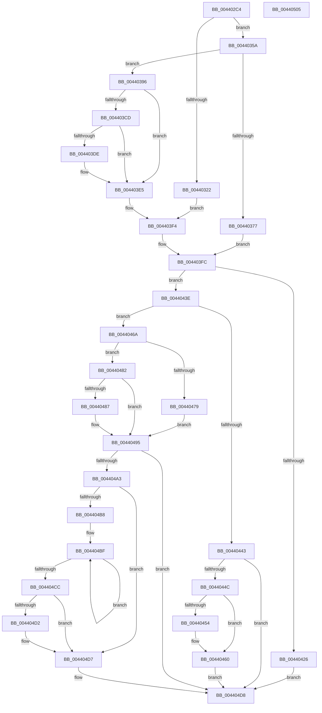

# HvlpSlowFlushAddressSpaceTb

- RVA: `0x004402C4`–`0x00440506` (길이 `578` bytes)
- VA: `0x00000001404402C4`
- 실행 섹션: `.text`
- PDB 이름 있음: `예`; PDB Function 태그: `아니요`
- unwind 정보 RVA: `0x000A4E80`
- 디코드: `152`개 명령, `578/578` bytes 표시
- 미해석 바이트: `0` (있으면 어셈블리에 `.byte`로 보존)

> 이 문서는 커널 이미지의 기계어와 PDB 기호를 분석해 생성했습니다. 4번과 5번은 함수 원형과 자료형을 바이너리 사용 방식에서 추정한 C 해석이며 원본 소스 복구 결과는 아닙니다.

## 1. Dependencies

- 직접 호출 지점: **10**; 고유 호출 대상: **10**
- 직접 호출자로 확인된 함수: **3**
- RIP 상대 이미지 참조: **3**

### Outgoing calls
- `0x00440329` → [KeDisableInterrupts](../21/KeDisableInterrupts_function_00217BE0.md) (function, `0x00217BE0`)
- `0x0044036A` → [ExpInterlockedPopEntrySList](../6B/ExpInterlockedPopEntrySList_function_006BA570.md) (function, `0x006BA570`)
- `0x004403E0` → [KiRaiseIrqlProcessIrqlFlags](../4F/KiRaiseIrqlProcessIrqlFlags_function_004F56FC.md) (function, `0x004F56FC`)
- `0x004403E8` → [MmGetPhysicalAddress](../23/MmGetPhysicalAddress_function_0023A500.md) (function, `0x0023A500`)
- `0x0044040B` → [HvlpPrepareFlushHeader](HvlpPrepareFlushHeader_function_00440510.md) (function, `0x00440510`)
- `0x00440419` → [HvcallInitiateHypercall](../31/HvcallInitiateHypercall_function_00313630.md) (function, `0x00313630`)
- `0x00440434` → [ExpInterlockedPushEntrySList](../6B/ExpInterlockedPushEntrySList_function_006BA5B0.md) (function, `0x006BA5B0`)
- `0x0044045B` → [KiLowerIrqlProcessIrqlFlags](../4F/KiLowerIrqlProcessIrqlFlags_function_004F5698.md) (function, `0x004F5698`)
- `0x004404D2` → [KiRemoveSystemWorkPriorityKick](../26/KiRemoveSystemWorkPriorityKick_function_002631D0.md) (function, `0x002631D0`)
- `0x004404DF` → [_security_check_cookie](../6A/_security_check_cookie_function_006AC640.md) (function, `0x006AC640`)

### Direct callers
- [KiFlushAddressSpaceTb](../30/KiFlushAddressSpaceTb_function_00308F50.md) at `0x00309047`
- [KiFlushAddressSpaceTb](../30/KiFlushAddressSpaceTb_function_00308F50.md) at `0x00309051`
- [KeFlushCurrentTbOnly](../31/KeFlushCurrentTbOnly_function_003134EC.md) at `0x003135F0`
- [sub_00314667](../31/Unknown_function_00314667.md) at `0x003146CC`
- [sub_00314667](../31/Unknown_function_00314667.md) at `0x003146D6`

### Static image references
- `0x004402E7` → RVA `0x00E0A740` (`.data`; read)
- `0x00440310` → RVA `0x00FC6A90` (`ALMOSTRO`; read)
- `0x004403D5` → RVA `0x00FC6D20` (`ALMOSTRO`; read)

## 2. Other-region calls and transfers

- 다른 실행 섹션으로 향하는 call: **0**
- 별도 외부 분기/꼬리 이동을 확인하지 못했습니다.

## 3. Assembly (complete function range)

```asm
004402C4  48 8B C4                        mov rax, rsp
004402C7  48 89 58 08                     mov qword ptr [rax + 8], rbx
004402CB  48 89 70 10                     mov qword ptr [rax + 0x10], rsi
004402CF  48 89 78 18                     mov qword ptr [rax + 0x18], rdi
004402D3  55                              push rbp
004402D4  41 54                           push r12
004402D6  41 55                           push r13
004402D8  41 56                           push r14
004402DA  41 57                           push r15
004402DC  48 8D 68 A1                     lea rbp, [rax - 0x5f]
004402E0  48 81 EC 90 00 00 00            sub rsp, 0x90
004402E7  48 8B 05 52 A4 9C 00            mov rax, qword ptr [rip + 0x9ca452]
004402EE  48 33 C4                        xor rax, rsp
004402F1  48 89 45 2F                     mov qword ptr [rbp + 0x2f], rax
004402F5  33 C0                           xor eax, eax
004402F7  44 88 45 C7                     mov byte ptr [rbp - 0x39], r8b
004402FB  48 89 45 DF                     mov qword ptr [rbp - 0x21], rax
004402FF  0F 57 C0                        xorps xmm0, xmm0
00440302  89 45 E7                        mov dword ptr [rbp - 0x19], eax
00440305  48 89 55 EF                     mov qword ptr [rbp - 0x11], rdx
00440309  8D 58 02                        lea ebx, [rax + 2]
0044030C  48 89 4D F7                     mov qword ptr [rbp - 9], rcx
00440310  8B 05 7A 67 B8 00               mov eax, dword ptr [rip + 0xb8677a]
00440316  44 8D 73 FF                     lea r14d, [rbx - 1]
0044031A  0F 11 45 CF                     movups xmmword ptr [rbp - 0x31], xmm0
0044031E  A8 08                           test al, 8
00440320  75 38                           jne 0x14044035a
00440322  C7 45 CF 04 00 00 00            mov dword ptr [rbp - 0x31], 4
00440329  E8 B2 78 DD FF                  call 0x140217be0
0044032E  88 45 D7                        mov byte ptr [rbp - 0x29], al
00440331  65 48 8B 04 25 20 00 00 00      mov rax, qword ptr gs:[0x20]
0044033A  44 8B 65 CF                     mov r12d, dword ptr [rbp - 0x31]
0044033E  44 89 75 DB                     mov dword ptr [rbp - 0x25], r14d
00440342  44 8A 75 D7                     mov r14b, byte ptr [rbp - 0x29]
00440346  48 8B B8 00 8C 00 00            mov rdi, qword ptr [rax + 0x8c00]
0044034D  4C 8B 7F 10                     mov r15, qword ptr [rdi + 0x10]
00440351  4C 89 7D E7                     mov qword ptr [rbp - 0x19], r15
00440355  E9 9A 00 00 00                  jmp 0x1404403f4
0044035A  65 48 8B 34 25 20 00 00 00      mov rsi, qword ptr gs:[0x20]
00440363  48 8D 8E C0 8B 00 00            lea rcx, [rsi + 0x8bc0]
0044036A  E8 01 A2 27 00                  call 0x1406ba570
0044036F  48 8B F8                        mov rdi, rax
00440372  48 85 C0                        test rax, rax
00440375  74 1F                           je 0x140440396
00440377  4C 8B 78 10                     mov r15, qword ptr [rax + 0x10]
0044037B  45 8B E6                        mov r12d, r14d
0044037E  44 89 75 CF                     mov dword ptr [rbp - 0x31], r14d
00440382  4C 8B E8                        mov r13, rax
00440385  4C 89 7D E7                     mov qword ptr [rbp - 0x19], r15
00440389  4C 8B F6                        mov r14, rsi
0044038C  48 89 75 D7                     mov qword ptr [rbp - 0x29], rsi
00440390  48 89 45 DF                     mov qword ptr [rbp - 0x21], rax
00440394  EB 66                           jmp 0x1404403fc
00440396  48 C7 C2 00 F0 FF FF            mov rdx, 0xfffffffffffff000
0044039D  89 5D CF                        mov dword ptr [rbp - 0x31], ebx
004403A0  48 8D 4D 06                     lea rcx, [rbp + 6]
004403A4  44 8B E3                        mov r12d, ebx
004403A7  48 83 E1 F8                     and rcx, 0xfffffffffffffff8
004403AB  48 8D 79 17                     lea rdi, [rcx + 0x17]
004403AF  48 8B C7                        mov rax, rdi
004403B2  48 23 FA                        and rdi, rdx
004403B5  48 33 C1                        xor rax, rcx
004403B8  48 85 C2                        test rdx, rax
004403BB  48 0F 44 F9                     cmove rdi, rcx
004403BF  44 0F 20 C0                     mov rax, cr8
004403C3  88 45 D7                        mov byte ptr [rbp - 0x29], al
004403C6  44 8A F0                        mov r14b, al
004403C9  3A C3                           cmp al, bl
004403CB  73 18                           jae 0x1404403e5
004403CD  44 0F 20 C1                     mov rcx, cr8
004403D1  44 0F 22 C3                     mov cr8, rbx
004403D5  83 3D 44 69 B8 00 00            cmp dword ptr [rip + 0xb86944], 0
004403DC  74 07                           je 0x1404403e5
004403DE  8A D3                           mov dl, bl
004403E0  E8 17 53 0B 00                  call 0x1404f56fc
004403E5  48 8B CF                        mov rcx, rdi
004403E8  E8 13 A1 DF FF                  call 0x14023a500
004403ED  4C 8B F8                        mov r15, rax
004403F0  48 89 45 E7                     mov qword ptr [rbp - 0x19], rax
004403F4  48 8B 75 D7                     mov rsi, qword ptr [rbp - 0x29]
004403F8  4C 8B 6D DF                     mov r13, qword ptr [rbp - 0x21]
004403FC  44 8A 4D C7                     mov r9b, byte ptr [rbp - 0x39]
00440400  48 8B CF                        mov rcx, rdi
00440403  4C 8B 45 EF                     mov r8, qword ptr [rbp - 0x11]
00440407  48 8B 55 F7                     mov rdx, qword ptr [rbp - 9]
0044040B  E8 00 01 00 00                  call 0x140440510
00440410  45 33 C0                        xor r8d, r8d
00440413  49 8B D7                        mov rdx, r15
00440416  48 8B CB                        mov rcx, rbx
00440419  E8 12 32 ED FF                  call 0x140313630
0044041E  33 C9                           xor ecx, ecx
00440420  41 F6 C4 01                     test r12b, 1
00440424  74 18                           je 0x14044043e
00440426  48 8D 8E C0 8B 00 00            lea rcx, [rsi + 0x8bc0]
0044042D  4D 89 7D 10                     mov qword ptr [r13 + 0x10], r15
00440431  49 8B D5                        mov rdx, r13
00440434  E8 77 A1 27 00                  call 0x1406ba5b0
00440439  E9 9A 00 00 00                  jmp 0x1404404d8
0044043E  44 84 E3                        test bl, r12b
00440441  74 27                           je 0x14044046a
00440443  44 3A F3                        cmp r14b, bl
00440446  0F 83 8C 00 00 00               jae 0x1404404d8
0044044C  39 0D CE 68 B8 00               cmp dword ptr [rip + 0xb868ce], ecx
00440452  74 0C                           je 0x140440460
00440454  44 0F 20 C1                     mov rcx, cr8
00440458  41 8A D6                        mov dl, r14b
0044045B  E8 38 52 0B 00                  call 0x1404f5698
00440460  41 0F B6 C6                     movzx eax, r14b
00440464  44 0F 22 C0                     mov cr8, rax
00440468  EB 6E                           jmp 0x1404404d8
0044046A  65 48 8B 04 25 20 00 00 00      mov rax, qword ptr gs:[0x20]
00440473  F6 45 DB 01                     test byte ptr [rbp - 0x25], 1
00440477  74 09                           je 0x140440482
00440479  48 8B 88 00 8C 00 00            mov rcx, qword ptr [rax + 0x8c00]
00440480  EB 13                           jmp 0x140440495
00440482  84 5D DB                        test byte ptr [rbp - 0x25], bl
00440485  74 0E                           je 0x140440495
00440487  48 8B 88 00 8C 00 00            mov rcx, qword ptr [rax + 0x8c00]
0044048E  48 81 C1 00 10 00 00            add rcx, 0x1000
00440495  80 7D D7 00                     cmp byte ptr [rbp - 0x29], 0
00440499  48 8B 45 E7                     mov rax, qword ptr [rbp - 0x19]
0044049D  48 89 41 10                     mov qword ptr [rcx + 0x10], rax
004404A1  74 35                           je 0x1404404d8
004404A3  65 48 8B 0C 25 20 00 00 00      mov rcx, qword ptr gs:[0x20]
004404AC  4C 8B 81 B8 8E 00 00            mov r8, qword ptr [rcx + 0x8eb8]
004404B3  4D 85 C0                        test r8, r8
004404B6  74 1F                           je 0x1404404d7
004404B8  41 0F 0D 08                     prefetchw byte ptr [r8]
004404BC  41 8B 00                        mov eax, dword ptr [r8]
004404BF  8B D0                           mov edx, eax
004404C1  0F BA F2 15                     btr edx, 0x15
004404C5  F0 41 0F B1 10                  lock cmpxchg dword ptr [r8], edx
004404CA  75 F3                           jne 0x1404404bf
004404CC  0F BA E0 15                     bt eax, 0x15
004404D0  73 05                           jae 0x1404404d7
004404D2  E8 F9 2C E2 FF                  call 0x1402631d0
004404D7  FB                              sti
004404D8  48 8B 4D 2F                     mov rcx, qword ptr [rbp + 0x2f]
004404DC  48 33 CC                        xor rcx, rsp
004404DF  E8 5C C1 26 00                  call 0x1406ac640
004404E4  4C 8D 9C 24 90 00 00 00         lea r11, [rsp + 0x90]
004404EC  49 8B 5B 30                     mov rbx, qword ptr [r11 + 0x30]
004404F0  49 8B 73 38                     mov rsi, qword ptr [r11 + 0x38]
004404F4  49 8B 7B 40                     mov rdi, qword ptr [r11 + 0x40]
004404F8  49 8B E3                        mov rsp, r11
004404FB  41 5F                           pop r15
004404FD  41 5E                           pop r14
004404FF  41 5D                           pop r13
00440501  41 5C                           pop r12
00440503  5D                              pop rbp
00440504  C3                              ret
00440505  CC                              int3
```

## 4. C-style interpretation (structured pseudocode)

```c
__int64 __fastcall HvlpSlowFlushAddressSpaceTb(__int64 a1, __int64 a2, unsigned __int8 a3)
{
    __int64 result;
    __int64 v_rdi;
    __int64 v_rsp;
    unsigned __int64 v_stack_m28;

    *(unsigned __int64 *)(v_rsp + 8) = v_rbx;
    *(unsigned __int64 *)(v_rsp + 16) = v_rsi;
    *(unsigned __int64 *)(v_rsp + 24) = v_rdi;
    v_rsp = (v_rsp) - (144);
    result = (*(unsigned __int64 *)(v_rip + 10265682)) ^ (v_rsp);
    *(unsigned __int64 *)(v_rsp - 95 + 47) = result;
    result = 0;
    *(unsigned __int8 *)(v_rsp - 95 - 57) = a3;
    *(unsigned __int64 *)(v_rsp - 95 - 33) = 0;
    *(unsigned int *)(v_rsp - 95 - 25) = 0;
    *(unsigned __int64 *)(v_rsp - 95 - 17) = a2;
    *(unsigned __int64 *)(v_rsp - 95 - 9) = a1;
    *(unsigned __int64 *)(v_rsp - 95 - 49) = v_xmm0;
    if ((((unsigned __int8)((unsigned int)(*(unsigned int *)(v_rip + 12085114)))) & (8)) != 0) goto loc_0044035A;
    *(unsigned int *)(v_rsp - 95 - 49) = 4;
    result = KeDisableInterrupts(a1, a2, a3, a4);
    *(unsigned __int8 *)(v_rsp - 95 - 41) = (unsigned __int8)(result);
    *(unsigned int *)(v_rsp - 95 - 37) = (unsigned int)(result + 2 - 1);
    *(unsigned __int64 *)(v_rsp - 95 - 25) = *(unsigned __int64 *)(*(unsigned __int64 *)(*(unsigned __int64 *)(gs_base + (0 + 32)) + 35840) + 16);
    goto loc_004403F4;
loc_0044035A:
    result = ExpInterlockedPopEntrySList(*(unsigned __int64 *)(gs_base + (0 + 32)) + 35776, a2, a3, a4);
    if (result == 0) goto loc_00440396;
    *(unsigned int *)(v_rsp - 95 - 49) = (unsigned int)(*(unsigned __int8 *)(v_rsp - 95 - 41));
    *(unsigned __int64 *)(v_rsp - 95 - 25) = *(unsigned __int64 *)(result + 16);
    *(unsigned __int64 *)(v_rsp - 95 - 41) = *(unsigned __int64 *)(gs_base + (0 + 32));
    *(unsigned __int64 *)(v_rsp - 95 - 33) = result;
    goto loc_004403FC;
loc_00440396:
    *(unsigned int *)(v_rsp - 95 - 49) = (unsigned int)(result + 2);
    a1 = (v_rsp - 95 + 6) & (-8);
    v_rdi = (a1 + 23) & (0xFFFFFFFFFFFFF000ULL);
    result = (a1 + 23) ^ (a1);
    if (((0xFFFFFFFFFFFFF000ULL) & (result)) == 0) { v_rdi = a1; }
    *(unsigned __int8 *)(v_rsp - 95 - 41) = (unsigned __int8)(v_cr8);
    if (((unsigned __int8)(v_cr8)) >= ((unsigned __int8)(result + 2))) goto loc_004403E5;
    result = v_cr8;
    if ((*(unsigned int *)(v_rip + 12085572)) != 0) {
        a2 = (unsigned __int8)(result + 2);
        result = KiRaiseIrqlProcessIrqlFlags(v_cr8, a2, a3, a4);
    }
    result = MmGetPhysicalAddress(v_rdi, a2, a3, a4);
    *(unsigned __int64 *)(v_rsp - 95 - 25) = result;
loc_004403F4:
loc_004403FC:
    result = HvlpPrepareFlushHeader(v_rdi, *(unsigned __int64 *)(v_rsp - 95 - 9), *(unsigned __int64 *)(v_rsp - 95 - 17), *(unsigned __int8 *)(v_rsp - 95 - 57));
    a3 = 0;
    result = HvcallInitiateHypercall(result + 2, result, a3, *(unsigned __int8 *)(v_rsp - 95 - 57));
    a1 = 0;
    if ((((unsigned __int8)((unsigned int)((unsigned int)(result + 2)))) & (1)) == 0) goto loc_0044043E;
    *(unsigned __int64 *)(*(unsigned __int64 *)(v_rsp - 95 - 33) + 16) = result;
    result = ExpInterlockedPushEntrySList(*(unsigned __int64 *)(v_rsp - 95 - 41) + 35776, *(unsigned __int64 *)(v_rsp - 95 - 33), a3, *(unsigned __int8 *)(v_rsp - 95 - 57));
    goto loc_004404D8;
loc_0044043E:
    if ((((unsigned __int8)(result + 2)) & ((unsigned __int8)((unsigned int)((unsigned int)(result + 2))))) == 0) goto loc_0044046A;
    if (((unsigned __int8)((unsigned __int8)(v_cr8))) >= ((unsigned __int8)(result + 2))) goto loc_004404D8;
    if ((*(unsigned int *)(v_rip + 12085454)) != ((unsigned int)(*(unsigned __int64 *)(v_rsp - 95 - 41) + 35776))) {
        a1 = result + 2;
        a2 = (unsigned __int8)((unsigned __int8)(v_cr8));
        result = KiLowerIrqlProcessIrqlFlags(a1, a2, a3, *(unsigned __int8 *)(v_rsp - 95 - 57));
    }
    goto loc_004404D8;
loc_0044046A:
    if (((*(unsigned __int8 *)(v_rsp - 95 - 37)) & (1)) == 0) goto loc_00440482;
    goto loc_00440495;
loc_00440482:
    if (((*(unsigned __int8 *)(v_rsp - 95 - 37)) & ((unsigned __int8)(result + 2))) != 0) {
        a1 = *(unsigned __int64 *)(*(unsigned __int64 *)(gs_base + (0 + 32)) + 35840);
        a1 = (a1) + (0x1000ULL);
    }
    *(unsigned __int64 *)(a1 + 16) = *(unsigned __int64 *)(v_rsp - 95 - 25);
    if ((*(unsigned __int8 *)(v_rsp - 95 - 41)) == 0) goto loc_004404D8;
    if (*(unsigned __int64 *)(*(unsigned __int64 *)(gs_base + (0 + 32)) + 36536) == 0) goto loc_004404D7;
loc_004404BF:
    if (*(unsigned __int64 *)(*(unsigned __int64 *)(gs_base + (0 + 32)) + 36536) != 0) goto loc_004404BF;
    result = (unsigned int)(*(unsigned int *)(*(unsigned __int64 *)(*(unsigned __int64 *)(gs_base + (0 + 32)) + 36536)));
    if (!(condition_is_above_or_equal)) {
        result = KiRemoveSystemWorkPriorityKick(*(unsigned __int64 *)(gs_base + (0 + 32)), (unsigned int)((unsigned int)((unsigned int)(*(unsigned int *)(*(unsigned __int64 *)(*(unsigned __int64 *)(gs_base + (0 + 32)) + 36536))))), *(unsigned __int64 *)(*(unsigned __int64 *)(gs_base + (0 + 32)) + 36536), *(unsigned __int8 *)(v_rsp - 95 - 57));
    }
loc_004404D8:
    a1 = (*(unsigned __int64 *)(v_rsp - 95 + 47)) ^ (v_rsp);
    result = _security_check_cookie(a1, (unsigned int)((unsigned int)((unsigned int)(*(unsigned int *)(*(unsigned __int64 *)(*(unsigned __int64 *)(gs_base + (0 + 32)) + 36536))))), *(unsigned __int64 *)(*(unsigned __int64 *)(gs_base + (0 + 32)) + 36536), *(unsigned __int8 *)(v_rsp - 95 - 57));
    return result;
}
```

## 5. (Beta) C Style

```c
int64_t HvlpSlowFlushAddressSpaceTb(int64_t Arg1, int64_t Arg2, uint8_t Arg3)
{
    int64_t result;
    int64_t local_rdi;
    int64_t local_rsp;
    uint64_t v_stack_m28;

    *(uint64_t *)(local_rsp + 0x8) = local_rbx;
    *(uint64_t *)(local_rsp + 0x10) = local_rsi;
    *(uint64_t *)(local_rsp + 0x18) = local_rdi;
    local_rsp = (local_rsp) - (144);
    result = (*(uint64_t *)(v_rip + 0x9CA452)) ^ (local_rsp);
    *(uint64_t *)(local_rsp - 0x5F + 0x2F) = result;
    result = 0;
    *(uint8_t *)(local_rsp - 0x5F - 0x39) = Arg3;
    *(uint64_t *)(local_rsp - 0x5F - 0x21) = 0;
    *(uint32_t *)(local_rsp - 0x5F - 0x19) = 0;
    *(uint64_t *)(local_rsp - 0x5F - 0x11) = Arg2;
    *(uint64_t *)(local_rsp - 0x5F - 0x9) = Arg1;
    *(uint64_t *)(local_rsp - 0x5F - 0x31) = v_xmm0;
    if ((((uint8_t)((uint32_t)(*(uint32_t *)(v_rip + 0xB8677A)))) & (8)) != 0) goto loc_0044035A;
    *(uint32_t *)(local_rsp - 0x5F - 0x31) = 4;
    result = KeDisableInterrupts(Arg1, Arg2, Arg3, a4);
    *(uint8_t *)(local_rsp - 0x5F - 0x29) = (uint8_t)(result);
    *(uint32_t *)(local_rsp - 0x5F - 0x25) = (uint32_t)(result + 2 - 1);
    *(uint64_t *)(local_rsp - 0x5F - 0x19) = *(uint64_t *)(*(uint64_t *)(*(uint64_t *)(gs_base + (0 + 0x20)) + 0x8C00) + 0x10);
    goto loc_004403F4;
loc_0044035A:
    result = ExpInterlockedPopEntrySList(*(uint64_t *)(gs_base + (0 + 0x20)) + 35776, Arg2, Arg3, a4);
    if (result == 0) goto loc_00440396;
    *(uint32_t *)(local_rsp - 0x5F - 0x31) = (uint32_t)(*(uint8_t *)(local_rsp - 0x5F - 0x29));
    *(uint64_t *)(local_rsp - 0x5F - 0x19) = *(uint64_t *)(result + 0x10);
    *(uint64_t *)(local_rsp - 0x5F - 0x29) = *(uint64_t *)(gs_base + (0 + 0x20));
    *(uint64_t *)(local_rsp - 0x5F - 0x21) = result;
    goto loc_004403FC;
loc_00440396:
    *(uint32_t *)(local_rsp - 0x5F - 0x31) = (uint32_t)(result + 2);
    Arg1 = (local_rsp - 95 + 6) & (-8);
    local_rdi = (Arg1 + 23) & (0xFFFFFFFFFFFFF000ULL);
    result = (Arg1 + 23) ^ (Arg1);
    if (((0xFFFFFFFFFFFFF000ULL) & (result)) == 0) { local_rdi = Arg1; }
    *(uint8_t *)(local_rsp - 0x5F - 0x29) = (uint8_t)(v_cr8);
    if (((uint8_t)(v_cr8)) >= ((uint8_t)(result + 2))) goto loc_004403E5;
    result = v_cr8;
    if ((*(uint32_t *)(v_rip + 0xB86944)) != 0) {
        Arg2 = (uint8_t)(result + 2);
        result = KiRaiseIrqlProcessIrqlFlags(v_cr8, Arg2, Arg3, a4);
    }
    result = MmGetPhysicalAddress(local_rdi, Arg2, Arg3, a4);
    *(uint64_t *)(local_rsp - 0x5F - 0x19) = result;
loc_004403F4:
loc_004403FC:
    result = HvlpPrepareFlushHeader(local_rdi, *(uint64_t *)(local_rsp - 0x5F - 0x9), *(uint64_t *)(local_rsp - 0x5F - 0x11), *(uint8_t *)(local_rsp - 0x5F - 0x39));
    Arg3 = 0;
    result = HvcallInitiateHypercall(result + 2, result, Arg3, *(uint8_t *)(local_rsp - 0x5F - 0x39));
    Arg1 = 0;
    if ((((uint8_t)((uint32_t)((uint32_t)(result + 2)))) & (1)) == 0) goto loc_0044043E;
    *(uint64_t *)(*(uint64_t *)(local_rsp - 0x5F - 0x21) + 0x10) = result;
    result = ExpInterlockedPushEntrySList(*(uint64_t *)(local_rsp - 0x5F - 0x29) + 35776, *(uint64_t *)(local_rsp - 0x5F - 0x21), Arg3, *(uint8_t *)(local_rsp - 0x5F - 0x39));
    goto loc_004404D8;
loc_0044043E:
    if ((((uint8_t)(result + 2)) & ((uint8_t)((uint32_t)((uint32_t)(result + 2))))) == 0) goto loc_0044046A;
    if (((uint8_t)((uint8_t)(v_cr8))) >= ((uint8_t)(result + 2))) goto loc_004404D8;
    if ((*(uint32_t *)(v_rip + 0xB868CE)) != ((uint32_t)(*(uint64_t *)(local_rsp - 0x5F - 0x29) + 35776))) {
        Arg1 = result + 2;
        Arg2 = (uint8_t)((uint8_t)(v_cr8));
        result = KiLowerIrqlProcessIrqlFlags(Arg1, Arg2, Arg3, *(uint8_t *)(local_rsp - 0x5F - 0x39));
    }
    goto loc_004404D8;
loc_0044046A:
    if (((*(uint8_t *)(local_rsp - 0x5F - 0x25)) & (1)) == 0) goto loc_00440482;
    goto loc_00440495;
loc_00440482:
    if (((*(uint8_t *)(local_rsp - 0x5F - 0x25)) & ((uint8_t)(result + 2))) != 0) {
        Arg1 = *(uint64_t *)(*(uint64_t *)(gs_base + (0 + 0x20)) + 0x8C00);
        Arg1 = (Arg1) + (0x1000ULL);
    }
    *(uint64_t *)(Arg1 + 0x10) = *(uint64_t *)(local_rsp - 0x5F - 0x19);
    if ((*(uint8_t *)(local_rsp - 0x5F - 0x29)) == 0) goto loc_004404D8;
    if (*(uint64_t *)(*(uint64_t *)(gs_base + (0 + 0x20)) + 0x8EB8) == 0) goto loc_004404D7;
loc_004404BF:
    if (*(uint64_t *)(*(uint64_t *)(gs_base + (0 + 0x20)) + 0x8EB8) != 0) goto loc_004404BF;
    result = (uint32_t)(*(uint32_t *)(*(uint64_t *)(*(uint64_t *)(gs_base + (0 + 0x20)) + 0x8EB8)));
    if (!(condition_is_above_or_equal)) {
        result = KiRemoveSystemWorkPriorityKick(*(uint64_t *)(gs_base + (0 + 0x20)), (uint32_t)((uint32_t)((uint32_t)(*(uint32_t *)(*(uint64_t *)(*(uint64_t *)(gs_base + (0 + 0x20)) + 0x8EB8))))), *(uint64_t *)(*(uint64_t *)(gs_base + (0 + 0x20)) + 0x8EB8), *(uint8_t *)(local_rsp - 0x5F - 0x39));
    }
loc_004404D8:
    Arg1 = (*(uint64_t *)(local_rsp - 0x5F + 0x2F)) ^ (local_rsp);
    result = _security_check_cookie(Arg1, (uint32_t)((uint32_t)((uint32_t)(*(uint32_t *)(*(uint64_t *)(*(uint64_t *)(gs_base + (0 + 0x20)) + 0x8EB8))))), *(uint64_t *)(*(uint64_t *)(gs_base + (0 + 0x20)) + 0x8EB8), *(uint8_t *)(local_rsp - 0x5F - 0x39));
    return result;
}
```

## 6. Execution-region graph

[열기: 2D/3D 그래프와 함수 탐색 컨트롤 패널](../../../control-panel.html?section=text&rva=0x004402C4&view=graph)

- 2D 그래프는 위에서 아래로 흐르고, 3D 그래프는 빈 공간을 드래그해 회전합니다. Shift+드래그는 이동, 휠은 확대·축소, 함수 노드 선택은 대상 보고서 이동입니다.

### Static fallback


