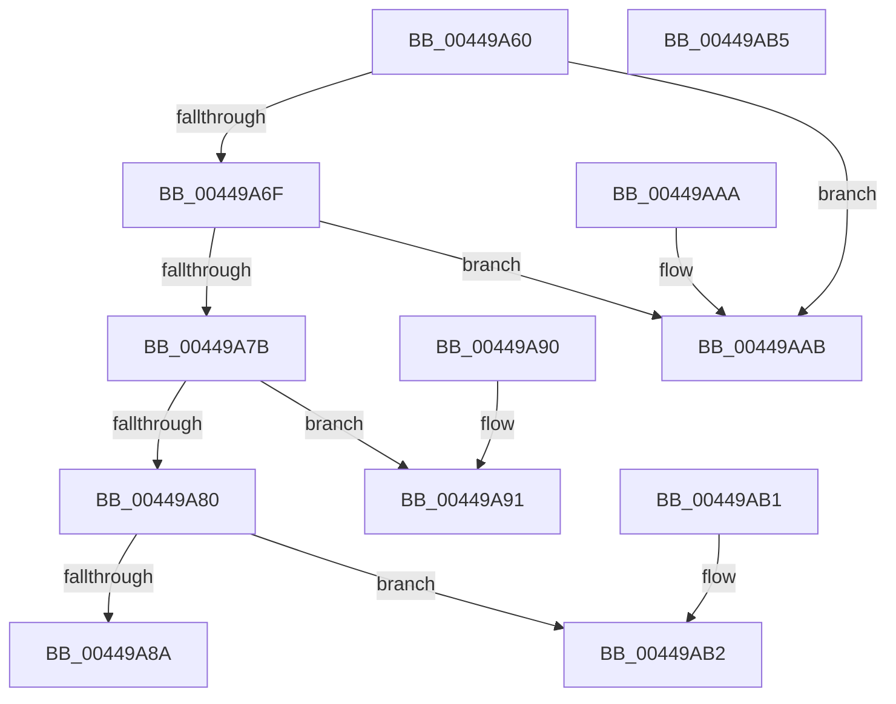

# IoChangeFileObjectFilterContext

- RVA: `0x00449A60`–`0x00449AB6` (길이 `86` bytes)
- VA: `0x0000000140449A60`
- 실행 섹션: `.text`
- PDB 이름 있음: `예`; PDB Function 태그: `아니요`
- unwind 정보 RVA: `0x000DB714`
- 디코드: `30`개 명령, `86/86` bytes 표시
- 미해석 바이트: `0` (있으면 어셈블리에 `.byte`로 보존)

> 이 문서는 커널 이미지의 기계어와 PDB 기호를 분석해 생성했습니다. 4번과 5번은 함수 원형과 자료형을 바이너리 사용 방식에서 추정한 C 해석이며 원본 소스 복구 결과는 아닙니다.

## 1. Dependencies

- 직접 호출 지점: **0**; 고유 호출 대상: **0**
- 직접 호출자로 확인된 함수: **1**
- RIP 상대 이미지 참조: **1**

### Outgoing calls
- 직접 디코드된 call 명령이 없습니다.

### Direct callers
- [sub_00863F57](../../page/86/Unknown_function_00863F57.md) at `0x00863FEA`

### Static image references
- `0x00449A6F` → RVA `0x00014730` (`.rdata`; read)

## 2. Other-region calls and transfers

- 다른 실행 섹션으로 향하는 call: **0**
- 별도 외부 분기/꼬리 이동을 확인하지 못했습니다.

## 3. Assembly (complete function range)

```asm
00449A60  48 8B 89 D0 00 00 00            mov rcx, qword ptr [rcx + 0xd0]
00449A67  4C 8B CA                        mov r9, rdx
00449A6A  48 85 C9                        test rcx, rcx
00449A6D  74 3C                           je 0x140449aab
00449A6F  48 8D 05 BA AC BC FF            lea rax, [rip - 0x435346]
00449A76  48 3B C8                        cmp rcx, rax
00449A79  74 30                           je 0x140449aab
00449A7B  45 84 C0                        test r8b, r8b
00449A7E  74 11                           je 0x140449a91
00449A80  33 C0                           xor eax, eax
00449A82  F0 4C 0F B1 49 20               lock cmpxchg qword ptr [rcx + 0x20], r9
00449A88  74 28                           je 0x140449ab2
00449A8A  B8 21 00 00 C0                  mov eax, 0xc0000021
00449A8F  C3                              ret
00449A90  CC                              int3
00449A91  33 D2                           xor edx, edx
00449A93  49 8B C1                        mov rax, r9
00449A96  F0 48 0F B1 51 20               lock cmpxchg qword ptr [rcx + 0x20], rdx
00449A9C  49 3B C1                        cmp rax, r9
00449A9F  B9 21 00 00 C0                  mov ecx, 0xc0000021
00449AA4  0F 45 D1                        cmovne edx, ecx
00449AA7  8B C2                           mov eax, edx
00449AA9  C3                              ret
00449AAA  CC                              int3
00449AAB  B8 0D 00 00 C0                  mov eax, 0xc000000d
00449AB0  C3                              ret
00449AB1  CC                              int3
00449AB2  33 C0                           xor eax, eax
00449AB4  C3                              ret
00449AB5  CC                              int3
```

## 4. C-style interpretation (structured pseudocode)

```c
__int64 __fastcall IoChangeFileObjectFilterContext(__int64 a1, __int64 a2, unsigned __int8 a3)
{
    __int64 result;

    if (*(unsigned __int64 *)(a1 + 208) == 0) goto loc_00449AAB;
    if ((*(unsigned __int64 *)(a1 + 208)) == (v_rip - 4412230)) goto loc_00449AAB;
    if (a3 == 0) goto loc_00449A91;
    result = 0;
    if (condition_is_equal) goto loc_00449AB2;
    return (unsigned int)(0xC0000021ULL);
loc_00449A91:
    a2 = 0;
    if (0 != 0) { a2 = (unsigned int)((unsigned int)(0xC0000021ULL)); }
    return (unsigned int)((unsigned int)(a2));
loc_00449AAB:
    return (unsigned int)(0xC000000DULL);
loc_00449AB2:
    result = 0;
    return result;
}
```

## 5. (Beta) C Style

```c
int64_t IoChangeFileObjectFilterContext(void *Arg1, int64_t Arg2, uint8_t Arg3)
{
    uint8_t *arg1 = (uint8_t *)Arg1;

    int64_t result;

    if (*(uint64_t *)(arg1 + 0xD0) == 0) goto loc_00449AAB;
    if ((*(uint64_t *)(arg1 + 0xD0)) == (v_rip - 4412230)) goto loc_00449AAB;
    if (Arg3 == 0) goto loc_00449A91;
    result = 0;
    if (condition_is_equal) goto loc_00449AB2;
    return (uint32_t)(0xC0000021ULL);
loc_00449A91:
    Arg2 = 0;
    if (0 != 0) { Arg2 = (uint32_t)((uint32_t)(0xC0000021ULL)); }
    return (uint32_t)((uint32_t)(Arg2));
loc_00449AAB:
    return (uint32_t)(0xC000000DULL);
loc_00449AB2:
    result = 0;
    return result;
}
```

### 관측된 메모리 오프셋

구조체 형식이 확인되지 않은 접근은 인자 기준의 오프셋으로만 기록했습니다.

| 기준 인자 | 오프셋 표현 | 폭 (bit) | 접근 |
|---|---:|---:|---|
| `Arg1` | `+ 0xD0` | `64` | `R` |

## 6. Execution-region graph

[열기: 2D/3D 그래프와 함수 탐색 컨트롤 패널](../../../control-panel.html?section=text&rva=0x00449A60&view=graph)

- 2D 그래프는 위에서 아래로 흐르고, 3D 그래프는 빈 공간을 드래그해 회전합니다. Shift+드래그는 이동, 휠은 확대·축소, 함수 노드 선택은 대상 보고서 이동입니다.

### Static fallback


