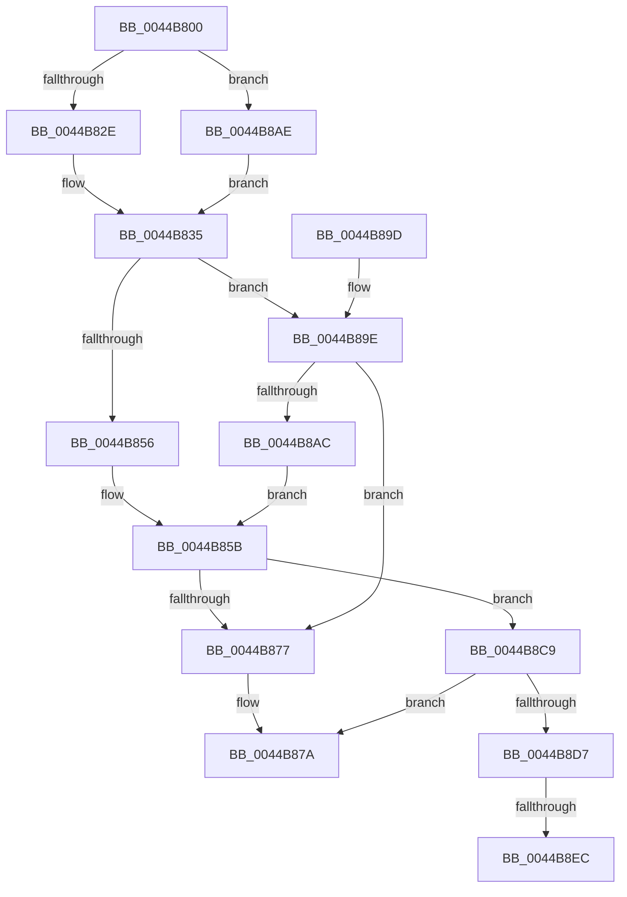

# IoCsqInsertIrpEx

- RVA: `0x0044B800`–`0x0044B8F9` (길이 `249` bytes)
- VA: `0x000000014044B800`
- 실행 섹션: `.text`
- PDB 이름 있음: `예`; PDB Function 태그: `예`
- unwind 정보 RVA: `0x000A6758`
- 디코드: `67`개 명령, `249/249` bytes 표시
- 미해석 바이트: `0` (있으면 어셈블리에 `.byte`로 보존)

> 이 문서는 커널 이미지의 기계어와 PDB 기호를 분석해 생성했습니다. 4번과 5번은 함수 원형과 자료형을 바이너리 사용 방식에서 추정한 C 해석이며 원본 소스 복구 결과는 아닙니다.

## 1. Dependencies

- 직접 호출 지점: **5**; 고유 호출 대상: **1**
- 직접 호출자로 확인된 함수: **1**
- RIP 상대 이미지 참조: **1**

### Outgoing calls
- `0x0044B842` → [guard_dispatch_icall](../6B/guard_dispatch_icall_function_006BAAD0.md) (function, `0x006BAAD0`)
- `0x0044B856` → [guard_dispatch_icall](../6B/guard_dispatch_icall_function_006BAAD0.md) (function, `0x006BAAD0`)
- `0x0044B883` → [guard_dispatch_icall](../6B/guard_dispatch_icall_function_006BAAD0.md) (function, `0x006BAAD0`)
- `0x0044B8A1` → [guard_dispatch_icall](../6B/guard_dispatch_icall_function_006BAAD0.md) (function, `0x006BAAD0`)
- `0x0044B8DE` → [guard_dispatch_icall](../6B/guard_dispatch_icall_function_006BAAD0.md) (function, `0x006BAAD0`)

### Direct callers
- [IoCsqInsertIrp](IoCsqInsertIrp_function_0044B7E0.md) at `0x0044B7E7`

### Static image references
- `0x0044B866` → RVA `0x004A7D00` (`IopCsqCancelRoutine`; read)

## 2. Other-region calls and transfers

- 다른 실행 섹션으로 향하는 call: **0**
- call이 아닌 외부 분기/꼬리 이동: **2**
  - `0x0044B8E6` → [sub_006F0D96](../6F/Unknown_function_006F0D96.md) (`tail-transfer`)
  - `0x0044B8F4` → [sub_006F0D96](../6F/Unknown_function_006F0D96.md) (`tail-transfer`)

## 3. Assembly (complete function range)

```asm
0044B800  48 89 5C 24 10                  mov qword ptr [rsp + 0x10], rbx
0044B805  48 89 6C 24 18                  mov qword ptr [rsp + 0x18], rbp
0044B80A  56                              push rsi
0044B80B  57                              push rdi
0044B80C  41 56                           push r14
0044B80E  48 83 EC 20                     sub rsp, 0x20
0044B812  33 F6                           xor esi, esi
0044B814  C6 44 24 40 00                  mov byte ptr [rsp + 0x40], 0
0044B819  49 8B E9                        mov rbp, r9
0044B81C  4D 8B F0                        mov r14, r8
0044B81F  48 8B FA                        mov rdi, rdx
0044B822  48 8B D9                        mov rbx, rcx
0044B825  4D 85 C0                        test r8, r8
0044B828  0F 85 80 00 00 00               jne 0x14044b8ae
0044B82E  48 89 8A 90 00 00 00            mov qword ptr [rdx + 0x90], rcx
0044B835  48 8B 41 20                     mov rax, qword ptr [rcx + 0x20]
0044B839  48 8D 54 24 40                  lea rdx, [rsp + 0x40]
0044B83E  48 89 71 38                     mov qword ptr [rcx + 0x38], rsi
0044B842  E8 89 F2 26 00                  call 0x1406baad0
0044B847  83 3B 03                        cmp dword ptr [rbx], 3
0044B84A  48 8B D7                        mov rdx, rdi
0044B84D  48 8B 43 08                     mov rax, qword ptr [rbx + 8]
0044B851  48 8B CB                        mov rcx, rbx
0044B854  74 48                           je 0x14044b89e
0044B856  E8 75 F2 26 00                  call 0x1406baad0
0044B85B  48 8B 87 B8 00 00 00            mov rax, qword ptr [rdi + 0xb8]
0044B862  80 48 03 01                     or byte ptr [rax + 3], 1
0044B866  48 8D 05 93 C4 05 00            lea rax, [rip + 0x5c493]
0044B86D  48 87 47 68                     xchg qword ptr [rdi + 0x68], rax
0044B871  80 7F 44 00                     cmp byte ptr [rdi + 0x44], 0
0044B875  75 52                           jne 0x14044b8c9
0044B877  48 8B CB                        mov rcx, rbx
0044B87A  0F B6 54 24 40                  movzx edx, byte ptr [rsp + 0x40]
0044B87F  48 8B 43 28                     mov rax, qword ptr [rbx + 0x28]
0044B883  E8 48 F2 26 00                  call 0x1406baad0
0044B888  48 8B 5C 24 48                  mov rbx, qword ptr [rsp + 0x48]
0044B88D  8B C6                           mov eax, esi
0044B88F  48 8B 6C 24 50                  mov rbp, qword ptr [rsp + 0x50]
0044B894  48 83 C4 20                     add rsp, 0x20
0044B898  41 5E                           pop r14
0044B89A  5F                              pop rdi
0044B89B  5E                              pop rsi
0044B89C  C3                              ret
0044B89D  CC                              int3
0044B89E  4C 8B C5                        mov r8, rbp
0044B8A1  E8 2A F2 26 00                  call 0x1406baad0
0044B8A6  8B F0                           mov esi, eax
0044B8A8  85 C0                           test eax, eax
0044B8AA  78 CB                           js 0x14044b877
0044B8AC  EB AD                           jmp 0x14044b85b
0044B8AE  4C 89 B2 90 00 00 00            mov qword ptr [rdx + 0x90], r14
0044B8B5  49 89 78 08                     mov qword ptr [r8 + 8], rdi
0044B8B9  49 89 58 10                     mov qword ptr [r8 + 0x10], rbx
0044B8BD  41 C7 00 01 00 00 00            mov dword ptr [r8], 1
0044B8C4  E9 6C FF FF FF                  jmp 0x14044b835
0044B8C9  33 C0                           xor eax, eax
0044B8CB  48 8B CB                        mov rcx, rbx
0044B8CE  48 87 47 68                     xchg qword ptr [rdi + 0x68], rax
0044B8D2  48 85 C0                        test rax, rax
0044B8D5  74 A3                           je 0x14044b87a
0044B8D7  48 8B 43 10                     mov rax, qword ptr [rbx + 0x10]
0044B8DB  48 8B D7                        mov rdx, rdi
0044B8DE  E8 ED F1 26 00                  call 0x1406baad0
0044B8E3  4D 85 F6                        test r14, r14
0044B8E6  0F 84 AA 54 2A 00               je 0x1406f0d96
0044B8EC  49 C7 46 08 00 00 00 00         mov qword ptr [r14 + 8], 0
0044B8F4  E9 9D 54 2A 00                  jmp 0x1406f0d96
```

## 4. C-style interpretation (structured pseudocode)

```c
__int64 __fastcall IoCsqInsertIrpEx(__int64 a1, __int64 a2, __int64 a3, __int64 a4)
{
    __int64 result;
    __int64 v_rsi;
    __int64 v_rsp;
    unsigned __int64 v_stack_p10;
    unsigned __int64 v_stack_p18;
    unsigned __int8 v_stack_p8;

    v_stack_p10 = v_rbx;
    v_stack_p18 = v_rbp;
    v_rsp = (v_rsp) - (32);
    v_rsi = 0;
    v_stack_p8 = 0;
    if (a3 != 0) goto loc_0044B8AE;
    *(unsigned __int64 *)(a2 + 144) = a1;
loc_0044B835:
    *(unsigned __int64 *)(a1 + 56) = 0;
    result = guard_dispatch_icall(a1, v_stack_p8, a3, a4);
    if ((*(unsigned int *)(a1)) == 3) goto loc_0044B89E;
    result = guard_dispatch_icall(a1, a2, a3, a4);
loc_0044B85B:
    if ((*(unsigned __int8 *)(a2 + 68)) != 0) goto loc_0044B8C9;
loc_0044B877:
loc_0044B87A:
    result = guard_dispatch_icall(a1, v_stack_p8, a3, a4);
    v_rsp = (v_rsp) + (32);
    return 0;
loc_0044B89E:
    result = guard_dispatch_icall(a1, v_stack_p8, v_stack_p18, a4);
    if (sign_flag) goto loc_0044B877;
    goto loc_0044B85B;
loc_0044B8AE:
    *(unsigned __int64 *)(v_stack_p8 + 144) = a3;
    *(unsigned __int64 *)(v_stack_p18 + 8) = a2;
    *(unsigned __int64 *)(v_stack_p18 + 16) = v_stack_p10;
    *(unsigned int *)(v_stack_p18) = 1;
    goto loc_0044B835;
loc_0044B8C9:
    result = 0;
    if (0 == 0) goto loc_0044B87A;
    result = guard_dispatch_icall(v_stack_p10, a2, v_stack_p18, a4);
    *(unsigned __int64 *)(a3 + 8) = 0;
}
```

## 5. (Beta) C Style

```c
int64_t IoCsqInsertIrpEx(void *Arg1, void *Arg2, int64_t Arg3, int64_t Arg4)
{
    uint8_t *arg1 = (uint8_t *)Arg1;
    uint8_t *arg2 = (uint8_t *)Arg2;

    int64_t result;
    int64_t local_rsi;
    int64_t local_rsp;
    uint64_t v_stack_p10;
    uint64_t v_stack_p18;
    uint8_t v_stack_p8;

    v_stack_p10 = local_rbx;
    v_stack_p18 = local_rbp;
    local_rsp = (local_rsp) - (32);
    local_rsi = 0;
    v_stack_p8 = 0;
    if (Arg3 != 0) goto loc_0044B8AE;
    *(void **)(arg2 + 0x90) = Arg1;
loc_0044B835:
    *(uint64_t *)(arg1 + 0x38) = 0;
    result = guard_dispatch_icall(Arg1, v_stack_p8, Arg3, Arg4);
    if ((*(uint32_t *)(arg1)) == 3) goto loc_0044B89E;
    result = guard_dispatch_icall(Arg1, Arg2, Arg3, Arg4);
loc_0044B85B:
    if ((*(uint8_t *)(arg2 + 0x44)) != 0) goto loc_0044B8C9;
loc_0044B877:
loc_0044B87A:
    result = guard_dispatch_icall(Arg1, v_stack_p8, Arg3, Arg4);
    local_rsp = (local_rsp) + (32);
    return 0;
loc_0044B89E:
    result = guard_dispatch_icall(Arg1, v_stack_p8, v_stack_p18, Arg4);
    if (sign_flag) goto loc_0044B877;
    goto loc_0044B85B;
loc_0044B8AE:
    *(uint64_t *)(v_stack_p8 + 0x90) = Arg3;
    *(void **)(v_stack_p18 + 0x8) = Arg2;
    *(uint64_t *)(v_stack_p18 + 0x10) = v_stack_p10;
    *(uint32_t *)(v_stack_p18) = 1;
    goto loc_0044B835;
loc_0044B8C9:
    result = 0;
    if (0 == 0) goto loc_0044B87A;
    result = guard_dispatch_icall(v_stack_p10, Arg2, v_stack_p18, Arg4);
    *(uint64_t *)(Arg3 + 0x8) = 0;
}
```

### 관측된 메모리 오프셋

구조체 형식이 확인되지 않은 접근은 인자 기준의 오프셋으로만 기록했습니다.

| 기준 인자 | 오프셋 표현 | 폭 (bit) | 접근 |
|---|---:|---:|---|
| `Arg1` | `+ 0x0` | `32` | `R` |
| `Arg1` | `+ 0x8` | `64` | `R` |
| `Arg1` | `+ 0x10` | `64` | `R` |
| `Arg1` | `+ 0x20` | `64` | `R` |
| `Arg1` | `+ 0x28` | `64` | `R` |
| `Arg1` | `+ 0x38` | `64` | `W` |
| `Arg2` | `+ 0x44` | `8` | `R` |
| `Arg2` | `+ 0x68` | `64` | `R/W` |
| `Arg2` | `+ 0x90` | `64` | `W` |
| `Arg2` | `+ 0xB8` | `64` | `R` |

## 6. Execution-region graph

[열기: 2D/3D 그래프와 함수 탐색 컨트롤 패널](../../../control-panel.html?section=text&rva=0x0044B800&view=graph)

- 2D 그래프는 위에서 아래로 흐르고, 3D 그래프는 빈 공간을 드래그해 회전합니다. Shift+드래그는 이동, 휠은 확대·축소, 함수 노드 선택은 대상 보고서 이동입니다.

### Static fallback


