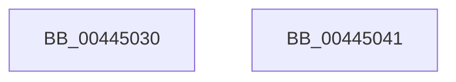

# IoGetActivityIdThread

- RVA: `0x00445030`–`0x00445042` (길이 `18` bytes)
- VA: `0x0000000140445030`
- 실행 섹션: `.text`
- PDB 이름 있음: `예`; PDB Function 태그: `아니요`
- unwind 정보 RVA: `0x000DB714`
- 디코드: `4`개 명령, `18/18` bytes 표시
- 미해석 바이트: `0` (있으면 어셈블리에 `.byte`로 보존)

> 이 문서는 커널 이미지의 기계어와 PDB 기호를 분석해 생성했습니다. 4번과 5번은 함수 원형과 자료형을 바이너리 사용 방식에서 추정한 C 해석이며 원본 소스 복구 결과는 아닙니다.

## 1. Dependencies

- 직접 호출 지점: **0**; 고유 호출 대상: **0**
- 직접 호출자로 확인된 함수: **13**
- RIP 상대 이미지 참조: **0**

### Outgoing calls
- 직접 디코드된 call 명령이 없습니다.

### Direct callers
- [PopAdaptiveStandbyHandleBatteryUpdate](../../page/6F/PopAdaptiveStandbyHandleBatteryUpdate_function_006FD39C.md) at `0x006FD49B`
- [PopAdaptiveStandbyHandleBatteryUpdate](../../page/6F/PopAdaptiveStandbyHandleBatteryUpdate_function_006FD39C.md) at `0x006FD724`
- [PopAdaptiveStandbyHandleBatteryUpdate](../../page/6F/PopAdaptiveStandbyHandleBatteryUpdate_function_006FD39C.md) at `0x006FD7A7`
- [IoRegisterFsRegistrationChangeMountAware](../../page/71/IoRegisterFsRegistrationChangeMountAware_function_0071D890.md) at `0x0071D8D8`
- [PopAdaptiveStandbyActionWorker](../../page/76/PopAdaptiveStandbyActionWorker_function_0076C9B0.md) at `0x0076CA5B`
- [PopAdaptiveStandbyCheckHibernateBudgetAction](../../page/76/PopAdaptiveStandbyCheckHibernateBudgetAction_function_0076CB54.md) at `0x0076CFC7`
- [PopAdaptiveStandbyCheckHibernateBudgetAction](../../page/76/PopAdaptiveStandbyCheckHibernateBudgetAction_function_0076CB54.md) at `0x0076D121`
- [PopAdaptiveStandbyCheckHibernateReserveAction](../../page/76/PopAdaptiveStandbyCheckHibernateReserveAction_function_0076D180.md) at `0x0076D396`
- [PopAdaptiveStandbyCheckRestrictedStandbyBudgetAction](../../page/76/PopAdaptiveStandbyCheckRestrictedStandbyBudgetAction_function_0076D5C4.md) at `0x0076D99A`
- [PopAdaptiveStandbyCheckRestrictedStandbyBudgetAction](../../page/76/PopAdaptiveStandbyCheckRestrictedStandbyBudgetAction_function_0076D5C4.md) at `0x0076DB12`
- [PopAdaptiveStandbyHandlePowerMessage](../../page/76/PopAdaptiveStandbyHandlePowerMessage_function_0076DB70.md) at `0x0076DC83`
- [PopAdaptiveStandbyHandlePowerMessage](../../page/76/PopAdaptiveStandbyHandlePowerMessage_function_0076DB70.md) at `0x0076DCFE`
- [PopAdaptiveStandbyHandlePowerMessage](../../page/76/PopAdaptiveStandbyHandlePowerMessage_function_0076DB70.md) at `0x0076DD5C`
- [PopAdaptiveStandbyQueryReserveConfiguration](../../page/76/PopAdaptiveStandbyQueryReserveConfiguration_function_0076E6D0.md) at `0x0076E730`
- [PopAdaptiveStandbyQueryReserveConfiguration](../../page/76/PopAdaptiveStandbyQueryReserveConfiguration_function_0076E6D0.md) at `0x0076E82C`
- [PopAdaptiveStandbySessionStart](../../page/76/PopAdaptiveStandbySessionStart_function_0076E8C8.md) at `0x0076EAF4`
- [PopAdaptiveStandbySessionStart](../../page/76/PopAdaptiveStandbySessionStart_function_0076E8C8.md) at `0x0076EC38`
- [PopAdaptiveStandbySessionStop](../../page/76/PopAdaptiveStandbySessionStop_function_0076EC94.md) at `0x0076EE16`
- [PopAdaptiveStandbySessionStop](../../page/76/PopAdaptiveStandbySessionStop_function_0076EC94.md) at `0x0076EEBC`
- [PopAdaptiveStandbyWnfCallback](../../page/76/PopAdaptiveStandbyWnfCallback_function_0076F910.md) at `0x0076FC0F`
- [PopAdaptiveStandbyWnfCallback](../../page/76/PopAdaptiveStandbyWnfCallback_function_0076F910.md) at `0x0076FCC1`
- [PopAdaptiveStandbyWnfCallback](../../page/76/PopAdaptiveStandbyWnfCallback_function_0076F910.md) at `0x0076FE03`
- [PnpInsertEventInQueue](../../page/95/PnpInsertEventInQueue_function_00951B78.md) at `0x00951B9F`
- [IopMountVolume](../../page/A3/IopMountVolume_function_00A329D0.md) at `0x00A32F1D`

### Static image references
- 디코드된 RIP-relative 메모리 참조가 없습니다.

## 2. Other-region calls and transfers

- 다른 실행 섹션으로 향하는 call: **0**
- 별도 외부 분기/꼬리 이동을 확인하지 못했습니다.

## 3. Assembly (complete function range)

```asm
00445030  65 48 8B 04 25 88 01 00 00      mov rax, qword ptr gs:[0x188]
00445039  48 8B 80 30 06 00 00            mov rax, qword ptr [rax + 0x630]
00445040  C3                              ret
00445041  CC                              int3
```

## 4. C-style interpretation (structured pseudocode)

```c
__int64 __fastcall IoGetActivityIdThread(void)
{
    return *(unsigned __int64 *)(*(unsigned __int64 *)(gs_base + (0 + 392)) + 1584);
}
```

## 5. (Beta) C Style

```c
void IoGetActivityIdThread(void)
{
    return *(uint64_t *)(*(uint64_t *)(gs_base + (0 + 0x188)) + 0x630);
}
```

## 6. Execution-region graph

[열기: 2D/3D 그래프와 함수 탐색 컨트롤 패널](../../../control-panel.html?section=text&rva=0x00445030&view=graph)

- 2D 그래프는 위에서 아래로 흐르고, 3D 그래프는 빈 공간을 드래그해 회전합니다. Shift+드래그는 이동, 휠은 확대·축소, 함수 노드 선택은 대상 보고서 이동입니다.

### Static fallback


