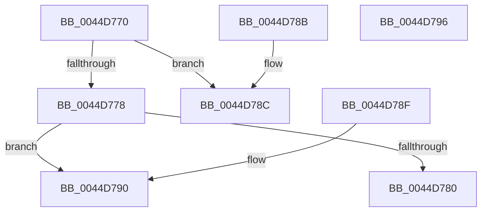

# IoGetPagingIoPriority

- RVA: `0x0044D770`–`0x0044D797` (길이 `39` bytes)
- VA: `0x000000014044D770`
- 실행 섹션: `.text`
- PDB 이름 있음: `예`; PDB Function 태그: `아니요`
- unwind 정보 RVA: `0x000DB714`
- 디코드: `18`개 명령, `39/39` bytes 표시
- 미해석 바이트: `0` (있으면 어셈블리에 `.byte`로 보존)

> 이 문서는 커널 이미지의 기계어와 PDB 기호를 분석해 생성했습니다. 4번과 5번은 함수 원형과 자료형을 바이너리 사용 방식에서 추정한 C 해석이며 원본 소스 복구 결과는 아닙니다.

## 1. Dependencies

- 직접 호출 지점: **0**; 고유 호출 대상: **0**
- 직접 호출자로 확인된 함수: **0**
- RIP 상대 이미지 참조: **0**

### Outgoing calls
- 직접 디코드된 call 명령이 없습니다.

### Direct callers
- 이 함수 시작 RVA로 연결되는 직접 call은 확인되지 않았습니다. 간접 호출은 완전히 역산할 수 없습니다.

### Static image references
- 디코드된 RIP-relative 메모리 참조가 없습니다.

## 2. Other-region calls and transfers

- 다른 실행 섹션으로 향하는 call: **0**
- 별도 외부 분기/꼬리 이동을 확인하지 못했습니다.

## 3. Assembly (complete function range)

```asm
0044D770  8B 51 10                        mov edx, dword ptr [rcx + 0x10]
0044D773  F6 C2 02                        test dl, 2
0044D776  74 14                           je 0x14044d78c
0044D778  C1 EA 11                        shr edx, 0x11
0044D77B  83 E2 07                        and edx, 7
0044D77E  74 10                           je 0x14044d790
0044D780  33 C0                           xor eax, eax
0044D782  83 FA 05                        cmp edx, 5
0044D785  0F 94 C0                        sete al
0044D788  FF C0                           inc eax
0044D78A  C3                              ret
0044D78B  CC                              int3
0044D78C  33 C0                           xor eax, eax
0044D78E  C3                              ret
0044D78F  CC                              int3
0044D790  B8 01 00 00 00                  mov eax, 1
0044D795  C3                              ret
0044D796  CC                              int3
```

## 4. C-style interpretation (structured pseudocode)

```c
__int64 __fastcall IoGetPagingIoPriority(__int64 a1)
{
    __int64 result;

    if ((((unsigned __int8)((unsigned int)(*(unsigned int *)(a1 + 16)))) & (2)) == 0) goto loc_0044D78C;
    a2 = (unsigned int)(((unsigned int)(*(unsigned int *)(a1 + 16))) >> (17));
    a2 = (unsigned int)((a2) & (7));
    if (condition_is_equal) goto loc_0044D790;
    result = 0;
    result = (((unsigned int)(a2)) == 5) ? 1 : 0;
    result = (unsigned int)((result) + 1);
    return result;
loc_0044D78C:
    result = 0;
    return result;
loc_0044D790:
    return 1;
}
```

## 5. (Beta) C Style

```c
int64_t IoGetPagingIoPriority(void *Arg1)
{
    uint8_t *arg1 = (uint8_t *)Arg1;

    int64_t result;

    if ((((uint8_t)((uint32_t)(*(uint32_t *)(arg1 + 0x10)))) & (2)) == 0) goto loc_0044D78C;
    a2 = (uint32_t)(((uint32_t)(*(uint32_t *)(arg1 + 0x10))) >> (17));
    a2 = (uint32_t)((a2) & (7));
    if (condition_is_equal) goto loc_0044D790;
    result = 0;
    result = (((uint32_t)(a2)) == 5) ? 1 : 0;
    result = (uint32_t)((result) + 1);
    return result;
loc_0044D78C:
    result = 0;
    return result;
loc_0044D790:
    return 1;
}
```

### 관측된 메모리 오프셋

구조체 형식이 확인되지 않은 접근은 인자 기준의 오프셋으로만 기록했습니다.

| 기준 인자 | 오프셋 표현 | 폭 (bit) | 접근 |
|---|---:|---:|---|
| `Arg1` | `+ 0x10` | `32` | `R` |

## 6. Execution-region graph

[열기: 2D/3D 그래프와 함수 탐색 컨트롤 패널](../../../control-panel.html?section=text&rva=0x0044D770&view=graph)

- 2D 그래프는 위에서 아래로 흐르고, 3D 그래프는 빈 공간을 드래그해 회전합니다. Shift+드래그는 이동, 휠은 확대·축소, 함수 노드 선택은 대상 보고서 이동입니다.

### Static fallback


