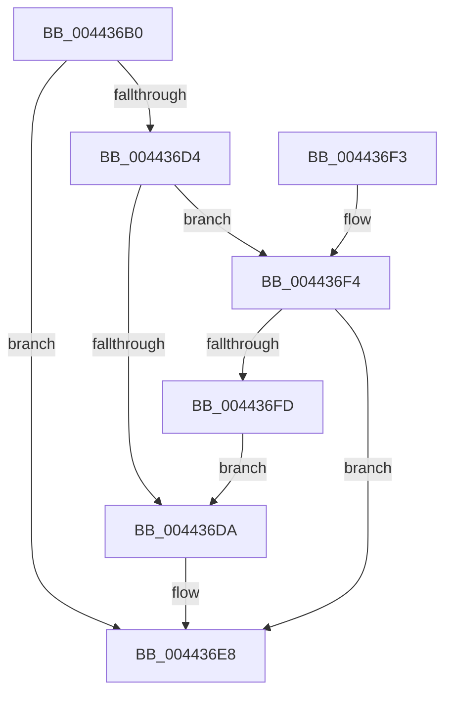

# IoInitializeIrpEx

- RVA: `0x004436B0`–`0x004436FF` (길이 `79` bytes)
- VA: `0x00000001404436B0`
- 실행 섹션: `.text`
- PDB 이름 있음: `예`; PDB Function 태그: `아니요`
- unwind 정보 RVA: `0x00069334`
- 디코드: `23`개 명령, `79/79` bytes 표시
- 미해석 바이트: `0` (있으면 어셈블리에 `.byte`로 보존)

> 이 문서는 커널 이미지의 기계어와 PDB 기호를 분석해 생성했습니다. 4번과 5번은 함수 원형과 자료형을 바이너리 사용 방식에서 추정한 C 해석이며 원본 소스 복구 결과는 아닙니다.

## 1. Dependencies

- 직접 호출 지점: **1**; 고유 호출 대상: **1**
- 직접 호출자로 확인된 함수: **0**
- RIP 상대 이미지 참조: **0**

### Outgoing calls
- `0x004436CA` → [IoInitializeIrpPriv](IoInitializeIrpPriv_function_00443710.md) (function, `0x00443710`)

### Direct callers
- 이 함수 시작 RVA로 연결되는 직접 call은 확인되지 않았습니다. 간접 호출은 완전히 역산할 수 없습니다.

### Static image references
- 디코드된 RIP-relative 메모리 참조가 없습니다.

## 2. Other-region calls and transfers

- 다른 실행 섹션으로 향하는 call: **0**
- 별도 외부 분기/꼬리 이동을 확인하지 못했습니다.

## 3. Assembly (complete function range)

```asm
004436B0  48 89 5C 24 08                  mov qword ptr [rsp + 8], rbx
004436B5  57                              push rdi
004436B6  48 83 EC 20                     sub rsp, 0x20
004436BA  41 0F B7 C0                     movzx eax, r8w
004436BE  48 8B FA                        mov rdi, rdx
004436C1  0F B7 D0                        movzx edx, ax
004436C4  45 8A C1                        mov r8b, r9b
004436C7  48 8B D9                        mov rbx, rcx
004436CA  E8 41 00 00 00                  call 0x140443710
004436CF  48 85 FF                        test rdi, rdi
004436D2  74 14                           je 0x1404436e8
004436D4  48 83 FF FF                     cmp rdi, -1
004436D8  75 1A                           jne 0x1404436f4
004436DA  48 8B 83 B8 00 00 00            mov rax, qword ptr [rbx + 0xb8]
004436E1  48 89 83 C8 00 00 00            mov qword ptr [rbx + 0xc8], rax
004436E8  48 8B 5C 24 30                  mov rbx, qword ptr [rsp + 0x30]
004436ED  48 83 C4 20                     add rsp, 0x20
004436F1  5F                              pop rdi
004436F2  C3                              ret
004436F3  CC                              int3
004436F4  F7 47 30 00 00 00 08            test dword ptr [rdi + 0x30], 0x8000000
004436FB  74 EB                           je 0x1404436e8
004436FD  EB DB                           jmp 0x1404436da
```

## 4. C-style interpretation (structured pseudocode)

```c
__int64 __fastcall IoInitializeIrpEx(__int64 a1, __int64 a2, unsigned __int16 a3, unsigned __int8 a4)
{
    __int64 result;
    __int64 v_rsp;
    unsigned __int64 v_stack_p8;

    v_stack_p8 = v_rbx;
    v_rsp = (v_rsp) - (32);
    result = IoInitializeIrpPriv(a1, a3, a4, a4);
    if (a2 == 0) goto loc_004436E8;
    if (a2 != -1) goto loc_004436F4;
loc_004436DA:
    *(unsigned __int64 *)(a1 + 200) = *(unsigned __int64 *)(a1 + 184);
loc_004436E8:
    v_rsp = (v_rsp) + (32);
    return *(unsigned __int64 *)(a1 + 184);
loc_004436F4:
    if (((*(unsigned int *)(a2 + 48)) & (0x8000000ULL)) == 0) goto loc_004436E8;
    goto loc_004436DA;
}
```

## 5. (Beta) C Style

```c
int64_t IoInitializeIrpEx(void *Arg1, int64_t Arg2, uint16_t Arg3, uint8_t Arg4)
{
    uint8_t *arg1 = (uint8_t *)Arg1;

    int64_t result;
    int64_t local_rsp;
    uint64_t v_stack_p8;

    v_stack_p8 = local_rbx;
    local_rsp = (local_rsp) - (32);
    result = IoInitializeIrpPriv(Arg1, Arg3, Arg4, Arg4);
    if (Arg2 == 0) goto loc_004436E8;
    if (Arg2 != -1) goto loc_004436F4;
loc_004436DA:
    *(uint64_t *)(arg1 + 0xC8) = *(uint64_t *)(arg1 + 0xB8);
loc_004436E8:
    local_rsp = (local_rsp) + (32);
    return *(uint64_t *)(arg1 + 0xB8);
loc_004436F4:
    if (((*(uint32_t *)(Arg2 + 0x30)) & (0x8000000ULL)) == 0) goto loc_004436E8;
    goto loc_004436DA;
}
```

### 관측된 메모리 오프셋

구조체 형식이 확인되지 않은 접근은 인자 기준의 오프셋으로만 기록했습니다.

| 기준 인자 | 오프셋 표현 | 폭 (bit) | 접근 |
|---|---:|---:|---|
| `Arg1` | `+ 0xB8` | `64` | `R` |
| `Arg1` | `+ 0xC8` | `64` | `W` |

## 6. Execution-region graph

[열기: 2D/3D 그래프와 함수 탐색 컨트롤 패널](../../../control-panel.html?section=text&rva=0x004436B0&view=graph)

- 2D 그래프는 위에서 아래로 흐르고, 3D 그래프는 빈 공간을 드래그해 회전합니다. Shift+드래그는 이동, 휠은 확대·축소, 함수 노드 선택은 대상 보고서 이동입니다.

### Static fallback


