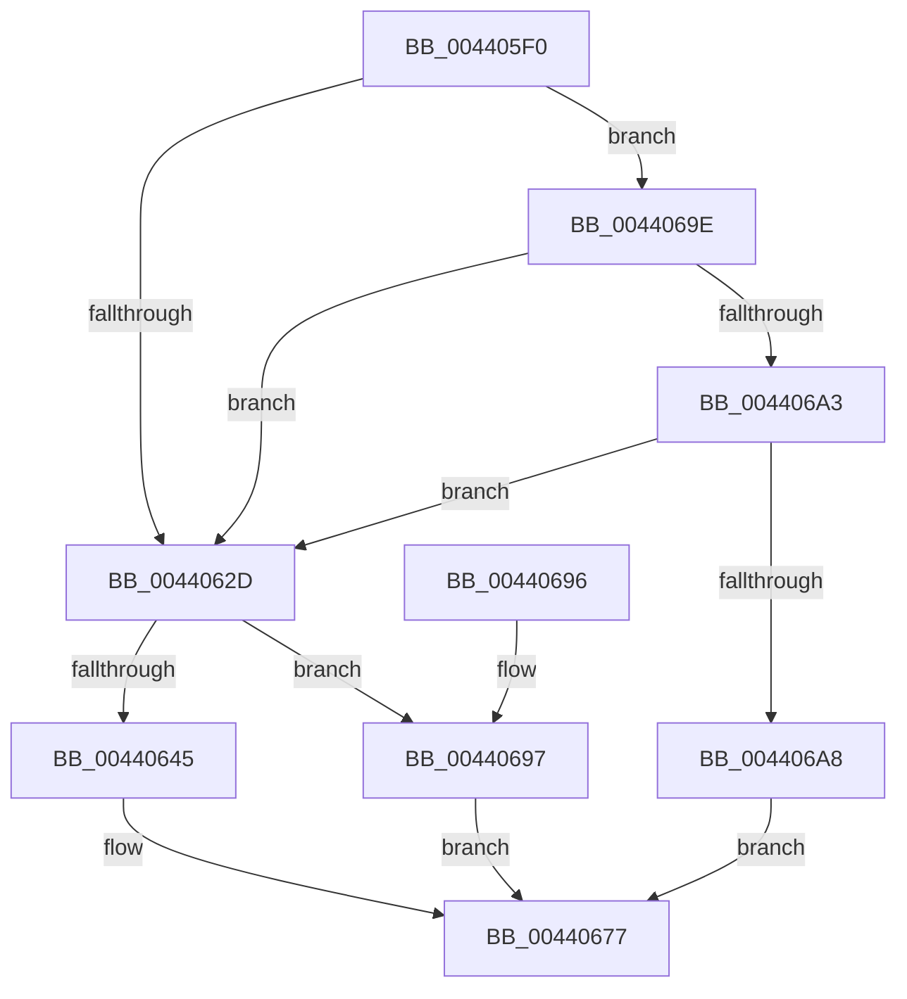

# IoSetCompletionRoutineEx

- RVA: `0x004405F0`–`0x004406AF` (길이 `191` bytes)
- VA: `0x00000001404405F0`
- 실행 섹션: `.text`
- PDB 이름 있음: `예`; PDB Function 태그: `아니요`
- unwind 정보 RVA: `0x000A4F68`
- 디코드: `53`개 명령, `191/191` bytes 표시
- 미해석 바이트: `0` (있으면 어셈블리에 `.byte`로 보존)

> 이 문서는 커널 이미지의 기계어와 PDB 기호를 분석해 생성했습니다. 4번과 5번은 함수 원형과 자료형을 바이너리 사용 방식에서 추정한 C 해석이며 원본 소스 복구 결과는 아닙니다.

## 1. Dependencies

- 직접 호출 지점: **1**; 고유 호출 대상: **1**
- 직접 호출자로 확인된 함수: **1**
- RIP 상대 이미지 참조: **1**

### Outgoing calls
- `0x0044063B` → [ExAllocatePool2](../../poolcode/B8/ExAllocatePool2_function_00B820F0.md) (function, `0x00B820F0`)

### Direct callers
- [DifIoSetCompletionRoutineExWrapper](../62/DifIoSetCompletionRoutineExWrapper_function_0062CB00.md) at `0x0062CC21`

### Static image references
- `0x00440648` → RVA `0x003A16A0` (`IopUnloadSafeCompletion`; read)

## 2. Other-region calls and transfers

- 다른 실행 섹션으로 향하는 call: **1**
  - `0x0044063B` → [ExAllocatePool2](../../poolcode/B8/ExAllocatePool2_function_00B820F0.md) (`.text` → `POOLCODE`)
- 별도 외부 분기/꼬리 이동을 확인하지 못했습니다.

## 3. Assembly (complete function range)

```asm
004405F0  48 89 5C 24 08                  mov qword ptr [rsp + 8], rbx
004405F5  48 89 6C 24 10                  mov qword ptr [rsp + 0x10], rbp
004405FA  48 89 74 24 18                  mov qword ptr [rsp + 0x18], rsi
004405FF  48 89 7C 24 20                  mov qword ptr [rsp + 0x20], rdi
00440604  41 54                           push r12
00440606  41 56                           push r14
00440608  41 57                           push r15
0044060A  48 83 EC 20                     sub rsp, 0x20
0044060E  0F B6 5C 24 68                  movzx ebx, byte ptr [rsp + 0x68]
00440613  49 8B E9                        mov rbp, r9
00440616  0F B6 7C 24 70                  movzx edi, byte ptr [rsp + 0x70]
0044061B  4D 8B F0                        mov r14, r8
0044061E  0F B6 74 24 60                  movzx esi, byte ptr [rsp + 0x60]
00440623  4C 8B FA                        mov r15, rdx
00440626  4C 8B E1                        mov r12, rcx
00440629  84 DB                           test bl, bl
0044062B  74 71                           je 0x14044069e
0044062D  BA 20 00 00 00                  mov edx, 0x20
00440632  41 B8 49 6F 55 73               mov r8d, 0x73556f49
00440638  8D 4A 20                        lea ecx, [rdx + 0x20]
0044063B  E8 B0 1A 74 00                  call 0x140b820f0
00440640  48 85 C0                        test rax, rax
00440643  74 52                           je 0x140440697
00440645  4C 89 20                        mov qword ptr [rax], r12
00440648  48 8D 15 51 10 F6 FF            lea rdx, [rip - 0x9efaf]
0044064F  4C 89 70 10                     mov qword ptr [rax + 0x10], r14
00440653  48 89 68 08                     mov qword ptr [rax + 8], rbp
00440657  88 58 18                        mov byte ptr [rax + 0x18], bl
0044065A  40 88 70 19                     mov byte ptr [rax + 0x19], sil
0044065E  40 88 78 1A                     mov byte ptr [rax + 0x1a], dil
00440662  49 8B 8F B8 00 00 00            mov rcx, qword ptr [r15 + 0xb8]
00440669  48 89 41 F8                     mov qword ptr [rcx - 8], rax
0044066D  33 C0                           xor eax, eax
0044066F  48 89 51 F0                     mov qword ptr [rcx - 0x10], rdx
00440673  C6 41 BB E0                     mov byte ptr [rcx - 0x45], 0xe0
00440677  48 8B 5C 24 40                  mov rbx, qword ptr [rsp + 0x40]
0044067C  48 8B 6C 24 48                  mov rbp, qword ptr [rsp + 0x48]
00440681  48 8B 74 24 50                  mov rsi, qword ptr [rsp + 0x50]
00440686  48 8B 7C 24 58                  mov rdi, qword ptr [rsp + 0x58]
0044068B  48 83 C4 20                     add rsp, 0x20
0044068F  41 5F                           pop r15
00440691  41 5E                           pop r14
00440693  41 5C                           pop r12
00440695  C3                              ret
00440696  CC                              int3
00440697  B8 9A 00 00 C0                  mov eax, 0xc000009a
0044069C  EB D9                           jmp 0x140440677
0044069E  40 84 FF                        test dil, dil
004406A1  75 8A                           jne 0x14044062d
004406A3  40 84 F6                        test sil, sil
004406A6  75 85                           jne 0x14044062d
004406A8  B8 0D 00 00 C0                  mov eax, 0xc000000d
004406AD  EB C8                           jmp 0x140440677
```

## 4. C-style interpretation (structured pseudocode)

```c
__int64 __fastcall IoSetCompletionRoutineEx(__int64 a1, __int64 a2, __int64 a3, __int64 a4, unsigned __int8 a5, unsigned __int8 a6, unsigned __int8 a7)
{
    __int64 result;
    __int64 v_rsp;
    unsigned __int64 v_stack_p10;
    unsigned __int64 v_stack_p18;
    unsigned __int64 v_stack_p20;
    unsigned __int64 v_stack_p8;

    v_stack_p8 = v_rbx;
    v_stack_p10 = v_rbp;
    v_stack_p18 = v_rsi;
    v_stack_p20 = v_rdi;
    v_rsp = (v_rsp) - (32);
    if (a6 == 0) goto loc_0044069E;
loc_0044062D:
    result = ExAllocatePool2(32 + 32, 32, (unsigned int)(0x73556F49ULL), a4);
    if (result == 0) goto loc_00440697;
    *(unsigned __int64 *)(result) = a1;
    *(unsigned __int64 *)(result + 16) = a3;
    *(unsigned __int64 *)(result + 8) = a4;
    *(unsigned __int8 *)(result + 24) = a6;
    *(unsigned __int8 *)(result + 25) = a5;
    *(unsigned __int8 *)(result + 26) = a7;
    *(unsigned __int64 *)(*(unsigned __int64 *)(a2 + 184) - 8) = result;
    result = 0;
    *(unsigned __int64 *)(*(unsigned __int64 *)(a2 + 184) - 16) = v_rip - 651183;
    *(unsigned __int8 *)(*(unsigned __int64 *)(a2 + 184) - 69) = 224;
loc_00440677:
    v_rsp = (v_rsp) + (32);
    return result;
loc_00440697:
    goto loc_00440677;
loc_0044069E:
    if ((unsigned __int8)(v_stack_p20) != 0) goto loc_0044062D;
    if ((unsigned __int8)(v_stack_p18) != 0) goto loc_0044062D;
    goto loc_00440677;
}
```

## 5. (Beta) C Style

```c
int64_t IoSetCompletionRoutineEx(int64_t Arg1, void *Arg2, int64_t Arg3, int64_t Arg4, uint8_t Arg5, uint8_t Arg6, uint8_t Arg7)
{
    uint8_t *arg2 = (uint8_t *)Arg2;

    int64_t result;
    int64_t local_rsp;
    uint64_t v_stack_p10;
    uint64_t v_stack_p18;
    uint64_t v_stack_p20;
    uint64_t v_stack_p8;

    v_stack_p8 = local_rbx;
    v_stack_p10 = local_rbp;
    v_stack_p18 = local_rsi;
    v_stack_p20 = local_rdi;
    local_rsp = (local_rsp) - (32);
    if (Arg6 == 0) goto loc_0044069E;
loc_0044062D:
    result = ExAllocatePool2(32 + 32, 32, (uint32_t)(0x73556F49ULL), Arg4);
    if (result == 0) goto loc_00440697;
    *(uint64_t *)(result) = Arg1;
    *(uint64_t *)(result + 0x10) = Arg3;
    *(uint64_t *)(result + 0x8) = Arg4;
    *(uint8_t *)(result + 0x18) = Arg6;
    *(uint8_t *)(result + 0x19) = Arg5;
    *(uint8_t *)(result + 0x1A) = Arg7;
    *(uint64_t *)(*(uint64_t *)(arg2 + 0xB8) - 0x8) = result;
    result = 0;
    *(uint64_t *)(*(uint64_t *)(arg2 + 0xB8) - 0x10) = v_rip - 651183;
    *(uint8_t *)(*(uint64_t *)(arg2 + 0xB8) - 0x45) = 224;
loc_00440677:
    local_rsp = (local_rsp) + (32);
    return result;
loc_00440697:
    goto loc_00440677;
loc_0044069E:
    if ((uint8_t)(v_stack_p20) != 0) goto loc_0044062D;
    if ((uint8_t)(v_stack_p18) != 0) goto loc_0044062D;
    goto loc_00440677;
}
```

### 관측된 메모리 오프셋

구조체 형식이 확인되지 않은 접근은 인자 기준의 오프셋으로만 기록했습니다.

| 기준 인자 | 오프셋 표현 | 폭 (bit) | 접근 |
|---|---:|---:|---|
| `Arg2` | `+ 0xB8` | `64` | `R` |

## 6. Execution-region graph

[열기: 2D/3D 그래프와 함수 탐색 컨트롤 패널](../../../control-panel.html?section=text&rva=0x004405F0&view=graph)

- 2D 그래프는 위에서 아래로 흐르고, 3D 그래프는 빈 공간을 드래그해 회전합니다. Shift+드래그는 이동, 휠은 확대·축소, 함수 노드 선택은 대상 보고서 이동입니다.

### Static fallback


