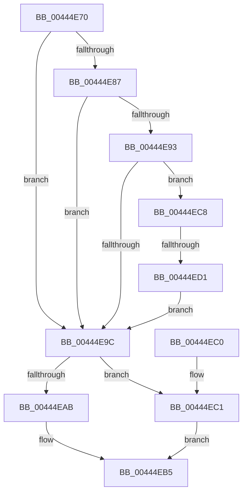

# IoSetFsTrackOffsetState

- RVA: `0x00444E70`–`0x00444EE6` (길이 `118` bytes)
- VA: `0x0000000140444E70`
- 실행 섹션: `.text`
- PDB 이름 있음: `예`; PDB Function 태그: `예`
- unwind 정보 RVA: `0x0009082C`
- 디코드: `35`개 명령, `118/118` bytes 표시
- 미해석 바이트: `0` (있으면 어셈블리에 `.byte`로 보존)

> 이 문서는 커널 이미지의 기계어와 PDB 기호를 분석해 생성했습니다. 4번과 5번은 함수 원형과 자료형을 바이너리 사용 방식에서 추정한 C 해석이며 원본 소스 복구 결과는 아닙니다.

## 1. Dependencies

- 직접 호출 지점: **1**; 고유 호출 대상: **1**
- 직접 호출자로 확인된 함수: **0**
- RIP 상대 이미지 참조: **0**

### Outgoing calls
- `0x00444EA1` → [IopAllocateIrpExtension](IopAllocateIrpExtension_function_00444F30.md) (function, `0x00444F30`)

### Direct callers
- 이 함수 시작 RVA로 연결되는 직접 call은 확인되지 않았습니다. 간접 호출은 완전히 역산할 수 없습니다.

### Static image references
- 디코드된 RIP-relative 메모리 참조가 없습니다.

## 2. Other-region calls and transfers

- 다른 실행 섹션으로 향하는 call: **0**
- call이 아닌 외부 분기/꼬리 이동: **1**
  - `0x00444ECB` → [sub_006EFD0E](../6E/Unknown_function_006EFD0E.md) (`tail-transfer`)

## 3. Assembly (complete function range)

```asm
00444E70  48 89 5C 24 08                  mov qword ptr [rsp + 8], rbx
00444E75  57                              push rdi
00444E76  48 83 EC 20                     sub rsp, 0x20
00444E7A  90                              nop
00444E7B  49 8B D8                        mov rbx, r8
00444E7E  80 79 47 00                     cmp byte ptr [rcx + 0x47], 0
00444E82  48 8B FA                        mov rdi, rdx
00444E85  7C 15                           jl 0x140444e9c
00444E87  48 8B 81 C8 00 00 00            mov rax, qword ptr [rcx + 0xc8]
00444E8E  48 85 C0                        test rax, rax
00444E91  74 09                           je 0x140444e9c
00444E93  0F B7 50 02                     movzx edx, word ptr [rax + 2]
00444E97  F6 C2 92                        test dl, 0x92
00444E9A  75 2C                           jne 0x140444ec8
00444E9C  BA 05 00 00 00                  mov edx, 5
00444EA1  E8 8A 00 00 00                  call 0x140444f30
00444EA6  48 85 C0                        test rax, rax
00444EA9  74 16                           je 0x140444ec1
00444EAB  48 89 78 28                     mov qword ptr [rax + 0x28], rdi
00444EAF  48 89 58 30                     mov qword ptr [rax + 0x30], rbx
00444EB3  33 C0                           xor eax, eax
00444EB5  48 8B 5C 24 30                  mov rbx, qword ptr [rsp + 0x30]
00444EBA  48 83 C4 20                     add rsp, 0x20
00444EBE  5F                              pop rdi
00444EBF  C3                              ret
00444EC0  CC                              int3
00444EC1  B8 9A 00 00 C0                  mov eax, 0xc000009a
00444EC6  EB ED                           jmp 0x140444eb5
00444EC8  F6 C2 02                        test dl, 2
00444ECB  0F 84 3D AE 2A 00               je 0x1406efd0e
00444ED1  41 B8 FE FF 00 00               mov r8d, 0xfffe
00444ED7  66 41 23 D0                     and dx, r8w
00444EDB  48 83 60 28 00                  and qword ptr [rax + 0x28], 0
00444EE0  66 89 50 02                     mov word ptr [rax + 2], dx
00444EE4  EB B6                           jmp 0x140444e9c
```

## 4. C-style interpretation (structured pseudocode)

```c
__int64 __fastcall IoSetFsTrackOffsetState(__int64 a1, __int64 a2, __int64 a3)
{
    __int64 result;
    __int64 v_rsp;
    unsigned __int64 v_stack_p8;

    v_stack_p8 = v_rbx;
    v_rsp = (v_rsp) - (32);
    if ((*(unsigned __int8 *)(a1 + 71)) < 0) goto loc_00444E9C;
    if (*(unsigned __int64 *)(a1 + 200) == 0) goto loc_00444E9C;
    if ((((unsigned __int8)(*(unsigned __int16 *)(*(unsigned __int64 *)(a1 + 200) + 2))) & (146)) != 0) goto loc_00444EC8;
loc_00444E9C:
    result = IopAllocateIrpExtension(a1, 5, a3, a4);
    if (result == 0) goto loc_00444EC1;
    *(unsigned __int64 *)(result + 40) = a2;
    *(unsigned __int64 *)(result + 48) = a3;
    result = 0;
loc_00444EB5:
    v_rsp = (v_rsp) + (32);
    return result;
loc_00444EC1:
    goto loc_00444EB5;
loc_00444EC8:
    a2 = (unsigned __int16)((5) & ((unsigned __int16)((unsigned int)(0xFFFEULL))));
    *(unsigned __int16 *)((unsigned int)(0xC000009AULL) + 2) = (unsigned __int16)(a2);
    goto loc_00444E9C;
}
```

## 5. (Beta) C Style

```c
int64_t IoSetFsTrackOffsetState(void *Arg1, int64_t Arg2, int64_t Arg3)
{
    uint8_t *arg1 = (uint8_t *)Arg1;

    int64_t result;
    int64_t local_rsp;
    uint64_t v_stack_p8;

    v_stack_p8 = local_rbx;
    local_rsp = (local_rsp) - (32);
    if ((*(uint8_t *)(arg1 + 0x47)) < 0) goto loc_00444E9C;
    if (*(uint64_t *)(arg1 + 0xC8) == 0) goto loc_00444E9C;
    if ((((uint8_t)(*(uint16_t *)(*(uint64_t *)(arg1 + 0xC8) + 0x2))) & (146)) != 0) goto loc_00444EC8;
loc_00444E9C:
    result = IopAllocateIrpExtension(Arg1, 5, Arg3, a4);
    if (result == 0) goto loc_00444EC1;
    *(uint64_t *)(result + 0x28) = Arg2;
    *(uint64_t *)(result + 0x30) = Arg3;
    result = 0;
loc_00444EB5:
    local_rsp = (local_rsp) + (32);
    return result;
loc_00444EC1:
    goto loc_00444EB5;
loc_00444EC8:
    Arg2 = (uint16_t)((5) & ((uint16_t)((uint32_t)(0xFFFEULL))));
    *(uint16_t *)((uint32_t)(0xC000009AULL) + 0x2) = (uint16_t)(Arg2);
    goto loc_00444E9C;
}
```

### 관측된 메모리 오프셋

구조체 형식이 확인되지 않은 접근은 인자 기준의 오프셋으로만 기록했습니다.

| 기준 인자 | 오프셋 표현 | 폭 (bit) | 접근 |
|---|---:|---:|---|
| `Arg1` | `+ 0x47` | `8` | `R` |
| `Arg1` | `+ 0xC8` | `64` | `R` |

## 6. Execution-region graph

[열기: 2D/3D 그래프와 함수 탐색 컨트롤 패널](../../../control-panel.html?section=text&rva=0x00444E70&view=graph)

- 2D 그래프는 위에서 아래로 흐르고, 3D 그래프는 빈 공간을 드래그해 회전합니다. Shift+드래그는 이동, 휠은 확대·축소, 함수 노드 선택은 대상 보고서 이동입니다.

### Static fallback


