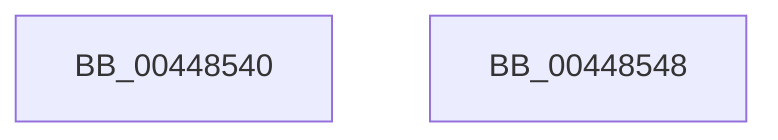

# IoThreadToProcess

- RVA: `0x00448540`–`0x00448549` (길이 `9` bytes)
- VA: `0x0000000140448540`
- 실행 섹션: `.text`
- PDB 이름 있음: `예`; PDB Function 태그: `아니요`
- unwind 정보 RVA: `0x000DB714`
- 디코드: `3`개 명령, `9/9` bytes 표시
- 미해석 바이트: `0` (있으면 어셈블리에 `.byte`로 보존)

> 이 문서는 커널 이미지의 기계어와 PDB 기호를 분석해 생성했습니다. 4번과 5번은 함수 원형과 자료형을 바이너리 사용 방식에서 추정한 C 해석이며 원본 소스 복구 결과는 아닙니다.

## 1. Dependencies

- 직접 호출 지점: **0**; 고유 호출 대상: **0**
- 직접 호출자로 확인된 함수: **21**
- RIP 상대 이미지 참조: **0**

### Outgoing calls
- 직접 디코드된 call 명령이 없습니다.

### Direct callers
- [DbgkQueueUserExceptionReport](../../page/71/DbgkQueueUserExceptionReport_function_00710B04.md) at `0x00710B62`
- [DbgkQueueUserExceptionReport](../../page/71/DbgkQueueUserExceptionReport_function_00710B04.md) at `0x00710C46`
- [DbgkUserReportWorkRoutine](../../page/71/DbgkUserReportWorkRoutine_function_00710D10.md) at `0x00710D8B`
- [DbgkCaptureLiveDump](../../page/71/DbgkCaptureLiveDump_function_0071113C.md) at `0x0071137B`
- [NtAlpcImpersonateClientContainerOfPort](../../page/74/NtAlpcImpersonateClientContainerOfPort_function_0074C1B0.md) at `0x0074C329`
- [SepGetMandatoryAccessControlList](../../page/79/SepGetMandatoryAccessControlList_function_0079D5EC.md) at `0x0079D68A`
- [sub_00868310](../../page/86/Unknown_function_00868310.md) at `0x0086840D`
- [AlpcpCreateSecurityContext](../../page/89/AlpcpCreateSecurityContext_function_00890D94.md) at `0x00890DC2`
- [sub_008CB9B9](../../page/8C/Unknown_function_008CB9B9.md) at `0x008CBAC6`
- [PspWow64SetContextThread](../../page/8C/PspWow64SetContextThread_function_008CCC88.md) at `0x008CCD8C`
- [PspWow64SetContextThread](../../page/8C/PspWow64SetContextThread_function_008CCC88.md) at `0x008CCD97`
- [PspSetContextThreadInternal](../../page/8D/PspSetContextThreadInternal_function_008D4420.md) at `0x008D45C2`
- [PspSetContextThreadInternal](../../page/8D/PspSetContextThreadInternal_function_008D4420.md) at `0x008D45CD`
- [IopXxxControlFile](../../page/8E/IopXxxControlFile_function_008E9AD0.md) at `0x008EB167`
- [sub_009A7748](../../page/9A/Unknown_function_009A7748.md) at `0x009A7848`
- [PsOpenThread](../../page/9C/PsOpenThread_function_009C5CC0.md) at `0x009C5F85`
- [AlpcpCaptureWorkOnBehalfAttribute](../../page/9D/AlpcpCaptureWorkOnBehalfAttribute_function_009D6D10.md) at `0x009D6D4E`
- [NtSetContextThread](../../page/A8/NtSetContextThread_function_00A88440.md) at `0x00A88496`
- [NtSetContextThread](../../page/A8/NtSetContextThread_function_00A88440.md) at `0x00A8850E`
- [NtGetCurrentProcessorNumber](../../page/A9/NtGetCurrentProcessorNumber_function_00A95550.md) at `0x00A95596`
- [PsSyscallProviderDispatch](../../page/AB/PsSyscallProviderDispatch_function_00AB3D80.md) at `0x00AB3DB7`
- [MiForceCrashForInvalidAccess](../../page/AC/MiForceCrashForInvalidAccess_function_00ACEFA4.md) at `0x00ACF03E`
- [NtQueryInformationThread](../../page/AE/NtQueryInformationThread_function_00AE3760.md) at `0x00AE39A6`
- [sub_00B1B2E4](../../page/B1/Unknown_function_00B1B2E4.md) at `0x00B1B669`
- [PopFlushVolumeBlameResolverCallback](../../pagelk/B7/PopFlushVolumeBlameResolverCallback_function_00B70830.md) at `0x00B70868`

### Static image references
- 디코드된 RIP-relative 메모리 참조가 없습니다.

## 2. Other-region calls and transfers

- 다른 실행 섹션으로 향하는 call: **0**
- 별도 외부 분기/꼬리 이동을 확인하지 못했습니다.

## 3. Assembly (complete function range)

```asm
00448540  48 8B 81 20 02 00 00            mov rax, qword ptr [rcx + 0x220]
00448547  C3                              ret
00448548  CC                              int3
```

## 4. C-style interpretation (structured pseudocode)

```c
__int64 __fastcall IoThreadToProcess(__int64 a1)
{
    return *(unsigned __int64 *)(a1 + 544);
}
```

## 5. (Beta) C Style

```c
int64_t IoThreadToProcess(void *Arg1)
{
    uint8_t *arg1 = (uint8_t *)Arg1;

    return *(uint64_t *)(arg1 + 0x220);
}
```

### 관측된 메모리 오프셋

구조체 형식이 확인되지 않은 접근은 인자 기준의 오프셋으로만 기록했습니다.

| 기준 인자 | 오프셋 표현 | 폭 (bit) | 접근 |
|---|---:|---:|---|
| `Arg1` | `+ 0x220` | `64` | `R` |

## 6. Execution-region graph

[열기: 2D/3D 그래프와 함수 탐색 컨트롤 패널](../../../control-panel.html?section=text&rva=0x00448540&view=graph)

- 2D 그래프는 위에서 아래로 흐르고, 3D 그래프는 빈 공간을 드래그해 회전합니다. Shift+드래그는 이동, 휠은 확대·축소, 함수 노드 선택은 대상 보고서 이동입니다.

### Static fallback


