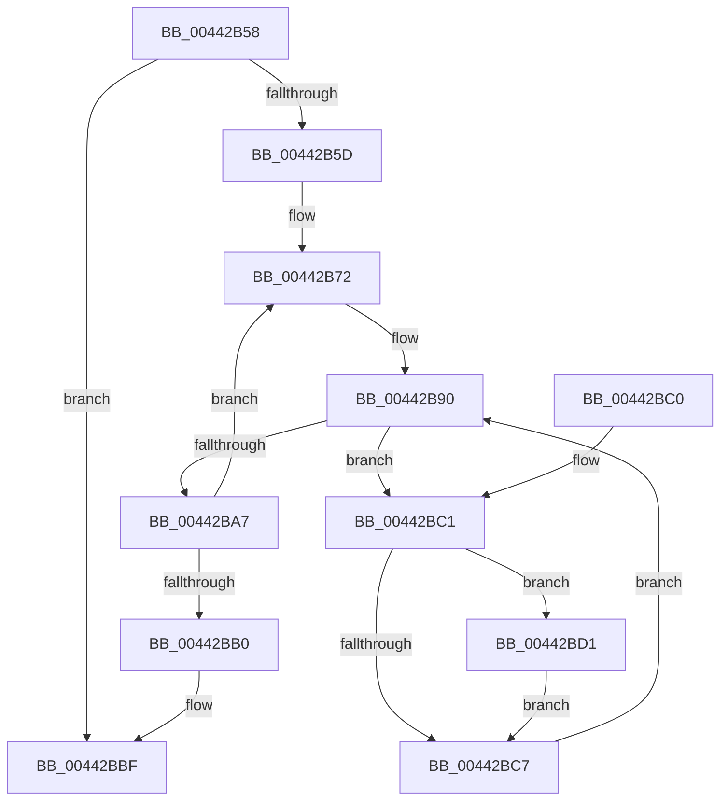

# IoTryReleasePages

- RVA: `0x00442B58`–`0x00442BE0` (길이 `136` bytes)
- VA: `0x0000000140442B58`
- 실행 섹션: `.text`
- PDB 이름 있음: `예`; PDB Function 태그: `아니요`
- unwind 정보 RVA: `0x000A53B8`
- 디코드: `37`개 명령, `136/136` bytes 표시
- 미해석 바이트: `0` (있으면 어셈블리에 `.byte`로 보존)

> 이 문서는 커널 이미지의 기계어와 PDB 기호를 분석해 생성했습니다. 4번과 5번은 함수 원형과 자료형을 바이너리 사용 방식에서 추정한 C 해석이며 원본 소스 복구 결과는 아닙니다.

## 1. Dependencies

- 직접 호출 지점: **3**; 고유 호출 대상: **3**
- 직접 호출자로 확인된 함수: **2**
- RIP 상대 이미지 참조: **1**

### Outgoing calls
- `0x00442B9A` → [IopMcFindNextTableEntryForUnlock](IopMcFindNextTableEntryForUnlock_function_00442C40.md) (function, `0x00442C40`)
- `0x00442BCA` → [IopMcDereferenceBufferEntry](IopMcDereferenceBufferEntry_function_00442BE8.md) (function, `0x00442BE8`)
- `0x00442BD9` → [IopMcTryUnlockMdl](../5A/IopMcTryUnlockMdl_function_005A3EE8.md) (function, `0x005A3EE8`)

### Direct callers
- [MiRequestIoPageMdlCacheRelease](MiRequestIoPageMdlCacheRelease_function_00442AD0.md) at `0x00442B3B`
- [MiInvokeIoReleasePages](../4E/MiInvokeIoReleasePages_function_004E3E40.md) at `0x004E3E78`

### Static image references
- `0x00442B72` → RVA `0x00F8D020` (`.data`; read/write)

## 2. Other-region calls and transfers

- 다른 실행 섹션으로 향하는 call: **0**
- 별도 외부 분기/꼬리 이동을 확인하지 못했습니다.

## 3. Assembly (complete function range)

```asm
00442B58  48 85 D2                        test rdx, rdx
00442B5B  74 62                           je 0x140442bbf
00442B5D  48 89 5C 24 08                  mov qword ptr [rsp + 8], rbx
00442B62  48 89 74 24 18                  mov qword ptr [rsp + 0x18], rsi
00442B67  57                              push rdi
00442B68  48 83 EC 40                     sub rsp, 0x40
00442B6C  48 8B FA                        mov rdi, rdx
00442B6F  48 8B F1                        mov rsi, rcx
00442B72  F0 FF 05 A7 A4 B4 00            lock inc dword ptr [rip + 0xb4a4a7]
00442B79  48 83 64 24 58 00               and qword ptr [rsp + 0x58], 0
00442B7F  48 83 64 24 30 00               and qword ptr [rsp + 0x30], 0
00442B85  48 83 64 24 28 00               and qword ptr [rsp + 0x28], 0
00442B8B  48 89 74 24 20                  mov qword ptr [rsp + 0x20], rsi
00442B90  48 8D 54 24 58                  lea rdx, [rsp + 0x58]
00442B95  48 8D 4C 24 20                  lea rcx, [rsp + 0x20]
00442B9A  E8 A1 00 00 00                  call 0x140442c40
00442B9F  48 8B D8                        mov rbx, rax
00442BA2  48 85 C0                        test rax, rax
00442BA5  75 1A                           jne 0x140442bc1
00442BA7  48 FF C6                        inc rsi
00442BAA  48 83 EF 01                     sub rdi, 1
00442BAE  75 C2                           jne 0x140442b72
00442BB0  48 8B 5C 24 50                  mov rbx, qword ptr [rsp + 0x50]
00442BB5  48 8B 74 24 60                  mov rsi, qword ptr [rsp + 0x60]
00442BBA  48 83 C4 40                     add rsp, 0x40
00442BBE  5F                              pop rdi
00442BBF  C3                              ret
00442BC0  CC                              int3
00442BC1  83 7B 30 00                     cmp dword ptr [rbx + 0x30], 0
00442BC5  74 0A                           je 0x140442bd1
00442BC7  48 8B CB                        mov rcx, rbx
00442BCA  E8 19 00 00 00                  call 0x140442be8
00442BCF  EB BF                           jmp 0x140442b90
00442BD1  48 8B 54 24 58                  mov rdx, qword ptr [rsp + 0x58]
00442BD6  48 8B CB                        mov rcx, rbx
00442BD9  E8 0A 13 16 00                  call 0x1405a3ee8
00442BDE  EB E7                           jmp 0x140442bc7
```

## 4. C-style interpretation (structured pseudocode)

```c
__int64 __fastcall IoTryReleasePages(__int64 a1, __int64 a2)
{
    __int64 result;
    __int64 v_rdi;
    __int64 v_rsi;
    __int64 v_rsp;
    unsigned __int64 v_stack_m18;
    unsigned __int64 v_stack_m20;
    unsigned __int64 v_stack_m28;
    unsigned __int64 v_stack_p10;
    unsigned __int64 v_stack_p18;
    unsigned __int64 v_stack_p58;
    unsigned __int64 v_stack_p8;

    if (a2 == 0) goto loc_00442BBF;
    v_stack_p8 = v_rbx;
    v_stack_p18 = v_rsi;
    v_rsp = (v_rsp) - (64);
loc_00442B72:
    v_stack_m28 = a1;
loc_00442B90:
    result = IopMcFindNextTableEntryForUnlock(v_stack_m28, v_stack_p10, a3, a4);
    if (result != 0) goto loc_00442BC1;
    v_rsi = (a1) + 1;
    v_rdi = (a2) - (1);
    if (condition_is_not_equal) goto loc_00442B72;
    v_rsp = (v_rsp) + (64);
loc_00442BBF:
    return result;
loc_00442BC1:
    if ((*(unsigned int *)(v_stack_p8 + 48)) == 0) goto loc_00442BD1;
loc_00442BC7:
    result = IopMcDereferenceBufferEntry(v_stack_p8, v_stack_p10, a3, a4);
    goto loc_00442B90;
loc_00442BD1:
    result = IopMcTryUnlockMdl(v_stack_p8, v_stack_p58, a3, a4);
    goto loc_00442BC7;
}
```

## 5. (Beta) C Style

```c
int64_t IoTryReleasePages(int64_t Arg1, int64_t Arg2)
{
    int64_t result;
    int64_t local_rdi;
    int64_t local_rsi;
    int64_t local_rsp;
    uint64_t v_stack_m18;
    uint64_t v_stack_m20;
    uint64_t v_stack_m28;
    uint64_t v_stack_p10;
    uint64_t v_stack_p18;
    uint64_t v_stack_p58;
    uint64_t v_stack_p8;

    if (Arg2 == 0) goto loc_00442BBF;
    v_stack_p8 = local_rbx;
    v_stack_p18 = local_rsi;
    local_rsp = (local_rsp) - (64);
loc_00442B72:
    v_stack_m28 = Arg1;
loc_00442B90:
    result = IopMcFindNextTableEntryForUnlock(v_stack_m28, v_stack_p10, a3, a4);
    if (result != 0) goto loc_00442BC1;
    local_rsi = (Arg1) + 1;
    local_rdi = (Arg2) - (1);
    if (condition_is_not_equal) goto loc_00442B72;
    local_rsp = (local_rsp) + (64);
loc_00442BBF:
    return result;
loc_00442BC1:
    if ((*(uint32_t *)(v_stack_p8 + 0x30)) == 0) goto loc_00442BD1;
loc_00442BC7:
    result = IopMcDereferenceBufferEntry(v_stack_p8, v_stack_p10, a3, a4);
    goto loc_00442B90;
loc_00442BD1:
    result = IopMcTryUnlockMdl(v_stack_p8, v_stack_p58, a3, a4);
    goto loc_00442BC7;
}
```

## 6. Execution-region graph

[열기: 2D/3D 그래프와 함수 탐색 컨트롤 패널](../../../control-panel.html?section=text&rva=0x00442B58&view=graph)

- 2D 그래프는 위에서 아래로 흐르고, 3D 그래프는 빈 공간을 드래그해 회전합니다. Shift+드래그는 이동, 휠은 확대·축소, 함수 노드 선택은 대상 보고서 이동입니다.

### Static fallback


