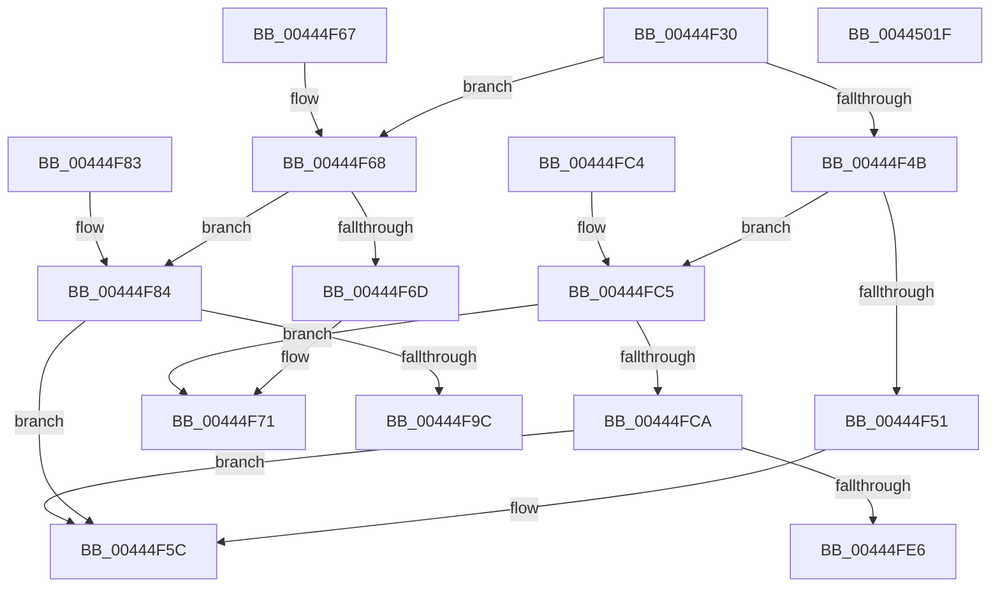

# IopAllocateIrpExtension

- RVA: `0x00444F30`–`0x00445020` (길이 `240` bytes)
- VA: `0x0000000140444F30`
- 실행 섹션: `.text`
- PDB 이름 있음: `예`; PDB Function 태그: `아니요`
- unwind 정보 RVA: `0x000A57D0`
- 디코드: `69`개 명령, `240/240` bytes 표시
- 미해석 바이트: `0` (있으면 어셈블리에 `.byte`로 보존)

> 이 문서는 커널 이미지의 기계어와 PDB 기호를 분석해 생성했습니다. 4번과 5번은 함수 원형과 자료형을 바이너리 사용 방식에서 추정한 C 해석이며 원본 소스 복구 결과는 아닙니다.

## 1. Dependencies

- 직접 호출 지점: **2**; 고유 호출 대상: **1**
- 직접 호출자로 확인된 함수: **8**
- RIP 상대 이미지 참조: **0**

### Outgoing calls
- `0x00444F92` → [ExAllocatePool2](../../poolcode/B8/ExAllocatePool2_function_00B820F0.md) (function, `0x00B820F0`)
- `0x00444FD8` → [ExAllocatePool2](../../poolcode/B8/ExAllocatePool2_function_00B820F0.md) (function, `0x00B820F0`)

### Direct callers
- [IoSetFsTrackOffsetState](IoSetFsTrackOffsetState_function_00444E70.md) at `0x00444EA1`
- [IopSetCopyInformationExtension](IopSetCopyInformationExtension_function_00444EEC.md) at `0x00444EFB`
- [IoPropagateIrpExtensionEx](../46/IoPropagateIrpExtensionEx_function_00461250.md) at `0x0046129D`
- [IoPropagateIrpExtensionEx](../46/IoPropagateIrpExtensionEx_function_00461250.md) at `0x004612BE`
- [IoPropagateIrpExtensionEx](../46/IoPropagateIrpExtensionEx_function_00461250.md) at `0x004612EF`
- [IoPropagateIrpExtensionEx](../46/IoPropagateIrpExtensionEx_function_00461250.md) at `0x00461314`
- [IoPropagateIrpExtensionEx](../46/IoPropagateIrpExtensionEx_function_00461250.md) at `0x004613CD`
- [IoPropagateIrpExtensionEx](../46/IoPropagateIrpExtensionEx_function_00461250.md) at `0x004613FB`
- [IopPerfCallDriver](../4A/IopPerfCallDriver_function_004A9680.md) at `0x004A973B`
- [IoClearAdapterCryptoEngineExtension](../59/IoClearAdapterCryptoEngineExtension_function_00598450.md) at `0x0059846A`
- [IoSetAdapterCryptoEngineExtension](../59/IoSetAdapterCryptoEngineExtension_function_00598520.md) at `0x00598549`
- [IoSetFsZeroingOffsetRequired](../59/IoSetFsZeroingOffsetRequired_function_005985C0.md) at `0x005985F7`
- [ViGetContextPointer](../../pagevrfy/B9/ViGetContextPointer_function_00B948E8.md) at `0x00B948FF`

### Static image references
- 디코드된 RIP-relative 메모리 참조가 없습니다.

## 2. Other-region calls and transfers

- 다른 실행 섹션으로 향하는 call: **2**
  - `0x00444F92` → [ExAllocatePool2](../../poolcode/B8/ExAllocatePool2_function_00B820F0.md) (`.text` → `POOLCODE`)
  - `0x00444FD8` → [ExAllocatePool2](../../poolcode/B8/ExAllocatePool2_function_00B820F0.md) (`.text` → `POOLCODE`)
- 별도 외부 분기/꼬리 이동을 확인하지 못했습니다.

## 3. Assembly (complete function range)

```asm
00444F30  48 89 5C 24 08                  mov qword ptr [rsp + 8], rbx
00444F35  57                              push rdi
00444F36  48 83 EC 20                     sub rsp, 0x20
00444F3A  48 8B 81 C8 00 00 00            mov rax, qword ptr [rcx + 0xc8]
00444F41  8B FA                           mov edi, edx
00444F43  48 8B D9                        mov rbx, rcx
00444F46  48 85 C0                        test rax, rax
00444F49  74 1D                           je 0x140444f68
00444F4B  80 79 47 00                     cmp byte ptr [rcx + 0x47], 0
00444F4F  7C 74                           jl 0x140444fc5
00444F51  0F B7 48 02                     movzx ecx, word ptr [rax + 2]
00444F55  0F AB D1                        bts ecx, edx
00444F58  66 89 48 02                     mov word ptr [rax + 2], cx
00444F5C  48 8B 5C 24 30                  mov rbx, qword ptr [rsp + 0x30]
00444F61  48 83 C4 20                     add rsp, 0x20
00444F65  5F                              pop rdi
00444F66  C3                              ret
00444F67  CC                              int3
00444F68  83 FF 02                        cmp edi, 2
00444F6B  75 17                           jne 0x140444f84
00444F6D  80 49 47 80                     or byte ptr [rcx + 0x47], 0x80
00444F71  48 8D 81 C4 00 00 00            lea rax, [rcx + 0xc4]
00444F78  48 8B 5C 24 30                  mov rbx, qword ptr [rsp + 0x30]
00444F7D  48 83 C4 20                     add rsp, 0x20
00444F81  5F                              pop rdi
00444F82  C3                              ret
00444F83  CC                              int3
00444F84  BA 50 00 00 00                  mov edx, 0x50
00444F89  41 B8 49 72 70 58               mov r8d, 0x58707249
00444F8F  8D 4A F0                        lea ecx, [rdx - 0x10]
00444F92  E8 59 D1 73 00                  call 0x140b820f0
00444F97  48 85 C0                        test rax, rax
00444F9A  74 C0                           je 0x140444f5c
00444F9C  BA 01 00 00 00                  mov edx, 1
00444FA1  8B CF                           mov ecx, edi
00444FA3  66 D3 E2                        shl dx, cl
00444FA6  66 89 50 02                     mov word ptr [rax + 2], dx
00444FAA  80 4B 47 40                     or byte ptr [rbx + 0x47], 0x40
00444FAE  48 89 83 C8 00 00 00            mov qword ptr [rbx + 0xc8], rax
00444FB5  66 83 08 01                     or word ptr [rax], 1
00444FB9  48 8B 5C 24 30                  mov rbx, qword ptr [rsp + 0x30]
00444FBE  48 83 C4 20                     add rsp, 0x20
00444FC2  5F                              pop rdi
00444FC3  C3                              ret
00444FC4  CC                              int3
00444FC5  83 FF 02                        cmp edi, 2
00444FC8  74 A7                           je 0x140444f71
00444FCA  BA 50 00 00 00                  mov edx, 0x50
00444FCF  41 B8 49 72 70 58               mov r8d, 0x58707249
00444FD5  8D 4A F0                        lea ecx, [rdx - 0x10]
00444FD8  E8 13 D1 73 00                  call 0x140b820f0
00444FDD  48 85 C0                        test rax, rax
00444FE0  0F 84 76 FF FF FF               je 0x140444f5c
00444FE6  B9 04 00 00 00                  mov ecx, 4
00444FEB  66 0F AB F9                     bts cx, di
00444FEF  66 89 48 02                     mov word ptr [rax + 2], cx
00444FF3  8B 8B C8 00 00 00               mov ecx, dword ptr [rbx + 0xc8]
00444FF9  89 48 04                        mov dword ptr [rax + 4], ecx
00444FFC  0F B6 4B 47                     movzx ecx, byte ptr [rbx + 0x47]
00445000  80 E1 3F                        and cl, 0x3f
00445003  48 89 83 C8 00 00 00            mov qword ptr [rbx + 0xc8], rax
0044500A  80 C9 40                        or cl, 0x40
0044500D  88 4B 47                        mov byte ptr [rbx + 0x47], cl
00445010  66 83 08 01                     or word ptr [rax], 1
00445014  48 8B 5C 24 30                  mov rbx, qword ptr [rsp + 0x30]
00445019  48 83 C4 20                     add rsp, 0x20
0044501D  5F                              pop rdi
0044501E  C3                              ret
0044501F  CC                              int3
```

## 4. C-style interpretation (structured pseudocode)

```c
__int64 __fastcall IopAllocateIrpExtension(__int64 a1, int a2)
{
    __int64 result;
    __int64 v_rsp;
    unsigned __int64 v_stack_p30;
    unsigned __int64 v_stack_p58;
    unsigned __int64 v_stack_p8;
    unsigned __int64 v_stack_p80;

    v_stack_p8 = v_rbx;
    v_rsp = (v_rsp) - (32);
    if (*(unsigned __int64 *)(a1 + 200) == 0) goto loc_00444F68;
    if ((*(unsigned __int8 *)(a1 + 71)) < 0) goto loc_00444FC5;
    *(unsigned __int16 *)(*(unsigned __int64 *)(a1 + 200) + 2) = (unsigned __int16)(*(unsigned __int16 *)(*(unsigned __int64 *)(a1 + 200) + 2));
loc_00444F5C:
    v_rsp = (v_rsp) + (32);
    return *(unsigned __int64 *)(a1 + 200);
loc_00444F68:
    if (((unsigned int)((unsigned int)(a2))) != 2) goto loc_00444F84;
loc_00444F71:
    v_rsp = (v_rsp) + (32);
    return *(unsigned __int16 *)(*(unsigned __int64 *)(a1 + 200) + 2) + 196;
loc_00444F84:
    result = ExAllocatePool2(80 - 16, 80, (unsigned int)(0x58707249ULL), a4);
    if (result == 0) goto loc_00444F5C;
    a2 = (unsigned __int16)((1) << ((unsigned __int8)((unsigned int)((unsigned int)((unsigned int)(a2))))));
    *(unsigned __int16 *)(result + 2) = (unsigned __int16)(a2);
    *(unsigned __int64 *)(v_stack_p30 + 200) = result;
    v_rsp = (v_rsp) + (32);
    return result;
loc_00444FC5:
    if (((unsigned int)((unsigned int)(a2))) == 2) goto loc_00444F71;
    result = ExAllocatePool2(80 - 16, 80, (unsigned int)(0x58707249ULL), a4);
    if (result == 0) goto loc_00444F5C;
    *(unsigned __int16 *)(result + 2) = 4;
    *(unsigned int *)(result + 4) = (unsigned int)((unsigned int)(*(unsigned int *)(v_stack_p58 + 200)));
    a1 = (unsigned __int8)((*(unsigned __int8 *)(v_stack_p58 + 71)) & (63));
    *(unsigned __int64 *)(v_stack_p58 + 200) = result;
    a1 = (unsigned __int8)((a1) | (64));
    *(unsigned __int8 *)(v_stack_p58 + 71) = (unsigned __int8)(a1);
    v_rsp = (v_rsp) + (32);
    return result;
}
```

## 5. (Beta) C Style

```c
int64_t IopAllocateIrpExtension(void *Arg1, int32_t Arg2)
{
    uint8_t *arg1 = (uint8_t *)Arg1;

    int64_t result;
    int64_t local_rsp;
    uint64_t v_stack_p30;
    uint64_t v_stack_p58;
    uint64_t v_stack_p8;
    uint64_t v_stack_p80;

    v_stack_p8 = local_rbx;
    local_rsp = (local_rsp) - (32);
    if (*(uint64_t *)(arg1 + 0xC8) == 0) goto loc_00444F68;
    if ((*(uint8_t *)(arg1 + 0x47)) < 0) goto loc_00444FC5;
    *(uint16_t *)(*(uint64_t *)(arg1 + 0xC8) + 0x2) = (uint16_t)(*(uint16_t *)(*(uint64_t *)(arg1 + 0xC8) + 0x2));
loc_00444F5C:
    local_rsp = (local_rsp) + (32);
    return *(uint64_t *)(arg1 + 0xC8);
loc_00444F68:
    if (((uint32_t)((uint32_t)(Arg2))) != 2) goto loc_00444F84;
loc_00444F71:
    local_rsp = (local_rsp) + (32);
    return *(uint16_t *)(*(uint64_t *)(arg1 + 0xC8) + 0x2) + 196;
loc_00444F84:
    result = ExAllocatePool2(80 - 16, 80, (uint32_t)(0x58707249ULL), a4);
    if (result == 0) goto loc_00444F5C;
    Arg2 = (uint16_t)((1) << ((uint8_t)((uint32_t)((uint32_t)((uint32_t)(Arg2))))));
    *(uint16_t *)(result + 0x2) = (uint16_t)(Arg2);
    *(uint64_t *)(v_stack_p30 + 0xC8) = result;
    local_rsp = (local_rsp) + (32);
    return result;
loc_00444FC5:
    if (((uint32_t)((uint32_t)(Arg2))) == 2) goto loc_00444F71;
    result = ExAllocatePool2(80 - 16, 80, (uint32_t)(0x58707249ULL), a4);
    if (result == 0) goto loc_00444F5C;
    *(uint16_t *)(result + 0x2) = 4;
    *(uint32_t *)(result + 0x4) = (uint32_t)((uint32_t)(*(uint32_t *)(v_stack_p58 + 0xC8)));
    Arg1 = (uint8_t)((*(uint8_t *)(v_stack_p58 + 0x47)) & (63));
    *(uint64_t *)(v_stack_p58 + 0xC8) = result;
    Arg1 = (uint8_t)((Arg1) | (64));
    *(uint8_t *)(v_stack_p58 + 0x47) = (uint8_t)(Arg1);
    local_rsp = (local_rsp) + (32);
    return result;
}
```

### 관측된 메모리 오프셋

구조체 형식이 확인되지 않은 접근은 인자 기준의 오프셋으로만 기록했습니다.

| 기준 인자 | 오프셋 표현 | 폭 (bit) | 접근 |
|---|---:|---:|---|
| `Arg1` | `+ 0x47` | `8` | `R` |
| `Arg1` | `+ 0x47` | `8` | `R/W` |
| `Arg1` | `+ 0x47` | `8` | `W` |
| `Arg1` | `+ 0xC4` | `64` | `R` |
| `Arg1` | `+ 0xC8` | `32` | `R` |
| `Arg1` | `+ 0xC8` | `64` | `R` |
| `Arg1` | `+ 0xC8` | `64` | `W` |

## 6. Execution-region graph

[열기: 2D/3D 그래프와 함수 탐색 컨트롤 패널](../../../control-panel.html?section=text&rva=0x00444F30&view=graph)

- 2D 그래프는 위에서 아래로 흐르고, 3D 그래프는 빈 공간을 드래그해 회전합니다. Shift+드래그는 이동, 휠은 확대·축소, 함수 노드 선택은 대상 보고서 이동입니다.

### Static fallback


