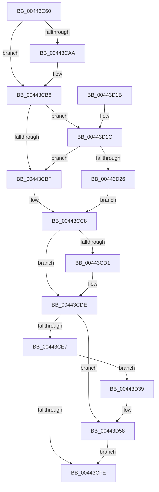

# IopIncrementCompletionContextUsageCountAndReadData

- RVA: `0x00443C60`–`0x00443D67` (길이 `263` bytes)
- VA: `0x0000000140443C60`
- 실행 섹션: `.text`
- PDB 이름 있음: `예`; PDB Function 태그: `아니요`
- unwind 정보 RVA: `0x000A561C`
- 디코드: `71`개 명령, `263/263` bytes 표시
- 미해석 바이트: `0` (있으면 어셈블리에 `.byte`로 보존)

> 이 문서는 커널 이미지의 기계어와 PDB 기호를 분석해 생성했습니다. 4번과 5번은 함수 원형과 자료형을 바이너리 사용 방식에서 추정한 C 해석이며 원본 소스 복구 결과는 아닙니다.

## 1. Dependencies

- 직접 호출 지점: **4**; 고유 호출 대상: **4**
- 직접 호출자로 확인된 함수: **3**
- RIP 상대 이미지 참조: **3**

### Outgoing calls
- `0x00443C96` → [KeAcquireSpinLockRaiseToDpc](../20/KeAcquireSpinLockRaiseToDpc_function_00208470.md) (function, `0x00208470`)
- `0x00443CD9` → [KiLowerIrqlProcessIrqlFlags](../4F/KiLowerIrqlProcessIrqlFlags_function_004F5698.md) (function, `0x004F5698`)
- `0x00443D32` → [KiReleaseSpinLockInstrumented](../39/KiReleaseSpinLockInstrumented_function_00392EF0.md) (function, `0x00392EF0`)
- `0x00443D52` → [KeBugCheckEx](../4F/KeBugCheckEx_function_004FD660.md) (function, `0x004FD660`)

### Direct callers
- [IopCompleteRequest](../20/IopCompleteRequest_function_0020AF50.md) at `0x0020B47C`
- [IopXxxControlFile](../../page/8E/IopXxxControlFile_function_008E9AD0.md) at `0x008EA94D`
- [sub_00B2FAB0](../../page/B2/Unknown_function_00B2FAB0.md) at `0x00B2FAFB`

### Static image references
- `0x00443CB6` → RVA `0x00FC6B06` (`ALMOSTRO`; read)
- `0x00443CC8` → RVA `0x00FC6D20` (`ALMOSTRO`; read)
- `0x00443D1C` → RVA `0x00F0DE58` (`.data`; read)

## 2. Other-region calls and transfers

- 다른 실행 섹션으로 향하는 call: **0**
- 별도 외부 분기/꼬리 이동을 확인하지 못했습니다.

## 3. Assembly (complete function range)

```asm
00443C60  48 89 5C 24 08                  mov qword ptr [rsp + 8], rbx
00443C65  48 89 6C 24 10                  mov qword ptr [rsp + 0x10], rbp
00443C6A  48 89 74 24 18                  mov qword ptr [rsp + 0x18], rsi
00443C6F  57                              push rdi
00443C70  41 54                           push r12
00443C72  41 55                           push r13
00443C74  41 56                           push r14
00443C76  41 57                           push r15
00443C78  48 83 EC 30                     sub rsp, 0x30
00443C7C  4C 8B E9                        mov r13, rcx
00443C7F  4D 8B F1                        mov r14, r9
00443C82  48 81 C1 B8 00 00 00            add rcx, 0xb8
00443C89  4D 8B F8                        mov r15, r8
00443C8C  4C 8B E2                        mov r12, rdx
00443C8F  48 C7 C6 FF FF FF FF            mov rsi, 0xffffffffffffffff
00443C96  E8 D5 47 DC FF                  call 0x140208470
00443C9B  49 8B 9D B0 00 00 00            mov rbx, qword ptr [r13 + 0xb0]
00443CA2  0F B6 E8                        movzx ebp, al
00443CA5  48 85 DB                        test rbx, rbx
00443CA8  74 0C                           je 0x140443cb6
00443CAA  48 8B 73 10                     mov rsi, qword ptr [rbx + 0x10]
00443CAE  48 8D 56 01                     lea rdx, [rsi + 1]
00443CB2  48 89 53 10                     mov qword ptr [rbx + 0x10], rdx
00443CB6  F6 05 49 2E B8 00 01            test byte ptr [rip + 0xb82e49], 1
00443CBD  75 5D                           jne 0x140443d1c
00443CBF  F0 49 83 A5 B8 00 00 00 00      lock and qword ptr [r13 + 0xb8], 0
00443CC8  83 3D 51 30 B8 00 00            cmp dword ptr [rip + 0xb83051], 0
00443CCF  74 0D                           je 0x140443cde
00443CD1  44 0F 20 C1                     mov rcx, cr8
00443CD5  40 0F B6 D5                     movzx edx, bpl
00443CD9  E8 BA 19 0B 00                  call 0x1404f5698
00443CDE  44 0F 22 C5                     mov cr8, rbp
00443CE2  48 85 DB                        test rbx, rbx
00443CE5  74 71                           je 0x140443d58
00443CE7  41 C6 04 24 01                  mov byte ptr [r12], 1
00443CEC  48 8B 03                        mov rax, qword ptr [rbx]
00443CEF  49 89 07                        mov qword ptr [r15], rax
00443CF2  48 8B 43 08                     mov rax, qword ptr [rbx + 8]
00443CF6  49 89 06                        mov qword ptr [r14], rax
00443CF9  48 85 F6                        test rsi, rsi
00443CFC  78 3B                           js 0x140443d39
00443CFE  48 8B 5C 24 60                  mov rbx, qword ptr [rsp + 0x60]
00443D03  48 8B 6C 24 68                  mov rbp, qword ptr [rsp + 0x68]
00443D08  48 8B 74 24 70                  mov rsi, qword ptr [rsp + 0x70]
00443D0D  48 83 C4 30                     add rsp, 0x30
00443D11  41 5F                           pop r15
00443D13  41 5E                           pop r14
00443D15  41 5D                           pop r13
00443D17  41 5C                           pop r12
00443D19  5F                              pop rdi
00443D1A  C3                              ret
00443D1B  CC                              int3
00443D1C  8B 05 36 A1 AC 00               mov eax, dword ptr [rip + 0xaca136]
00443D22  85 C0                           test eax, eax
00443D24  75 99                           jne 0x140443cbf
00443D26  48 8B 54 24 58                  mov rdx, qword ptr [rsp + 0x58]
00443D2B  49 8D 8D B8 00 00 00            lea rcx, [r13 + 0xb8]
00443D32  E8 B9 F1 F4 FF                  call 0x140392ef0
00443D37  EB 8F                           jmp 0x140443cc8
00443D39  4D 8B 85 B0 00 00 00            mov r8, qword ptr [r13 + 0xb0]
00443D40  41 B9 81 00 00 00               mov r9d, 0x81
00443D46  49 8B D5                        mov rdx, r13
00443D49  48 89 74 24 20                  mov qword ptr [rsp + 0x20], rsi
00443D4E  41 8D 49 97                     lea ecx, [r9 - 0x69]
00443D52  E8 09 99 0B 00                  call 0x1404fd660
00443D57  CC                              int3
00443D58  33 C0                           xor eax, eax
00443D5A  41 C6 04 24 00                  mov byte ptr [r12], 0
00443D5F  49 89 07                        mov qword ptr [r15], rax
00443D62  49 89 06                        mov qword ptr [r14], rax
00443D65  EB 97                           jmp 0x140443cfe
```

## 4. C-style interpretation (structured pseudocode)

```c
__int64 __fastcall IopIncrementCompletionContextUsageCountAndReadData(__int64 a1, __int64 a2, __int64 a3, __int64 a4)
{
    __int64 result;
    __int64 v_rsi;
    __int64 v_rsp;
    unsigned __int64 v_stack_p10;
    unsigned __int64 v_stack_p18;
    unsigned __int64 v_stack_p20;
    unsigned __int64 v_stack_p58;
    unsigned __int64 v_stack_p8;

    v_stack_p8 = v_rbx;
    v_stack_p10 = v_rbp;
    v_stack_p18 = v_rsi;
    v_rsp = (v_rsp) - (48);
    a1 = (a1) + (184);
    result = KeAcquireSpinLockRaiseToDpc(a1, a2, a3, a4);
    v_rsi = -1;
    if (*(unsigned __int64 *)(a1 + 176) != 0) {
        v_rsi = *(unsigned __int64 *)(*(unsigned __int64 *)(a1 + 176) + 16);
        a2 = v_rsi + 1;
        *(unsigned __int64 *)(*(unsigned __int64 *)(a1 + 176) + 16) = a2;
    }
    if (((*(unsigned __int8 *)(v_rip + 12070473)) & (1)) != 0) goto loc_00443D1C;
loc_00443CBF:
loc_00443CC8:
    if ((*(unsigned int *)(v_rip + 12070993)) != 0) {
        a1 = v_cr8;
        a2 = (unsigned __int8)((unsigned __int8)(result));
        result = KiLowerIrqlProcessIrqlFlags(a1, a2, a3, a4);
    }
    if (*(unsigned __int64 *)(a1 + 176) == 0) goto loc_00443D58;
    *(unsigned __int8 *)(a2) = 1;
    *(unsigned __int64 *)(a3) = *(unsigned __int64 *)(*(unsigned __int64 *)(a1 + 176));
    *(unsigned __int64 *)(a4) = *(unsigned __int64 *)(*(unsigned __int64 *)(a1 + 176) + 8);
    if (sign_flag) goto loc_00443D39;
loc_00443CFE:
    v_rsp = (v_rsp) + (48);
    return *(unsigned __int64 *)(*(unsigned __int64 *)(a1 + 176) + 8);
loc_00443D1C:
    if ((unsigned int)((unsigned int)(*(unsigned int *)(v_rip + 11313462))) != 0) goto loc_00443CBF;
    result = KiReleaseSpinLockInstrumented(a1 + 184, v_stack_p58, a3, a4);
    goto loc_00443CC8;
loc_00443D39:
    v_stack_p20 = v_stack_p18;
    result = KeBugCheckEx(129 - 105, a1, *(unsigned __int64 *)(a1 + 176), 129);
loc_00443D58:
    result = 0;
    *(unsigned __int8 *)(a2) = 0;
    *(unsigned __int64 *)(a3) = 0;
    *(unsigned __int64 *)(a4) = 0;
    goto loc_00443CFE;
}
```

## 5. (Beta) C Style

```c
int64_t IopIncrementCompletionContextUsageCountAndReadData(void *Arg1, void *Arg2, void *Arg3, void *Arg4)
{
    uint8_t *arg1 = (uint8_t *)Arg1;
    uint8_t *arg2 = (uint8_t *)Arg2;
    uint8_t *arg3 = (uint8_t *)Arg3;
    uint8_t *arg4 = (uint8_t *)Arg4;

    int64_t result;
    int64_t local_rsi;
    int64_t local_rsp;
    uint64_t v_stack_p10;
    uint64_t v_stack_p18;
    uint64_t v_stack_p20;
    uint64_t v_stack_p58;
    uint64_t v_stack_p8;

    v_stack_p8 = local_rbx;
    v_stack_p10 = local_rbp;
    v_stack_p18 = local_rsi;
    local_rsp = (local_rsp) - (48);
    Arg1 = (Arg1) + (184);
    result = KeAcquireSpinLockRaiseToDpc(Arg1, Arg2, Arg3, Arg4);
    local_rsi = -1;
    if (*(uint64_t *)(arg1 + 0xB0) != 0) {
        local_rsi = *(uint64_t *)(*(uint64_t *)(arg1 + 0xB0) + 0x10);
        Arg2 = local_rsi + 1;
        *(void **)(*(uint64_t *)(arg1 + 0xB0) + 0x10) = Arg2;
    }
    if (((*(uint8_t *)(v_rip + 0xB82E49)) & (1)) != 0) goto loc_00443D1C;
loc_00443CBF:
loc_00443CC8:
    if ((*(uint32_t *)(v_rip + 0xB83051)) != 0) {
        Arg1 = v_cr8;
        Arg2 = (uint8_t)((uint8_t)(result));
        result = KiLowerIrqlProcessIrqlFlags(Arg1, Arg2, Arg3, Arg4);
    }
    if (*(uint64_t *)(arg1 + 0xB0) == 0) goto loc_00443D58;
    *(uint8_t *)(arg2) = 1;
    *(uint64_t *)(arg3) = *(uint64_t *)(*(uint64_t *)(arg1 + 0xB0));
    *(uint64_t *)(arg4) = *(uint64_t *)(*(uint64_t *)(arg1 + 0xB0) + 0x8);
    if (sign_flag) goto loc_00443D39;
loc_00443CFE:
    local_rsp = (local_rsp) + (48);
    return *(uint64_t *)(*(uint64_t *)(arg1 + 0xB0) + 0x8);
loc_00443D1C:
    if ((uint32_t)((uint32_t)(*(uint32_t *)(v_rip + 0xACA136))) != 0) goto loc_00443CBF;
    result = KiReleaseSpinLockInstrumented(Arg1 + 184, v_stack_p58, Arg3, Arg4);
    goto loc_00443CC8;
loc_00443D39:
    v_stack_p20 = v_stack_p18;
    result = KeBugCheckEx(129 - 105, Arg1, *(uint64_t *)(arg1 + 0xB0), 129);
loc_00443D58:
    result = 0;
    *(uint8_t *)(arg2) = 0;
    *(uint64_t *)(arg3) = 0;
    *(uint64_t *)(arg4) = 0;
    goto loc_00443CFE;
}
```

### 관측된 메모리 오프셋

구조체 형식이 확인되지 않은 접근은 인자 기준의 오프셋으로만 기록했습니다.

| 기준 인자 | 오프셋 표현 | 폭 (bit) | 접근 |
|---|---:|---:|---|
| `Arg1` | `+ 0xB0` | `64` | `R` |
| `Arg1` | `+ 0xB8` | `64` | `R` |
| `Arg1` | `+ 0xB8` | `64` | `R/W` |
| `Arg2` | `+ 0x0` | `8` | `W` |
| `Arg3` | `+ 0x0` | `64` | `W` |
| `Arg4` | `+ 0x0` | `64` | `W` |

## 6. Execution-region graph

[열기: 2D/3D 그래프와 함수 탐색 컨트롤 패널](../../../control-panel.html?section=text&rva=0x00443C60&view=graph)

- 2D 그래프는 위에서 아래로 흐르고, 3D 그래프는 빈 공간을 드래그해 회전합니다. Shift+드래그는 이동, 휠은 확대·축소, 함수 노드 선택은 대상 보고서 이동입니다.

### Static fallback


