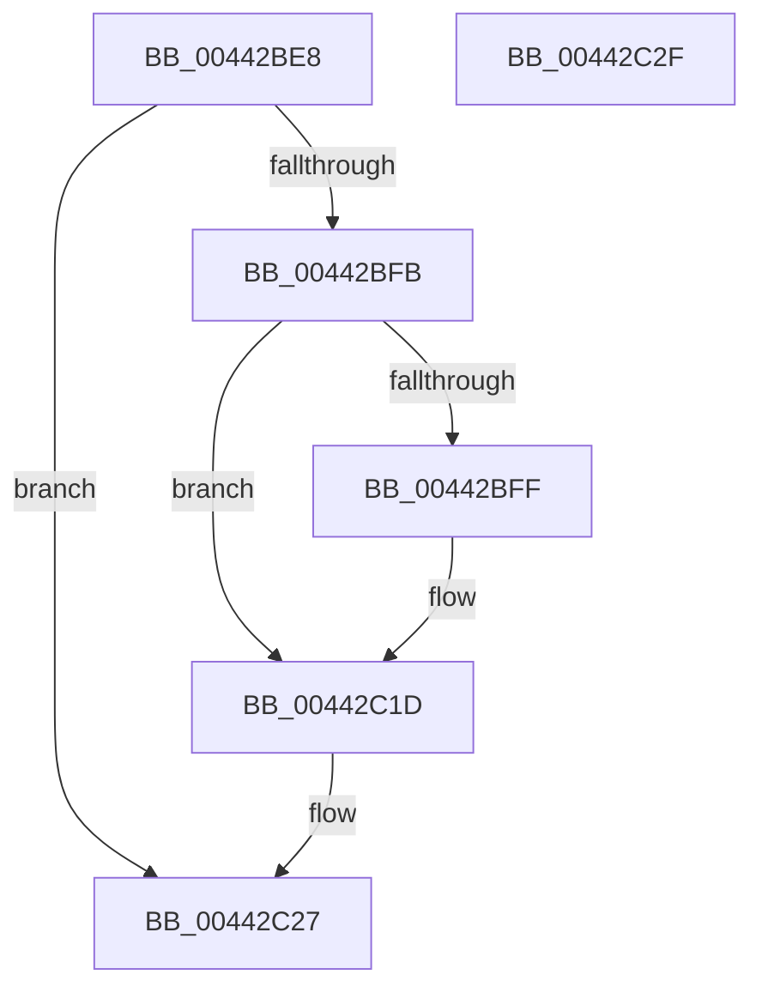

# IopMcDereferenceBufferEntry

- RVA: `0x00442BE8`–`0x00442C30` (길이 `72` bytes)
- VA: `0x0000000140442BE8`
- 실행 섹션: `.text`
- PDB 이름 있음: `예`; PDB Function 태그: `아니요`
- unwind 정보 RVA: `0x00064C80`
- 디코드: `23`개 명령, `72/72` bytes 표시
- 미해석 바이트: `0` (있으면 어셈블리에 `.byte`로 보존)

> 이 문서는 커널 이미지의 기계어와 PDB 기호를 분석해 생성했습니다. 4번과 5번은 함수 원형과 자료형을 바이너리 사용 방식에서 추정한 C 해석이며 원본 소스 복구 결과는 아닙니다.

## 1. Dependencies

- 직접 호출 지점: **2**; 고유 호출 대상: **2**
- 직접 호출자로 확인된 함수: **3**
- RIP 상대 이미지 참조: **0**

### Outgoing calls
- `0x00442C17` → [KeBugCheckEx](../4F/KeBugCheckEx_function_004FD660.md) (function, `0x004FD660`)
- `0x00442C22` → [ExFreePoolWithTag](../../poolcode/B8/ExFreePoolWithTag_function_00B82870.md) (function, `0x00B82870`)

### Direct callers
- [IoTryReleasePages](IoTryReleasePages_function_00442B58.md) at `0x00442BCA`
- [IopMcReleaseMdl](../5A/IopMcReleaseMdl_function_005A3CE8.md) at `0x005A3D65`
- [IopMcWaitAndCleanupBufferEntry](../5A/IopMcWaitAndCleanupBufferEntry_function_005A3F44.md) at `0x005A3FE4`

### Static image references
- 디코드된 RIP-relative 메모리 참조가 없습니다.

## 2. Other-region calls and transfers

- 다른 실행 섹션으로 향하는 call: **1**
  - `0x00442C22` → [ExFreePoolWithTag](../../poolcode/B8/ExFreePoolWithTag_function_00B82870.md) (`.text` → `POOLCODE`)
- 별도 외부 분기/꼬리 이동을 확인하지 못했습니다.

## 3. Assembly (complete function range)

```asm
00442BE8  40 53                           push rbx
00442BEA  48 83 EC 30                     sub rsp, 0x30
00442BEE  83 CB FF                        or ebx, 0xffffffff
00442BF1  F0 0F C1 59 08                  lock xadd dword ptr [rcx + 8], ebx
00442BF6  83 EB 01                        sub ebx, 1
00442BF9  7F 2C                           jg 0x140442c27
00442BFB  85 DB                           test ebx, ebx
00442BFD  79 1E                           jns 0x140442c1d
00442BFF  48 8B 01                        mov rax, qword ptr [rcx]
00442C02  4C 8B C1                        mov r8, rcx
00442C05  B9 F4 01 00 00                  mov ecx, 0x1f4
00442C0A  4C 63 CB                        movsxd r9, ebx
00442C0D  BA 01 00 00 00                  mov edx, 1
00442C12  48 89 44 24 20                  mov qword ptr [rsp + 0x20], rax
00442C17  E8 44 AA 0B 00                  call 0x1404fd660
00442C1C  CC                              int3
00442C1D  BA 4D 63 42 65                  mov edx, 0x6542634d
00442C22  E8 49 FC 73 00                  call 0x140b82870
00442C27  8B C3                           mov eax, ebx
00442C29  48 83 C4 30                     add rsp, 0x30
00442C2D  5B                              pop rbx
00442C2E  C3                              ret
00442C2F  CC                              int3
```

## 4. C-style interpretation (structured pseudocode)

```c
__int64 __fastcall IopMcDereferenceBufferEntry(__int64 a1)
{
    __int64 result;
    __int64 v_rbx;
    __int64 v_rsp;
    unsigned __int64 v_stack_m18;

    v_rsp = (v_rsp) - (48);
    v_rbx = (unsigned int)((v_rbx) | (0xFFFFFFFFULL));
    v_rbx = (unsigned int)((v_rbx) - (1));
    if (condition_is_greater) goto loc_00442C27;
    if (sign_flag) {
        result = *(unsigned __int64 *)(a1);
        a3 = a1;
        a1 = 500;
        a4 = (int)((unsigned int)(v_rbx));
        a2 = 1;
        v_stack_m18 = result;
        result = KeBugCheckEx(a1, a2, a3, a4);
    }
    result = ExFreePoolWithTag(a1, (unsigned int)(0x6542634DULL), a3, a4);
loc_00442C27:
    v_rsp = (v_rsp) + (48);
    return (unsigned int)((unsigned int)(v_rbx));
}
```

## 5. (Beta) C Style

```c
int64_t IopMcDereferenceBufferEntry(void *Arg1)
{
    uint8_t *arg1 = (uint8_t *)Arg1;

    int64_t result;
    int64_t local_rbx;
    int64_t local_rsp;
    uint64_t v_stack_m18;

    local_rsp = (local_rsp) - (48);
    local_rbx = (uint32_t)((local_rbx) | (0xFFFFFFFFULL));
    local_rbx = (uint32_t)((local_rbx) - (1));
    if (condition_is_greater) goto loc_00442C27;
    if (sign_flag) {
        result = *(uint64_t *)(arg1);
        a3 = Arg1;
        Arg1 = 500;
        a4 = (int32_t)((uint32_t)(local_rbx));
        a2 = 1;
        v_stack_m18 = result;
        result = KeBugCheckEx(Arg1, a2, a3, a4);
    }
    result = ExFreePoolWithTag(Arg1, (uint32_t)(0x6542634DULL), a3, a4);
loc_00442C27:
    local_rsp = (local_rsp) + (48);
    return (uint32_t)((uint32_t)(local_rbx));
}
```

### 관측된 메모리 오프셋

구조체 형식이 확인되지 않은 접근은 인자 기준의 오프셋으로만 기록했습니다.

| 기준 인자 | 오프셋 표현 | 폭 (bit) | 접근 |
|---|---:|---:|---|
| `Arg1` | `+ 0x0` | `64` | `R` |
| `Arg1` | `+ 0x8` | `32` | `R/W` |

## 6. Execution-region graph

[열기: 2D/3D 그래프와 함수 탐색 컨트롤 패널](../../../control-panel.html?section=text&rva=0x00442BE8&view=graph)

- 2D 그래프는 위에서 아래로 흐르고, 3D 그래프는 빈 공간을 드래그해 회전합니다. Shift+드래그는 이동, 휠은 확대·축소, 함수 노드 선택은 대상 보고서 이동입니다.

### Static fallback


