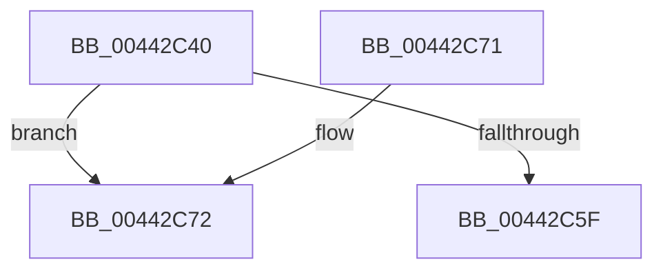

# IopMcFindNextTableEntryForUnlock

- RVA: `0x00442C40`–`0x00442C79` (길이 `57` bytes)
- VA: `0x0000000140442C40`
- 실행 섹션: `.text`
- PDB 이름 있음: `예`; PDB Function 태그: `예`
- unwind 정보 RVA: `0x000A53CC`
- 디코드: `18`개 명령, `57/57` bytes 표시
- 미해석 바이트: `0` (있으면 어셈블리에 `.byte`로 보존)

> 이 문서는 커널 이미지의 기계어와 PDB 기호를 분석해 생성했습니다. 4번과 5번은 함수 원형과 자료형을 바이너리 사용 방식에서 추정한 C 해석이며 원본 소스 복구 결과는 아닙니다.

## 1. Dependencies

- 직접 호출 지점: **0**; 고유 호출 대상: **0**
- 직접 호출자로 확인된 함수: **1**
- RIP 상대 이미지 참조: **1**

### Outgoing calls
- 직접 디코드된 call 명령이 없습니다.

### Direct callers
- [IoTryReleasePages](IoTryReleasePages_function_00442B58.md) at `0x00442B9A`

### Static image references
- `0x00442C72` → RVA `0x00F8D024` (`.data`; read)

## 2. Other-region calls and transfers

- 다른 실행 섹션으로 향하는 call: **0**
- 별도 외부 분기/꼬리 이동을 확인하지 못했습니다.

## 3. Assembly (complete function range)

```asm
00442C40  48 89 5C 24 10                  mov qword ptr [rsp + 0x10], rbx
00442C45  48 89 74 24 18                  mov qword ptr [rsp + 0x18], rsi
00442C4A  57                              push rdi
00442C4B  48 83 EC 20                     sub rsp, 0x20
00442C4F  33 DB                           xor ebx, ebx
00442C51  48 8B F2                        mov rsi, rdx
00442C54  48 8B F9                        mov rdi, rcx
00442C57  48 89 1A                        mov qword ptr [rdx], rbx
00442C5A  38 59 10                        cmp byte ptr [rcx + 0x10], bl
00442C5D  74 13                           je 0x140442c72
00442C5F  33 C0                           xor eax, eax
00442C61  48 8B 5C 24 38                  mov rbx, qword ptr [rsp + 0x38]
00442C66  48 8B 74 24 40                  mov rsi, qword ptr [rsp + 0x40]
00442C6B  48 83 C4 20                     add rsp, 0x20
00442C6F  5F                              pop rdi
00442C70  C3                              ret
00442C71  CC                              int3
00442C72  48 8D 0D AB A3 B4 00            lea rcx, [rip + 0xb4a3ab]
```

## 4. C-style interpretation (structured pseudocode)

```c
__int64 __fastcall IopMcFindNextTableEntryForUnlock(__int64 a1, __int64 a2)
{
    __int64 result;
    __int64 v_rbx;
    __int64 v_rsp;
    unsigned __int64 v_stack_p10;
    unsigned __int64 v_stack_p18;

    v_stack_p10 = v_rbx;
    v_stack_p18 = v_rsi;
    v_rsp = (v_rsp) - (32);
    v_rbx = 0;
    *(unsigned __int64 *)(a2) = 0;
    if ((*(unsigned __int8 *)(a1 + 16)) == 0) goto loc_00442C72;
    result = 0;
    v_rsp = (v_rsp) + (32);
    return result;
loc_00442C72:
    return result;
}
```

## 5. (Beta) C Style

```c
int64_t IopMcFindNextTableEntryForUnlock(void *Arg1, void *Arg2)
{
    uint8_t *arg1 = (uint8_t *)Arg1;
    uint8_t *arg2 = (uint8_t *)Arg2;

    int64_t result;
    int64_t local_rbx;
    int64_t local_rsp;
    uint64_t v_stack_p10;
    uint64_t v_stack_p18;

    v_stack_p10 = local_rbx;
    v_stack_p18 = local_rsi;
    local_rsp = (local_rsp) - (32);
    local_rbx = 0;
    *(uint64_t *)(arg2) = 0;
    if ((*(uint8_t *)(arg1 + 0x10)) == 0) goto loc_00442C72;
    result = 0;
    local_rsp = (local_rsp) + (32);
    return result;
loc_00442C72:
    return result;
}
```

### 관측된 메모리 오프셋

구조체 형식이 확인되지 않은 접근은 인자 기준의 오프셋으로만 기록했습니다.

| 기준 인자 | 오프셋 표현 | 폭 (bit) | 접근 |
|---|---:|---:|---|
| `Arg1` | `+ 0x10` | `8` | `R` |
| `Arg2` | `+ 0x0` | `64` | `W` |

## 6. Execution-region graph

[열기: 2D/3D 그래프와 함수 탐색 컨트롤 패널](../../../control-panel.html?section=text&rva=0x00442C40&view=graph)

- 2D 그래프는 위에서 아래로 흐르고, 3D 그래프는 빈 공간을 드래그해 회전합니다. Shift+드래그는 이동, 휠은 확대·축소, 함수 노드 선택은 대상 보고서 이동입니다.

### Static fallback


