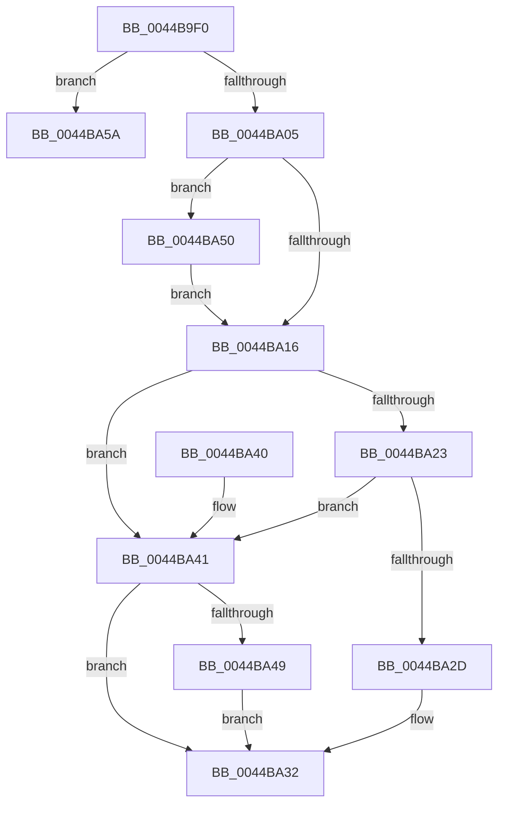

# KeAcquireInterruptSpinLock

- RVA: `0x0044B9F0`–`0x0044BA75` (길이 `133` bytes)
- VA: `0x000000014044B9F0`
- 실행 섹션: `.text`
- PDB 이름 있음: `예`; PDB Function 태그: `아니요`
- unwind 정보 RVA: `0x0006E1DC`
- 디코드: `38`개 명령, `133/133` bytes 표시
- 미해석 바이트: `0` (있으면 어셈블리에 `.byte`로 보존)

> 이 문서는 커널 이미지의 기계어와 PDB 기호를 분석해 생성했습니다. 4번과 5번은 함수 원형과 자료형을 바이너리 사용 방식에서 추정한 C 해석이며 원본 소스 복구 결과는 아닙니다.

## 1. Dependencies

- 직접 호출 지점: **4**; 고유 호출 대상: **4**
- 직접 호출자로 확인된 함수: **0**
- RIP 상대 이미지 참조: **3**

### Outgoing calls
- `0x0044BA2D` → [KiAcquireSpinLockInstrumented](../20/KiAcquireSpinLockInstrumented_function_002084F0.md) (function, `0x002084F0`)
- `0x0044BA49` → [KxWaitForSpinLockAndAcquire](../20/KxWaitForSpinLockAndAcquire_function_002085C0.md) (function, `0x002085C0`)
- `0x0044BA53` → [KiRaiseIrqlProcessIrqlFlags](../4F/KiRaiseIrqlProcessIrqlFlags_function_004F56FC.md) (function, `0x004F56FC`)
- `0x0044BA6F` → [KeBugCheckEx](../4F/KeBugCheckEx_function_004FD660.md) (function, `0x004FD660`)

### Direct callers
- 이 함수 시작 RVA로 연결되는 직접 call은 확인되지 않았습니다. 간접 호출은 완전히 역산할 수 없습니다.

### Static image references
- `0x0044BA0D` → RVA `0x00FC6D20` (`ALMOSTRO`; read)
- `0x0044BA16` → RVA `0x00FC6B06` (`ALMOSTRO`; read)
- `0x0044BA23` → RVA `0x00F0DE58` (`.data`; read)

## 2. Other-region calls and transfers

- 다른 실행 섹션으로 향하는 call: **0**
- 별도 외부 분기/꼬리 이동을 확인하지 못했습니다.

## 3. Assembly (complete function range)

```asm
0044B9F0  48 89 5C 24 08                  mov qword ptr [rsp + 8], rbx
0044B9F5  57                              push rdi
0044B9F6  48 83 EC 30                     sub rsp, 0x30
0044B9FA  0F B6 51 5D                     movzx edx, byte ptr [rcx + 0x5d]
0044B9FE  48 8B D9                        mov rbx, rcx
0044BA01  84 D2                           test dl, dl
0044BA03  74 55                           je 0x14044ba5a
0044BA05  44 0F 20 C7                     mov rdi, cr8
0044BA09  44 0F 22 C2                     mov cr8, rdx
0044BA0D  83 3D 0C B3 B7 00 00            cmp dword ptr [rip + 0xb7b30c], 0
0044BA14  75 3A                           jne 0x14044ba50
0044BA16  F6 05 E9 B0 B7 00 21            test byte ptr [rip + 0xb7b0e9], 0x21
0044BA1D  48 8B 4B 48                     mov rcx, qword ptr [rbx + 0x48]
0044BA21  74 1E                           je 0x14044ba41
0044BA23  8B 05 2F 24 AC 00               mov eax, dword ptr [rip + 0xac242f]
0044BA29  85 C0                           test eax, eax
0044BA2B  75 14                           jne 0x14044ba41
0044BA2D  E8 BE CA DB FF                  call 0x1402084f0
0044BA32  48 8B 5C 24 40                  mov rbx, qword ptr [rsp + 0x40]
0044BA37  40 8A C7                        mov al, dil
0044BA3A  48 83 C4 30                     add rsp, 0x30
0044BA3E  5F                              pop rdi
0044BA3F  C3                              ret
0044BA40  CC                              int3
0044BA41  F0 48 0F BA 29 00               lock bts qword ptr [rcx], 0
0044BA47  73 E9                           jae 0x14044ba32
0044BA49  E8 72 CB DB FF                  call 0x1402085c0
0044BA4E  EB E2                           jmp 0x14044ba32
0044BA50  40 8A CF                        mov cl, dil
0044BA53  E8 A4 9C 0A 00                  call 0x1404f56fc
0044BA58  EB BC                           jmp 0x14044ba16
0044BA5A  48 83 64 24 20 00               and qword ptr [rsp + 0x20], 0
0044BA60  45 33 C9                        xor r9d, r9d
0044BA63  4C 8B C3                        mov r8, rbx
0044BA66  B9 3B 01 00 00                  mov ecx, 0x13b
0044BA6B  41 8D 51 01                     lea edx, [r9 + 1]
0044BA6F  E8 EC 1B 0B 00                  call 0x1404fd660
0044BA74  CC                              int3
```

## 4. C-style interpretation (structured pseudocode)

```c
__int64 __fastcall KeAcquireInterruptSpinLock(__int64 a1, __int64 a2, __int64 a3, int a4)
{
    __int64 result;
    __int64 v_rsp;
    unsigned __int64 v_stack_p20;
    unsigned __int64 v_stack_p8;

    v_stack_p8 = v_rbx;
    v_rsp = (v_rsp) - (48);
    if ((unsigned __int8)(*(unsigned __int8 *)(a1 + 93)) == 0) goto loc_0044BA5A;
    if ((*(unsigned int *)(v_rip + 12038924)) != 0) goto loc_0044BA50;
loc_0044BA16:
    if (((*(unsigned __int8 *)(v_rip + 12038377)) & (33)) == 0) goto loc_0044BA41;
    if ((unsigned int)((unsigned int)(*(unsigned int *)(v_rip + 11281455))) != 0) goto loc_0044BA41;
    result = KiAcquireSpinLockInstrumented(*(unsigned __int64 *)(a1 + 72), *(unsigned __int8 *)(a1 + 93), a3, a4);
loc_0044BA32:
    v_rsp = (v_rsp) + (48);
    return (unsigned __int8)(v_cr8);
loc_0044BA41:
    if (condition_is_above_or_equal) goto loc_0044BA32;
    result = KxWaitForSpinLockAndAcquire(*(unsigned __int64 *)(a1 + 72), *(unsigned __int8 *)(a1 + 93), a3, a4);
    goto loc_0044BA32;
loc_0044BA50:
    result = KiRaiseIrqlProcessIrqlFlags((unsigned __int8)(v_cr8), *(unsigned __int8 *)(a1 + 93), a3, a4);
    goto loc_0044BA16;
loc_0044BA5A:
    a4 = 0;
    result = KeBugCheckEx(315, a4 + 1, v_stack_p8, a4);
    return result;
}
```

## 5. (Beta) C Style

```c
int64_t KeAcquireInterruptSpinLock(void *Arg1, int64_t Arg2, int64_t Arg3, int32_t Arg4)
{
    uint8_t *arg1 = (uint8_t *)Arg1;

    int64_t result;
    int64_t local_rsp;
    uint64_t v_stack_p20;
    uint64_t v_stack_p8;

    v_stack_p8 = local_rbx;
    local_rsp = (local_rsp) - (48);
    if ((uint8_t)(*(uint8_t *)(arg1 + 0x5D)) == 0) goto loc_0044BA5A;
    if ((*(uint32_t *)(v_rip + 0xB7B30C)) != 0) goto loc_0044BA50;
loc_0044BA16:
    if (((*(uint8_t *)(v_rip + 0xB7B0E9)) & (33)) == 0) goto loc_0044BA41;
    if ((uint32_t)((uint32_t)(*(uint32_t *)(v_rip + 0xAC242F))) != 0) goto loc_0044BA41;
    result = KiAcquireSpinLockInstrumented(*(uint64_t *)(arg1 + 0x48), *(uint8_t *)(arg1 + 0x5D), Arg3, Arg4);
loc_0044BA32:
    local_rsp = (local_rsp) + (48);
    return (uint8_t)(v_cr8);
loc_0044BA41:
    if (condition_is_above_or_equal) goto loc_0044BA32;
    result = KxWaitForSpinLockAndAcquire(*(uint64_t *)(arg1 + 0x48), *(uint8_t *)(arg1 + 0x5D), Arg3, Arg4);
    goto loc_0044BA32;
loc_0044BA50:
    result = KiRaiseIrqlProcessIrqlFlags((uint8_t)(v_cr8), *(uint8_t *)(arg1 + 0x5D), Arg3, Arg4);
    goto loc_0044BA16;
loc_0044BA5A:
    Arg4 = 0;
    result = KeBugCheckEx(315, Arg4 + 1, v_stack_p8, Arg4);
    return result;
}
```

### 관측된 메모리 오프셋

구조체 형식이 확인되지 않은 접근은 인자 기준의 오프셋으로만 기록했습니다.

| 기준 인자 | 오프셋 표현 | 폭 (bit) | 접근 |
|---|---:|---:|---|
| `Arg1` | `+ 0x48` | `64` | `R` |
| `Arg1` | `+ 0x5D` | `8` | `R` |

## 6. Execution-region graph

[열기: 2D/3D 그래프와 함수 탐색 컨트롤 패널](../../../control-panel.html?section=text&rva=0x0044B9F0&view=graph)

- 2D 그래프는 위에서 아래로 흐르고, 3D 그래프는 빈 공간을 드래그해 회전합니다. Shift+드래그는 이동, 휠은 확대·축소, 함수 노드 선택은 대상 보고서 이동입니다.

### Static fallback


