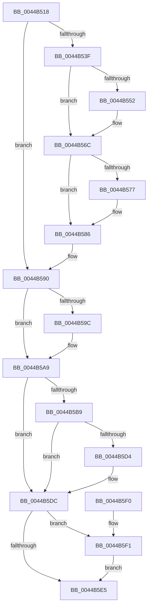

# KeCleanupThreadState

- RVA: `0x0044B518`–`0x0044B5F8` (길이 `224` bytes)
- VA: `0x000000014044B518`
- 실행 섹션: `.text`
- PDB 이름 있음: `예`; PDB Function 태그: `아니요`
- unwind 정보 RVA: `0x000A66C4`
- 디코드: `56`개 명령, `224/224` bytes 표시
- 미해석 바이트: `0` (있으면 어셈블리에 `.byte`로 보존)

> 이 문서는 커널 이미지의 기계어와 PDB 기호를 분석해 생성했습니다. 4번과 5번은 함수 원형과 자료형을 바이너리 사용 방식에서 추정한 C 해석이며 원본 소스 복구 결과는 아닙니다.

## 1. Dependencies

- 직접 호출 지점: **6**; 고유 호출 대상: **5**
- 직접 호출자로 확인된 함수: **1**
- RIP 상대 이미지 참조: **1**

### Outgoing calls
- `0x0044B531` → [KiAcquireThreadLockRaiseToDpc](../39/KiAcquireThreadLockRaiseToDpc_function_00396280.md) (function, `0x00396280`)
- `0x0044B566` → [KeBugCheckEx](../4F/KeBugCheckEx_function_004FD660.md) (function, `0x004FD660`)
- `0x0044B5A4` → [KiLowerIrqlProcessIrqlFlags](../4F/KiLowerIrqlProcessIrqlFlags_function_004F5698.md) (function, `0x004F5698`)
- `0x0044B5C3` → [KiAbCleanupLockEntriesState](KiAbCleanupLockEntriesState_function_0044B600.md) (function, `0x0044B600`)
- `0x0044B5D7` → [KiAbCleanupLockEntriesState](KiAbCleanupLockEntriesState_function_0044B600.md) (function, `0x0044B600`)
- `0x0044B5F1` → [KeFlushQueuedDpcs](../3C/KeFlushQueuedDpcs_function_003C0300.md) (function, `0x003C0300`)

### Direct callers
- [PspThreadDelete](../../page/A7/PspThreadDelete_function_00A79C20.md) at `0x00A79C37`

### Static image references
- `0x0044B594` → RVA `0x00FC6D20` (`ALMOSTRO`; read)

## 2. Other-region calls and transfers

- 다른 실행 섹션으로 향하는 call: **0**
- 별도 외부 분기/꼬리 이동을 확인하지 못했습니다.

## 3. Assembly (complete function range)

```asm
0044B518  48 89 5C 24 10                  mov qword ptr [rsp + 0x10], rbx
0044B51D  57                              push rdi
0044B51E  48 83 EC 30                     sub rsp, 0x30
0044B522  33 FF                           xor edi, edi
0044B524  48 8D 54 24 40                  lea rdx, [rsp + 0x40]
0044B529  40 88 7C 24 40                  mov byte ptr [rsp + 0x40], dil
0044B52E  48 8B D9                        mov rbx, rcx
0044B531  E8 4A AD F4 FF                  call 0x140396280
0044B536  83 BB 04 04 00 00 20            cmp dword ptr [rbx + 0x404], 0x20
0044B53D  74 51                           je 0x14044b590
0044B53F  48 0F BE 93 04 04 00 00         movsx rdx, byte ptr [rbx + 0x404]
0044B547  8A 84 1A 38 03 00 00            mov al, byte ptr [rdx + rbx + 0x338]
0044B54E  84 C0                           test al, al
0044B550  75 1A                           jne 0x14044b56c
0044B552  4C 8B C2                        mov r8, rdx
0044B555  48 89 7C 24 20                  mov qword ptr [rsp + 0x20], rdi
0044B55A  48 8B D3                        mov rdx, rbx
0044B55D  44 8D 4F 02                     lea r9d, [rdi + 2]
0044B561  B9 57 01 00 00                  mov ecx, 0x157
0044B566  E8 F5 20 0B 00                  call 0x1404fd660
0044B56B  CC                              int3
0044B56C  2C 01                           sub al, 1
0044B56E  88 84 1A 38 03 00 00            mov byte ptr [rdx + rbx + 0x338], al
0044B575  75 0F                           jne 0x14044b586
0044B577  8B 83 58 03 00 00               mov eax, dword ptr [rbx + 0x358]
0044B57D  0F BB D0                        btc eax, edx
0044B580  89 83 58 03 00 00               mov dword ptr [rbx + 0x358], eax
0044B586  C7 83 04 04 00 00 20 00 00 00   mov dword ptr [rbx + 0x404], 0x20
0044B590  48 89 7B 40                     mov qword ptr [rbx + 0x40], rdi
0044B594  39 3D 86 B7 B7 00               cmp dword ptr [rip + 0xb7b786], edi
0044B59A  74 0D                           je 0x14044b5a9
0044B59C  44 0F 20 C1                     mov rcx, cr8
0044B5A0  8A 54 24 40                     mov dl, byte ptr [rsp + 0x40]
0044B5A4  E8 EF A0 0A 00                  call 0x1404f5698
0044B5A9  0F B6 44 24 40                  movzx eax, byte ptr [rsp + 0x40]
0044B5AE  44 0F 22 C0                     mov cr8, rax
0044B5B2  8B 43 74                        mov eax, dword ptr [rbx + 0x74]
0044B5B5  A8 01                           test al, 1
0044B5B7  74 23                           je 0x14044b5dc
0044B5B9  48 8B 8B 70 04 00 00            mov rcx, qword ptr [rbx + 0x470]
0044B5C0  48 8B D3                        mov rdx, rbx
0044B5C3  E8 38 00 00 00                  call 0x14044b600
0044B5C8  48 8B 8B 78 04 00 00            mov rcx, qword ptr [rbx + 0x478]
0044B5CF  48 85 C9                        test rcx, rcx
0044B5D2  74 08                           je 0x14044b5dc
0044B5D4  48 8B D3                        mov rdx, rbx
0044B5D7  E8 24 00 00 00                  call 0x14044b600
0044B5DC  66 39 BB 64 03 00 00            cmp word ptr [rbx + 0x364], di
0044B5E3  75 0C                           jne 0x14044b5f1
0044B5E5  48 8B 5C 24 48                  mov rbx, qword ptr [rsp + 0x48]
0044B5EA  48 83 C4 30                     add rsp, 0x30
0044B5EE  5F                              pop rdi
0044B5EF  C3                              ret
0044B5F0  CC                              int3
0044B5F1  E8 0A 4D F7 FF                  call 0x1403c0300
0044B5F6  EB ED                           jmp 0x14044b5e5
```

## 4. C-style interpretation (structured pseudocode)

```c
__int64 __fastcall KeCleanupThreadState(__int64 a1)
{
    __int64 result;
    __int64 v_rdi;
    __int64 v_rsp;
    unsigned __int64 v_stack_m18;
    unsigned __int64 v_stack_p10;
    unsigned __int64 v_stack_p8;

    v_stack_p10 = v_rbx;
    v_rsp = (v_rsp) - (48);
    v_rdi = 0;
    v_stack_p8 = 0;
    result = KiAcquireThreadLockRaiseToDpc(a1, v_stack_p8, a3, a4);
    if ((*(unsigned int *)(a1 + 1028)) == 32) goto loc_0044B590;
    result = *(unsigned __int8 *)((__int8)(*(unsigned __int8 *)(a1 + 1028)) + a1 * 1 + 824);
    if ((unsigned __int8)(*(unsigned __int8 *)((__int8)(*(unsigned __int8 *)(a1 + 1028)) + a1 * 1 + 824)) == 0) {
        a3 = (__int8)(*(unsigned __int8 *)(a1 + 1028));
        v_stack_m18 = 0;
        a2 = a1;
        a4 = v_rdi + 2;
        a1 = 343;
        result = KeBugCheckEx(a1, a2, a3, a4);
    }
    result = (unsigned __int8)((result) - (1));
    *(unsigned __int8 *)(a2 + a1 * 1 + 824) = (unsigned __int8)(result);
    if (!(condition_is_not_equal)) {
        result = *(unsigned int *)(a1 + 856);
        *(unsigned int *)(a1 + 856) = (unsigned int)(result);
    }
    *(unsigned int *)(a1 + 1028) = 32;
loc_0044B590:
    *(unsigned __int64 *)(a1 + 64) = 0;
    if ((*(unsigned int *)(v_rip + 12040070)) != 0) {
        a1 = v_cr8;
        a2 = v_stack_p8;
        result = KiLowerIrqlProcessIrqlFlags(a1, a2, a3, a4);
    }
    if ((((unsigned __int8)((unsigned int)(*(unsigned int *)(a1 + 116)))) & (1)) == 0) goto loc_0044B5DC;
    result = KiAbCleanupLockEntriesState(*(unsigned __int64 *)(a1 + 1136), a1, a3, a4);
    if (*(unsigned __int64 *)(a1 + 1144) != 0) {
        a2 = a1;
        result = KiAbCleanupLockEntriesState(*(unsigned __int64 *)(a1 + 1144), a2, a3, a4);
    }
    if ((*(unsigned __int16 *)(a1 + 868)) != 0) goto loc_0044B5F1;
loc_0044B5E5:
    v_rsp = (v_rsp) + (48);
    return result;
loc_0044B5F1:
    result = KeFlushQueuedDpcs(*(unsigned __int64 *)(a1 + 1144), a2, a3, a4);
    goto loc_0044B5E5;
}
```

## 5. (Beta) C Style

```c
int64_t KeCleanupThreadState(void *Arg1)
{
    uint8_t *arg1 = (uint8_t *)Arg1;

    int64_t result;
    int64_t local_rdi;
    int64_t local_rsp;
    uint64_t v_stack_m18;
    uint64_t v_stack_p10;
    uint64_t v_stack_p8;

    v_stack_p10 = local_rbx;
    local_rsp = (local_rsp) - (48);
    local_rdi = 0;
    v_stack_p8 = 0;
    result = KiAcquireThreadLockRaiseToDpc(Arg1, v_stack_p8, a3, a4);
    if ((*(uint32_t *)(arg1 + 0x404)) == 32) goto loc_0044B590;
    result = *(uint8_t *)((int8_t)(*(uint8_t *)(arg1 + 0x404)) + arg1 * 1 + 0x338);
    if ((uint8_t)(*(uint8_t *)((int8_t)(*(uint8_t *)(arg1 + 0x404)) + arg1 * 1 + 0x338)) == 0) {
        a3 = (int8_t)(*(uint8_t *)(arg1 + 0x404));
        v_stack_m18 = 0;
        a2 = Arg1;
        a4 = local_rdi + 2;
        Arg1 = 343;
        result = KeBugCheckEx(Arg1, a2, a3, a4);
    }
    result = (uint8_t)((result) - (1));
    *(uint8_t *)(a2 + arg1 * 1 + 0x338) = (uint8_t)(result);
    if (!(condition_is_not_equal)) {
        result = *(uint32_t *)(arg1 + 0x358);
        *(uint32_t *)(arg1 + 0x358) = (uint32_t)(result);
    }
    *(uint32_t *)(arg1 + 0x404) = 32;
loc_0044B590:
    *(uint64_t *)(arg1 + 0x40) = 0;
    if ((*(uint32_t *)(v_rip + 0xB7B786)) != 0) {
        Arg1 = v_cr8;
        a2 = v_stack_p8;
        result = KiLowerIrqlProcessIrqlFlags(Arg1, a2, a3, a4);
    }
    if ((((uint8_t)((uint32_t)(*(uint32_t *)(arg1 + 0x74)))) & (1)) == 0) goto loc_0044B5DC;
    result = KiAbCleanupLockEntriesState(*(uint64_t *)(arg1 + 0x470), Arg1, a3, a4);
    if (*(uint64_t *)(arg1 + 0x478) != 0) {
        a2 = Arg1;
        result = KiAbCleanupLockEntriesState(*(uint64_t *)(arg1 + 0x478), a2, a3, a4);
    }
    if ((*(uint16_t *)(arg1 + 0x364)) != 0) goto loc_0044B5F1;
loc_0044B5E5:
    local_rsp = (local_rsp) + (48);
    return result;
loc_0044B5F1:
    result = KeFlushQueuedDpcs(*(uint64_t *)(arg1 + 0x478), a2, a3, a4);
    goto loc_0044B5E5;
}
```

### 관측된 메모리 오프셋

구조체 형식이 확인되지 않은 접근은 인자 기준의 오프셋으로만 기록했습니다.

| 기준 인자 | 오프셋 표현 | 폭 (bit) | 접근 |
|---|---:|---:|---|
| `Arg1` | `+ 0x40` | `64` | `W` |
| `Arg1` | `+ 0x74` | `32` | `R` |
| `Arg1` | `+ 0x358` | `32` | `R` |
| `Arg1` | `+ 0x358` | `32` | `W` |
| `Arg1` | `+ 0x364` | `16` | `R` |
| `Arg1` | `+ 0x404` | `8` | `R` |
| `Arg1` | `+ 0x404` | `32` | `R` |
| `Arg1` | `+ 0x404` | `32` | `W` |
| `Arg1` | `+ 0x470` | `64` | `R` |
| `Arg1` | `+ 0x478` | `64` | `R` |

## 6. Execution-region graph

[열기: 2D/3D 그래프와 함수 탐색 컨트롤 패널](../../../control-panel.html?section=text&rva=0x0044B518&view=graph)

- 2D 그래프는 위에서 아래로 흐르고, 3D 그래프는 빈 공간을 드래그해 회전합니다. Shift+드래그는 이동, 휠은 확대·축소, 함수 노드 선택은 대상 보고서 이동입니다.

### Static fallback


