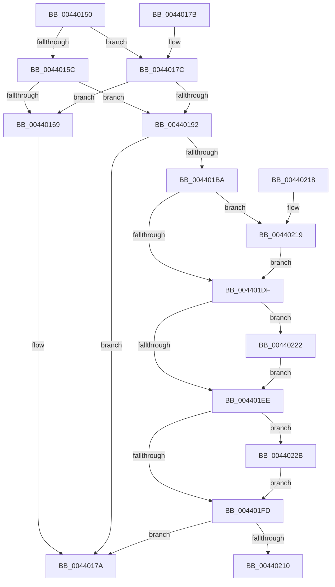

# KeCopyLastBranchInformation

- RVA: `0x00440150`–`0x00440234` (길이 `228` bytes)
- VA: `0x0000000140440150`
- 실행 섹션: `.text`
- PDB 이름 있음: `예`; PDB Function 태그: `아니요`
- unwind 정보 RVA: `0x000DB714`
- 디코드: `49`개 명령, `228/228` bytes 표시
- 미해석 바이트: `0` (있으면 어셈블리에 `.byte`로 보존)

> 이 문서는 커널 이미지의 기계어와 PDB 기호를 분석해 생성했습니다. 4번과 5번은 함수 원형과 자료형을 바이너리 사용 방식에서 추정한 C 해석이며 원본 소스 복구 결과는 아닙니다.

## 1. Dependencies

- 직접 호출 지점: **0**; 고유 호출 대상: **0**
- 직접 호출자로 확인된 함수: **2**
- RIP 상대 이미지 참조: **0**

### Outgoing calls
- 직접 디코드된 call 명령이 없습니다.

### Direct callers
- [sub_009A6B1D](../../page/9A/Unknown_function_009A6B1D.md) at `0x009A6B4F`
- [sub_009A6C04](../../page/9A/Unknown_function_009A6C04.md) at `0x009A6C4C`

### Static image references
- 디코드된 RIP-relative 메모리 참조가 없습니다.

## 2. Other-region calls and transfers

- 다른 실행 섹션으로 향하는 call: **0**
- 별도 외부 분기/꼬리 이동을 확인하지 못했습니다.

## 3. Assembly (complete function range)

```asm
00440150  F6 82 70 01 00 00 01            test byte ptr [rdx + 0x170], 1
00440157  4C 8B C2                        mov r8, rdx
0044015A  74 20                           je 0x14044017c
0044015C  8B 82 00 01 00 00               mov eax, dword ptr [rdx + 0x100]
00440162  48 0F BA E0 08                  bt rax, 8
00440167  72 29                           jb 0x140440192
00440169  0F 57 C0                        xorps xmm0, xmm0
0044016C  0F 11 81 B0 04 00 00            movups xmmword ptr [rcx + 0x4b0], xmm0
00440173  0F 11 81 C0 04 00 00            movups xmmword ptr [rcx + 0x4c0], xmm0
0044017A  C3                              ret
0044017B  CC                              int3
0044017C  65 48 8B 04 25 20 00 00 00      mov rax, qword ptr gs:[0x20]
00440185  8B 90 48 01 00 00               mov edx, dword ptr [rax + 0x148]
0044018B  48 0F BA E2 08                  bt rdx, 8
00440190  73 D7                           jae 0x140440169
00440192  41 0F 10 80 10 01 00 00         movups xmm0, xmmword ptr [r8 + 0x110]
0044019A  0F 11 81 B0 04 00 00            movups xmmword ptr [rcx + 0x4b0], xmm0
004401A1  41 0F 10 88 20 01 00 00         movups xmm1, xmmword ptr [r8 + 0x120]
004401A9  0F 11 89 C0 04 00 00            movups xmmword ptr [rcx + 0x4c0], xmm1
004401B0  41 F6 80 70 01 00 00 01         test byte ptr [r8 + 0x170], 1
004401B8  74 C0                           je 0x14044017a
004401BA  48 8B 81 B0 04 00 00            mov rax, qword ptr [rcx + 0x4b0]
004401C1  49 B8 FF FF FF FF FF FF FF 7F   movabs r8, 0x7fffffffffffffff
004401CB  49 23 C0                        and rax, r8
004401CE  33 D2                           xor edx, edx
004401D0  49 B9 FF FF FE FF FF 7F 00 00   movabs r9, 0x7ffffffeffff
004401DA  49 3B C1                        cmp rax, r9
004401DD  77 3A                           ja 0x140440219
004401DF  48 8B 81 B8 04 00 00            mov rax, qword ptr [rcx + 0x4b8]
004401E6  49 23 C0                        and rax, r8
004401E9  49 3B C1                        cmp rax, r9
004401EC  77 34                           ja 0x140440222
004401EE  48 8B 81 C0 04 00 00            mov rax, qword ptr [rcx + 0x4c0]
004401F5  49 23 C0                        and rax, r8
004401F8  49 3B C1                        cmp rax, r9
004401FB  77 2E                           ja 0x14044022b
004401FD  48 8B 81 C8 04 00 00            mov rax, qword ptr [rcx + 0x4c8]
00440204  49 23 C0                        and rax, r8
00440207  49 3B C1                        cmp rax, r9
0044020A  0F 86 6A FF FF FF               jbe 0x14044017a
00440210  48 89 91 C8 04 00 00            mov qword ptr [rcx + 0x4c8], rdx
00440217  C3                              ret
00440218  CC                              int3
00440219  48 89 91 B0 04 00 00            mov qword ptr [rcx + 0x4b0], rdx
00440220  EB BD                           jmp 0x1404401df
00440222  48 89 91 B8 04 00 00            mov qword ptr [rcx + 0x4b8], rdx
00440229  EB C3                           jmp 0x1404401ee
0044022B  48 89 91 C0 04 00 00            mov qword ptr [rcx + 0x4c0], rdx
00440232  EB C9                           jmp 0x1404401fd
```

## 4. C-style interpretation (structured pseudocode)

```c
__int64 __fastcall KeCopyLastBranchInformation(__int64 a1, __int64 a2)
{
    __int64 result;

    if (((*(unsigned __int8 *)(a2 + 368)) & (1)) == 0) goto loc_0044017C;
    if (condition_is_below) goto loc_00440192;
loc_00440169:
    *(unsigned __int64 *)(a1 + 1200) = v_xmm0;
    *(unsigned __int64 *)(a1 + 1216) = v_xmm0;
loc_0044017A:
    return (unsigned int)(*(unsigned int *)(a2 + 256));
loc_0044017C:
    if (condition_is_above_or_equal) goto loc_00440169;
loc_00440192:
    *(unsigned __int64 *)(a1 + 1200) = v_xmm0;
    *(unsigned __int64 *)(a1 + 1216) = v_xmm1;
    if (((*(unsigned __int8 *)(a2 + 368)) & (1)) == 0) goto loc_0044017A;
    result = (*(unsigned __int64 *)(a1 + 1200)) & (a2);
    a2 = 0;
    if (result > a4) goto loc_00440219;
loc_004401DF:
    result = (*(unsigned __int64 *)(a1 + 1208)) & (0);
    if (result > a4) goto loc_00440222;
loc_004401EE:
    result = (*(unsigned __int64 *)(a1 + 1216)) & (0);
    if (result > a4) goto loc_0044022B;
loc_004401FD:
    result = (*(unsigned __int64 *)(a1 + 1224)) & (0);
    if (result <= a4) goto loc_0044017A;
    *(unsigned __int64 *)(a1 + 1224) = 0;
    return result;
loc_00440219:
    *(unsigned __int64 *)(a1 + 1200) = 0;
    goto loc_004401DF;
loc_00440222:
    *(unsigned __int64 *)(a1 + 1208) = 0;
    goto loc_004401EE;
loc_0044022B:
    *(unsigned __int64 *)(a1 + 1216) = 0;
    goto loc_004401FD;
}
```

## 5. (Beta) C Style

```c
int64_t KeCopyLastBranchInformation(void *Arg1, void *Arg2)
{
    uint8_t *arg1 = (uint8_t *)Arg1;
    uint8_t *arg2 = (uint8_t *)Arg2;

    int64_t result;

    if (((*(uint8_t *)(arg2 + 0x170)) & (1)) == 0) goto loc_0044017C;
    if (condition_is_below) goto loc_00440192;
loc_00440169:
    *(uint64_t *)(arg1 + 0x4B0) = v_xmm0;
    *(uint64_t *)(arg1 + 0x4C0) = v_xmm0;
loc_0044017A:
    return (uint32_t)(*(uint32_t *)(arg2 + 0x100));
loc_0044017C:
    if (condition_is_above_or_equal) goto loc_00440169;
loc_00440192:
    *(uint64_t *)(arg1 + 0x4B0) = v_xmm0;
    *(uint64_t *)(arg1 + 0x4C0) = v_xmm1;
    if (((*(uint8_t *)(arg2 + 0x170)) & (1)) == 0) goto loc_0044017A;
    result = (*(uint64_t *)(arg1 + 0x4B0)) & (Arg2);
    Arg2 = 0;
    if (result > a4) goto loc_00440219;
loc_004401DF:
    result = (*(uint64_t *)(arg1 + 0x4B8)) & (0);
    if (result > a4) goto loc_00440222;
loc_004401EE:
    result = (*(uint64_t *)(arg1 + 0x4C0)) & (0);
    if (result > a4) goto loc_0044022B;
loc_004401FD:
    result = (*(uint64_t *)(arg1 + 0x4C8)) & (0);
    if (result <= a4) goto loc_0044017A;
    *(uint64_t *)(arg1 + 0x4C8) = 0;
    return result;
loc_00440219:
    *(uint64_t *)(arg1 + 0x4B0) = 0;
    goto loc_004401DF;
loc_00440222:
    *(uint64_t *)(arg1 + 0x4B8) = 0;
    goto loc_004401EE;
loc_0044022B:
    *(uint64_t *)(arg1 + 0x4C0) = 0;
    goto loc_004401FD;
}
```

### 관측된 메모리 오프셋

구조체 형식이 확인되지 않은 접근은 인자 기준의 오프셋으로만 기록했습니다.

| 기준 인자 | 오프셋 표현 | 폭 (bit) | 접근 |
|---|---:|---:|---|
| `Arg1` | `+ 0x4B0` | `64` | `R` |
| `Arg1` | `+ 0x4B0` | `64` | `W` |
| `Arg1` | `+ 0x4B0` | `128` | `R` |
| `Arg1` | `+ 0x4B8` | `64` | `R` |
| `Arg1` | `+ 0x4B8` | `64` | `W` |
| `Arg1` | `+ 0x4C0` | `64` | `R` |
| `Arg1` | `+ 0x4C0` | `64` | `W` |
| `Arg1` | `+ 0x4C0` | `128` | `R` |
| `Arg1` | `+ 0x4C8` | `64` | `R` |
| `Arg1` | `+ 0x4C8` | `64` | `W` |
| `Arg2` | `+ 0x100` | `32` | `R` |
| `Arg2` | `+ 0x110` | `128` | `R` |
| `Arg2` | `+ 0x120` | `128` | `R` |
| `Arg2` | `+ 0x170` | `8` | `R` |

## 6. Execution-region graph

[열기: 2D/3D 그래프와 함수 탐색 컨트롤 패널](../../../control-panel.html?section=text&rva=0x00440150&view=graph)

- 2D 그래프는 위에서 아래로 흐르고, 3D 그래프는 빈 공간을 드래그해 회전합니다. Shift+드래그는 이동, 휠은 확대·축소, 함수 노드 선택은 대상 보고서 이동입니다.

### Static fallback


