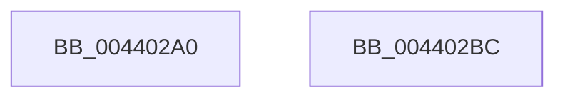

# KeGetProcessorNodeNumberByIndex

- RVA: `0x004402A0`–`0x004402BD` (길이 `29` bytes)
- VA: `0x00000001404402A0`
- 실행 섹션: `.text`
- PDB 이름 있음: `예`; PDB Function 태그: `아니요`
- unwind 정보 RVA: `0x000DB714`
- 디코드: `7`개 명령, `29/29` bytes 표시
- 미해석 바이트: `0` (있으면 어셈블리에 `.byte`로 보존)

> 이 문서는 커널 이미지의 기계어와 PDB 기호를 분석해 생성했습니다. 4번과 5번은 함수 원형과 자료형을 바이너리 사용 방식에서 추정한 C 해석이며 원본 소스 복구 결과는 아닙니다.

## 1. Dependencies

- 직접 호출 지점: **0**; 고유 호출 대상: **0**
- 직접 호출자로 확인된 함수: **4**
- RIP 상대 이미지 참조: **1**

### Outgoing calls
- 직접 디코드된 call 명령이 없습니다.

### Direct callers
- [PspEnableProcessOptionalXStateFeatures](../../page/78/PspEnableProcessOptionalXStateFeatures_function_00781EF0.md) at `0x0078208F`
- [KeUserModeCallback](../../page/8E/KeUserModeCallback_function_008E8A00.md) at `0x008E8ABF`
- [PspAllocateThread](../../page/9E/PspAllocateThread_function_009EF72C.md) at `0x009F01D3`
- [sub_00B39158](../../page/B3/Unknown_function_00B39158.md) at `0x00B39169`

### Static image references
- `0x004402A2` → RVA `0x00FC8C40` (`ALMOSTRO`; read)

## 2. Other-region calls and transfers

- 다른 실행 섹션으로 향하는 call: **0**
- 별도 외부 분기/꼬리 이동을 확인하지 못했습니다.

## 3. Assembly (complete function range)

```asm
004402A0  8B C1                           mov eax, ecx
004402A2  48 8D 0D 97 89 B8 00            lea rcx, [rip + 0xb88997]
004402A9  48 8B 04 C1                     mov rax, qword ptr [rcx + rax*8]
004402AD  48 8B 80 C0 00 00 00            mov rax, qword ptr [rax + 0xc0]
004402B4  0F B7 80 8A 00 00 00            movzx eax, word ptr [rax + 0x8a]
004402BB  C3                              ret
004402BC  CC                              int3
```

## 4. C-style interpretation (structured pseudocode)

```c
__int64 __fastcall KeGetProcessorNodeNumberByIndex(int a1)
{
    return *(unsigned __int16 *)(*(unsigned __int64 *)(*(unsigned __int64 *)(v_rip + 12093847 + (unsigned int)(a1) * 8) + 192) + 138);
}
```

## 5. (Beta) C Style

```c
int64_t KeGetProcessorNodeNumberByIndex(int32_t Arg1)
{
    return *(uint16_t *)(*(uint64_t *)(*(uint64_t *)(v_rip + 0xB88997 + (uint32_t)(Arg1) * 8) + 0xC0) + 0x8A);
}
```

## 6. Execution-region graph

[열기: 2D/3D 그래프와 함수 탐색 컨트롤 패널](../../../control-panel.html?section=text&rva=0x004402A0&view=graph)

- 2D 그래프는 위에서 아래로 흐르고, 3D 그래프는 빈 공간을 드래그해 회전합니다. Shift+드래그는 이동, 휠은 확대·축소, 함수 노드 선택은 대상 보고서 이동입니다.

### Static fallback


