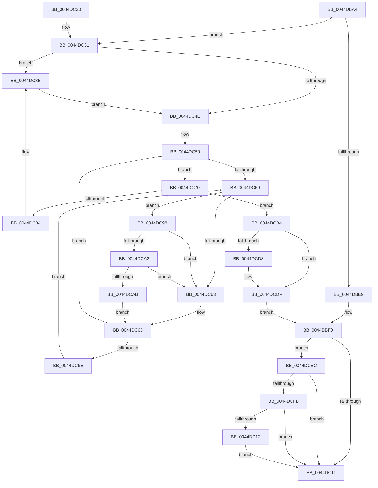

# KeInitializeMutantEx

- RVA: `0x0044DBA4`–`0x0044DD1B` (길이 `375` bytes)
- VA: `0x000000014044DBA4`
- 실행 섹션: `.text`
- PDB 이름 있음: `예`; PDB Function 태그: `아니요`
- unwind 정보 RVA: `0x000A69D0`
- 디코드: `104`개 명령, `375/375` bytes 표시
- 미해석 바이트: `0` (있으면 어셈블리에 `.byte`로 보존)

> 이 문서는 커널 이미지의 기계어와 PDB 기호를 분석해 생성했습니다. 4번과 5번은 함수 원형과 자료형을 바이너리 사용 방식에서 추정한 C 해석이며 원본 소스 복구 결과는 아닙니다.

## 1. Dependencies

- 직접 호출 지점: **5**; 고유 호출 대상: **5**
- 직접 호출자로 확인된 함수: **1**
- RIP 상대 이미지 참조: **3**

### Outgoing calls
- `0x0044DC91` → [KiRaiseIrqlProcessIrqlFlags](../4F/KiRaiseIrqlProcessIrqlFlags_function_004F56FC.md) (function, `0x004F56FC`)
- `0x0044DCA2` → [KiCheckVpBackingLongSpinWaitHypercall](../30/KiCheckVpBackingLongSpinWaitHypercall_function_0030F490.md) (function, `0x0030F490`)
- `0x0044DCAD` → [HvlNotifyLongSpinWait](../30/HvlNotifyLongSpinWait_function_0030F460.md) (function, `0x0030F460`)
- `0x0044DCDA` → [KiLowerIrqlProcessIrqlFlags](../4F/KiLowerIrqlProcessIrqlFlags_function_004F5698.md) (function, `0x004F5698`)
- `0x0044DD04` → [KeAbPreAcquire](../21/KeAbPreAcquire_function_00210230.md) (function, `0x00210230`)

### Direct callers
- [NtCreateMutant](../../page/8C/NtCreateMutant_function_008C43D0.md) at `0x008C45A5`

### Static image references
- `0x0044DC46` → RVA `0x00FC6D20` (`ALMOSTRO`; read)
- `0x0044DC5B` → RVA `0x00FC52AC` (`ALMOSTRO`; reference)
- `0x0044DC98` → RVA `0x00FC6AB8` (`ALMOSTRO`; read)

## 2. Other-region calls and transfers

- 다른 실행 섹션으로 향하는 call: **0**
- 별도 외부 분기/꼬리 이동을 확인하지 못했습니다.

## 3. Assembly (complete function range)

```asm
0044DBA4  48 8B C4                        mov rax, rsp
0044DBA7  48 89 58 08                     mov qword ptr [rax + 8], rbx
0044DBAB  48 89 68 10                     mov qword ptr [rax + 0x10], rbp
0044DBAF  48 89 70 18                     mov qword ptr [rax + 0x18], rsi
0044DBB3  48 89 78 20                     mov qword ptr [rax + 0x20], rdi
0044DBB7  41 55                           push r13
0044DBB9  41 56                           push r14
0044DBBB  41 57                           push r15
0044DBBD  48 83 EC 20                     sub rsp, 0x20
0044DBC1  33 C0                           xor eax, eax
0044DBC3  0F 57 C0                        xorps xmm0, xmm0
0044DBC6  45 8B F8                        mov r15d, r8d
0044DBC9  44 8A F2                        mov r14b, dl
0044DBCC  48 8B D9                        mov rbx, rcx
0044DBCF  0F 11 01                        movups xmmword ptr [rcx], xmm0
0044DBD2  44 8D 68 02                     lea r13d, [rax + 2]
0044DBD6  0F 11 41 10                     movups xmmword ptr [rcx + 0x10], xmm0
0044DBDA  0F 11 41 20                     movups xmmword ptr [rcx + 0x20], xmm0
0044DBDE  48 89 41 30                     mov qword ptr [rcx + 0x30], rax
0044DBE2  44 88 29                        mov byte ptr [rcx], r13b
0044DBE5  84 D2                           test dl, dl
0044DBE7  75 48                           jne 0x14044dc31
0044DBE9  C7 41 04 01 00 00 00            mov dword ptr [rcx + 4], 1
0044DBF0  48 8D 43 08                     lea rax, [rbx + 8]
0044DBF4  48 89 40 08                     mov qword ptr [rax + 8], rax
0044DBF8  48 89 00                        mov qword ptr [rax], rax
0044DBFB  8A 43 30                        mov al, byte ptr [rbx + 0x30]
0044DBFE  24 FE                           and al, 0xfe
0044DC00  C6 43 31 00                     mov byte ptr [rbx + 0x31], 0
0044DC04  88 43 30                        mov byte ptr [rbx + 0x30], al
0044DC07  41 F6 C7 01                     test r15b, 1
0044DC0B  0F 85 DB 00 00 00               jne 0x14044dcec
0044DC11  48 8B 5C 24 40                  mov rbx, qword ptr [rsp + 0x40]
0044DC16  48 8B 6C 24 48                  mov rbp, qword ptr [rsp + 0x48]
0044DC1B  48 8B 74 24 50                  mov rsi, qword ptr [rsp + 0x50]
0044DC20  48 8B 7C 24 58                  mov rdi, qword ptr [rsp + 0x58]
0044DC25  48 83 C4 20                     add rsp, 0x20
0044DC29  41 5F                           pop r15
0044DC2B  41 5E                           pop r14
0044DC2D  41 5D                           pop r13
0044DC2F  C3                              ret
0044DC30  CC                              int3
0044DC31  65 48 8B 3C 25 88 01 00 00      mov rdi, qword ptr gs:[0x188]
0044DC3A  48 89 79 28                     mov qword ptr [rcx + 0x28], rdi
0044DC3E  44 0F 20 C5                     mov rbp, cr8
0044DC42  45 0F 22 C5                     mov cr8, r13
0044DC46  39 05 D4 90 B7 00               cmp dword ptr [rip + 0xb790d4], eax
0044DC4C  75 3D                           jne 0x14044dc8b
0044DC4E  33 F6                           xor esi, esi
0044DC50  F0 48 0F BA 6F 40 00            lock bts qword ptr [rdi + 0x40], 0
0044DC57  73 17                           jae 0x14044dc70
0044DC59  FF C6                           inc esi
0044DC5B  85 35 4B 76 B7 00               test dword ptr [rip + 0xb7764b], esi
0044DC61  74 35                           je 0x14044dc98
0044DC63  F3 90                           pause
0044DC65  48 8B 47 40                     mov rax, qword ptr [rdi + 0x40]
0044DC69  48 85 C0                        test rax, rax
0044DC6C  74 E2                           je 0x14044dc50
0044DC6E  EB E9                           jmp 0x14044dc59
0044DC70  48 8D 8F 08 03 00 00            lea rcx, [rdi + 0x308]
0044DC77  48 8B 51 08                     mov rdx, qword ptr [rcx + 8]
0044DC7B  48 8D 43 18                     lea rax, [rbx + 0x18]
0044DC7F  48 39 0A                        cmp qword ptr [rdx], rcx
0044DC82  74 30                           je 0x14044dcb4
0044DC84  B9 03 00 00 00                  mov ecx, 3
0044DC89  CD 29                           int 0x29
0044DC8B  41 8A D5                        mov dl, r13b
0044DC8E  40 8A CD                        mov cl, bpl
0044DC91  E8 66 7A 0A 00                  call 0x1404f56fc
0044DC96  EB B6                           jmp 0x14044dc4e
0044DC98  8B 05 1A 8E B7 00               mov eax, dword ptr [rip + 0xb78e1a]
0044DC9E  A8 40                           test al, 0x40
0044DCA0  74 C1                           je 0x14044dc63
0044DCA2  E8 E9 17 EC FF                  call 0x14030f490
0044DCA7  84 C0                           test al, al
0044DCA9  74 B8                           je 0x14044dc63
0044DCAB  8B CE                           mov ecx, esi
0044DCAD  E8 AE 17 EC FF                  call 0x14030f460
0044DCB2  EB B1                           jmp 0x14044dc65
0044DCB4  48 89 08                        mov qword ptr [rax], rcx
0044DCB7  48 89 50 08                     mov qword ptr [rax + 8], rdx
0044DCBB  48 89 02                        mov qword ptr [rdx], rax
0044DCBE  48 89 41 08                     mov qword ptr [rcx + 8], rax
0044DCC2  48 C7 47 40 00 00 00 00         mov qword ptr [rdi + 0x40], 0
0044DCCA  83 3D 4F 90 B7 00 00            cmp dword ptr [rip + 0xb7904f], 0
0044DCD1  74 0C                           je 0x14044dcdf
0044DCD3  44 0F 20 C1                     mov rcx, cr8
0044DCD7  40 8A D5                        mov dl, bpl
0044DCDA  E8 B9 79 0A 00                  call 0x1404f5698
0044DCDF  40 0F B6 C5                     movzx eax, bpl
0044DCE3  44 0F 22 C0                     mov cr8, rax
0044DCE7  E9 04 FF FF FF                  jmp 0x14044dbf0
0044DCEC  41 0A C5                        or al, r13b
0044DCEF  88 43 30                        mov byte ptr [rbx + 0x30], al
0044DCF2  45 84 F6                        test r14b, r14b
0044DCF5  0F 84 16 FF FF FF               je 0x14044dc11
0044DCFB  33 D2                           xor edx, edx
0044DCFD  48 8B CB                        mov rcx, rbx
0044DD00  44 8D 42 01                     lea r8d, [rdx + 1]
0044DD04  E8 27 25 DC FF                  call 0x140210230
0044DD09  48 85 C0                        test rax, rax
0044DD0C  0F 84 FF FE FF FF               je 0x14044dc11
0044DD12  C6 40 0A 01                     mov byte ptr [rax + 0xa], 1
0044DD16  E9 F6 FE FF FF                  jmp 0x14044dc11
```

## 4. C-style interpretation (structured pseudocode)

```c
__int64 __fastcall KeInitializeMutantEx(__int64 a1, unsigned __int8 a2, int a3)
{
    __int64 result;
    __int64 v_rsi;
    __int64 v_rsp;
    unsigned __int64 v_stack_p10;
    unsigned __int64 v_stack_p18;
    unsigned __int64 v_stack_p20;
    unsigned __int64 v_stack_p8;

    *(unsigned __int64 *)(v_rsp + 8) = v_rbx;
    *(unsigned __int64 *)(v_rsp + 16) = v_rbp;
    *(unsigned __int64 *)(v_rsp + 24) = v_rsi;
    *(unsigned __int64 *)(v_rsp + 32) = v_rdi;
    v_rsp = (v_rsp) - (32);
    result = 0;
    *(unsigned __int64 *)(a1) = v_xmm0;
    *(unsigned __int64 *)(a1 + 16) = v_xmm0;
    *(unsigned __int64 *)(a1 + 32) = v_xmm0;
    *(unsigned __int64 *)(a1 + 48) = 0;
    *(unsigned __int8 *)(a1) = (unsigned __int8)(result + 2);
    if (a2 != 0) goto loc_0044DC31;
    *(unsigned int *)(a1 + 4) = 1;
loc_0044DBF0:
    *(unsigned __int64 *)(a1 + 8 + 8) = a1 + 8;
    *(unsigned __int64 *)(a1 + 8) = a1 + 8;
    result = (unsigned __int8)((*(unsigned __int8 *)(a1 + 48)) & (254));
    *(unsigned __int8 *)(a1 + 49) = 0;
    *(unsigned __int8 *)(a1 + 48) = (unsigned __int8)(result);
    if ((((unsigned __int8)((unsigned int)(a3))) & (1)) != 0) goto loc_0044DCEC;
loc_0044DC11:
    v_rsp = (v_rsp) + (32);
    return result;
loc_0044DC31:
    *(unsigned __int64 *)(a1 + 40) = *(unsigned __int64 *)(gs_base + (0 + 392));
    if ((*(unsigned int *)(v_rip + 12030164)) != ((unsigned int)(result))) goto loc_0044DC8B;
loc_0044DC4E:
    v_rsi = 0;
loc_0044DC50:
    if (condition_is_above_or_equal) goto loc_0044DC70;
loc_0044DC59:
    v_rsi = (unsigned int)((v_rsi) + 1);
    if (((*(unsigned int *)(v_rip + 12023371)) & ((unsigned int)(v_rsi))) == 0) goto loc_0044DC98;
loc_0044DC63:
loc_0044DC65:
    if (*(unsigned __int64 *)(*(unsigned __int64 *)(gs_base + (0 + 392)) + 64) == 0) goto loc_0044DC50;
    goto loc_0044DC59;
loc_0044DC70:
    if ((*(unsigned __int64 *)(*(unsigned __int64 *)(*(unsigned __int64 *)(gs_base + (0 + 392)) + 776 + 8))) == (*(unsigned __int64 *)(gs_base + (0 + 392)) + 776)) goto loc_0044DCB4;
loc_0044DC8B:
    result = KiRaiseIrqlProcessIrqlFlags((unsigned __int8)(v_cr8), (unsigned __int8)(result + 2), a3, a4);
    goto loc_0044DC4E;
loc_0044DC98:
    if ((((unsigned __int8)((unsigned int)(*(unsigned int *)(v_rip + 12029466)))) & (64)) == 0) goto loc_0044DC63;
    result = KiCheckVpBackingLongSpinWaitHypercall((unsigned __int8)(v_cr8), (unsigned __int8)(result + 2), a3, a4);
    if ((unsigned __int8)(result) == 0) goto loc_0044DC63;
    result = HvlNotifyLongSpinWait((unsigned int)((unsigned int)(v_rsi)), (unsigned __int8)(result + 2), a3, a4);
    goto loc_0044DC65;
loc_0044DCB4:
    *(unsigned __int64 *)(result) = (unsigned int)((unsigned int)(v_rsi));
    *(unsigned __int64 *)(result + 8) = (unsigned __int8)(result + 2);
    *(unsigned __int64 *)((unsigned __int8)(result + 2)) = result;
    *(unsigned __int64 *)((unsigned int)((unsigned int)(v_rsi)) + 8) = result;
    *(unsigned __int64 *)(*(unsigned __int64 *)(gs_base + (0 + 392)) + 64) = 0;
    if ((*(unsigned int *)(v_rip + 12030031)) != 0) {
        a1 = result + 2;
        a2 = (unsigned __int8)(v_cr8);
        result = KiLowerIrqlProcessIrqlFlags(a1, a2, a3, a4);
    }
    goto loc_0044DBF0;
loc_0044DCEC:
    result = (unsigned __int8)(((unsigned __int8)(v_cr8)) | ((unsigned __int8)(result + 2)));
    *(unsigned __int8 *)(v_stack_p8 + 48) = (unsigned __int8)(result);
    if (a2 == 0) goto loc_0044DC11;
    a2 = 0;
    result = KeAbPreAcquire(v_stack_p8, a2, a2 + 1, a4);
    if (result == 0) goto loc_0044DC11;
    *(unsigned __int8 *)(result + 10) = 1;
    goto loc_0044DC11;
}
```

## 5. (Beta) C Style

```c
int64_t KeInitializeMutantEx(void *Mutant, uint8_t Arg2, int32_t Arg3)
{
    uint8_t *mutant = (uint8_t *)Mutant;

    int64_t result;
    int64_t local_rsi;
    int64_t local_rsp;
    uint64_t v_stack_p10;
    uint64_t v_stack_p18;
    uint64_t v_stack_p20;
    uint64_t v_stack_p8;

    *(uint64_t *)(local_rsp + 0x8) = local_rbx;
    *(uint64_t *)(local_rsp + 0x10) = local_rbp;
    *(uint64_t *)(local_rsp + 0x18) = local_rsi;
    *(uint64_t *)(local_rsp + 0x20) = local_rdi;
    local_rsp = (local_rsp) - (32);
    result = 0;
    *(uint64_t *)(mutant) = v_xmm0;
    *(uint64_t *)(mutant + 0x10) = v_xmm0;
    *(uint64_t *)(mutant + 0x20) = v_xmm0;
    *(uint64_t *)(mutant + 0x30) = 0;
    *(uint8_t *)(mutant) = (uint8_t)(result + 2);
    if (Arg2 != 0) goto loc_0044DC31;
    *(uint32_t *)(mutant + 0x4) = 1;
loc_0044DBF0:
    *(void **)(mutant + 0x8 + 0x8) = Mutant + 8;
    *(void **)(mutant + 0x8) = Mutant + 8;
    result = (uint8_t)((*(uint8_t *)(mutant + 0x30)) & (254));
    *(uint8_t *)(mutant + 0x31) = 0;
    *(uint8_t *)(mutant + 0x30) = (uint8_t)(result);
    if ((((uint8_t)((uint32_t)(Arg3))) & (1)) != 0) goto loc_0044DCEC;
loc_0044DC11:
    local_rsp = (local_rsp) + (32);
    return result;
loc_0044DC31:
    *(uint64_t *)(mutant + 0x28) = *(uint64_t *)(gs_base + (0 + 0x188));
    if ((*(uint32_t *)(v_rip + 0xB790D4)) != ((uint32_t)(result))) goto loc_0044DC8B;
loc_0044DC4E:
    local_rsi = 0;
loc_0044DC50:
    if (condition_is_above_or_equal) goto loc_0044DC70;
loc_0044DC59:
    local_rsi = (uint32_t)((local_rsi) + 1);
    if (((*(uint32_t *)(v_rip + 0xB7764B)) & ((uint32_t)(local_rsi))) == 0) goto loc_0044DC98;
loc_0044DC63:
loc_0044DC65:
    if (*(uint64_t *)(*(uint64_t *)(gs_base + (0 + 0x188)) + 0x40) == 0) goto loc_0044DC50;
    goto loc_0044DC59;
loc_0044DC70:
    if ((*(uint64_t *)(*(uint64_t *)(*(uint64_t *)(gs_base + (0 + 0x188)) + 0x308 + 0x8))) == (*(uint64_t *)(gs_base + (0 + 0x188)) + 776)) goto loc_0044DCB4;
loc_0044DC8B:
    result = KiRaiseIrqlProcessIrqlFlags((uint8_t)(v_cr8), (uint8_t)(result + 2), Arg3, a4);
    goto loc_0044DC4E;
loc_0044DC98:
    if ((((uint8_t)((uint32_t)(*(uint32_t *)(v_rip + 0xB78E1A)))) & (64)) == 0) goto loc_0044DC63;
    result = KiCheckVpBackingLongSpinWaitHypercall((uint8_t)(v_cr8), (uint8_t)(result + 2), Arg3, a4);
    if ((uint8_t)(result) == 0) goto loc_0044DC63;
    result = HvlNotifyLongSpinWait((uint32_t)((uint32_t)(local_rsi)), (uint8_t)(result + 2), Arg3, a4);
    goto loc_0044DC65;
loc_0044DCB4:
    *(uint64_t *)(result) = (uint32_t)((uint32_t)(local_rsi));
    *(uint64_t *)(result + 0x8) = (uint8_t)(result + 2);
    *(uint64_t *)((uint8_t)(result + 0x2)) = result;
    *(uint64_t *)((uint32_t)((uint32_t)(local_rsi)) + 0x8) = result;
    *(uint64_t *)(*(uint64_t *)(gs_base + (0 + 0x188)) + 0x40) = 0;
    if ((*(uint32_t *)(v_rip + 0xB7904F)) != 0) {
        Mutant = result + 2;
        Arg2 = (uint8_t)(v_cr8);
        result = KiLowerIrqlProcessIrqlFlags(Mutant, Arg2, Arg3, a4);
    }
    goto loc_0044DBF0;
loc_0044DCEC:
    result = (uint8_t)(((uint8_t)(v_cr8)) | ((uint8_t)(result + 2)));
    *(uint8_t *)(v_stack_p8 + 0x30) = (uint8_t)(result);
    if (Arg2 == 0) goto loc_0044DC11;
    Arg2 = 0;
    result = KeAbPreAcquire(v_stack_p8, Arg2, Arg2 + 1, a4);
    if (result == 0) goto loc_0044DC11;
    *(uint8_t *)(result + 0xA) = 1;
    goto loc_0044DC11;
}
```

### 관측된 메모리 오프셋

구조체 형식이 확인되지 않은 접근은 인자 기준의 오프셋으로만 기록했습니다.

| 기준 인자 | 오프셋 표현 | 폭 (bit) | 접근 |
|---|---:|---:|---|
| `Mutant` | `+ 0x0` | `8` | `W` |
| `Mutant` | `+ 0x0` | `64` | `W` |
| `Mutant` | `+ 0x0` | `128` | `R` |
| `Mutant` | `+ 0x4` | `32` | `W` |
| `Mutant` | `+ 0x8` | `64` | `R` |
| `Mutant` | `+ 0x8` | `64` | `W` |
| `Mutant` | `+ 0x10` | `128` | `R` |
| `Mutant` | `+ 0x18` | `64` | `R` |
| `Mutant` | `+ 0x20` | `128` | `R` |
| `Mutant` | `+ 0x28` | `64` | `W` |
| `Mutant` | `+ 0x30` | `8` | `R` |
| `Mutant` | `+ 0x30` | `8` | `W` |
| `Mutant` | `+ 0x30` | `64` | `W` |
| `Mutant` | `+ 0x31` | `8` | `W` |

## 6. Execution-region graph

[열기: 2D/3D 그래프와 함수 탐색 컨트롤 패널](../../../control-panel.html?section=text&rva=0x0044DBA4&view=graph)

- 2D 그래프는 위에서 아래로 흐르고, 3D 그래프는 빈 공간을 드래그해 회전합니다. Shift+드래그는 이동, 휠은 확대·축소, 함수 노드 선택은 대상 보고서 이동입니다.

### Static fallback


