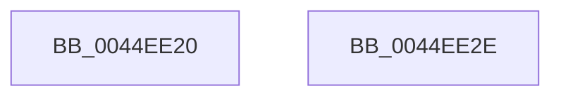

# KeIsRetpolineEnabled

- RVA: `0x0044EE20`–`0x0044EE2F` (길이 `15` bytes)
- VA: `0x000000014044EE20`
- 실행 섹션: `.text`
- PDB 이름 있음: `예`; PDB Function 태그: `아니요`
- unwind 정보 RVA: `0x000DB714`
- 디코드: `5`개 명령, `15/15` bytes 표시
- 미해석 바이트: `0` (있으면 어셈블리에 `.byte`로 보존)

> 이 문서는 커널 이미지의 기계어와 PDB 기호를 분석해 생성했습니다. 4번과 5번은 함수 원형과 자료형을 바이너리 사용 방식에서 추정한 C 해석이며 원본 소스 복구 결과는 아닙니다.

## 1. Dependencies

- 직접 호출 지점: **0**; 고유 호출 대상: **0**
- 직접 호출자로 확인된 함수: **8**
- RIP 상대 이미지 참조: **1**

### Outgoing calls
- 직접 디코드된 call 명령이 없습니다.

### Direct callers
- [MiPerformFixups](../../page/93/MiPerformFixups_function_0093F5F4.md) at `0x0093F904`
- [MiParseImageLoadConfig](../../page/94/MiParseImageLoadConfig_function_00940D18.md) at `0x00941100`
- [MiCaptureRetpolineRelocationTables](../../page/94/MiCaptureRetpolineRelocationTables_function_00942E14.md) at `0x00942FF7`
- [MiCaptureRetpolineRelocationTables](../../page/94/MiCaptureRetpolineRelocationTables_function_00942E14.md) at `0x00943005`
- [MiCaptureRetpolineImportInfo](../../page/A9/MiCaptureRetpolineImportInfo_function_00A9FB00.md) at `0x00A9FB30`
- [MiMarkKernelImageRetpolineBits](../../page/AA/MiMarkKernelImageRetpolineBits_function_00AA0348.md) at `0x00AA0357`
- [MiUnloadSystemImage](../../page/AA/MiUnloadSystemImage_function_00AA2FD4.md) at `0x00AA314B`
- [MmMarkHiberPhase](../../pagelk/B7/MmMarkHiberPhase_function_00B74578.md) at `0x00B746C0`
- [sub_00BF16D0](../../init/BF/Unknown_function_00BF16D0.md) at `0x00BF5977`

### Static image references
- `0x0044EE20` → RVA `0x00FC6B48` (`ALMOSTRO`; read)

## 2. Other-region calls and transfers

- 다른 실행 섹션으로 향하는 call: **0**
- 별도 외부 분기/꼬리 이동을 확인하지 못했습니다.

## 3. Assembly (complete function range)

```asm
0044EE20  48 8B 05 21 7D B7 00            mov rax, qword ptr [rip + 0xb77d21]
0044EE27  48 C1 E8 29                     shr rax, 0x29
0044EE2B  24 01                           and al, 1
0044EE2D  C3                              ret
0044EE2E  CC                              int3
```

## 4. C-style interpretation (structured pseudocode)

```c
__int64 __fastcall KeIsRetpolineEnabled(void)
{
    __int64 result;

    result = (*(unsigned __int64 *)(v_rip + 12025121)) >> (41);
    result = (unsigned __int8)((result) & (1));
    return result;
}
```

## 5. (Beta) C Style

```c
void KeIsRetpolineEnabled(void)
{
    int64_t result;

    result = (*(uint64_t *)(v_rip + 0xB77D21)) >> (41);
    result = (uint8_t)((result) & (1));
    return result;
}
```

## 6. Execution-region graph

[열기: 2D/3D 그래프와 함수 탐색 컨트롤 패널](../../../control-panel.html?section=text&rva=0x0044EE20&view=graph)

- 2D 그래프는 위에서 아래로 흐르고, 3D 그래프는 빈 공간을 드래그해 회전합니다. Shift+드래그는 이동, 휠은 확대·축소, 함수 노드 선택은 대상 보고서 이동입니다.

### Static fallback


