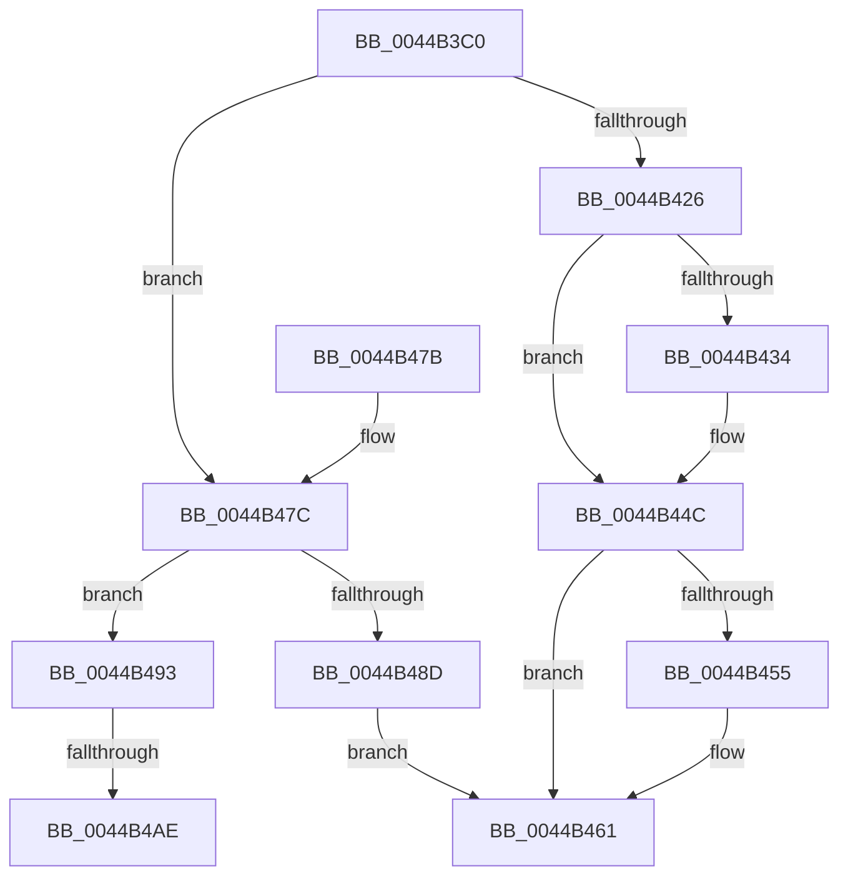

# KePrepareToDispatchVirtualProcessor

- RVA: `0x0044B3C0`–`0x0044B4B7` (길이 `247` bytes)
- VA: `0x000000014044B3C0`
- 실행 섹션: `.text`
- PDB 이름 있음: `예`; PDB Function 태그: `예`
- unwind 정보 RVA: `0x000A6674`
- 디코드: `59`개 명령, `247/247` bytes 표시
- 미해석 바이트: `0` (있으면 어셈블리에 `.byte`로 보존)

> 이 문서는 커널 이미지의 기계어와 PDB 기호를 분석해 생성했습니다. 4번과 5번은 함수 원형과 자료형을 바이너리 사용 방식에서 추정한 C 해석이며 원본 소스 복구 결과는 아닙니다.

## 1. Dependencies

- 직접 호출 지점: **1**; 고유 호출 대상: **1**
- 직접 호출자로 확인된 함수: **0**
- RIP 상대 이미지 참조: **2**

### Outgoing calls
- `0x0044B455` → [KiFlushCurrentRsb](../6C/KiFlushCurrentRsb_function_006C6540.md) (function, `0x006C6540`)

### Direct callers
- 이 함수 시작 RVA로 연결되는 직접 call은 확인되지 않았습니다. 간접 호출은 완전히 역산할 수 없습니다.

### Static image references
- `0x0044B3E2` → RVA `0x00FC6B48` (`ALMOSTRO`; read)
- `0x0044B3F1` → RVA `0x00FC6B58` (`ALMOSTRO`; read)

## 2. Other-region calls and transfers

- 다른 실행 섹션으로 향하는 call: **0**
- call이 아닌 외부 분기/꼬리 이동: **2**
  - `0x0044B4A8` → [sub_006F0C64](../6F/Unknown_function_006F0C64.md) (`tail-transfer`)
  - `0x0044B4B2` → [sub_006F0C64 + 0x43](../6F/Unknown_function_006F0C64.md) (`tail-transfer`)

## 3. Assembly (complete function range)

```asm
0044B3C0  48 89 5C 24 10                  mov qword ptr [rsp + 0x10], rbx
0044B3C5  48 89 6C 24 18                  mov qword ptr [rsp + 0x18], rbp
0044B3CA  56                              push rsi
0044B3CB  57                              push rdi
0044B3CC  41 54                           push r12
0044B3CE  41 56                           push r14
0044B3D0  41 57                           push r15
0044B3D2  48 83 EC 40                     sub rsp, 0x40
0044B3D6  65 48 8B 1C 25 20 00 00 00      mov rbx, qword ptr gs:[0x20]
0044B3DF  4C 8B D2                        mov r10, rdx
0044B3E2  0F 10 05 5F B7 B7 00            movups xmm0, xmmword ptr [rip + 0xb7b75f]
0044B3E9  48 8B B4 24 90 00 00 00         mov rsi, qword ptr [rsp + 0x90]
0044B3F1  F2 0F 10 0D 5F B7 B7 00         movsd xmm1, qword ptr [rip + 0xb7b75f]
0044B3F9  4C 8B B4 24 98 00 00 00         mov r14, qword ptr [rsp + 0x98]
0044B401  C6 02 00                        mov byte ptr [rdx], 0
0044B404  41 C6 00 00                     mov byte ptr [r8], 0
0044B408  41 C6 01 00                     mov byte ptr [r9], 0
0044B40C  C6 06 00                        mov byte ptr [rsi], 0
0044B40F  49 C7 06 00 00 00 00            mov qword ptr [r14], 0
0044B416  0F 11 44 24 20                  movups xmmword ptr [rsp + 0x20], xmm0
0044B41B  F2 0F 11 4C 24 30               movsd qword ptr [rsp + 0x30], xmm1
0044B421  FA                              cli
0044B422  84 C9                           test cl, cl
0044B424  75 56                           jne 0x14044b47c
0044B426  F6 83 D8 06 00 00 04            test byte ptr [rbx + 0x6d8], 4
0044B42D  BF FB FF 00 00                  mov edi, 0xfffb
0044B432  74 18                           je 0x14044b44c
0044B434  B8 01 00 00 00                  mov eax, 1
0044B439  33 D2                           xor edx, edx
0044B43B  B9 49 00 00 00                  mov ecx, 0x49
0044B440  0F 30                           wrmsr
0044B442  66 21 BB D8 06 00 00            and word ptr [rbx + 0x6d8], di
0044B449  41 88 02                        mov byte ptr [r10], al
0044B44C  F6 83 D8 06 00 00 20            test byte ptr [rbx + 0x6d8], 0x20
0044B453  74 0C                           je 0x14044b461
0044B455  E8 E6 B0 27 00                  call 0x1406c6540
0044B45A  66 21 BB D8 06 00 00            and word ptr [rbx + 0x6d8], di
0044B461  48 8B 5C 24 78                  mov rbx, qword ptr [rsp + 0x78]
0044B466  48 8B AC 24 80 00 00 00         mov rbp, qword ptr [rsp + 0x80]
0044B46E  48 83 C4 40                     add rsp, 0x40
0044B472  41 5F                           pop r15
0044B474  41 5E                           pop r14
0044B476  41 5C                           pop r12
0044B478  5F                              pop rdi
0044B479  5E                              pop rsi
0044B47A  C3                              ret
0044B47B  CC                              int3
0044B47C  48 B8 00 00 00 00 10 00 00 00   movabs rax, 0x1000000000
0044B486  48 85 44 24 20                  test qword ptr [rsp + 0x20], rax
0044B48B  75 06                           jne 0x14044b493
0044B48D  41 C6 00 01                     mov byte ptr [r8], 1
0044B491  EB CE                           jmp 0x14044b461
0044B493  48 8B 43 08                     mov rax, qword ptr [rbx + 8]
0044B497  48 8B 88 20 02 00 00            mov rcx, qword ptr [rax + 0x220]
0044B49E  4C 8B A1 60 07 00 00            mov r12, qword ptr [rcx + 0x760]
0044B4A5  4D 85 E4                        test r12, r12
0044B4A8  0F 85 B6 57 2A 00               jne 0x1406f0c64
0044B4AE  41 C6 00 01                     mov byte ptr [r8], 1
0044B4B2  E9 F0 57 2A 00                  jmp 0x1406f0ca7
```

## 4. C-style interpretation (structured pseudocode)

```c
__int64 __fastcall KePrepareToDispatchVirtualProcessor(unsigned __int8 a1, __int64 a2, __int64 a3, __int64 a4, __int64 a5, __int64 a6)
{
    __int64 result;
    __int64 v_rsp;
    unsigned __int64 v_stack_m38;
    unsigned __int64 v_stack_m48;
    unsigned __int64 v_stack_p10;
    unsigned __int64 v_stack_p18;
    unsigned __int64 v_stack_p20;

    v_stack_p10 = v_rbx;
    v_stack_p18 = v_rbp;
    v_rsp = (v_rsp) - (64);
    *(unsigned __int8 *)(a2) = 0;
    *(unsigned __int8 *)(a3) = 0;
    *(unsigned __int8 *)(a4) = 0;
    *(unsigned __int8 *)(a5) = 0;
    *(unsigned __int64 *)(a6) = 0;
    v_stack_m48 = v_xmm0;
    v_stack_m38 = v_xmm1;
    if (a1 != 0) goto loc_0044B47C;
    if (((*(unsigned __int8 *)(*(unsigned __int64 *)(gs_base + (0 + 32)) + 1752)) & (4)) != 0) {
        result = 1;
        a2 = 0;
        a1 = 73;
        *(unsigned __int8 *)(a2) = (unsigned __int8)(result);
    }
    if (((*(unsigned __int8 *)(*(unsigned __int64 *)(gs_base + (0 + 32)) + 1752)) & (32)) != 0) {
        result = KiFlushCurrentRsb(a1, a2, a3, a4);
    }
    v_rsp = (v_rsp) + (64);
    return result;
loc_0044B47C:
    if (((v_stack_p20) & (result)) != 0) goto loc_0044B493;
    *(unsigned __int8 *)(a3) = 1;
    goto loc_0044B461;
loc_0044B493:
    *(unsigned __int8 *)(a3) = 1;
}
```

## 5. (Beta) C Style

```c
int64_t KePrepareToDispatchVirtualProcessor(uint8_t Arg1, void *Arg2, void *Arg3, void *Arg4, void *Arg5, void *Arg6)
{
    uint8_t *arg2 = (uint8_t *)Arg2;
    uint8_t *arg3 = (uint8_t *)Arg3;
    uint8_t *arg4 = (uint8_t *)Arg4;
    uint8_t *arg5 = (uint8_t *)Arg5;
    uint8_t *arg6 = (uint8_t *)Arg6;

    int64_t result;
    int64_t local_rsp;
    uint64_t v_stack_m38;
    uint64_t v_stack_m48;
    uint64_t v_stack_p10;
    uint64_t v_stack_p18;
    uint64_t v_stack_p20;

    v_stack_p10 = local_rbx;
    v_stack_p18 = local_rbp;
    local_rsp = (local_rsp) - (64);
    *(uint8_t *)(arg2) = 0;
    *(uint8_t *)(arg3) = 0;
    *(uint8_t *)(arg4) = 0;
    *(uint8_t *)(arg5) = 0;
    *(uint64_t *)(arg6) = 0;
    v_stack_m48 = v_xmm0;
    v_stack_m38 = v_xmm1;
    if (Arg1 != 0) goto loc_0044B47C;
    if (((*(uint8_t *)(*(uint64_t *)(gs_base + (0 + 0x20)) + 0x6D8)) & (4)) != 0) {
        result = 1;
        Arg2 = 0;
        Arg1 = 73;
        *(uint8_t *)(arg2) = (uint8_t)(result);
    }
    if (((*(uint8_t *)(*(uint64_t *)(gs_base + (0 + 0x20)) + 0x6D8)) & (32)) != 0) {
        result = KiFlushCurrentRsb(Arg1, Arg2, Arg3, Arg4);
    }
    local_rsp = (local_rsp) + (64);
    return result;
loc_0044B47C:
    if (((v_stack_p20) & (result)) != 0) goto loc_0044B493;
    *(uint8_t *)(arg3) = 1;
    goto loc_0044B461;
loc_0044B493:
    *(uint8_t *)(arg3) = 1;
}
```

### 관측된 메모리 오프셋

구조체 형식이 확인되지 않은 접근은 인자 기준의 오프셋으로만 기록했습니다.

| 기준 인자 | 오프셋 표현 | 폭 (bit) | 접근 |
|---|---:|---:|---|
| `Arg2` | `+ 0x0` | `8` | `W` |
| `Arg3` | `+ 0x0` | `8` | `W` |
| `Arg4` | `+ 0x0` | `8` | `W` |
| `Arg5` | `+ 0x0` | `8` | `W` |
| `Arg6` | `+ 0x0` | `64` | `W` |

## 6. Execution-region graph

[열기: 2D/3D 그래프와 함수 탐색 컨트롤 패널](../../../control-panel.html?section=text&rva=0x0044B3C0&view=graph)

- 2D 그래프는 위에서 아래로 흐르고, 3D 그래프는 빈 공간을 드래그해 회전합니다. Shift+드래그는 이동, 휠은 확대·축소, 함수 노드 선택은 대상 보고서 이동입니다.

### Static fallback


