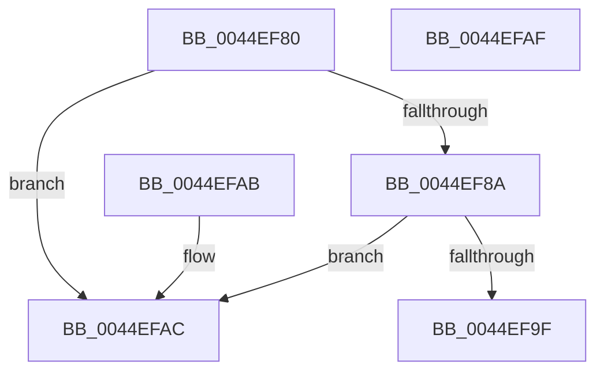

# KeQueryProcessorTaggedCyclesImprecise

- RVA: `0x0044EF80`–`0x0044EFB0` (길이 `48` bytes)
- VA: `0x000000014044EF80`
- 실행 섹션: `.text`
- PDB 이름 있음: `예`; PDB Function 태그: `아니요`
- unwind 정보 RVA: `0x000DB714`
- 디코드: `16`개 명령, `48/48` bytes 표시
- 미해석 바이트: `0` (있으면 어셈블리에 `.byte`로 보존)

> 이 문서는 커널 이미지의 기계어와 PDB 기호를 분석해 생성했습니다. 4번과 5번은 함수 원형과 자료형을 바이너리 사용 방식에서 추정한 C 해석이며 원본 소스 복구 결과는 아닙니다.

## 1. Dependencies

- 직접 호출 지점: **0**; 고유 호출 대상: **0**
- 직접 호출자로 확인된 함수: **0**
- RIP 상대 이미지 참조: **2**

### Outgoing calls
- 직접 디코드된 call 명령이 없습니다.

### Direct callers
- 이 함수 시작 RVA로 연결되는 직접 call은 확인되지 않았습니다. 간접 호출은 완전히 역산할 수 없습니다.

### Static image references
- `0x0044EF80` → RVA `0x00FC6A80` (`ALMOSTRO`; read)
- `0x0044EF8F` → RVA `0x00FC8C40` (`ALMOSTRO`; read)

## 2. Other-region calls and transfers

- 다른 실행 섹션으로 향하는 call: **0**
- 별도 외부 분기/꼬리 이동을 확인하지 못했습니다.

## 3. Assembly (complete function range)

```asm
0044EF80  8B 05 FA 7A B7 00               mov eax, dword ptr [rip + 0xb77afa]
0044EF86  3B C8                           cmp ecx, eax
0044EF88  73 22                           jae 0x14044efac
0044EF8A  0F AE E8                        lfence
0044EF8D  8B C1                           mov eax, ecx
0044EF8F  48 8D 0D AA 9C B7 00            lea rcx, [rip + 0xb79caa]
0044EF96  48 8B 0C C1                     mov rcx, qword ptr [rcx + rax*8]
0044EF9A  48 85 C9                        test rcx, rcx
0044EF9D  74 0D                           je 0x14044efac
0044EF9F  48 63 C2                        movsxd rax, edx
0044EFA2  48 8B 84 C1 88 86 00 00         mov rax, qword ptr [rcx + rax*8 + 0x8688]
0044EFAA  C3                              ret
0044EFAB  CC                              int3
0044EFAC  33 C0                           xor eax, eax
0044EFAE  C3                              ret
0044EFAF  CC                              int3
```

## 4. C-style interpretation (structured pseudocode)

```c
__int64 __fastcall KeQueryProcessorTaggedCyclesImprecise(int a1, int a2)
{
    __int64 result;

    if (a1 >= ((unsigned int)((unsigned int)(*(unsigned int *)(v_rip + 12024570))))) goto loc_0044EFAC;
    if (*(unsigned __int64 *)(v_rip + 12033194 + (unsigned int)(a1) * 8) == 0) goto loc_0044EFAC;
    return *(unsigned __int64 *)(*(unsigned __int64 *)(v_rip + 12033194 + (unsigned int)(a1) * 8) + (int)(a2) * 8 + 34440);
loc_0044EFAC:
    result = 0;
    return result;
}
```

## 5. (Beta) C Style

```c
int64_t KeQueryProcessorTaggedCyclesImprecise(int32_t Arg1, int32_t Arg2)
{
    int64_t result;

    if (Arg1 >= ((uint32_t)((uint32_t)(*(uint32_t *)(v_rip + 0xB77AFA))))) goto loc_0044EFAC;
    if (*(uint64_t *)(v_rip + 0xB79CAA + (uint32_t)(Arg1) * 8) == 0) goto loc_0044EFAC;
    return *(uint64_t *)(*(uint64_t *)(v_rip + 0xB79CAA + (uint32_t)(Arg1) * 8) + (int32_t)(Arg2) * 8 + 0x8688);
loc_0044EFAC:
    result = 0;
    return result;
}
```

## 6. Execution-region graph

[열기: 2D/3D 그래프와 함수 탐색 컨트롤 패널](../../../control-panel.html?section=text&rva=0x0044EF80&view=graph)

- 2D 그래프는 위에서 아래로 흐르고, 3D 그래프는 빈 공간을 드래그해 회전합니다. Shift+드래그는 이동, 휠은 확대·축소, 함수 노드 선택은 대상 보고서 이동입니다.

### Static fallback


