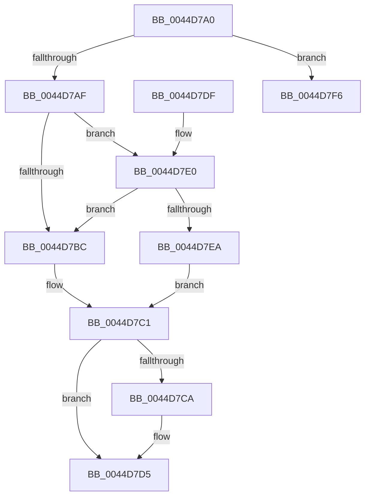

# KeReleaseInterruptSpinLock

- RVA: `0x0044D7A0`–`0x0044D811` (길이 `113` bytes)
- VA: `0x000000014044D7A0`
- 실행 섹션: `.text`
- PDB 이름 있음: `예`; PDB Function 태그: `아니요`
- unwind 정보 RVA: `0x000A69A8`
- 디코드: `32`개 명령, `113/113` bytes 표시
- 미해석 바이트: `0` (있으면 어셈블리에 `.byte`로 보존)

> 이 문서는 커널 이미지의 기계어와 PDB 기호를 분석해 생성했습니다. 4번과 5번은 함수 원형과 자료형을 바이너리 사용 방식에서 추정한 C 해석이며 원본 소스 복구 결과는 아닙니다.

## 1. Dependencies

- 직접 호출 지점: **3**; 고유 호출 대상: **3**
- 직접 호출자로 확인된 함수: **0**
- RIP 상대 이미지 참조: **3**

### Outgoing calls
- `0x0044D7D0` → [KiLowerIrqlProcessIrqlFlags](../4F/KiLowerIrqlProcessIrqlFlags_function_004F5698.md) (function, `0x004F5698`)
- `0x0044D7EF` → [KiReleaseSpinLockInstrumented](../39/KiReleaseSpinLockInstrumented_function_00392EF0.md) (function, `0x00392EF0`)
- `0x0044D80B` → [KeBugCheckEx](../4F/KeBugCheckEx_function_004FD660.md) (function, `0x004FD660`)

### Direct callers
- 이 함수 시작 RVA로 연결되는 직접 call은 확인되지 않았습니다. 간접 호출은 완전히 역산할 수 없습니다.

### Static image references
- `0x0044D7AF` → RVA `0x00FC6B06` (`ALMOSTRO`; read)
- `0x0044D7C1` → RVA `0x00FC6D20` (`ALMOSTRO`; read)
- `0x0044D7E0` → RVA `0x00F0DE58` (`.data`; read)

## 2. Other-region calls and transfers

- 다른 실행 섹션으로 향하는 call: **0**
- 별도 외부 분기/꼬리 이동을 확인하지 못했습니다.

## 3. Assembly (complete function range)

```asm
0044D7A0  40 53                           push rbx
0044D7A2  48 83 EC 30                     sub rsp, 0x30
0044D7A6  80 79 5D 00                     cmp byte ptr [rcx + 0x5d], 0
0044D7AA  0F B6 DA                        movzx ebx, dl
0044D7AD  74 47                           je 0x14044d7f6
0044D7AF  F6 05 50 93 B7 00 01            test byte ptr [rip + 0xb79350], 1
0044D7B6  48 8B 49 48                     mov rcx, qword ptr [rcx + 0x48]
0044D7BA  75 24                           jne 0x14044d7e0
0044D7BC  F0 48 83 21 00                  lock and qword ptr [rcx], 0
0044D7C1  83 3D 58 95 B7 00 00            cmp dword ptr [rip + 0xb79558], 0
0044D7C8  74 0B                           je 0x14044d7d5
0044D7CA  44 0F 20 C1                     mov rcx, cr8
0044D7CE  8A D3                           mov dl, bl
0044D7D0  E8 C3 7E 0A 00                  call 0x1404f5698
0044D7D5  44 0F 22 C3                     mov cr8, rbx
0044D7D9  48 83 C4 30                     add rsp, 0x30
0044D7DD  5B                              pop rbx
0044D7DE  C3                              ret
0044D7DF  CC                              int3
0044D7E0  8B 05 72 06 AC 00               mov eax, dword ptr [rip + 0xac0672]
0044D7E6  85 C0                           test eax, eax
0044D7E8  75 D2                           jne 0x14044d7bc
0044D7EA  48 8B 54 24 38                  mov rdx, qword ptr [rsp + 0x38]
0044D7EF  E8 FC 56 F4 FF                  call 0x140392ef0
0044D7F4  EB CB                           jmp 0x14044d7c1
0044D7F6  48 83 64 24 20 00               and qword ptr [rsp + 0x20], 0
0044D7FC  45 33 C9                        xor r9d, r9d
0044D7FF  4C 8B C1                        mov r8, rcx
0044D802  B9 3B 01 00 00                  mov ecx, 0x13b
0044D807  41 8D 51 01                     lea edx, [r9 + 1]
0044D80B  E8 50 FE 0A 00                  call 0x1404fd660
0044D810  CC                              int3
```

## 4. C-style interpretation (structured pseudocode)

```c
__int64 __fastcall KeReleaseInterruptSpinLock(__int64 a1, unsigned __int8 a2, __int64 a3, int a4)
{
    __int64 result;
    __int64 v_rsp;
    unsigned __int64 v_stack_p20;
    unsigned __int64 v_stack_p38;

    v_rsp = (v_rsp) - (48);
    if ((*(unsigned __int8 *)(a1 + 93)) == 0) goto loc_0044D7F6;
    if (((*(unsigned __int8 *)(v_rip + 12030800)) & (1)) != 0) goto loc_0044D7E0;
loc_0044D7BC:
loc_0044D7C1:
    if ((*(unsigned int *)(v_rip + 12031320)) != 0) {
        a1 = v_cr8;
        a2 = a2;
        result = KiLowerIrqlProcessIrqlFlags(a1, a2, a3, a4);
    }
    v_rsp = (v_rsp) + (48);
    return result;
loc_0044D7E0:
    if ((unsigned int)((unsigned int)(*(unsigned int *)(v_rip + 11273842))) != 0) goto loc_0044D7BC;
    result = KiReleaseSpinLockInstrumented(a1, v_stack_p38, a3, a4);
    goto loc_0044D7C1;
loc_0044D7F6:
    a4 = 0;
    result = KeBugCheckEx(315, a4 + 1, a1, a4);
    return result;
}
```

## 5. (Beta) C Style

```c
int64_t KeReleaseInterruptSpinLock(void *Arg1, uint8_t Arg2, int64_t Arg3, int32_t Arg4)
{
    uint8_t *arg1 = (uint8_t *)Arg1;

    int64_t result;
    int64_t local_rsp;
    uint64_t v_stack_p20;
    uint64_t v_stack_p38;

    local_rsp = (local_rsp) - (48);
    if ((*(uint8_t *)(arg1 + 0x5D)) == 0) goto loc_0044D7F6;
    if (((*(uint8_t *)(v_rip + 0xB79350)) & (1)) != 0) goto loc_0044D7E0;
loc_0044D7BC:
loc_0044D7C1:
    if ((*(uint32_t *)(v_rip + 0xB79558)) != 0) {
        Arg1 = v_cr8;
        Arg2 = Arg2;
        result = KiLowerIrqlProcessIrqlFlags(Arg1, Arg2, Arg3, Arg4);
    }
    local_rsp = (local_rsp) + (48);
    return result;
loc_0044D7E0:
    if ((uint32_t)((uint32_t)(*(uint32_t *)(v_rip + 0xAC0672))) != 0) goto loc_0044D7BC;
    result = KiReleaseSpinLockInstrumented(Arg1, v_stack_p38, Arg3, Arg4);
    goto loc_0044D7C1;
loc_0044D7F6:
    Arg4 = 0;
    result = KeBugCheckEx(315, Arg4 + 1, Arg1, Arg4);
    return result;
}
```

### 관측된 메모리 오프셋

구조체 형식이 확인되지 않은 접근은 인자 기준의 오프셋으로만 기록했습니다.

| 기준 인자 | 오프셋 표현 | 폭 (bit) | 접근 |
|---|---:|---:|---|
| `Arg1` | `+ 0x48` | `64` | `R` |
| `Arg1` | `+ 0x5D` | `8` | `R` |

## 6. Execution-region graph

[열기: 2D/3D 그래프와 함수 탐색 컨트롤 패널](../../../control-panel.html?section=text&rva=0x0044D7A0&view=graph)

- 2D 그래프는 위에서 아래로 흐르고, 3D 그래프는 빈 공간을 드래그해 회전합니다. Shift+드래그는 이동, 휠은 확대·축소, 함수 노드 선택은 대상 보고서 이동입니다.

### Static fallback


