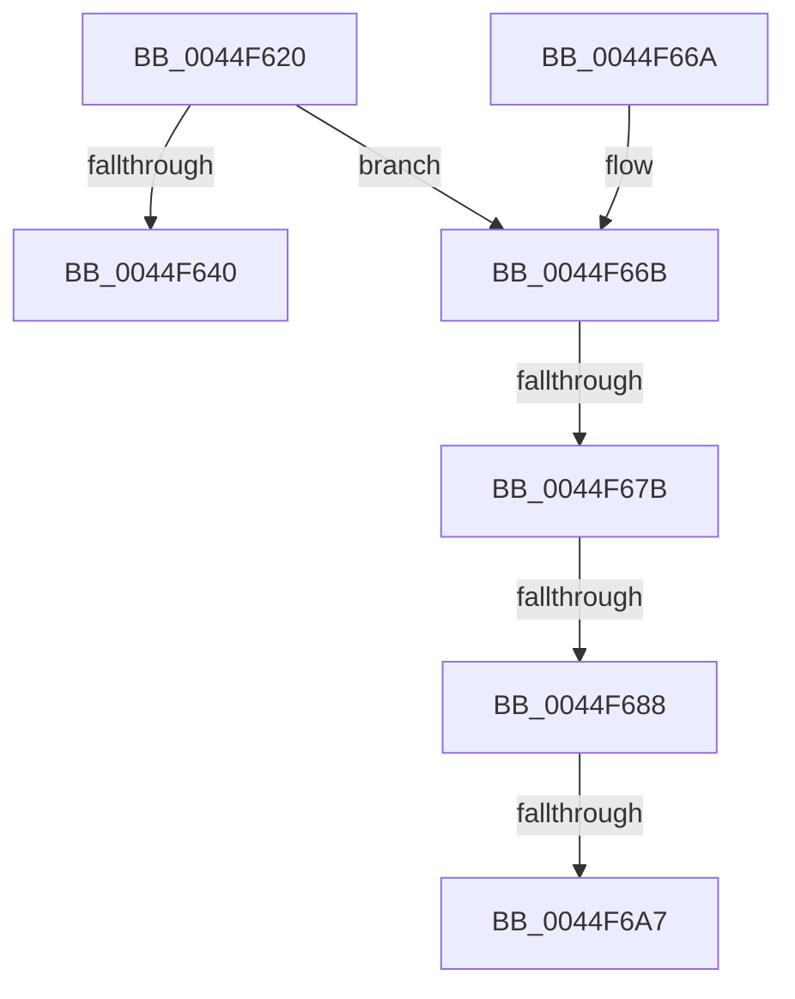

# KeStallExecutionProcessor

- RVA: `0x0044F620`–`0x0044F6B2` (길이 `146` bytes)
- VA: `0x000000014044F620`
- 실행 섹션: `.text`
- PDB 이름 있음: `예`; PDB Function 태그: `예`
- unwind 정보 RVA: `0x000A6C8C`
- 디코드: `36`개 명령, `146/146` bytes 표시
- 미해석 바이트: `0` (있으면 어셈블리에 `.byte`로 보존)

> 이 문서는 커널 이미지의 기계어와 PDB 기호를 분석해 생성했습니다. 4번과 5번은 함수 원형과 자료형을 바이너리 사용 방식에서 추정한 C 해석이며 원본 소스 복구 결과는 아닙니다.

## 1. Dependencies

- 직접 호출 지점: **3**; 고유 호출 대상: **3**
- 직접 호출자로 확인된 함수: **30**
- RIP 상대 이미지 참조: **4**

### Outgoing calls
- `0x0044F650` → [HalpTimerStallExecutionProcessor](../20/HalpTimerStallExecutionProcessor_function_00208F60.md) (function, `0x00208F60`)
- `0x0044F68B` → [HalpTimerGetInternalData](../20/HalpTimerGetInternalData_function_00209500.md) (function, `0x00209500`)
- `0x0044F6A7` → [HalpHvCounterQueryCounter](../37/HalpHvCounterQueryCounter_function_00378F50.md) (function, `0x00378F50`)

### Direct callers
- [PpmIdleSelectStates](../2C/PpmIdleSelectStates_function_002CFFE8.md) at `0x002D0421`
- [KeFreezeExecution](../4D/KeFreezeExecution_function_004DFA40.md) at `0x004DFB11`
- [KeFreezeExecution](../4D/KeFreezeExecution_function_004DFA40.md) at `0x004DFC99`
- [AccelpWaitForCompletionBusySpin](../4F/AccelpWaitForCompletionBusySpin_function_004FB194.md) at `0x004FB1C7`
- [HalpInterruptResetThisProcessor](../54/HalpInterruptResetThisProcessor_function_00543930.md) at `0x0054399F`
- [HalpInterruptResetThisProcessor](../54/HalpInterruptResetThisProcessor_function_00543930.md) at `0x00543A20`
- [HalpInterruptWaitForProcessorStartUp](../54/HalpInterruptWaitForProcessorStartUp_function_00543B6C.md) at `0x00543BA3`
- [HalpPowerWriteResetCommand](../54/HalpPowerWriteResetCommand_function_00546744.md) at `0x00546788`
- [HalpPowerWriteResetCommand](../54/HalpPowerWriteResetCommand_function_00546744.md) at `0x005467DC`
- [HalpPowerWriteResetCommand](../54/HalpPowerWriteResetCommand_function_00546744.md) at `0x00546822`
- [HalpPowerWriteResetCommand](../54/HalpPowerWriteResetCommand_function_00546744.md) at `0x00546840`
- [HalpTimerInitializeClock](../54/HalpTimerInitializeClock_function_00548424.md) at `0x00548584`
- [HalpTimerMeasureFrequencies](../54/HalpTimerMeasureFrequencies_function_005493C0.md) at `0x00549440`
- [HalpTimerTestHypervisorTimer](../54/HalpTimerTestHypervisorTimer_function_0054BBC0.md) at `0x0054BCE7`
- [HalpTimerMeasureProcessorsWorker](../54/HalpTimerMeasureProcessorsWorker_function_0054D910.md) at `0x0054D9BC`
- [HalpNmiReboot](../55/HalpNmiReboot_function_0055B2D4.md) at `0x0055B39A`
- [HalpUsbLegacyStopOhciInterrupt](../56/HalpUsbLegacyStopOhciInterrupt_function_00563AA0.md) at `0x00563B7A`
- [HalpUsbLegacyStopUhciInterrupt](../56/HalpUsbLegacyStopUhciInterrupt_function_00563BD4.md) at `0x00563C71`
- [HalpApicStartProcessor](../56/HalpApicStartProcessor_function_0056A6B0.md) at `0x0056A6D7`
- [HalpApicStartProcessor](../56/HalpApicStartProcessor_function_0056A6B0.md) at `0x0056A70C`
- [HalpApicStartProcessor](../56/HalpApicStartProcessor_function_0056A6B0.md) at `0x0056A729`
- [HalpApicStartProcessor](../56/HalpApicStartProcessor_function_0056A6B0.md) at `0x0056A752`
- [HalpApicStartProcessor](../56/HalpApicStartProcessor_function_0056A6B0.md) at `0x0056A768`
- [HalpApicStartProcessor](../56/HalpApicStartProcessor_function_0056A6B0.md) at `0x0056A782`
- [IvtUpdateGlobalCommand](../57/IvtUpdateGlobalCommand_function_00572854.md) at `0x005728B1`
- [HsaGetPageFault](../57/HsaGetPageFault_function_005742E0.md) at `0x005743CE`
- [HvlPrepareForRootCrashdump](../58/HvlPrepareForRootCrashdump_function_00588F84.md) at `0x00588FBB`
- [IoWriteCrashDump](../59/IoWriteCrashDump_function_005936D8.md) at `0x00593DAE`
- [KcsanValidateAddress](../5A/KcsanValidateAddress_function_005AF5E0.md) at `0x005AF822`
- [KeBugCheck2](../5B/KeBugCheck2_function_005B27D0.md) at `0x005B351E`
- [KiBugCheckRecoveryFreezeOtherProcessors](../5C/KiBugCheckRecoveryFreezeOtherProcessors_function_005C7120.md) at `0x005C727C`
- [KiBugCheckRecoveryFreezeOtherProcessors](../5C/KiBugCheckRecoveryFreezeOtherProcessors_function_005C7120.md) at `0x005C72FC`
- [KiMcheckAlternateReturn](../5C/KiMcheckAlternateReturn_function_005CB180.md) at `0x005CB43D`
- [ExpWaitForBootDevices](../65/ExpWaitForBootDevices_function_00657D90.md) at `0x00657E40`
- [BgpFwDisplayBugCheckProgressUpdate](../6A/BgpFwDisplayBugCheckProgressUpdate_function_006A0E1C.md) at `0x006A0F57`
- [BgpFwDisplayBugCheckScreen](../6A/BgpFwDisplayBugCheckScreen_function_006A0FE8.md) at `0x006A12DB`
- [BgpFwDisplayBugCheckScreenModernized](../6A/BgpFwDisplayBugCheckScreenModernized_function_006A1338.md) at `0x006A17E3`
- [IpmiLibpDelay](../6A/IpmiLibpDelay_function_006A6E04.md) at `0x006A6E39`
- [InbvPortPutByte](../6A/InbvPortPutByte_function_006A8350.md) at `0x006A83A2`
- [IvtInitializeIommu](../../pagelk/B6/IvtInitializeIommu_function_00B61FE0.md) at `0x00B62822`
- [HdlspBugCheckProcessing](../../pagehdls/BB/HdlspBugCheckProcessing_function_00BBD1F8.md) at `0x00BBD28F`

### Static image references
- `0x0044F634` → RVA `0x00FC4060` (`.data`; read)
- `0x0044F640` → RVA `0x00FC4100` (`.data`; read)
- `0x0044F66B` → RVA `0x00FC4140` (`.data`; read)
- `0x0044F694` → RVA `0x00378F50` (`HalpHvCounterQueryCounter`; read)

## 2. Other-region calls and transfers

- 다른 실행 섹션으로 향하는 call: **0**
- call이 아닌 외부 분기/꼬리 이동: **4**
  - `0x0044F675` → [sub_006F11D4 + 0xBF](../6F/Unknown_function_006F11D4.md) (`tail-transfer`)
  - `0x0044F682` → [sub_006F11D4](../6F/Unknown_function_006F11D4.md) (`tail-transfer`)
  - `0x0044F6A1` → [sub_006F11D4 + 0xB0](../6F/Unknown_function_006F11D4.md) (`tail-transfer`)
  - `0x0044F6AD` → [sub_006F11D4 + 0xB8](../6F/Unknown_function_006F11D4.md) (`tail-transfer`)

## 3. Assembly (complete function range)

```asm
0044F620  48 89 5C 24 08                  mov qword ptr [rsp + 8], rbx
0044F625  48 89 6C 24 10                  mov qword ptr [rsp + 0x10], rbp
0044F62A  48 89 74 24 18                  mov qword ptr [rsp + 0x18], rsi
0044F62F  57                              push rdi
0044F630  48 83 EC 20                     sub rsp, 0x20
0044F634  8B 05 26 4A B7 00               mov eax, dword ptr [rip + 0xb74a26]
0044F63A  8B F1                           mov esi, ecx
0044F63C  85 C0                           test eax, eax
0044F63E  75 2B                           jne 0x14044f66b
0044F640  48 8B 0D B9 4A B7 00            mov rcx, qword ptr [rip + 0xb74ab9]
0044F647  8D 04 B6                        lea eax, [rsi + rsi*4]
0044F64A  8D 14 00                        lea edx, [rax + rax]
0044F64D  41 B0 01                        mov r8b, 1
0044F650  E8 0B 99 DB FF                  call 0x140208f60
0044F655  48 8B 5C 24 30                  mov rbx, qword ptr [rsp + 0x30]
0044F65A  48 8B 6C 24 38                  mov rbp, qword ptr [rsp + 0x38]
0044F65F  48 8B 74 24 40                  mov rsi, qword ptr [rsp + 0x40]
0044F664  48 83 C4 20                     add rsp, 0x20
0044F668  5F                              pop rdi
0044F669  C3                              ret
0044F66A  CC                              int3
0044F66B  48 8B 3D CE 4A B7 00            mov rdi, qword ptr [rip + 0xb74ace]
0044F672  48 85 FF                        test rdi, rdi
0044F675  0F 84 18 1C 2A 00               je 0x1406f1293
0044F67B  83 BF DC 00 00 00 40            cmp dword ptr [rdi + 0xdc], 0x40
0044F682  0F 85 4C 1B 2A 00               jne 0x1406f11d4
0044F688  48 8B CF                        mov rcx, rdi
0044F68B  E8 70 9E DB FF                  call 0x140209500
0044F690  48 8B 57 70                     mov rdx, qword ptr [rdi + 0x70]
0044F694  48 8D 0D B5 98 F2 FF            lea rcx, [rip - 0xd674b]
0044F69B  48 3B D1                        cmp rdx, rcx
0044F69E  48 8B C8                        mov rcx, rax
0044F6A1  0F 85 DD 1B 2A 00               jne 0x1406f1284
0044F6A7  E8 A4 98 F2 FF                  call 0x140378f50
0044F6AC  90                              nop
0044F6AD  E9 DA 1B 2A 00                  jmp 0x1406f128c
```

## 4. C-style interpretation (structured pseudocode)

```c
__int64 __fastcall KeStallExecutionProcessor(int a1)
{
    __int64 result;
    __int64 v_rsp;
    unsigned __int64 v_stack_p10;
    unsigned __int64 v_stack_p18;
    unsigned __int64 v_stack_p8;

    v_stack_p8 = v_rbx;
    v_stack_p10 = v_rbp;
    v_stack_p18 = v_rsi;
    v_rsp = (v_rsp) - (32);
    if ((unsigned int)((unsigned int)(*(unsigned int *)(v_rip + 12012070))) != 0) goto loc_0044F66B;
    result = HalpTimerStallExecutionProcessor(*(unsigned __int64 *)(v_rip + 12012217), (unsigned int)(a1) + (unsigned int)(a1) * 4 + (unsigned int)(a1) + (unsigned int)(a1) * 4 * 1, 1, a4);
    v_rsp = (v_rsp) + (32);
    return result;
loc_0044F66B:
    result = HalpTimerGetInternalData(*(unsigned __int64 *)(v_rip + 12012238), (unsigned int)(a1) + (unsigned int)(a1) * 4 + (unsigned int)(a1) + (unsigned int)(a1) * 4 * 1, 1, a4);
    result = HalpHvCounterQueryCounter(result, *(unsigned __int64 *)(*(unsigned __int64 *)(v_rip + 12012238) + 112), 1, a4);
}
```

## 5. (Beta) C Style

```c
int64_t KeStallExecutionProcessor(void *Arg1)
{
    uint8_t *arg1 = (uint8_t *)Arg1;

    int64_t result;
    int64_t local_rsp;
    uint64_t v_stack_p10;
    uint64_t v_stack_p18;
    uint64_t v_stack_p8;

    v_stack_p8 = local_rbx;
    v_stack_p10 = local_rbp;
    v_stack_p18 = local_rsi;
    local_rsp = (local_rsp) - (32);
    if ((uint32_t)((uint32_t)(*(uint32_t *)(v_rip + 0xB74A26))) != 0) goto loc_0044F66B;
    result = HalpTimerStallExecutionProcessor(*(uint64_t *)(v_rip + 0xB74AB9), (uint32_t)(Arg1) + (uint32_t)(Arg1) * 4 + (uint32_t)(Arg1) + (uint32_t)(Arg1) * 4 * 1, 1, a4);
    local_rsp = (local_rsp) + (32);
    return result;
loc_0044F66B:
    result = HalpTimerGetInternalData(*(uint64_t *)(v_rip + 0xB74ACE), (uint32_t)(Arg1) + (uint32_t)(Arg1) * 4 + (uint32_t)(Arg1) + (uint32_t)(Arg1) * 4 * 1, 1, a4);
    result = HalpHvCounterQueryCounter(result, *(uint64_t *)(*(uint64_t *)(v_rip + 0xB74ACE) + 0x70), 1, a4);
}
```

### 관측된 메모리 오프셋

구조체 형식이 확인되지 않은 접근은 인자 기준의 오프셋으로만 기록했습니다.

| 기준 인자 | 오프셋 표현 | 폭 (bit) | 접근 |
|---|---:|---:|---|
| `Arg1` | `+ 0x0 + rax*1` | `32` | `R` |
| `Arg1` | `+ 0x0 + rsi*4` | `32` | `R` |

## 6. Execution-region graph

[열기: 2D/3D 그래프와 함수 탐색 컨트롤 패널](../../../control-panel.html?section=text&rva=0x0044F620&view=graph)

- 2D 그래프는 위에서 아래로 흐르고, 3D 그래프는 빈 공간을 드래그해 회전합니다. Shift+드래그는 이동, 휠은 확대·축소, 함수 노드 선택은 대상 보고서 이동입니다.

### Static fallback


