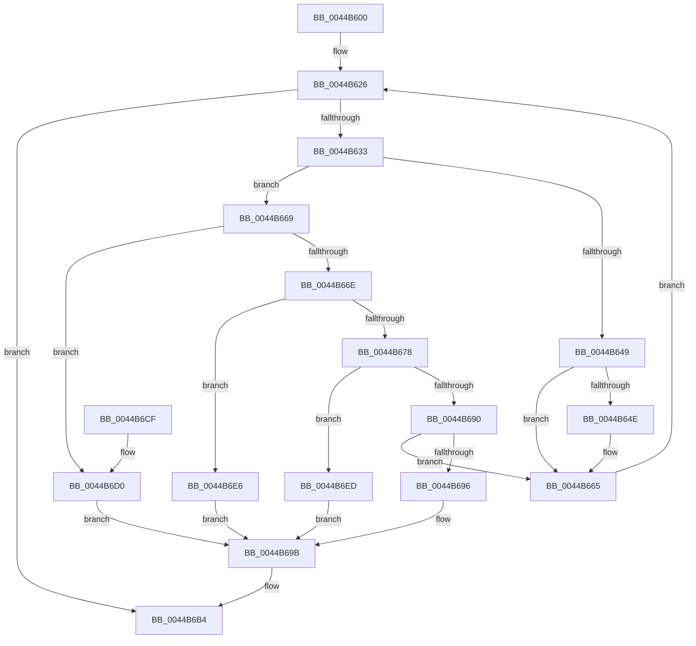

# KiAbCleanupLockEntriesState

- RVA: `0x0044B600`–`0x0044B6F4` (길이 `244` bytes)
- VA: `0x000000014044B600`
- 실행 섹션: `.text`
- PDB 이름 있음: `예`; PDB Function 태그: `아니요`
- unwind 정보 RVA: `0x0008D414`
- 디코드: `71`개 명령, `244/244` bytes 표시
- 미해석 바이트: `0` (있으면 어셈블리에 `.byte`로 보존)

> 이 문서는 커널 이미지의 기계어와 PDB 기호를 분석해 생성했습니다. 4번과 5번은 함수 원형과 자료형을 바이너리 사용 방식에서 추정한 C 해석이며 원본 소스 복구 결과는 아닙니다.

## 1. Dependencies

- 직접 호출 지점: **2**; 고유 호출 대상: **2**
- 직접 호출자로 확인된 함수: **1**
- RIP 상대 이미지 참조: **0**

### Outgoing calls
- `0x0044B660` → [KiAbEntryFreeAndEnableInterrupts](../26/KiAbEntryFreeAndEnableInterrupts_function_002622D0.md) (function, `0x002622D0`)
- `0x0044B6AE` → [KeBugCheckEx](../4F/KeBugCheckEx_function_004FD660.md) (function, `0x004FD660`)

### Direct callers
- [KeCleanupThreadState](KeCleanupThreadState_function_0044B518.md) at `0x0044B5C3`
- [KeCleanupThreadState](KeCleanupThreadState_function_0044B518.md) at `0x0044B5D7`

### Static image references
- 디코드된 RIP-relative 메모리 참조가 없습니다.

## 2. Other-region calls and transfers

- 다른 실행 섹션으로 향하는 call: **0**
- 별도 외부 분기/꼬리 이동을 확인하지 못했습니다.

## 3. Assembly (complete function range)

```asm
0044B600  48 8B C4                        mov rax, rsp
0044B603  48 89 58 08                     mov qword ptr [rax + 8], rbx
0044B607  48 89 68 10                     mov qword ptr [rax + 0x10], rbp
0044B60B  48 89 70 18                     mov qword ptr [rax + 0x18], rsi
0044B60F  48 89 78 20                     mov qword ptr [rax + 0x20], rdi
0044B613  41 56                           push r14
0044B615  48 83 EC 30                     sub rsp, 0x30
0044B619  33 DB                           xor ebx, ebx
0044B61B  48 8B EA                        mov rbp, rdx
0044B61E  4C 8B F1                        mov r14, rcx
0044B621  8B F3                           mov esi, ebx
0044B623  8D 7B 01                        lea edi, [rbx + 1]
0044B626  41 0F B6 46 0C                  movzx eax, byte ptr [r14 + 0xc]
0044B62B  3B F0                           cmp esi, eax
0044B62D  0F 83 81 00 00 00               jae 0x14044b6b4
0044B633  8B C6                           mov eax, esi
0044B635  4C 6B D0 58                     imul r10, rax, 0x58
0044B639  49 83 C2 10                     add r10, 0x10
0044B63D  4D 03 D6                        add r10, r14
0044B640  49 8B 02                        mov rax, qword ptr [r10]
0044B643  41 38 5A 08                     cmp byte ptr [r10 + 8], bl
0044B647  7D 20                           jge 0x14044b669
0044B649  48 85 C0                        test rax, rax
0044B64C  74 17                           je 0x14044b665
0044B64E  FA                              cli
0044B64F  44 8B CF                        mov r9d, edi
0044B652  48 89 5C 24 20                  mov qword ptr [rsp + 0x20], rbx
0044B657  45 33 C0                        xor r8d, r8d
0044B65A  48 8B D5                        mov rdx, rbp
0044B65D  49 8B CA                        mov rcx, r10
0044B660  E8 6B 6C E1 FF                  call 0x1402622d0
0044B665  03 F7                           add esi, edi
0044B667  EB BD                           jmp 0x14044b626
0044B669  48 85 C0                        test rax, rax
0044B66C  75 62                           jne 0x14044b6d0
0044B66E  41 81 7A 08 00 01 00 00         cmp dword ptr [r10 + 8], 0x100
0044B676  73 6E                           jae 0x14044b6e6
0044B678  41 0F B6 42 08                  movzx eax, byte ptr [r10 + 8]
0044B67D  83 E0 3F                        and eax, 0x3f
0044B680  48 6B C8 58                     imul rcx, rax, 0x58
0044B684  49 8B C2                        mov rax, r10
0044B687  48 2B C1                        sub rax, rcx
0044B68A  48 3B 68 F0                     cmp rbp, qword ptr [rax - 0x10]
0044B68E  75 5D                           jne 0x14044b6ed
0044B690  41 39 5A 50                     cmp dword ptr [r10 + 0x50], ebx
0044B694  74 CF                           je 0x14044b665
0044B696  BF 04 00 00 00                  mov edi, 4
0044B69B  4C 8B CF                        mov r9, rdi
0044B69E  48 89 5C 24 20                  mov qword ptr [rsp + 0x20], rbx
0044B6A3  4D 8B C2                        mov r8, r10
0044B6A6  48 8B D5                        mov rdx, rbp
0044B6A9  B9 53 01 00 00                  mov ecx, 0x153
0044B6AE  E8 AD 1F 0B 00                  call 0x1404fd660
0044B6B3  CC                              int3
0044B6B4  48 8B 5C 24 40                  mov rbx, qword ptr [rsp + 0x40]
0044B6B9  48 8B 6C 24 48                  mov rbp, qword ptr [rsp + 0x48]
0044B6BE  48 8B 74 24 50                  mov rsi, qword ptr [rsp + 0x50]
0044B6C3  48 8B 7C 24 58                  mov rdi, qword ptr [rsp + 0x58]
0044B6C8  48 83 C4 30                     add rsp, 0x30
0044B6CC  41 5E                           pop r14
0044B6CE  C3                              ret
0044B6CF  CC                              int3
0044B6D0  49 8B 1A                        mov rbx, qword ptr [r10]
0044B6D3  48 B8 00 00 00 00 00 00 00 80   movabs rax, 0x8000000000000000
0044B6DD  48 83 E3 FC                     and rbx, 0xfffffffffffffffc
0044B6E1  48 0B D8                        or rbx, rax
0044B6E4  EB B5                           jmp 0x14044b69b
0044B6E6  BF 02 00 00 00                  mov edi, 2
0044B6EB  EB AE                           jmp 0x14044b69b
0044B6ED  BF 03 00 00 00                  mov edi, 3
0044B6F2  EB A7                           jmp 0x14044b69b
```

## 4. C-style interpretation (structured pseudocode)

```c
__int64 __fastcall KiAbCleanupLockEntriesState(__int64 a1, __int64 a2, int a3)
{
    __int64 result;
    __int64 v_r10;
    __int64 v_rbx;
    __int64 v_rsi;
    __int64 v_rsp;
    unsigned __int64 v_stack_m18;
    unsigned __int64 v_stack_p10;
    unsigned __int64 v_stack_p18;
    unsigned __int64 v_stack_p20;
    unsigned __int64 v_stack_p8;

    *(unsigned __int64 *)(v_rsp + 8) = v_rbx;
    *(unsigned __int64 *)(v_rsp + 16) = v_rbp;
    *(unsigned __int64 *)(v_rsp + 24) = v_rsi;
    *(unsigned __int64 *)(v_rsp + 32) = v_rdi;
    v_rsp = (v_rsp) - (48);
    v_rbx = 0;
loc_0044B626:
    if (0 >= ((unsigned int)(*(unsigned __int8 *)(a1 + 12)))) goto loc_0044B6B4;
    v_r10 = (v_r10) * (0);
    v_r10 = (v_r10) + (16);
    v_r10 = (v_r10) + (a1);
    if ((*(unsigned __int8 *)(v_r10 + 8)) >= 0) goto loc_0044B669;
    result = *(unsigned __int64 *)(v_r10);
    if (*(unsigned __int64 *)(v_r10) != 0) {
        a4 = (unsigned int)(v_rbx + 1);
        v_stack_m18 = 0;
        a3 = 0;
        a2 = a2;
        a1 = v_r10;
        result = KiAbEntryFreeAndEnableInterrupts(a1, a2, a3, a4);
    }
    v_rsi = (unsigned int)((0) + ((unsigned int)(v_rbx + 1)));
    goto loc_0044B626;
loc_0044B669:
    if (result != 0) goto loc_0044B6D0;
    if ((*(unsigned int *)(v_r10 + 8)) >= 256) goto loc_0044B6E6;
    result = (unsigned int)((*(unsigned __int8 *)(v_r10 + 8)) & (63));
    a1 = (a1) * (result);
    result = (v_r10) - (a1);
    if (a2 != (*(unsigned __int64 *)(result - 16))) goto loc_0044B6ED;
    if ((*(unsigned int *)(v_r10 + 80)) == 0) goto loc_0044B665;
loc_0044B69B:
    v_stack_m18 = 0;
    result = KeBugCheckEx(339, a2, v_r10, 4);
loc_0044B6B4:
    v_rsp = (v_rsp) + (48);
    return result;
loc_0044B6D0:
    v_rbx = (*(unsigned __int64 *)(v_r10)) & (-4);
    v_rbx = (v_rbx) | (result);
    goto loc_0044B69B;
loc_0044B6E6:
    goto loc_0044B69B;
loc_0044B6ED:
    goto loc_0044B69B;
}
```

## 5. (Beta) C Style

```c
int64_t KiAbCleanupLockEntriesState(void *Arg1, int64_t Arg2, int32_t Arg3)
{
    uint8_t *arg1 = (uint8_t *)Arg1;

    int64_t result;
    int64_t local_r10;
    int64_t local_rbx;
    int64_t local_rsi;
    int64_t local_rsp;
    uint64_t v_stack_m18;
    uint64_t v_stack_p10;
    uint64_t v_stack_p18;
    uint64_t v_stack_p20;
    uint64_t v_stack_p8;

    *(uint64_t *)(local_rsp + 0x8) = local_rbx;
    *(uint64_t *)(local_rsp + 0x10) = local_rbp;
    *(uint64_t *)(local_rsp + 0x18) = local_rsi;
    *(uint64_t *)(local_rsp + 0x20) = local_rdi;
    local_rsp = (local_rsp) - (48);
    local_rbx = 0;
loc_0044B626:
    if (0 >= ((uint32_t)(*(uint8_t *)(arg1 + 0xC)))) goto loc_0044B6B4;
    local_r10 = (local_r10) * (0);
    local_r10 = (local_r10) + (16);
    local_r10 = (local_r10) + (Arg1);
    if ((*(uint8_t *)(local_r10 + 0x8)) >= 0) goto loc_0044B669;
    result = *(uint64_t *)(local_r10);
    if (*(uint64_t *)(local_r10) != 0) {
        a4 = (uint32_t)(local_rbx + 1);
        v_stack_m18 = 0;
        Arg3 = 0;
        Arg2 = Arg2;
        Arg1 = local_r10;
        result = KiAbEntryFreeAndEnableInterrupts(Arg1, Arg2, Arg3, a4);
    }
    local_rsi = (uint32_t)((0) + ((uint32_t)(local_rbx + 1)));
    goto loc_0044B626;
loc_0044B669:
    if (result != 0) goto loc_0044B6D0;
    if ((*(uint32_t *)(local_r10 + 0x8)) >= 256) goto loc_0044B6E6;
    result = (uint32_t)((*(uint8_t *)(local_r10 + 0x8)) & (63));
    Arg1 = (Arg1) * (result);
    result = (local_r10) - (Arg1);
    if (Arg2 != (*(uint64_t *)(result - 0x10))) goto loc_0044B6ED;
    if ((*(uint32_t *)(local_r10 + 0x50)) == 0) goto loc_0044B665;
loc_0044B69B:
    v_stack_m18 = 0;
    result = KeBugCheckEx(339, Arg2, local_r10, 4);
loc_0044B6B4:
    local_rsp = (local_rsp) + (48);
    return result;
loc_0044B6D0:
    local_rbx = (*(uint64_t *)(local_r10)) & (-4);
    local_rbx = (local_rbx) | (result);
    goto loc_0044B69B;
loc_0044B6E6:
    goto loc_0044B69B;
loc_0044B6ED:
    goto loc_0044B69B;
}
```

### 관측된 메모리 오프셋

구조체 형식이 확인되지 않은 접근은 인자 기준의 오프셋으로만 기록했습니다.

| 기준 인자 | 오프셋 표현 | 폭 (bit) | 접근 |
|---|---:|---:|---|
| `Arg1` | `+ 0xC` | `8` | `R` |

## 6. Execution-region graph

[열기: 2D/3D 그래프와 함수 탐색 컨트롤 패널](../../../control-panel.html?section=text&rva=0x0044B600&view=graph)

- 2D 그래프는 위에서 아래로 흐르고, 3D 그래프는 빈 공간을 드래그해 회전합니다. Shift+드래그는 이동, 휠은 확대·축소, 함수 노드 선택은 대상 보고서 이동입니다.

### Static fallback


