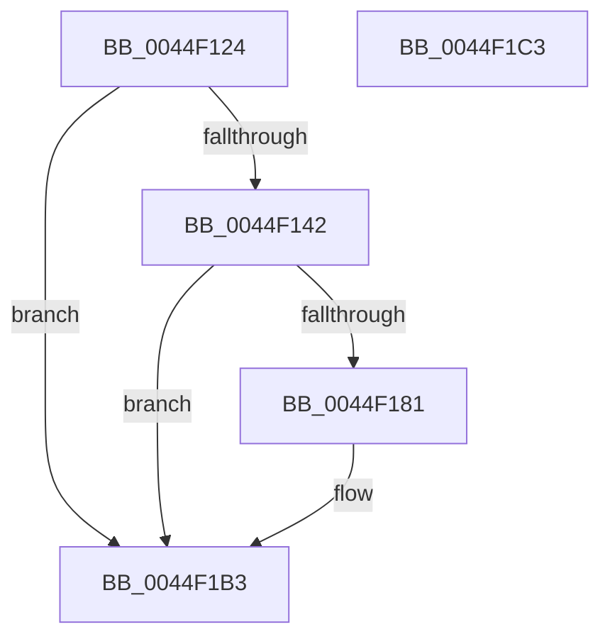

# KiDpcWatchdogCaptureStack

- RVA: `0x0044F124`–`0x0044F1C4` (길이 `160` bytes)
- VA: `0x000000014044F124`
- 실행 섹션: `.text`
- PDB 이름 있음: `예`; PDB Function 태그: `아니요`
- unwind 정보 RVA: `0x00060BC4`
- 디코드: `40`개 명령, `160/160` bytes 표시
- 미해석 바이트: `0` (있으면 어셈블리에 `.byte`로 보존)

> 이 문서는 커널 이미지의 기계어와 PDB 기호를 분석해 생성했습니다. 4번과 5번은 함수 원형과 자료형을 바이너리 사용 방식에서 추정한 C 해석이며 원본 소스 복구 결과는 아닙니다.

## 1. Dependencies

- 직접 호출 지점: **1**; 고유 호출 대상: **1**
- 직접 호출자로 확인된 함수: **1**
- RIP 상대 이미지 참조: **0**

### Outgoing calls
- `0x0044F174` → [RtlWalkFrameChain](../2F/RtlWalkFrameChain_function_002F85E0.md) (function, `0x002F85E0`)

### Direct callers
- [KeAccumulateTicks](../39/KeAccumulateTicks_function_0039C140.md) at `0x0039C4FA`

### Static image references
- 디코드된 RIP-relative 메모리 참조가 없습니다.

## 2. Other-region calls and transfers

- 다른 실행 섹션으로 향하는 call: **0**
- 별도 외부 분기/꼬리 이동을 확인하지 못했습니다.

## 3. Assembly (complete function range)

```asm
0044F124  48 89 5C 24 08                  mov qword ptr [rsp + 8], rbx
0044F129  48 89 74 24 10                  mov qword ptr [rsp + 0x10], rsi
0044F12E  57                              push rdi
0044F12F  48 83 EC 20                     sub rsp, 0x20
0044F133  48 8B D9                        mov rbx, rcx
0044F136  48 8B 89 A8 8E 00 00            mov rcx, qword ptr [rcx + 0x8ea8]
0044F13D  48 85 C9                        test rcx, rcx
0044F140  74 71                           je 0x14044f1b3
0044F142  48 8B B3 B0 8E 00 00            mov rsi, qword ptr [rbx + 0x8eb0]
0044F149  41 B8 00 02 00 00               mov r8d, 0x200
0044F14F  8B 93 DC 38 00 00               mov edx, dword ptr [rbx + 0x38dc]
0044F155  48 8B C6                        mov rax, rsi
0044F158  48 2B C1                        sub rax, rcx
0044F15B  81 EA A0 01 00 00               sub edx, 0x1a0
0044F161  48 3B D0                        cmp rdx, rax
0044F164  48 8B FE                        mov rdi, rsi
0044F167  BA 32 00 00 00                  mov edx, 0x32
0044F16C  48 0F 42 F9                     cmovb rdi, rcx
0044F170  48 8D 4F 08                     lea rcx, [rdi + 8]
0044F174  E8 67 94 EA FF                  call 0x1402f85e0
0044F179  8D 48 FD                        lea ecx, [rax - 3]
0044F17C  83 F9 31                        cmp ecx, 0x31
0044F17F  77 32                           ja 0x14044f1b3
0044F181  66 83 E8 02                     sub ax, 2
0044F185  66 89 07                        mov word ptr [rdi], ax
0044F188  0F B7 8B EC 83 00 00            movzx ecx, word ptr [rbx + 0x83ec]
0044F18F  0F B7 C0                        movzx eax, ax
0044F192  66 89 4F 02                     mov word ptr [rdi + 2], cx
0044F196  8B 8B C0 38 00 00               mov ecx, dword ptr [rbx + 0x38c0]
0044F19C  89 4F 04                        mov dword ptr [rdi + 4], ecx
0044F19F  48 89 74 C7 08                  mov qword ptr [rdi + rax*8 + 8], rsi
0044F1A4  48 83 C0 02                     add rax, 2
0044F1A8  48 8D 04 C7                     lea rax, [rdi + rax*8]
0044F1AC  48 89 83 B0 8E 00 00            mov qword ptr [rbx + 0x8eb0], rax
0044F1B3  48 8B 5C 24 30                  mov rbx, qword ptr [rsp + 0x30]
0044F1B8  48 8B 74 24 38                  mov rsi, qword ptr [rsp + 0x38]
0044F1BD  48 83 C4 20                     add rsp, 0x20
0044F1C1  5F                              pop rdi
0044F1C2  C3                              ret
0044F1C3  CC                              int3
```

## 4. C-style interpretation (structured pseudocode)

```c
__int64 __fastcall KiDpcWatchdogCaptureStack(__int64 a1)
{
    __int64 result;
    __int64 v_rdi;
    __int64 v_rsp;
    unsigned __int64 v_stack_p10;
    unsigned __int64 v_stack_p8;

    v_stack_p8 = v_rbx;
    v_stack_p10 = v_rsi;
    v_rsp = (v_rsp) - (32);
    if (*(unsigned __int64 *)(a1 + 36520) == 0) goto loc_0044F1B3;
    result = (*(unsigned __int64 *)(a1 + 36528)) - (*(unsigned __int64 *)(a1 + 36520));
    a2 = (unsigned int)(((unsigned int)(*(unsigned int *)(a1 + 14556))) - (416));
    v_rdi = *(unsigned __int64 *)(a1 + 36528);
    if (a2 < result) { v_rdi = *(unsigned __int64 *)(a1 + 36520); }
    result = RtlWalkFrameChain(v_rdi + 8, 50, 512, a4);
    if (((unsigned int)(result - 3)) <= 49) {
        result = (unsigned __int16)((result) - (2));
        *(unsigned __int16 *)(v_rdi) = (unsigned __int16)(result);
        a1 = *(unsigned __int16 *)(a1 + 33772);
        result = (unsigned __int16)(result);
        *(unsigned __int16 *)(v_rdi + 2) = (unsigned __int16)(a1);
        a1 = *(unsigned int *)(a1 + 14528);
        *(unsigned int *)(v_rdi + 4) = (unsigned int)(a1);
        *(unsigned __int64 *)(v_rdi + result * 8 + 8) = *(unsigned __int64 *)(a1 + 36528);
        result = (result) + (2);
        result = v_rdi + result * 8;
        *(unsigned __int64 *)(a1 + 36528) = result;
    }
    v_rsp = (v_rsp) + (32);
    return result;
}
```

## 5. (Beta) C Style

```c
int64_t KiDpcWatchdogCaptureStack(void *Arg1)
{
    uint8_t *arg1 = (uint8_t *)Arg1;

    int64_t result;
    int64_t local_rdi;
    int64_t local_rsp;
    uint64_t v_stack_p10;
    uint64_t v_stack_p8;

    v_stack_p8 = local_rbx;
    v_stack_p10 = local_rsi;
    local_rsp = (local_rsp) - (32);
    if (*(uint64_t *)(arg1 + 0x8EA8) == 0) goto loc_0044F1B3;
    result = (*(uint64_t *)(arg1 + 0x8EB0)) - (*(uint64_t *)(arg1 + 0x8EA8));
    a2 = (uint32_t)(((uint32_t)(*(uint32_t *)(arg1 + 0x38DC))) - (416));
    local_rdi = *(uint64_t *)(arg1 + 0x8EB0);
    if (a2 < result) { local_rdi = *(uint64_t *)(arg1 + 0x8EA8); }
    result = RtlWalkFrameChain(local_rdi + 8, 50, 512, a4);
    if (((uint32_t)(result - 3)) <= 49) {
        result = (uint16_t)((result) - (2));
        *(uint16_t *)(local_rdi) = (uint16_t)(result);
        Arg1 = *(uint16_t *)(arg1 + 0x83EC);
        result = (uint16_t)(result);
        *(uint16_t *)(local_rdi + 0x2) = (uint16_t)(Arg1);
        Arg1 = *(uint32_t *)(arg1 + 0x38C0);
        *(uint32_t *)(local_rdi + 0x4) = (uint32_t)(Arg1);
        *(uint64_t *)(local_rdi + result * 8 + 0x8) = *(uint64_t *)(arg1 + 0x8EB0);
        result = (result) + (2);
        result = local_rdi + result * 8;
        *(uint64_t *)(arg1 + 0x8EB0) = result;
    }
    local_rsp = (local_rsp) + (32);
    return result;
}
```

### 관측된 메모리 오프셋

구조체 형식이 확인되지 않은 접근은 인자 기준의 오프셋으로만 기록했습니다.

| 기준 인자 | 오프셋 표현 | 폭 (bit) | 접근 |
|---|---:|---:|---|
| `Arg1` | `+ 0x38C0` | `32` | `R` |
| `Arg1` | `+ 0x38DC` | `32` | `R` |
| `Arg1` | `+ 0x83EC` | `16` | `R` |
| `Arg1` | `+ 0x8EA8` | `64` | `R` |
| `Arg1` | `+ 0x8EB0` | `64` | `R` |
| `Arg1` | `+ 0x8EB0` | `64` | `W` |

## 6. Execution-region graph

[열기: 2D/3D 그래프와 함수 탐색 컨트롤 패널](../../../control-panel.html?section=text&rva=0x0044F124&view=graph)

- 2D 그래프는 위에서 아래로 흐르고, 3D 그래프는 빈 공간을 드래그해 회전합니다. Shift+드래그는 이동, 휠은 확대·축소, 함수 노드 선택은 대상 보고서 이동입니다.

### Static fallback


