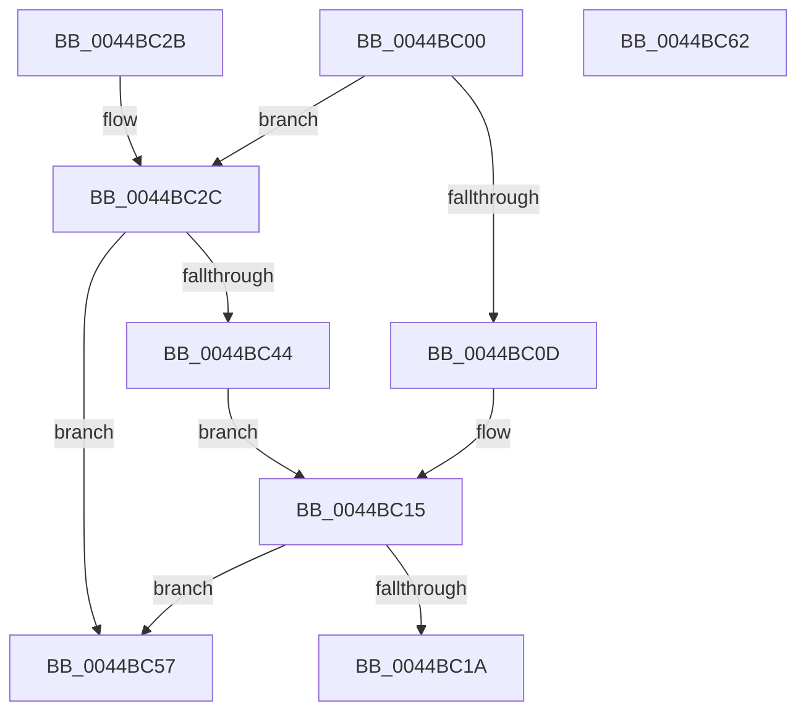

# KiEnumerateNextNodeInSystem

- RVA: `0x0044BC00`–`0x0044BC63` (길이 `99` bytes)
- VA: `0x000000014044BC00`
- 실행 섹션: `.text`
- PDB 이름 있음: `예`; PDB Function 태그: `아니요`
- unwind 정보 RVA: `0x000DB714`
- 디코드: `29`개 명령, `99/99` bytes 표시
- 미해석 바이트: `0` (있으면 어셈블리에 `.byte`로 보존)

> 이 문서는 커널 이미지의 기계어와 PDB 기호를 분석해 생성했습니다. 4번과 5번은 함수 원형과 자료형을 바이너리 사용 방식에서 추정한 C 해석이며 원본 소스 복구 결과는 아닙니다.

## 1. Dependencies

- 직접 호출 지점: **0**; 고유 호출 대상: **0**
- 직접 호출자로 확인된 함수: **1**
- RIP 상대 이미지 참조: **3**

### Outgoing calls
- 직접 디코드된 call 명령이 없습니다.

### Direct callers
- [sub_006D831E](../6D/Unknown_function_006D831E.md) at `0x006D86A3`

### Static image references
- `0x0044BC1A` → RVA `0x00FCF6C0` (`CACHEALI`; read)
- `0x0044BC30` → RVA `0x00FC5000` (`ALMOSTRO`; read)
- `0x0044BC44` → RVA `0x00E2DBD0` (`.data`; read)

## 2. Other-region calls and transfers

- 다른 실행 섹션으로 향하는 call: **0**
- 별도 외부 분기/꼬리 이동을 확인하지 못했습니다.

## 3. Assembly (complete function range)

```asm
0044BC00  66 83 79 02 00                  cmp word ptr [rcx + 2], 0
0044BC05  4C 8B C2                        mov r8, rdx
0044BC08  0F B7 11                        movzx edx, word ptr [rcx]
0044BC0B  75 1F                           jne 0x14044bc2c
0044BC0D  8B C2                           mov eax, edx
0044BC0F  66 C7 41 02 01 00               mov word ptr [rcx + 2], 1
0044BC15  83 F8 FF                        cmp eax, -1
0044BC18  74 3D                           je 0x14044bc57
0044BC1A  48 8D 0D 9F 3A B8 00            lea rcx, [rip + 0xb83a9f]
0044BC21  48 8B 04 C1                     mov rax, qword ptr [rcx + rax*8]
0044BC25  49 89 00                        mov qword ptr [r8], rax
0044BC28  33 C0                           xor eax, eax
0044BC2A  C3                              ret
0044BC2B  CC                              int3
0044BC2C  44 8B 49 04                     mov r9d, dword ptr [rcx + 4]
0044BC30  44 0F B7 15 C8 93 B7 00         movzx r10d, word ptr [rip + 0xb793c8]
0044BC38  41 FF C1                        inc r9d
0044BC3B  44 89 49 04                     mov dword ptr [rcx + 4], r9d
0044BC3F  45 3B CA                        cmp r9d, r10d
0044BC42  74 13                           je 0x14044bc57
0044BC44  48 8B 05 85 1F 9E 00            mov rax, qword ptr [rip + 0x9e1f85]
0044BC4B  41 0F AF D2                     imul edx, r10d
0044BC4F  41 03 D1                        add edx, r9d
0044BC52  8B 04 90                        mov eax, dword ptr [rax + rdx*4]
0044BC55  EB BE                           jmp 0x14044bc15
0044BC57  66 C7 01 FF FF                  mov word ptr [rcx], 0xffff
0044BC5C  B8 1A 00 00 80                  mov eax, 0x8000001a
0044BC61  C3                              ret
0044BC62  CC                              int3
```

## 4. C-style interpretation (structured pseudocode)

```c
__int64 __fastcall KiEnumerateNextNodeInSystem(__int64 a1, __int64 a2)
{
    __int64 result;

    if ((*(unsigned __int16 *)(a1 + 2)) != 0) goto loc_0044BC2C;
    *(unsigned __int16 *)(a1 + 2) = 1;
loc_0044BC15:
    if (((unsigned int)((unsigned int)((unsigned int)(*(unsigned __int16 *)(a1))))) == -1) goto loc_0044BC57;
    *(unsigned __int64 *)(a2) = *(unsigned __int64 *)(v_rip + 12073631 + (unsigned int)((unsigned int)(*(unsigned __int16 *)(a1))) * 8);
    result = 0;
    return result;
loc_0044BC2C:
    a4 = (unsigned int)(((unsigned int)(*(unsigned int *)(v_rip + 12073631 + 4))) + 1);
    *(unsigned int *)(v_rip + 12073631 + 4) = (unsigned int)(a4);
    if (((unsigned int)(a4)) == ((unsigned int)(*(unsigned __int16 *)(v_rip + 12030920)))) goto loc_0044BC57;
    a2 = (unsigned int)((*(unsigned __int16 *)(a1)) * ((unsigned int)(*(unsigned __int16 *)(v_rip + 12030920))));
    a2 = (unsigned int)((a2) + ((unsigned int)(a4)));
    goto loc_0044BC15;
loc_0044BC57:
    *(unsigned __int16 *)(v_rip + 12073631) = 0xFFFFULL;
    return (unsigned int)(0x8000001AULL);
}
```

## 5. (Beta) C Style

```c
int64_t KiEnumerateNextNodeInSystem(void *Arg1, void *Arg2)
{
    uint8_t *arg1 = (uint8_t *)Arg1;
    uint8_t *arg2 = (uint8_t *)Arg2;

    int64_t result;

    if ((*(uint16_t *)(arg1 + 0x2)) != 0) goto loc_0044BC2C;
    *(uint16_t *)(arg1 + 0x2) = 1;
loc_0044BC15:
    if (((uint32_t)((uint32_t)((uint32_t)(*(uint16_t *)(arg1))))) == -1) goto loc_0044BC57;
    *(uint64_t *)(arg2) = *(uint64_t *)(v_rip + 0xB83A9F + (uint32_t)((uint32_t)(*(uint16_t *)(arg1))) * 8);
    result = 0;
    return result;
loc_0044BC2C:
    a4 = (uint32_t)(((uint32_t)(*(uint32_t *)(v_rip + 0xB83A9F + 0x4))) + 1);
    *(uint32_t *)(v_rip + 0xB83A9F + 0x4) = (uint32_t)(a4);
    if (((uint32_t)(a4)) == ((uint32_t)(*(uint16_t *)(v_rip + 0xB793C8)))) goto loc_0044BC57;
    Arg2 = (uint32_t)((*(uint16_t *)(arg1)) * ((uint32_t)(*(uint16_t *)(v_rip + 0xB793C8))));
    Arg2 = (uint32_t)((Arg2) + ((uint32_t)(a4)));
    goto loc_0044BC15;
loc_0044BC57:
    *(uint16_t *)(v_rip + 0xB83A9F) = 0xFFFFULL;
    return (uint32_t)(0x8000001AULL);
}
```

### 관측된 메모리 오프셋

구조체 형식이 확인되지 않은 접근은 인자 기준의 오프셋으로만 기록했습니다.

| 기준 인자 | 오프셋 표현 | 폭 (bit) | 접근 |
|---|---:|---:|---|
| `Arg1` | `+ 0x0` | `16` | `R` |
| `Arg1` | `+ 0x0` | `16` | `W` |
| `Arg1` | `+ 0x2` | `16` | `R` |
| `Arg1` | `+ 0x2` | `16` | `W` |
| `Arg1` | `+ 0x4` | `32` | `R` |
| `Arg1` | `+ 0x4` | `32` | `W` |
| `Arg2` | `+ 0x0` | `64` | `W` |

## 6. Execution-region graph

[열기: 2D/3D 그래프와 함수 탐색 컨트롤 패널](../../../control-panel.html?section=text&rva=0x0044BC00&view=graph)

- 2D 그래프는 위에서 아래로 흐르고, 3D 그래프는 빈 공간을 드래그해 회전합니다. Shift+드래그는 이동, 휠은 확대·축소, 함수 노드 선택은 대상 보고서 이동입니다.

### Static fallback


