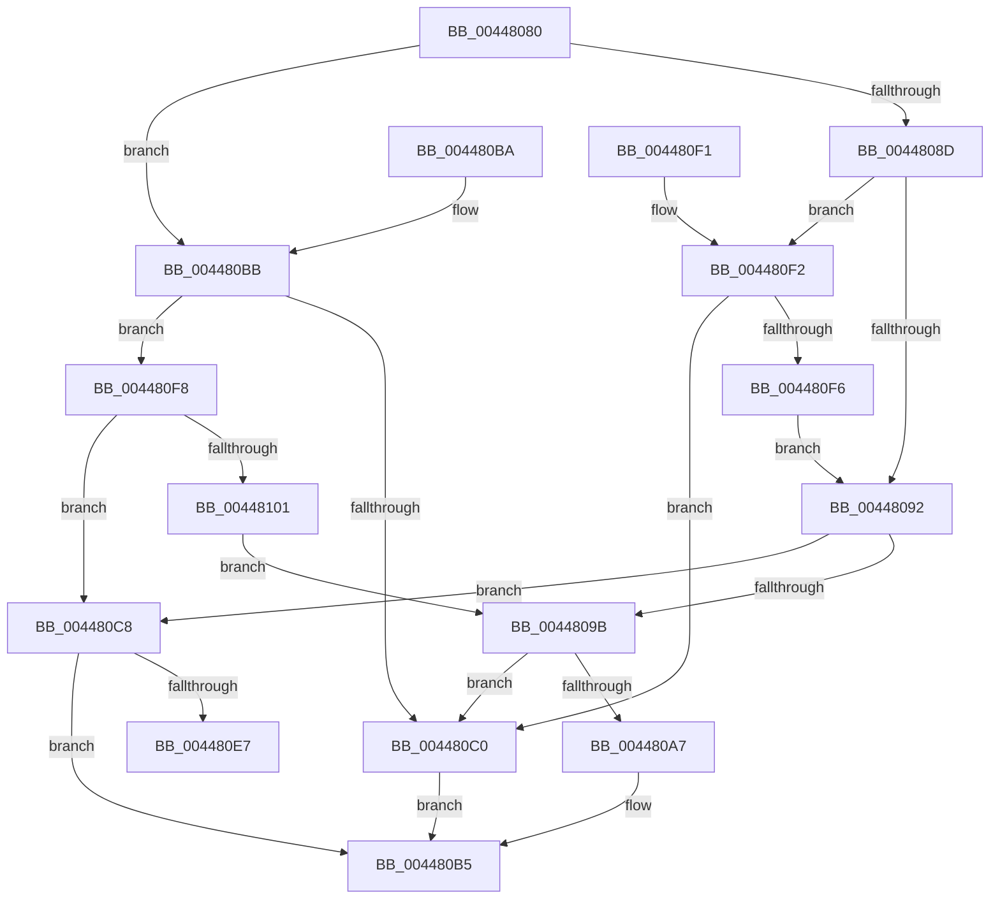

# KiFlushCurrentTbOnly

- RVA: `0x00448080`–`0x00448103` (길이 `131` bytes)
- VA: `0x0000000140448080`
- 실행 섹션: `.text`
- PDB 이름 있음: `예`; PDB Function 태그: `아니요`
- unwind 정보 RVA: `0x000A600C`
- 디코드: `38`개 명령, `131/131` bytes 표시
- 미해석 바이트: `0` (있으면 어셈블리에 `.byte`로 보존)

> 이 문서는 커널 이미지의 기계어와 PDB 기호를 분석해 생성했습니다. 4번과 5번은 함수 원형과 자료형을 바이너리 사용 방식에서 추정한 C 해석이며 원본 소스 복구 결과는 아닙니다.

## 1. Dependencies

- 직접 호출 지점: **1**; 고유 호출 대상: **1**
- 직접 호출자로 확인된 함수: **1**
- RIP 상대 이미지 참조: **2**

### Outgoing calls
- `0x004480E7` → [KiSetUserTbFlushPending](../6B/KiSetUserTbFlushPending_function_006B20C0.md) (function, `0x006B20C0`)

### Direct callers
- [KeFlushCurrentTbOnly](../31/KeFlushCurrentTbOnly_function_003134EC.md) at `0x003135F9`

### Static image references
- `0x00448084` → RVA `0x01201840` (`CFGRO`; read)
- `0x00448092` → RVA `0x00FC6A87` (`ALMOSTRO`; read)

## 2. Other-region calls and transfers

- 다른 실행 섹션으로 향하는 call: **0**
- 별도 외부 분기/꼬리 이동을 확인하지 못했습니다.

## 3. Assembly (complete function range)

```asm
00448080  48 83 EC 28                     sub rsp, 0x28
00448084  80 3D B5 97 DB 00 00            cmp byte ptr [rip + 0xdb97b5], 0
0044808B  74 2E                           je 0x1404480bb
0044808D  83 F9 03                        cmp ecx, 3
00448090  75 60                           jne 0x1404480f2
00448092  80 3D EE E9 B7 00 00            cmp byte ptr [rip + 0xb7e9ee], 0
00448099  75 2D                           jne 0x1404480c8
0044809B  0F 20 E1                        mov rcx, cr4
0044809E  48 F7 C1 80 00 02 00            test rcx, 0x20080
004480A5  74 19                           je 0x1404480c0
004480A7  48 8B C1                        mov rax, rcx
004480AA  48 0F BA F8 07                  btc rax, 7
004480AF  0F 22 E0                        mov cr4, rax
004480B2  0F 22 E1                        mov cr4, rcx
004480B5  48 83 C4 28                     add rsp, 0x28
004480B9  C3                              ret
004480BA  CC                              int3
004480BB  83 F9 01                        cmp ecx, 1
004480BE  75 38                           jne 0x1404480f8
004480C0  0F 20 D8                        mov rax, cr3
004480C3  0F 22 D8                        mov cr3, rax
004480C6  EB ED                           jmp 0x1404480b5
004480C8  0F 20 D8                        mov rax, cr3
004480CB  0F 22 D8                        mov cr3, rax
004480CE  65 48 8B 04 25 88 01 00 00      mov rax, qword ptr gs:[0x188]
004480D7  48 8B 88 B8 00 00 00            mov rcx, qword ptr [rax + 0xb8]
004480DE  80 B9 60 01 00 00 00            cmp byte ptr [rcx + 0x160], 0
004480E5  75 CE                           jne 0x1404480b5
004480E7  E8 D4 9F 26 00                  call 0x1406b20c0
004480EC  48 83 C4 28                     add rsp, 0x28
004480F0  C3                              ret
004480F1  CC                              int3
004480F2  85 C9                           test ecx, ecx
004480F4  74 CA                           je 0x1404480c0
004480F6  EB 9A                           jmp 0x140448092
004480F8  80 3D 88 E9 B7 00 00            cmp byte ptr [rip + 0xb7e988], 0
004480FF  75 C7                           jne 0x1404480c8
00448101  EB 98                           jmp 0x14044809b
```

## 4. C-style interpretation (structured pseudocode)

```c
__int64 __fastcall KiFlushCurrentTbOnly(int a1)
{
    __int64 result;
    __int64 v_rsp;

    v_rsp = (v_rsp) - (40);
    if ((*(unsigned __int8 *)(v_rip + 14391221)) == 0) goto loc_004480BB;
    if (a1 != 3) goto loc_004480F2;
loc_00448092:
    if ((*(unsigned __int8 *)(v_rip + 12052974)) != 0) goto loc_004480C8;
loc_0044809B:
    if (((v_cr4) & (0x20080ULL)) == 0) goto loc_004480C0;
loc_004480B5:
    v_rsp = (v_rsp) + (40);
    return v_cr4;
loc_004480BB:
    if (((unsigned int)(v_cr4)) != 1) goto loc_004480F8;
loc_004480C0:
    goto loc_004480B5;
loc_004480C8:
    if ((*(unsigned __int8 *)(*(unsigned __int64 *)(*(unsigned __int64 *)(gs_base + (0 + 392)) + 184) + 352)) != 0) goto loc_004480B5;
    result = KiSetUserTbFlushPending(*(unsigned __int64 *)(*(unsigned __int64 *)(gs_base + (0 + 392)) + 184), a2, a3, a4);
    v_rsp = (v_rsp) + (40);
    return result;
loc_004480F2:
    if ((unsigned int)(*(unsigned __int64 *)(*(unsigned __int64 *)(gs_base + (0 + 392)) + 184)) == 0) goto loc_004480C0;
    goto loc_00448092;
loc_004480F8:
    if ((*(unsigned __int8 *)(v_rip + 12052872)) != 0) goto loc_004480C8;
    goto loc_0044809B;
}
```

## 5. (Beta) C Style

```c
int64_t KiFlushCurrentTbOnly(int32_t Arg1)
{
    int64_t result;
    int64_t local_rsp;

    local_rsp = (local_rsp) - (40);
    if ((*(uint8_t *)(v_rip + 0xDB97B5)) == 0) goto loc_004480BB;
    if (Arg1 != 3) goto loc_004480F2;
loc_00448092:
    if ((*(uint8_t *)(v_rip + 0xB7E9EE)) != 0) goto loc_004480C8;
loc_0044809B:
    if (((v_cr4) & (0x20080ULL)) == 0) goto loc_004480C0;
loc_004480B5:
    local_rsp = (local_rsp) + (40);
    return v_cr4;
loc_004480BB:
    if (((uint32_t)(v_cr4)) != 1) goto loc_004480F8;
loc_004480C0:
    goto loc_004480B5;
loc_004480C8:
    if ((*(uint8_t *)(*(uint64_t *)(*(uint64_t *)(gs_base + (0 + 0x188)) + 0xB8) + 0x160)) != 0) goto loc_004480B5;
    result = KiSetUserTbFlushPending(*(uint64_t *)(*(uint64_t *)(gs_base + (0 + 0x188)) + 0xB8), a2, a3, a4);
    local_rsp = (local_rsp) + (40);
    return result;
loc_004480F2:
    if ((uint32_t)(*(uint64_t *)(*(uint64_t *)(gs_base + (0 + 0x188)) + 0xB8)) == 0) goto loc_004480C0;
    goto loc_00448092;
loc_004480F8:
    if ((*(uint8_t *)(v_rip + 0xB7E988)) != 0) goto loc_004480C8;
    goto loc_0044809B;
}
```

## 6. Execution-region graph

[열기: 2D/3D 그래프와 함수 탐색 컨트롤 패널](../../../control-panel.html?section=text&rva=0x00448080&view=graph)

- 2D 그래프는 위에서 아래로 흐르고, 3D 그래프는 빈 공간을 드래그해 회전합니다. Shift+드래그는 이동, 휠은 확대·축소, 함수 노드 선택은 대상 보고서 이동입니다.

### Static fallback


