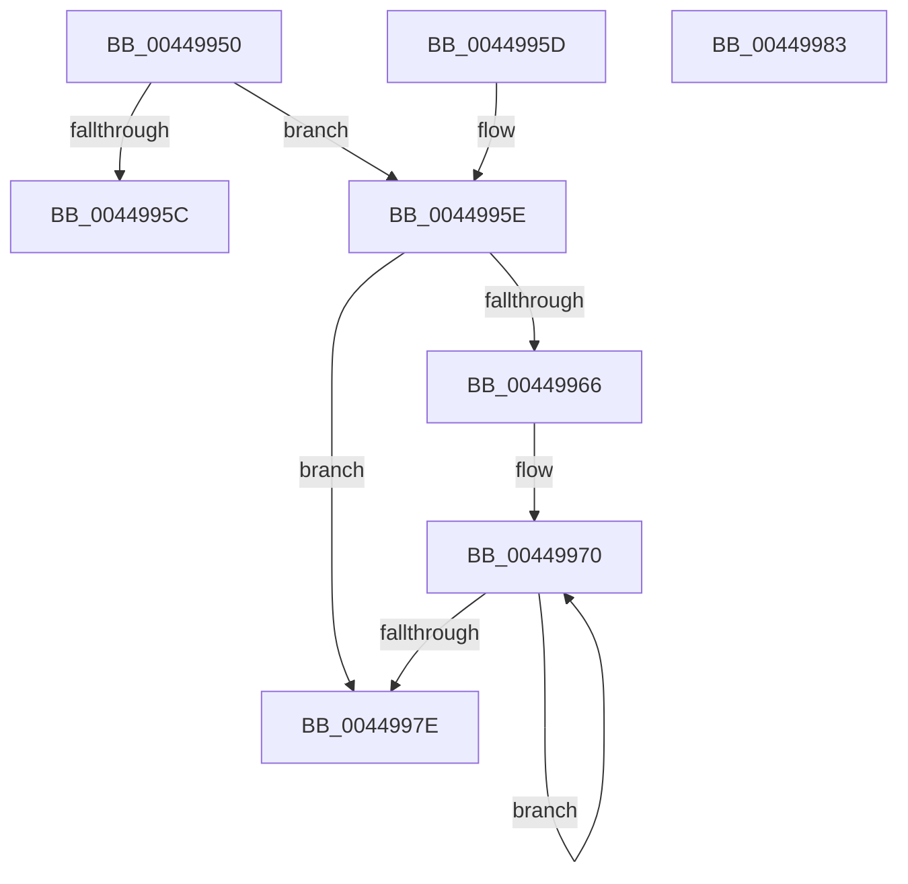

# KiGetAllocatedXSaveArea

- RVA: `0x00449950`–`0x00449984` (길이 `52` bytes)
- VA: `0x0000000140449950`
- 실행 섹션: `.text`
- PDB 이름 있음: `예`; PDB Function 태그: `아니요`
- unwind 정보 RVA: `0x000DB714`
- 디코드: `17`개 명령, `52/52` bytes 표시
- 미해석 바이트: `0` (있으면 어셈블리에 `.byte`로 보존)

> 이 문서는 커널 이미지의 기계어와 PDB 기호를 분석해 생성했습니다. 4번과 5번은 함수 원형과 자료형을 바이너리 사용 방식에서 추정한 C 해석이며 원본 소스 복구 결과는 아닙니다.

## 1. Dependencies

- 직접 호출 지점: **0**; 고유 호출 대상: **0**
- 직접 호출자로 확인된 함수: **2**
- RIP 상대 이미지 참조: **0**

### Outgoing calls
- 직접 디코드된 call 명령이 없습니다.

### Direct callers
- [sub_009A6B68](../../page/9A/Unknown_function_009A6B68.md) at `0x009A6B74`
- [sub_009A6FF0](../../page/9A/Unknown_function_009A6FF0.md) at `0x009A6FFC`

### Static image references
- 디코드된 RIP-relative 메모리 참조가 없습니다.

## 2. Other-region calls and transfers

- 다른 실행 섹션으로 향하는 call: **0**
- 별도 외부 분기/꼬리 이동을 확인하지 못했습니다.

## 3. Assembly (complete function range)

```asm
00449950  48 8B 81 98 01 00 00            mov rax, qword ptr [rcx + 0x198]
00449957  48 85 C0                        test rax, rax
0044995A  75 02                           jne 0x14044995e
0044995C  C3                              ret
0044995D  CC                              int3
0044995E  48 8B 10                        mov rdx, qword ptr [rax]
00449961  48 85 D2                        test rdx, rdx
00449964  74 18                           je 0x14044997e
00449966  66 66 0F 1F 84 00 00 00 00 00   nop word ptr [rax + rax]
00449970  48 8B 0A                        mov rcx, qword ptr [rdx]
00449973  48 8B C2                        mov rax, rdx
00449976  48 8B D1                        mov rdx, rcx
00449979  48 85 C9                        test rcx, rcx
0044997C  75 F2                           jne 0x140449970
0044997E  48 8B 40 28                     mov rax, qword ptr [rax + 0x28]
00449982  C3                              ret
00449983  CC                              int3
```

## 4. C-style interpretation (structured pseudocode)

```c
__int64 __fastcall KiGetAllocatedXSaveArea(__int64 a1)
{
    if (*(unsigned __int64 *)(a1 + 408) != 0) goto loc_0044995E;
    return *(unsigned __int64 *)(a1 + 408);
loc_0044995E:
    if (*(unsigned __int64 *)(*(unsigned __int64 *)(a1 + 408)) == 0) goto loc_0044997E;
loc_00449970:
    if (*(unsigned __int64 *)(*(unsigned __int64 *)(*(unsigned __int64 *)(a1 + 408))) != 0) goto loc_00449970;
loc_0044997E:
    return *(unsigned __int64 *)(*(unsigned __int64 *)(*(unsigned __int64 *)(a1 + 408)) + 40);
}
```

## 5. (Beta) C Style

```c
int64_t KiGetAllocatedXSaveArea(void *Arg1)
{
    uint8_t *arg1 = (uint8_t *)Arg1;

    if (*(uint64_t *)(arg1 + 0x198) != 0) goto loc_0044995E;
    return *(uint64_t *)(arg1 + 0x198);
loc_0044995E:
    if (*(uint64_t *)(*(uint64_t *)(arg1 + 0x198)) == 0) goto loc_0044997E;
loc_00449970:
    if (*(uint64_t *)(*(uint64_t *)(*(uint64_t *)(arg1 + 0x198))) != 0) goto loc_00449970;
loc_0044997E:
    return *(uint64_t *)(*(uint64_t *)(*(uint64_t *)(arg1 + 0x198)) + 0x28);
}
```

### 관측된 메모리 오프셋

구조체 형식이 확인되지 않은 접근은 인자 기준의 오프셋으로만 기록했습니다.

| 기준 인자 | 오프셋 표현 | 폭 (bit) | 접근 |
|---|---:|---:|---|
| `Arg1` | `+ 0x198` | `64` | `R` |

## 6. Execution-region graph

[열기: 2D/3D 그래프와 함수 탐색 컨트롤 패널](../../../control-panel.html?section=text&rva=0x00449950&view=graph)

- 2D 그래프는 위에서 아래로 흐르고, 3D 그래프는 빈 공간을 드래그해 회전합니다. Shift+드래그는 이동, 휠은 확대·축소, 함수 노드 선택은 대상 보고서 이동입니다.

### Static fallback


