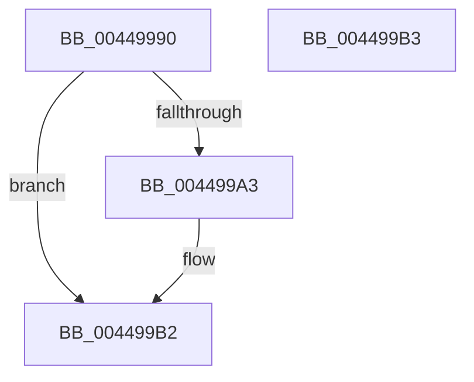

# KiGetClockIntervalOneShot

- RVA: `0x00449990`–`0x004499B4` (길이 `36` bytes)
- VA: `0x0000000140449990`
- 실행 섹션: `.text`
- PDB 이름 있음: `예`; PDB Function 태그: `아니요`
- unwind 정보 RVA: `0x000DB714`
- 디코드: `13`개 명령, `36/36` bytes 표시
- 미해석 바이트: `0` (있으면 어셈블리에 `.byte`로 보존)

> 이 문서는 커널 이미지의 기계어와 PDB 기호를 분석해 생성했습니다. 4번과 5번은 함수 원형과 자료형을 바이너리 사용 방식에서 추정한 C 해석이며 원본 소스 복구 결과는 아닙니다.

## 1. Dependencies

- 직접 호출 지점: **0**; 고유 호출 대상: **0**
- 직접 호출자로 확인된 함수: **2**
- RIP 상대 이미지 참조: **1**

### Outgoing calls
- 직접 디코드된 call 명령이 없습니다.

### Direct callers
- [KiSetClockIntervalToMinimumRequested](../39/KiSetClockIntervalToMinimumRequested_function_0039DF1C.md) at `0x0039DF88`
- [KiSetClockIntervalToMinimumRequested](../39/KiSetClockIntervalToMinimumRequested_function_0039DF1C.md) at `0x0039DFFA`
- [KiRestoreClockTickRate](../4D/KiRestoreClockTickRate_function_004D2780.md) at `0x004D2888`

### Static image references
- `0x00449990` → RVA `0x00FC6B3C` (`ALMOSTRO`; read)

## 2. Other-region calls and transfers

- 다른 실행 섹션으로 향하는 call: **0**
- 별도 외부 분기/꼬리 이동을 확인하지 못했습니다.

## 3. Assembly (complete function range)

```asm
00449990  44 8B 05 A5 D1 B7 00            mov r8d, dword ptr [rip + 0xb7d1a5]
00449997  4A 8D 04 02                     lea rax, [rdx + r8]
0044999B  48 3B C8                        cmp rcx, rax
0044999E  41 8B C0                        mov eax, r8d
004499A1  76 0F                           jbe 0x1404499b2
004499A3  2B C2                           sub eax, edx
004499A5  33 D2                           xor edx, edx
004499A7  FF C8                           dec eax
004499A9  03 C1                           add eax, ecx
004499AB  41 F7 F0                        div r8d
004499AE  41 0F AF C0                     imul eax, r8d
004499B2  C3                              ret
004499B3  CC                              int3
```

## 4. C-style interpretation (structured pseudocode)

```c
__int64 __fastcall KiGetClockIntervalOneShot(__int64 a1, __int64 a2)
{
    __int64 result;

    result = (unsigned int)((unsigned int)((unsigned int)(*(unsigned int *)(v_rip + 12046757))));
    if (a1 >= = (a2 + (unsigned int)(*(unsigned int *)(v_rip + 12046757)) * 1)) {
        result = (unsigned int)(((unsigned int)((unsigned int)((unsigned int)(*(unsigned int *)(v_rip + 12046757))))) - ((unsigned int)(a2)));
        a2 = 0;
        result = (unsigned int)((result) - 1);
        result = (unsigned int)((result) + ((unsigned int)(a1)));
        result = (unsigned int)((result) * ((unsigned int)((unsigned int)(*(unsigned int *)(v_rip + 12046757)))));
    }
    return result;
}
```

## 5. (Beta) C Style

```c
int64_t KiGetClockIntervalOneShot(int64_t Arg1, void *Arg2)
{
    uint8_t *arg2 = (uint8_t *)Arg2;

    int64_t result;

    result = (uint32_t)((uint32_t)((uint32_t)(*(uint32_t *)(v_rip + 0xB7D1A5))));
    if (Arg1 >= = (Arg2 + (uint32_t)(*(uint32_t *)(v_rip + 0xB7D1A5)) * 1)) {
        result = (uint32_t)(((uint32_t)((uint32_t)((uint32_t)(*(uint32_t *)(v_rip + 0xB7D1A5))))) - ((uint32_t)(Arg2)));
        Arg2 = 0;
        result = (uint32_t)((result) - 1);
        result = (uint32_t)((result) + ((uint32_t)(Arg1)));
        result = (uint32_t)((result) * ((uint32_t)((uint32_t)(*(uint32_t *)(v_rip + 0xB7D1A5)))));
    }
    return result;
}
```

### 관측된 메모리 오프셋

구조체 형식이 확인되지 않은 접근은 인자 기준의 오프셋으로만 기록했습니다.

| 기준 인자 | 오프셋 표현 | 폭 (bit) | 접근 |
|---|---:|---:|---|
| `Arg2` | `+ 0x0 + r8*1` | `64` | `R` |

## 6. Execution-region graph

[열기: 2D/3D 그래프와 함수 탐색 컨트롤 패널](../../../control-panel.html?section=text&rva=0x00449990&view=graph)

- 2D 그래프는 위에서 아래로 흐르고, 3D 그래프는 빈 공간을 드래그해 회전합니다. Shift+드래그는 이동, 휠은 확대·축소, 함수 노드 선택은 대상 보고서 이동입니다.

### Static fallback


