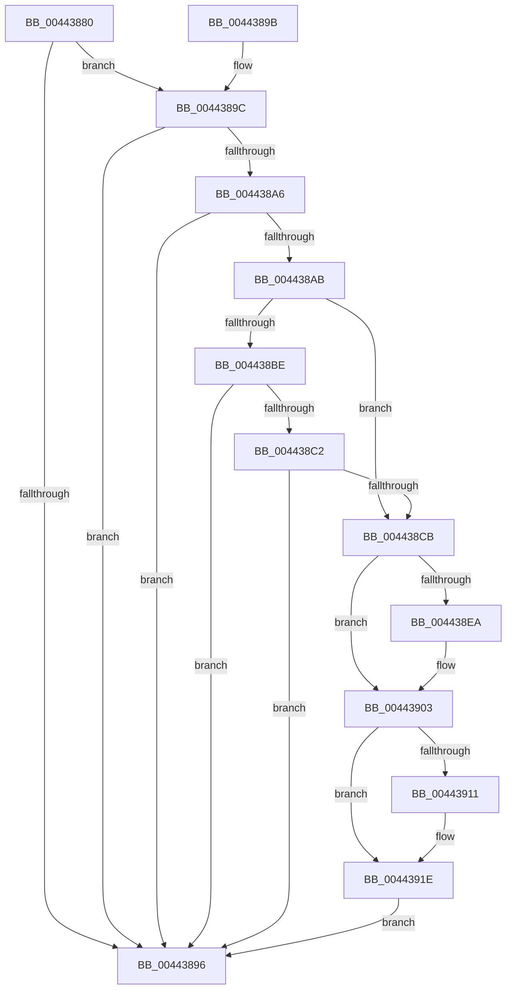

# KiHvEnlightenedGuestPriorityKick

- RVA: `0x00443880`–`0x00443937` (길이 `183` bytes)
- VA: `0x0000000140443880`
- 실행 섹션: `.text`
- PDB 이름 있음: `예`; PDB Function 태그: `아니요`
- unwind 정보 RVA: `0x000A55B4`
- 디코드: `49`개 명령, `183/183` bytes 표시
- 미해석 바이트: `0` (있으면 어셈블리에 `.byte`로 보존)

> 이 문서는 커널 이미지의 기계어와 PDB 기호를 분석해 생성했습니다. 4번과 5번은 함수 원형과 자료형을 바이너리 사용 방식에서 추정한 C 해석이며 원본 소스 복구 결과는 아닙니다.

## 1. Dependencies

- 직접 호출 지점: **1**; 고유 호출 대상: **1**
- 직접 호출자로 확인된 함수: **7**
- RIP 상대 이미지 참조: **3**

### Outgoing calls
- `0x00443919` → [EtwTraceXSchedulerPriorityKickSend](../4F/EtwTraceXSchedulerPriorityKickSend_function_004FB2C0.md) (function, `0x004FB2C0`)

### Direct callers
- [KiRemoveBoostThread](../21/KiRemoveBoostThread_function_00219128.md) at `0x0021941F`
- [KiSetPriorityThread](../22/KiSetPriorityThread_function_00220E78.md) at `0x002213A1`
- [KeSetTimer2](../3A/KeSetTimer2_function_003A08E0.md) at `0x003A10C5`
- [KiInsertTimer2](../3A/KiInsertTimer2_function_003A244C.md) at `0x003A24D1`
- [KiExpireTimer2](../3A/KiExpireTimer2_function_003A24E0.md) at `0x003A2C83`
- [KiApplyForegroundBoostThread](../4F/KiApplyForegroundBoostThread_function_004F7DC0.md) at `0x004F7FF6`
- [sub_006F178E](../6F/Unknown_function_006F178E.md) at `0x006F17AC`

### Static image references
- `0x004438CB` → RVA `0x00FC5007` (`ALMOSTRO`; read)
- `0x004438EC` → RVA `0x00FCD260` (`ALMOSTRO`; read)
- `0x00443906` → RVA `0x00FC6B14` (`ALMOSTRO`; read)

## 2. Other-region calls and transfers

- 다른 실행 섹션으로 향하는 call: **0**
- 별도 외부 분기/꼬리 이동을 확인하지 못했습니다.

## 3. Assembly (complete function range)

```asm
00443880  48 83 EC 28                     sub rsp, 0x28
00443884  48 8B C2                        mov rax, rdx
00443887  4C 8B C9                        mov r9, rcx
0044388A  48 8B 92 B8 8E 00 00            mov rdx, qword ptr [rdx + 0x8eb8]
00443891  48 85 D2                        test rdx, rdx
00443894  75 06                           jne 0x14044389c
00443896  48 83 C4 28                     add rsp, 0x28
0044389A  C3                              ret
0044389B  CC                              int3
0044389C  48 83 B9 B8 8E 00 00 00         cmp qword ptr [rcx + 0x8eb8], 0
004438A4  74 F0                           je 0x140443896
004438A6  4C 3B C8                        cmp r9, rax
004438A9  74 EB                           je 0x140443896
004438AB  44 8B 12                        mov r10d, dword ptr [rdx]
004438AE  41 8B CA                        mov ecx, r10d
004438B1  81 E1 00 00 04 00               and ecx, 0x40000
004438B7  41 0F BA E2 14                  bt r10d, 0x14
004438BC  72 0D                           jb 0x1404438cb
004438BE  85 C9                           test ecx, ecx
004438C0  74 D4                           je 0x140443896
004438C2  41 0F B6 CA                     movzx ecx, r10b
004438C6  41 3B C8                        cmp ecx, r8d
004438C9  7D CB                           jge 0x140443896
004438CB  80 3D 35 17 B8 00 00            cmp byte ptr [rip + 0xb81735], 0
004438D2  49 8B 91 B8 8E 00 00            mov rdx, qword ptr [r9 + 0x8eb8]
004438D9  48 89 5C 24 20                  mov qword ptr [rsp + 0x20], rbx
004438DE  C7 42 0C 02 00 00 00            mov dword ptr [rdx + 0xc], 2
004438E5  8B 58 24                        mov ebx, dword ptr [rax + 0x24]
004438E8  75 19                           jne 0x140443903
004438EA  8B CB                           mov ecx, ebx
004438EC  4C 8D 05 6D 99 B8 00            lea r8, [rip + 0xb8996d]
004438F3  41 0F B6 1C 58                  movzx ebx, byte ptr [r8 + rbx*2]
004438F8  C1 E3 06                        shl ebx, 6
004438FB  41 0F B6 4C 48 01               movzx ecx, byte ptr [r8 + rcx*2 + 1]
00443901  0B D9                           or ebx, ecx
00443903  89 5A 08                        mov dword ptr [rdx + 8], ebx
00443906  8B 0D 08 32 B8 00               mov ecx, dword ptr [rip + 0xb83208]
0044390C  F6 C1 20                        test cl, 0x20
0044390F  74 0D                           je 0x14044391e
00443911  8B 48 24                        mov ecx, dword ptr [rax + 0x24]
00443914  BA 02 00 00 00                  mov edx, 2
00443919  E8 A2 79 0B 00                  call 0x1404fb2c0
0044391E  8B D3                           mov edx, ebx
00443920  B9 C2 00 00 40                  mov ecx, 0x400000c2
00443925  48 C1 EA 20                     shr rdx, 0x20
00443929  8B C3                           mov eax, ebx
0044392B  0F 30                           wrmsr
0044392D  48 8B 5C 24 20                  mov rbx, qword ptr [rsp + 0x20]
00443932  E9 5F FF FF FF                  jmp 0x140443896
```

## 4. C-style interpretation (structured pseudocode)

```c
__int64 __fastcall KiHvEnlightenedGuestPriorityKick(__int64 a1, __int64 a2, int a3)
{
    __int64 result;
    __int64 v_rbx;
    __int64 v_rsp;
    unsigned __int64 v_stack_p20;

    v_rsp = (v_rsp) - (40);
    if (*(unsigned __int64 *)(a2 + 36536) != 0) goto loc_0044389C;
loc_00443896:
    v_rsp = (v_rsp) + (40);
    return a2;
loc_0044389C:
    if ((*(unsigned __int64 *)(a1 + 36536)) == 0) goto loc_00443896;
    if (a1 == a2) goto loc_00443896;
    a1 = (unsigned int)(((unsigned int)((unsigned int)((unsigned int)(*(unsigned int *)(*(unsigned __int64 *)(a2 + 36536)))))) & (0x40000ULL));
    if (condition_is_below) goto loc_004438CB;
    if ((unsigned int)(a1) == 0) goto loc_00443896;
    if (((unsigned int)((unsigned __int8)((unsigned int)(*(unsigned int *)(*(unsigned __int64 *)(a2 + 36536)))))) >= a3) goto loc_00443896;
loc_004438CB:
    v_stack_p20 = v_rbx;
    *(unsigned int *)(*(unsigned __int64 *)(a1 + 36536) + 12) = 2;
    v_rbx = (unsigned int)(*(unsigned int *)(a2 + 36));
    if ((*(unsigned __int8 *)(v_rip + 12064565)) == 0) {
        a1 = (unsigned int)((unsigned int)(*(unsigned int *)(a2 + 36)));
        a3 = v_rip + 12097901;
        v_rbx = *(unsigned __int8 *)(a3 + (unsigned int)(*(unsigned int *)(a2 + 36)) * 2);
        v_rbx = (unsigned int)((v_rbx) << (6));
        a1 = *(unsigned __int8 *)(a3 + a1 * 2 + 1);
        v_rbx = (unsigned int)((v_rbx) | ((unsigned int)(a1)));
    }
    *(unsigned int *)(*(unsigned __int64 *)(a1 + 36536) + 8) = (unsigned int)(v_rbx);
    result = a2;
    if ((((unsigned __int8)((unsigned int)(*(unsigned int *)(v_rip + 12071432)))) & (32)) != 0) {
        a1 = *(unsigned int *)(a2 + 36);
        a2 = 2;
        result = EtwTraceXSchedulerPriorityKickSend(a1, a2, a3, a1);
    }
    a2 = ((unsigned int)((unsigned int)(v_rbx))) >> (32);
    goto loc_00443896;
}
```

## 5. (Beta) C Style

```c
void *KiHvEnlightenedGuestPriorityKick(void *Arg1, void *Arg2, int32_t Arg3)
{
    uint8_t *arg1 = (uint8_t *)Arg1;
    uint8_t *arg2 = (uint8_t *)Arg2;

    int64_t result;
    int64_t local_rbx;
    int64_t local_rsp;
    uint64_t v_stack_p20;

    local_rsp = (local_rsp) - (40);
    if (*(uint64_t *)(arg2 + 0x8EB8) != 0) goto loc_0044389C;
loc_00443896:
    local_rsp = (local_rsp) + (40);
    return Arg2;
loc_0044389C:
    if ((*(uint64_t *)(arg1 + 0x8EB8)) == 0) goto loc_00443896;
    if (Arg1 == Arg2) goto loc_00443896;
    Arg1 = (uint32_t)(((uint32_t)((uint32_t)((uint32_t)(*(uint32_t *)(*(uint64_t *)(arg2 + 0x8EB8)))))) & (0x40000ULL));
    if (condition_is_below) goto loc_004438CB;
    if ((uint32_t)(Arg1) == 0) goto loc_00443896;
    if (((uint32_t)((uint8_t)((uint32_t)(*(uint32_t *)(*(uint64_t *)(arg2 + 0x8EB8)))))) >= Arg3) goto loc_00443896;
loc_004438CB:
    v_stack_p20 = local_rbx;
    *(uint32_t *)(*(uint64_t *)(arg1 + 0x8EB8) + 0xC) = 2;
    local_rbx = (uint32_t)(*(uint32_t *)(arg2 + 0x24));
    if ((*(uint8_t *)(v_rip + 0xB81735)) == 0) {
        Arg1 = (uint32_t)((uint32_t)(*(uint32_t *)(arg2 + 0x24)));
        Arg3 = v_rip + 12097901;
        local_rbx = *(uint8_t *)(Arg3 + (uint32_t)(*(uint32_t *)(arg2 + 0x24)) * 2);
        local_rbx = (uint32_t)((local_rbx) << (6));
        Arg1 = *(uint8_t *)(Arg3 + arg1 * 2 + 0x1);
        local_rbx = (uint32_t)((local_rbx) | ((uint32_t)(Arg1)));
    }
    *(uint32_t *)(*(uint64_t *)(arg1 + 0x8EB8) + 0x8) = (uint32_t)(local_rbx);
    result = Arg2;
    if ((((uint8_t)((uint32_t)(*(uint32_t *)(v_rip + 0xB83208)))) & (32)) != 0) {
        Arg1 = *(uint32_t *)(arg2 + 0x24);
        Arg2 = 2;
        result = EtwTraceXSchedulerPriorityKickSend(Arg1, Arg2, Arg3, Arg1);
    }
    Arg2 = ((uint32_t)((uint32_t)(local_rbx))) >> (32);
    goto loc_00443896;
}
```

### 관측된 메모리 오프셋

구조체 형식이 확인되지 않은 접근은 인자 기준의 오프셋으로만 기록했습니다.

| 기준 인자 | 오프셋 표현 | 폭 (bit) | 접근 |
|---|---:|---:|---|
| `Arg1` | `+ 0x8EB8` | `64` | `R` |
| `Arg2` | `+ 0x24` | `32` | `R` |
| `Arg2` | `+ 0x8EB8` | `64` | `R` |

## 6. Execution-region graph

[열기: 2D/3D 그래프와 함수 탐색 컨트롤 패널](../../../control-panel.html?section=text&rva=0x00443880&view=graph)

- 2D 그래프는 위에서 아래로 흐르고, 3D 그래프는 빈 공간을 드래그해 회전합니다. Shift+드래그는 이동, 휠은 확대·축소, 함수 노드 선택은 대상 보고서 이동입니다.

### Static fallback


