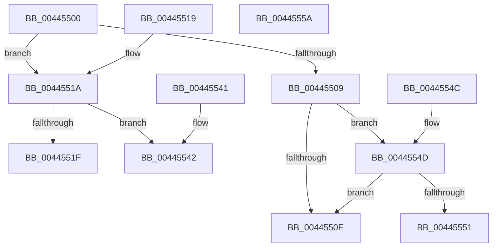

# KiPrepareFlushParameters

- RVA: `0x00445500`–`0x0044555B` (길이 `91` bytes)
- VA: `0x0000000140445500`
- 실행 섹션: `.text`
- PDB 이름 있음: `예`; PDB Function 태그: `아니요`
- unwind 정보 RVA: `0x000DB714`
- 디코드: `32`개 명령, `91/91` bytes 표시
- 미해석 바이트: `0` (있으면 어셈블리에 `.byte`로 보존)

> 이 문서는 커널 이미지의 기계어와 PDB 기호를 분석해 생성했습니다. 4번과 5번은 함수 원형과 자료형을 바이너리 사용 방식에서 추정한 C 해석이며 원본 소스 복구 결과는 아닙니다.

## 1. Dependencies

- 직접 호출 지점: **0**; 고유 호출 대상: **0**
- 직접 호출자로 확인된 함수: **2**
- RIP 상대 이미지 참조: **1**

### Outgoing calls
- 직접 디코드된 call 명령이 없습니다.

### Direct callers
- [KeFlushSingleCurrentTb](../5B/KeFlushSingleCurrentTb_function_005BDC9C.md) at `0x005BDD2A`
- [KeFlushSingleTb](../5B/KeFlushSingleTb_function_005BDE84.md) at `0x005BDF7D`

### Static image references
- `0x00445500` → RVA `0x01201840` (`CFGRO`; read)

## 2. Other-region calls and transfers

- 다른 실행 섹션으로 향하는 call: **0**
- 별도 외부 분기/꼬리 이동을 확인하지 못했습니다.

## 3. Assembly (complete function range)

```asm
00445500  80 3D 39 C3 DB 00 00            cmp byte ptr [rip + 0xdbc339], 0
00445507  74 11                           je 0x14044551a
00445509  83 F9 03                        cmp ecx, 3
0044550C  75 3F                           jne 0x14044554d
0044550E  33 C0                           xor eax, eax
00445510  B1 01                           mov cl, 1
00445512  48 89 02                        mov qword ptr [rdx], rax
00445515  41 88 08                        mov byte ptr [r8], cl
00445518  C3                              ret
00445519  CC                              int3
0044551A  83 F9 01                        cmp ecx, 1
0044551D  75 23                           jne 0x140445542
0044551F  65 48 8B 04 25 88 01 00 00      mov rax, qword ptr gs:[0x188]
00445528  41 C6 00 00                     mov byte ptr [r8], 0
0044552C  48 8B 88 B8 00 00 00            mov rcx, qword ptr [rax + 0xb8]
00445533  48 8B 41 28                     mov rax, qword ptr [rcx + 0x28]
00445537  48 25 00 F0 FF FF               and rax, 0xfffffffffffff000
0044553D  48 89 02                        mov qword ptr [rdx], rax
00445540  C3                              ret
00445541  CC                              int3
00445542  33 C0                           xor eax, eax
00445544  41 C6 00 01                     mov byte ptr [r8], 1
00445548  48 89 02                        mov qword ptr [rdx], rax
0044554B  C3                              ret
0044554C  CC                              int3
0044554D  85 C9                           test ecx, ecx
0044554F  75 BD                           jne 0x14044550e
00445551  33 C0                           xor eax, eax
00445553  48 89 02                        mov qword ptr [rdx], rax
00445556  41 88 08                        mov byte ptr [r8], cl
00445559  C3                              ret
0044555A  CC                              int3
```

## 4. C-style interpretation (structured pseudocode)

```c
__int64 __fastcall KiPrepareFlushParameters(int a1, __int64 a2, __int64 a3)
{
    __int64 result;

    if ((*(unsigned __int8 *)(v_rip + 14402361)) == 0) goto loc_0044551A;
    if (a1 != 3) goto loc_0044554D;
loc_0044550E:
    result = 0;
    *(unsigned __int64 *)(a2) = 0;
    *(unsigned __int8 *)(a3) = 1;
    return result;
loc_0044551A:
    if (1 != 1) goto loc_00445542;
    *(unsigned __int8 *)(a3) = 0;
    result = (*(unsigned __int64 *)(*(unsigned __int64 *)(*(unsigned __int64 *)(gs_base + (0 + 392)) + 184) + 40)) & (0xFFFFFFFFFFFFF000ULL);
    *(unsigned __int64 *)(a2) = result;
    return result;
loc_00445542:
    result = 0;
    *(unsigned __int8 *)(a3) = 1;
    *(unsigned __int64 *)(a2) = 0;
    return result;
loc_0044554D:
    if ((unsigned int)(*(unsigned __int64 *)(*(unsigned __int64 *)(gs_base + (0 + 392)) + 184)) != 0) goto loc_0044550E;
    result = 0;
    *(unsigned __int64 *)(a2) = 0;
    *(unsigned __int8 *)(a3) = (unsigned __int8)(*(unsigned __int64 *)(*(unsigned __int64 *)(gs_base + (0 + 392)) + 184));
    return result;
}
```

## 5. (Beta) C Style

```c
int64_t KiPrepareFlushParameters(int32_t Arg1, void *Arg2, void *Arg3)
{
    uint8_t *arg2 = (uint8_t *)Arg2;
    uint8_t *arg3 = (uint8_t *)Arg3;

    int64_t result;

    if ((*(uint8_t *)(v_rip + 0xDBC339)) == 0) goto loc_0044551A;
    if (Arg1 != 3) goto loc_0044554D;
loc_0044550E:
    result = 0;
    *(uint64_t *)(arg2) = 0;
    *(uint8_t *)(arg3) = 1;
    return result;
loc_0044551A:
    if (1 != 1) goto loc_00445542;
    *(uint8_t *)(arg3) = 0;
    result = (*(uint64_t *)(*(uint64_t *)(*(uint64_t *)(gs_base + (0 + 0x188)) + 0xB8) + 0x28)) & (0xFFFFFFFFFFFFF000ULL);
    *(uint64_t *)(arg2) = result;
    return result;
loc_00445542:
    result = 0;
    *(uint8_t *)(arg3) = 1;
    *(uint64_t *)(arg2) = 0;
    return result;
loc_0044554D:
    if ((uint32_t)(*(uint64_t *)(*(uint64_t *)(gs_base + (0 + 0x188)) + 0xB8)) != 0) goto loc_0044550E;
    result = 0;
    *(uint64_t *)(arg2) = 0;
    *(uint8_t *)(arg3) = (uint8_t)(*(uint64_t *)(*(uint64_t *)(gs_base + (0 + 0x188)) + 0xB8));
    return result;
}
```

### 관측된 메모리 오프셋

구조체 형식이 확인되지 않은 접근은 인자 기준의 오프셋으로만 기록했습니다.

| 기준 인자 | 오프셋 표현 | 폭 (bit) | 접근 |
|---|---:|---:|---|
| `Arg2` | `+ 0x0` | `64` | `W` |
| `Arg3` | `+ 0x0` | `8` | `W` |

## 6. Execution-region graph

[열기: 2D/3D 그래프와 함수 탐색 컨트롤 패널](../../../control-panel.html?section=text&rva=0x00445500&view=graph)

- 2D 그래프는 위에서 아래로 흐르고, 3D 그래프는 빈 공간을 드래그해 회전합니다. Shift+드래그는 이동, 휠은 확대·축소, 함수 노드 선택은 대상 보고서 이동입니다.

### Static fallback


