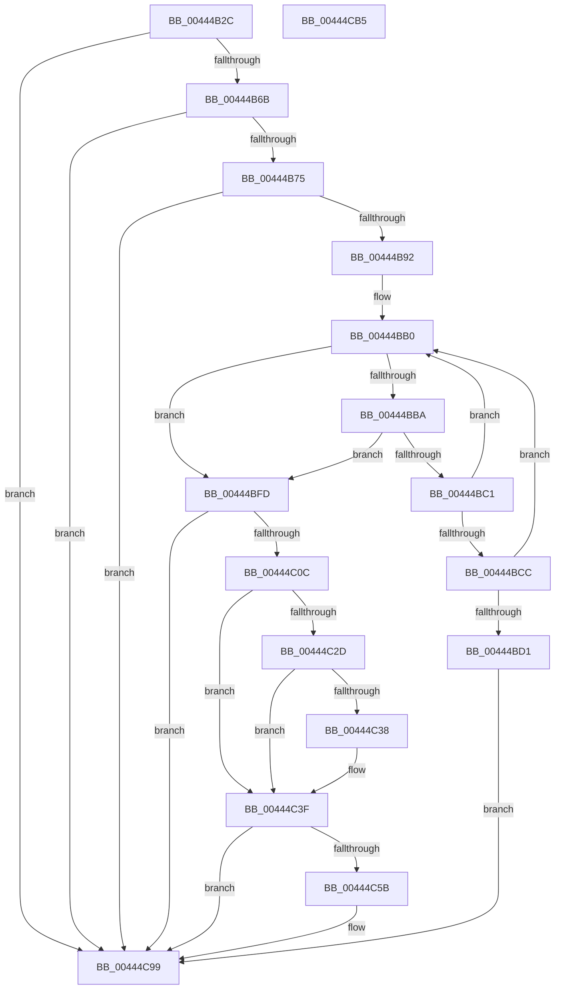

# KiProcessControlProtectionFromKernelMode

- RVA: `0x00444B2C`–`0x00444CB6` (길이 `394` bytes)
- VA: `0x0000000140444B2C`
- 실행 섹션: `.text`
- PDB 이름 있음: `예`; PDB Function 태그: `아니요`
- unwind 정보 RVA: `0x000A5754`
- 디코드: `97`개 명령, `394/394` bytes 표시
- 미해석 바이트: `0` (있으면 어셈블리에 `.byte`로 보존)

> 이 문서는 커널 이미지의 기계어와 PDB 기호를 분석해 생성했습니다. 4번과 5번은 함수 원형과 자료형을 바이너리 사용 방식에서 추정한 C 해석이며 원본 소스 복구 결과는 아닙니다.

## 1. Dependencies

- 직접 호출 지점: **4**; 고유 호출 대상: **4**
- 직접 호출자로 확인된 함수: **1**
- RIP 상대 이미지 참조: **2**

### Outgoing calls
- `0x00444B96` → [KiGetCurrentKernelShadowStackBounds](../5C/KiGetCurrentKernelShadowStackBounds_function_005C816C.md) (function, `0x005C816C`)
- `0x00444BE3` → [VslKernelShadowStackAssist](../3D/VslKernelShadowStackAssist_function_003D5BA0.md) (function, `0x003D5BA0`)
- `0x00444C52` → [KiFixupControlProtectionKernelModeReturnMismatch](../5C/KiFixupControlProtectionKernelModeReturnMismatch_function_005C8028.md) (function, `0x005C8028`)
- `0x00444C8F` → [KiLogControlProtectionKernelModeReturnMismatch](../5C/KiLogControlProtectionKernelModeReturnMismatch_function_005C8284.md) (function, `0x005C8284`)

### Direct callers
- [KiProcessControlProtection](KiProcessControlProtection_function_00444750.md) at `0x00444A90`

### Static image references
- `0x00444BE8` → RVA `0x00FC80B8` (`ALMOSTRO`; read/write)
- `0x00444BFD` → RVA `0x01201843` (`CFGRO`; read)

## 2. Other-region calls and transfers

- 다른 실행 섹션으로 향하는 call: **0**
- 별도 외부 분기/꼬리 이동을 확인하지 못했습니다.

## 3. Assembly (complete function range)

```asm
00444B2C  4C 8B DC                        mov r11, rsp
00444B2F  49 89 5B 10                     mov qword ptr [r11 + 0x10], rbx
00444B33  49 89 6B 18                     mov qword ptr [r11 + 0x18], rbp
00444B37  49 89 73 20                     mov qword ptr [r11 + 0x20], rsi
00444B3B  57                              push rdi
00444B3C  41 56                           push r14
00444B3E  41 57                           push r15
00444B40  48 83 EC 50                     sub rsp, 0x50
00444B44  48 8B 81 60 01 00 00            mov rax, qword ptr [rcx + 0x160]
00444B4B  33 DB                           xor ebx, ebx
00444B4D  33 FF                           xor edi, edi
00444B4F  49 89 5B 08                     mov qword ptr [r11 + 8], rbx
00444B53  48 FF C8                        dec rax
00444B56  48 8B F1                        mov rsi, rcx
00444B59  F3 48 0F 1E CF                  rdsspq rdi
00444B5E  8D 6B 02                        lea ebp, [rbx + 2]
00444B61  48 83 F8 01                     cmp rax, 1
00444B65  0F 87 2E 01 00 00               ja 0x140444c99
00444B6B  40 F6 C7 07                     test dil, 7
00444B6F  0F 85 24 01 00 00               jne 0x140444c99
00444B75  48 8B 81 80 01 00 00            mov rax, qword ptr [rcx + 0x180]
00444B7C  4C 8B 30                        mov r14, qword ptr [rax]
00444B7F  48 B8 00 00 00 00 00 80 FF FF   movabs rax, 0xffff800000000000
00444B89  4C 3B F0                        cmp r14, rax
00444B8C  0F 82 07 01 00 00               jb 0x140444c99
00444B92  49 8D 4B 08                     lea rcx, [r11 + 8]
00444B96  E8 D1 35 18 00                  call 0x1405c816c
00444B9B  48 8B 96 D8 00 00 00            mov rdx, qword ptr [rsi + 0xd8]
00444BA2  4C 8B D0                        mov r10, rax
00444BA5  48 8B 8E 60 01 00 00            mov rcx, qword ptr [rsi + 0x160]
00444BAC  4C 8D 4A 18                     lea r9, [rdx + 0x18]
00444BB0  49 83 C1 08                     add r9, 8
00444BB4  48 83 F9 01                     cmp rcx, 1
00444BB8  75 43                           jne 0x140444bfd
00444BBA  4C 3B 4C 24 70                  cmp r9, qword ptr [rsp + 0x70]
00444BBF  73 3C                           jae 0x140444bfd
00444BC1  49 8B 01                        mov rax, qword ptr [r9]
00444BC4  48 3D 00 00 01 00               cmp rax, 0x10000
00444BCA  72 E4                           jb 0x140444bb0
00444BCC  49 3B C6                        cmp rax, r14
00444BCF  75 DF                           jne 0x140444bb0
00444BD1  C7 44 24 28 04 00 00 00         mov dword ptr [rsp + 0x28], 4
00444BD9  45 33 C0                        xor r8d, r8d
00444BDC  33 C9                           xor ecx, ecx
00444BDE  48 89 5C 24 20                  mov qword ptr [rsp + 0x20], rbx
00444BE3  E8 B8 0F F9 FF                  call 0x1403d5ba0
00444BE8  F0 FF 05 C9 34 B8 00            lock inc dword ptr [rip + 0xb834c9]
00444BEF  C1 F8 1F                        sar eax, 0x1f
00444BF2  83 E0 01                        and eax, 1
00444BF5  8D 68 01                        lea ebp, [rax + 1]
00444BF8  E9 9C 00 00 00                  jmp 0x140444c99
00444BFD  38 1D 40 CC DB 00               cmp byte ptr [rip + 0xdbcc40], bl
00444C03  4C 8B FB                        mov r15, rbx
00444C06  0F 84 8D 00 00 00               je 0x140444c99
00444C0C  65 48 8B 04 25 88 01 00 00      mov rax, qword ptr gs:[0x188]
00444C15  48 8B 80 20 04 00 00            mov rax, qword ptr [rax + 0x420]
00444C1C  48 25 00 F0 FF FF               and rax, 0xfffffffffffff000
00444C22  48 05 00 10 00 00               add rax, 0x1000
00444C28  48 3B F8                        cmp rdi, rax
00444C2B  72 12                           jb 0x140444c3f
00444C2D  48 05 80 02 00 00               add rax, 0x280
00444C33  48 3B F8                        cmp rdi, rax
00444C36  77 07                           ja 0x140444c3f
00444C38  4C 8D BF 00 08 00 00            lea r15, [rdi + 0x800]
00444C3F  48 3B CD                        cmp rcx, rbp
00444C42  4D 8B CF                        mov r9, r15
00444C45  4D 8B C6                        mov r8, r14
00444C48  49 8B CA                        mov rcx, r10
00444C4B  0F 94 C0                        sete al
00444C4E  88 44 24 20                     mov byte ptr [rsp + 0x20], al
00444C52  E8 D1 33 18 00                  call 0x1405c8028
00444C57  85 C0                           test eax, eax
00444C59  78 3E                           js 0x140444c99
00444C5B  48 8B 86 68 01 00 00            mov rax, qword ptr [rsi + 0x168]
00444C62  48 8D 54 24 30                  lea rdx, [rsp + 0x30]
00444C67  4D 85 FF                        test r15, r15
00444C6A  48 89 5C 24 44                  mov qword ptr [rsp + 0x44], rbx
00444C6F  48 89 44 24 30                  mov qword ptr [rsp + 0x30], rax
00444C74  B9 01 00 00 00                  mov ecx, 1
00444C79  8B 86 60 01 00 00               mov eax, dword ptr [rsi + 0x160]
00444C7F  0F 95 C3                        setne bl
00444C82  89 5C 24 4C                     mov dword ptr [rsp + 0x4c], ebx
00444C86  4C 89 74 24 38                  mov qword ptr [rsp + 0x38], r14
00444C8B  89 44 24 40                     mov dword ptr [rsp + 0x40], eax
00444C8F  E8 F0 35 18 00                  call 0x1405c8284
00444C94  BD 01 00 00 00                  mov ebp, 1
00444C99  4C 8D 5C 24 50                  lea r11, [rsp + 0x50]
00444C9E  8B C5                           mov eax, ebp
00444CA0  49 8B 5B 28                     mov rbx, qword ptr [r11 + 0x28]
00444CA4  49 8B 6B 30                     mov rbp, qword ptr [r11 + 0x30]
00444CA8  49 8B 73 38                     mov rsi, qword ptr [r11 + 0x38]
00444CAC  49 8B E3                        mov rsp, r11
00444CAF  41 5F                           pop r15
00444CB1  41 5E                           pop r14
00444CB3  5F                              pop rdi
00444CB4  C3                              ret
00444CB5  CC                              int3
```

## 4. C-style interpretation (structured pseudocode)

```c
__int64 __fastcall KiProcessControlProtectionFromKernelMode(__int64 a1, __int64 a2, int a3)
{
    __int64 result;
    __int64 v_r15;
    __int64 v_rbp;
    __int64 v_rbx;
    __int64 v_rdi;
    __int64 v_rsp;
    unsigned __int64 v_stack_m18;
    unsigned int v_stack_m1C;
    unsigned __int64 v_stack_m24;
    unsigned int v_stack_m28;
    unsigned __int64 v_stack_m30;
    unsigned __int64 v_stack_m38;
    unsigned int v_stack_m40;
    unsigned __int64 v_stack_m48;
    unsigned __int64 v_stack_p8;

    *(unsigned __int64 *)(v_rsp + 16) = v_rbx;
    *(unsigned __int64 *)(v_rsp + 24) = v_rbp;
    *(unsigned __int64 *)(v_rsp + 32) = v_rsi;
    v_rsp = (v_rsp) - (80);
    v_rbx = 0;
    v_rdi = 0;
    *(unsigned __int64 *)(v_rsp + 8) = 0;
    result = (*(unsigned __int64 *)(a1 + 352)) - 1;
    if (result > 1) goto loc_00444C99;
    if (((0) & (7)) != 0) goto loc_00444C99;
    if ((*(unsigned __int64 *)(*(unsigned __int64 *)(a1 + 384))) < (*(unsigned __int64 *)(a1 + 384))) goto loc_00444C99;
    result = KiGetCurrentKernelShadowStackBounds(v_rsp + 8, a2, a3, a4);
loc_00444BB0:
    a4 = (*(unsigned __int64 *)(a1 + 216) + 24) + (8);
    if ((*(unsigned __int64 *)(a1 + 352)) != 1) goto loc_00444BFD;
    if (a4 >= v_stack_p8) goto loc_00444BFD;
    if ((*(unsigned __int64 *)(a4)) < 0x10000ULL) goto loc_00444BB0;
    if ((*(unsigned __int64 *)(a4)) != (*(unsigned __int64 *)(*(unsigned __int64 *)(a1 + 384)))) goto loc_00444BB0;
    v_stack_m40 = 4;
    a3 = 0;
    a1 = 0;
    v_stack_m48 = 0;
    result = VslKernelShadowStackAssist(a1, *(unsigned __int64 *)(a1 + 216), a3, a4);
    result = (unsigned int)((result) >> (31));
    result = (unsigned int)((result) & (1));
    goto loc_00444C99;
loc_00444BFD:
    if ((*(unsigned __int8 *)(v_rip + 14404672)) == 0) goto loc_00444C99;
    result = (*(unsigned __int64 *)(*(unsigned __int64 *)(gs_base + (0 + 392)) + 1056)) & (0xFFFFFFFFFFFFF000ULL);
    result = (result) + (0x1000ULL);
    if (0 < result) goto loc_00444C3F;
    result = (result) + (640);
    v_r15 = 0;
    if (0 <= result) {
        v_r15 = v_rdi + 2048;
    }
    result = (0 == (result + 1)) ? 1 : 0;
    v_stack_m48 = (unsigned __int8)(result);
    result = KiFixupControlProtectionKernelModeReturnMismatch(result, *(unsigned __int64 *)(a1 + 216), *(unsigned __int64 *)(*(unsigned __int64 *)(a1 + 384)), v_r15);
    v_rbp = result + 1;
    if (!(sign_flag)) {
        result = *(unsigned __int64 *)(a1 + 360);
        a2 = v_stack_m38;
        v_stack_m24 = 0;
        v_stack_m38 = result;
        a1 = 1;
        result = *(unsigned int *)(a1 + 352);
        v_rbx = (v_r15 != 0) ? 1 : 0;
        v_stack_m1C = (unsigned int)(v_rbx);
        v_stack_m30 = *(unsigned __int64 *)(*(unsigned __int64 *)(a1 + 384));
        v_stack_m28 = (unsigned int)(result);
        result = KiLogControlProtectionKernelModeReturnMismatch(a1, a2, *(unsigned __int64 *)(*(unsigned __int64 *)(a1 + 384)), v_r15);
        v_rbp = 1;
    }
    return (unsigned int)((unsigned int)(v_rbp));
}
```

## 5. (Beta) C Style

```c
int64_t KiProcessControlProtectionFromKernelMode(void *Arg1, int64_t Arg2, int32_t Arg3)
{
    uint8_t *arg1 = (uint8_t *)Arg1;

    int64_t result;
    int64_t local_r15;
    int64_t local_rbp;
    int64_t local_rbx;
    int64_t local_rdi;
    int64_t local_rsp;
    uint64_t v_stack_m18;
    uint32_t v_stack_m1C;
    uint64_t v_stack_m24;
    uint32_t v_stack_m28;
    uint64_t v_stack_m30;
    uint64_t v_stack_m38;
    uint32_t v_stack_m40;
    uint64_t v_stack_m48;
    uint64_t v_stack_p8;

    *(uint64_t *)(local_rsp + 0x10) = local_rbx;
    *(uint64_t *)(local_rsp + 0x18) = local_rbp;
    *(uint64_t *)(local_rsp + 0x20) = local_rsi;
    local_rsp = (local_rsp) - (80);
    local_rbx = 0;
    local_rdi = 0;
    *(uint64_t *)(local_rsp + 0x8) = 0;
    result = (*(uint64_t *)(arg1 + 0x160)) - 1;
    if (result > 1) goto loc_00444C99;
    if (((0) & (7)) != 0) goto loc_00444C99;
    if ((*(uint64_t *)(*(uint64_t *)(arg1 + 0x180))) < (*(uint64_t *)(arg1 + 0x180))) goto loc_00444C99;
    result = KiGetCurrentKernelShadowStackBounds(local_rsp + 8, Arg2, Arg3, a4);
loc_00444BB0:
    a4 = (*(uint64_t *)(arg1 + 0xD8) + 24) + (8);
    if ((*(uint64_t *)(arg1 + 0x160)) != 1) goto loc_00444BFD;
    if (a4 >= v_stack_p8) goto loc_00444BFD;
    if ((*(uint64_t *)(a4)) < 0x10000ULL) goto loc_00444BB0;
    if ((*(uint64_t *)(a4)) != (*(uint64_t *)(*(uint64_t *)(arg1 + 0x180)))) goto loc_00444BB0;
    v_stack_m40 = 4;
    Arg3 = 0;
    Arg1 = 0;
    v_stack_m48 = 0;
    result = VslKernelShadowStackAssist(Arg1, *(uint64_t *)(arg1 + 0xD8), Arg3, a4);
    result = (uint32_t)((result) >> (31));
    result = (uint32_t)((result) & (1));
    goto loc_00444C99;
loc_00444BFD:
    if ((*(uint8_t *)(v_rip + 0xDBCC40)) == 0) goto loc_00444C99;
    result = (*(uint64_t *)(*(uint64_t *)(gs_base + (0 + 0x188)) + 0x420)) & (0xFFFFFFFFFFFFF000ULL);
    result = (result) + (0x1000ULL);
    if (0 < result) goto loc_00444C3F;
    result = (result) + (640);
    local_r15 = 0;
    if (0 <= result) {
        local_r15 = local_rdi + 2048;
    }
    result = (0 == (result + 1)) ? 1 : 0;
    v_stack_m48 = (uint8_t)(result);
    result = KiFixupControlProtectionKernelModeReturnMismatch(result, *(uint64_t *)(arg1 + 0xD8), *(uint64_t *)(*(uint64_t *)(arg1 + 0x180)), local_r15);
    local_rbp = result + 1;
    if (!(sign_flag)) {
        result = *(uint64_t *)(arg1 + 0x168);
        Arg2 = v_stack_m38;
        v_stack_m24 = 0;
        v_stack_m38 = result;
        Arg1 = 1;
        result = *(uint32_t *)(arg1 + 0x160);
        local_rbx = (local_r15 != 0) ? 1 : 0;
        v_stack_m1C = (uint32_t)(local_rbx);
        v_stack_m30 = *(uint64_t *)(*(uint64_t *)(arg1 + 0x180));
        v_stack_m28 = (uint32_t)(result);
        result = KiLogControlProtectionKernelModeReturnMismatch(Arg1, Arg2, *(uint64_t *)(*(uint64_t *)(arg1 + 0x180)), local_r15);
        local_rbp = 1;
    }
    return (uint32_t)((uint32_t)(local_rbp));
}
```

### 관측된 메모리 오프셋

구조체 형식이 확인되지 않은 접근은 인자 기준의 오프셋으로만 기록했습니다.

| 기준 인자 | 오프셋 표현 | 폭 (bit) | 접근 |
|---|---:|---:|---|
| `Arg1` | `+ 0xD8` | `64` | `R` |
| `Arg1` | `+ 0x160` | `32` | `R` |
| `Arg1` | `+ 0x160` | `64` | `R` |
| `Arg1` | `+ 0x168` | `64` | `R` |
| `Arg1` | `+ 0x180` | `64` | `R` |

## 6. Execution-region graph

[열기: 2D/3D 그래프와 함수 탐색 컨트롤 패널](../../../control-panel.html?section=text&rva=0x00444B2C&view=graph)

- 2D 그래프는 위에서 아래로 흐르고, 3D 그래프는 빈 공간을 드래그해 회전합니다. Shift+드래그는 이동, 휠은 확대·축소, 함수 노드 선택은 대상 보고서 이동입니다.

### Static fallback


