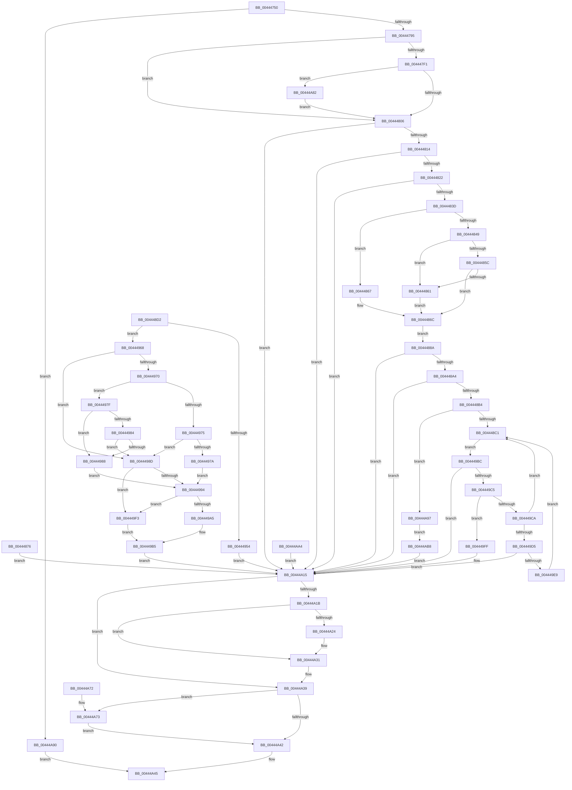

# KiProcessControlProtection

- RVA: `0x00444750`–`0x00444AC8` (길이 `888` bytes)
- VA: `0x0000000140444750`
- 실행 섹션: `.text`
- PDB 이름 있음: `예`; PDB Function 태그: `아니요`
- unwind 정보 RVA: `0x000A56F8`
- 디코드: `212`개 명령, `888/888` bytes 표시
- 미해석 바이트: `0` (있으면 어셈블리에 `.byte`로 보존)

> 이 문서는 커널 이미지의 기계어와 PDB 기호를 분석해 생성했습니다. 4번과 5번은 함수 원형과 자료형을 바이너리 사용 방식에서 추정한 C 해석이며 원본 소스 복구 결과는 아닙니다.

## 1. Dependencies

- 직접 호출 지점: **9**; 고유 호출 대상: **8**
- 직접 호출자로 확인된 함수: **1**
- RIP 상대 이미지 참조: **4**

### Outgoing calls
- `0x00444867` → [ExRaiseDatatypeMisalignment](../../page/89/ExRaiseDatatypeMisalignment_function_00899FD0.md) (function, `0x00899FD0`)
- `0x00444911` → [KiCheckUserAddressCetCompat](../../page/8D/KiCheckUserAddressCetCompat_function_008D9AF8.md) (function, `0x008D9AF8`)
- `0x00444922` → [KiCheckUserAddressCetCompat](../../page/8D/KiCheckUserAddressCetCompat_function_008D9AF8.md) (function, `0x008D9AF8`)
- `0x0044499C` → [KiFixupControlProtectionUserModeReturnMismatch](../48/KiFixupControlProtectionUserModeReturnMismatch_function_0048E5C4.md) (function, `0x0048E5C4`)
- `0x00444A2C` → [KiLowerIrqlProcessIrqlFlags](../4F/KiLowerIrqlProcessIrqlFlags_function_004F5698.md) (function, `0x004F5698`)
- `0x00444A50` → [_security_check_cookie](../6A/_security_check_cookie_function_006AC640.md) (function, `0x006AC640`)
- `0x00444A7B` → [KiLogControlProtectionUserModeReturnMismatch](KiLogControlProtectionUserModeReturnMismatch_function_00444AD0.md) (function, `0x00444AD0`)
- `0x00444A86` → [KiRaiseIrqlProcessIrqlFlags](../4F/KiRaiseIrqlProcessIrqlFlags_function_004F56FC.md) (function, `0x004F56FC`)
- `0x00444A90` → [KiProcessControlProtectionFromKernelMode](KiProcessControlProtectionFromKernelMode_function_00444B2C.md) (function, `0x00444B2C`)

### Direct callers
- [KiControlProtectionFault](../6C/KiControlProtectionFault_function_006C3040.md) at `0x006C3391`

### Static image references
- `0x0044476A` → RVA `0x00E0A740` (`.data`; read)
- `0x004447F9` → RVA `0x00FC6D20` (`ALMOSTRO`; read)
- `0x004448B4` → RVA `0x00FC7500` (`ALMOSTRO`; read)
- `0x00444900` → RVA `0x00FC6E80` (`ALMOSTRO`; read)

## 2. Other-region calls and transfers

- 다른 실행 섹션으로 향하는 call: **3**
  - `0x00444867` → [ExRaiseDatatypeMisalignment](../../page/89/ExRaiseDatatypeMisalignment_function_00899FD0.md) (`.text` → `PAGE`)
  - `0x00444911` → [KiCheckUserAddressCetCompat](../../page/8D/KiCheckUserAddressCetCompat_function_008D9AF8.md) (`.text` → `PAGE`)
  - `0x00444922` → [KiCheckUserAddressCetCompat](../../page/8D/KiCheckUserAddressCetCompat_function_008D9AF8.md) (`.text` → `PAGE`)
- 별도 외부 분기/꼬리 이동을 확인하지 못했습니다.

## 3. Assembly (complete function range)

```asm
00444750  48 89 5C 24 10                  mov qword ptr [rsp + 0x10], rbx
00444755  48 89 74 24 18                  mov qword ptr [rsp + 0x18], rsi
0044475A  57                              push rdi
0044475B  41 54                           push r12
0044475D  41 55                           push r13
0044475F  41 56                           push r14
00444761  41 57                           push r15
00444763  48 81 EC 90 00 00 00            sub rsp, 0x90
0044476A  48 8B 05 CF 5F 9C 00            mov rax, qword ptr [rip + 0x9c5fcf]
00444771  48 33 C4                        xor rax, rsp
00444774  48 89 84 24 80 00 00 00         mov qword ptr [rsp + 0x80], rax
0044477C  48 8B D9                        mov rbx, rcx
0044477F  45 33 F6                        xor r14d, r14d
00444782  4C 89 74 24 30                  mov qword ptr [rsp + 0x30], r14
00444787  66 83 B9 70 01 00 00 10         cmp word ptr [rcx + 0x170], 0x10
0044478F  0F 84 FB 02 00 00               je 0x140444a90
00444795  65 48 8B 04 25 88 01 00 00      mov rax, qword ptr gs:[0x188]
0044479E  48 8B 88 B8 00 00 00            mov rcx, qword ptr [rax + 0xb8]
004447A5  48 89 4C 24 40                  mov qword ptr [rsp + 0x40], rcx
004447AA  44 89 74 24 28                  mov dword ptr [rsp + 0x28], r14d
004447AF  4C 89 74 24 30                  mov qword ptr [rsp + 0x30], r14
004447B4  48 8B BB 68 01 00 00            mov rdi, qword ptr [rbx + 0x168]
004447BB  48 89 7C 24 48                  mov qword ptr [rsp + 0x48], rdi
004447C0  41 BF 02 00 00 00               mov r15d, 2
004447C6  44 89 7C 24 24                  mov dword ptr [rsp + 0x24], r15d
004447CB  4C 8B A9 A8 01 00 00            mov r13, qword ptr [rcx + 0x1a8]
004447D2  0F 57 C0                        xorps xmm0, xmm0
004447D5  0F 11 44 24 60                  movups xmmword ptr [rsp + 0x60], xmm0
004447DA  0F 11 44 24 70                  movups xmmword ptr [rsp + 0x70], xmm0
004447DF  44 0F 20 C6                     mov rsi, cr8
004447E3  40 88 74 24 20                  mov byte ptr [rsp + 0x20], sil
004447E8  45 8D 66 01                     lea r12d, [r14 + 1]
004447EC  41 3A F4                        cmp sil, r12b
004447EF  73 15                           jae 0x140444806
004447F1  44 0F 20 C1                     mov rcx, cr8
004447F5  45 0F 22 C4                     mov cr8, r12
004447F9  44 39 35 20 25 B8 00            cmp dword ptr [rip + 0xb82520], r14d
00444800  0F 85 7C 02 00 00               jne 0x140444a82
00444806  66 83 BB 70 01 00 00 33         cmp word ptr [rbx + 0x170], 0x33
0044480E  0F 85 01 02 00 00               jne 0x140444a15
00444814  48 83 BB 60 01 00 00 01         cmp qword ptr [rbx + 0x160], 1
0044481C  0F 85 F3 01 00 00               jne 0x140444a15
00444822  B9 A7 06 00 00                  mov ecx, 0x6a7
00444827  0F 32                           rdmsr
00444829  48 C1 E2 20                     shl rdx, 0x20
0044482D  48 0B C2                        or rax, rdx
00444830  48 89 44 24 50                  mov qword ptr [rsp + 0x50], rax
00444835  A8 07                           test al, 7
00444837  0F 85 D8 01 00 00               jne 0x140444a15
0044483D  48 8B 93 80 01 00 00            mov rdx, qword ptr [rbx + 0x180]
00444844  F6 C2 07                        test dl, 7
00444847  75 1E                           jne 0x140444867
00444849  48 8D 4A 08                     lea rcx, [rdx + 8]
0044484D  49 B8 00 00 FF FF FF 7F 00 00   movabs r8, 0x7fffffff0000
00444857  49 3B C8                        cmp rcx, r8
0044485A  77 05                           ja 0x140444861
0044485C  48 3B CA                        cmp rcx, rdx
0044485F  73 0B                           jae 0x14044486c
00444861  41 0F B6 08                     movzx ecx, byte ptr [r8]
00444865  EB 05                           jmp 0x14044486c
00444867  E8 64 57 45 00                  call 0x140899fd0
0044486C  4C 8B 02                        mov r8, qword ptr [rdx]
0044486F  4C 89 44 24 30                  mov qword ptr [rsp + 0x30], r8
00444874  EB 14                           jmp 0x14044488a
00444876  44 8B 74 24 28                  mov r14d, dword ptr [rsp + 0x28]
0044487B  0F B6 74 24 20                  movzx esi, byte ptr [rsp + 0x20]
00444880  44 8B 7C 24 24                  mov r15d, dword ptr [rsp + 0x24]
00444885  E9 8B 01 00 00                  jmp 0x140444a15
0044488A  49 8D 88 00 00 FF FF            lea rcx, [r8 - 0x10000]
00444891  49 B9 FF FF FD FF FF 7F 00 00   movabs r9, 0x7ffffffdffff
0044489B  49 3B C9                        cmp rcx, r9
0044489E  0F 87 71 01 00 00               ja 0x140444a15
004448A4  48 8D 8F 00 00 FF FF            lea rcx, [rdi - 0x10000]
004448AB  49 3B C9                        cmp rcx, r9
004448AE  0F 87 61 01 00 00               ja 0x140444a15
004448B4  4C 3B 05 45 2C B8 00            cmp r8, qword ptr [rip + 0xb82c45]
004448BB  0F 84 D6 01 00 00               je 0x140444a97
004448C1  48 83 C0 08                     add rax, 8
004448C5  48 8B 10                        mov rdx, qword ptr [rax]
004448C8  48 89 54 24 58                  mov qword ptr [rsp + 0x58], rdx
004448CD  E9 EA 00 00 00                  jmp 0x1404449bc
004448D2  44 8B F8                        mov r15d, eax
004448D5  C7 44 24 38 03 00 00 00         mov dword ptr [rsp + 0x38], 3
004448DD  48 8B 74 24 40                  mov rsi, qword ptr [rsp + 0x40]
004448E2  44 8B B6 54 07 00 00            mov r14d, dword ptr [rsi + 0x754]
004448E9  45 8B EE                        mov r13d, r14d
004448EC  41 C1 ED 14                     shr r13d, 0x14
004448F0  41 80 E5 01                     and r13b, 1
004448F4  41 8B C6                        mov eax, r14d
004448F7  C1 E8 0F                        shr eax, 0xf
004448FA  24 01                           and al, 1
004448FC  89 44 24 28                     mov dword ptr [rsp + 0x28], eax
00444900  8B 1D 7A 25 B8 00               mov ebx, dword ptr [rip + 0xb8257a]
00444906  48 8B 7C 24 48                  mov rdi, qword ptr [rsp + 0x48]
0044490B  48 8B D7                        mov rdx, rdi
0044490E  48 8B CE                        mov rcx, rsi
00444911  E8 E2 51 49 00                  call 0x1408d9af8
00444916  44 0F B6 E0                     movzx r12d, al
0044491A  48 8B 54 24 30                  mov rdx, qword ptr [rsp + 0x30]
0044491F  48 8B CE                        mov rcx, rsi
00444922  E8 D1 51 49 00                  call 0x1408d9af8
00444927  44 89 74 24 60                  mov dword ptr [rsp + 0x60], r14d
0044492C  89 5C 24 64                     mov dword ptr [rsp + 0x64], ebx
00444930  48 89 7C 24 68                  mov qword ptr [rsp + 0x68], rdi
00444935  48 8B 54 24 30                  mov rdx, qword ptr [rsp + 0x30]
0044493A  48 89 54 24 70                  mov qword ptr [rsp + 0x70], rdx
0044493F  44 89 64 24 78                  mov dword ptr [rsp + 0x78], r12d
00444944  0F B6 C8                        movzx ecx, al
00444947  89 4C 24 7C                     mov dword ptr [rsp + 0x7c], ecx
0044494B  41 81 FF 05 00 00 C0            cmp r15d, 0xc0000005
00444952  74 14                           je 0x140444968
00444954  0F B6 74 24 20                  movzx esi, byte ptr [rsp + 0x20]
00444959  44 8B 7C 24 24                  mov r15d, dword ptr [rsp + 0x24]
0044495E  4C 8B 74 24 38                  mov r14, qword ptr [rsp + 0x38]
00444963  E9 AD 00 00 00                  jmp 0x140444a15
00444968  40 32 FF                        xor dil, dil
0044496B  45 84 ED                        test r13b, r13b
0044496E  75 1D                           jne 0x14044498d
00444970  F6 C3 01                        test bl, 1
00444973  75 0A                           jne 0x14044497f
00444975  45 84 E4                        test r12b, r12b
00444978  75 13                           jne 0x14044498d
0044497A  40 B7 01                        mov dil, 1
0044497D  EB 15                           jmp 0x140444994
0044497F  45 84 E4                        test r12b, r12b
00444982  74 04                           je 0x140444988
00444984  84 C0                           test al, al
00444986  75 05                           jne 0x14044498d
00444988  40 B7 01                        mov dil, 1
0044498B  EB 07                           jmp 0x140444994
0044498D  40 38 7C 24 28                  cmp byte ptr [rsp + 0x28], dil
00444992  74 5F                           je 0x1404449f3
00444994  4C 8B C2                        mov r8, rdx
00444997  48 8B 4C 24 50                  mov rcx, qword ptr [rsp + 0x50]
0044499C  E8 23 9C 04 00                  call 0x14048e5c4
004449A1  85 C0                           test eax, eax
004449A3  78 4E                           js 0x1404449f3
004449A5  33 C0                           xor eax, eax
004449A7  44 8D 78 01                     lea r15d, [rax + 1]
004449AB  40 84 FF                        test dil, dil
004449AE  0F 95 C0                        setne al
004449B1  44 8D 70 01                     lea r14d, [rax + 1]
004449B5  0F B6 74 24 20                  movzx esi, byte ptr [rsp + 0x20]
004449BA  EB 59                           jmp 0x140444a15
004449BC  48 81 FA 00 00 01 00            cmp rdx, 0x10000
004449C3  72 50                           jb 0x140444a15
004449C5  49 3B D0                        cmp rdx, r8
004449C8  74 35                           je 0x1404449ff
004449CA  A9 FF 0F 00 00                  test eax, 0xfff
004449CF  0F 85 EC FE FF FF               jne 0x1404448c1
004449D5  65 48 8B 0C 25 88 01 00 00      mov rcx, qword ptr gs:[0x188]
004449DE  8B 89 A0 05 00 00               mov ecx, dword ptr [rcx + 0x5a0]
004449E4  F6 C1 01                        test cl, 1
004449E7  75 2C                           jne 0x140444a15
004449E9  4C 8B 44 24 30                  mov r8, qword ptr [rsp + 0x30]
004449EE  E9 CE FE FF FF                  jmp 0x1404448c1
004449F3  44 8B 7C 24 24                  mov r15d, dword ptr [rsp + 0x24]
004449F8  4C 8B 74 24 38                  mov r14, qword ptr [rsp + 0x38]
004449FD  EB B6                           jmp 0x1404449b5
004449FF  48 8B D0                        mov rdx, rax
00444A02  48 C1 EA 20                     shr rdx, 0x20
00444A06  B9 A7 06 00 00                  mov ecx, 0x6a7
00444A0B  0F 30                           wrmsr
00444A0D  45 8B FC                        mov r15d, r12d
00444A10  F0 41 FF 45 50                  lock inc dword ptr [r13 + 0x50]
00444A15  40 80 FE 01                     cmp sil, 1
00444A19  73 1E                           jae 0x140444a39
00444A1B  83 3D FE 22 B8 00 00            cmp dword ptr [rip + 0xb822fe], 0
00444A22  74 0D                           je 0x140444a31
00444A24  44 0F 20 C1                     mov rcx, cr8
00444A28  40 0F B6 D6                     movzx edx, sil
00444A2C  E8 67 0C 0B 00                  call 0x1404f5698
00444A31  40 0F B6 D6                     movzx edx, sil
00444A35  44 0F 22 C2                     mov cr8, rdx
00444A39  41 8D 56 FF                     lea edx, [r14 - 1]
00444A3D  83 FA 02                        cmp edx, 2
00444A40  76 31                           jbe 0x140444a73
00444A42  41 8B C7                        mov eax, r15d
00444A45  48 8B 8C 24 80 00 00 00         mov rcx, qword ptr [rsp + 0x80]
00444A4D  48 33 CC                        xor rcx, rsp
00444A50  E8 EB 7B 26 00                  call 0x1406ac640
00444A55  4C 8D 9C 24 90 00 00 00         lea r11, [rsp + 0x90]
00444A5D  49 8B 5B 38                     mov rbx, qword ptr [r11 + 0x38]
00444A61  49 8B 73 40                     mov rsi, qword ptr [r11 + 0x40]
00444A65  49 8B E3                        mov rsp, r11
00444A68  41 5F                           pop r15
00444A6A  41 5E                           pop r14
00444A6C  41 5D                           pop r13
00444A6E  41 5C                           pop r12
00444A70  5F                              pop rdi
00444A71  C3                              ret
00444A72  CC                              int3
00444A73  4C 8D 44 24 60                  lea r8, [rsp + 0x60]
00444A78  41 8B CE                        mov ecx, r14d
00444A7B  E8 50 00 00 00                  call 0x140444ad0
00444A80  EB C0                           jmp 0x140444a42
00444A82  41 0F B6 D4                     movzx edx, r12b
00444A86  E8 71 0C 0B 00                  call 0x1404f56fc
00444A8B  E9 76 FD FF FF                  jmp 0x140444806
00444A90  E8 97 00 00 00                  call 0x140444b2c
00444A95  EB AE                           jmp 0x140444a45
00444A97  48 8B 08                        mov rcx, qword ptr [rax]
00444A9A  48 89 4C 24 38                  mov qword ptr [rsp + 0x38], rcx
00444A9F  48 89 0A                        mov qword ptr [rdx], rcx
00444AA2  EB 14                           jmp 0x140444ab8
00444AA4  44 8B 74 24 28                  mov r14d, dword ptr [rsp + 0x28]
00444AA9  0F B6 74 24 20                  movzx esi, byte ptr [rsp + 0x20]
00444AAE  44 8B 7C 24 24                  mov r15d, dword ptr [rsp + 0x24]
00444AB3  E9 5D FF FF FF                  jmp 0x140444a15
00444AB8  41 BF 03 00 00 00               mov r15d, 3
00444ABE  F0 41 FF 45 54                  lock inc dword ptr [r13 + 0x54]
00444AC3  E9 4D FF FF FF                  jmp 0x140444a15
```

## 4. C-style interpretation (structured pseudocode)

```c
__int64 __fastcall KiProcessControlProtection(__int64 a1, __int64 a2)
{
    __int64 result;
    __int64 v_r14;
    __int64 v_rsp;
    unsigned __int64 v_stack_m28;
    unsigned __int64 v_stack_m30;
    unsigned __int64 v_stack_m38;
    unsigned int v_stack_m3C;
    unsigned int v_stack_m40;
    unsigned __int64 v_stack_m48;
    unsigned __int64 v_stack_m50;
    unsigned int v_stack_m54;
    unsigned __int64 v_stack_m58;
    unsigned __int64 v_stack_m60;
    unsigned __int64 v_stack_m68;
    unsigned int v_stack_m6C;
    unsigned __int64 v_stack_m70;
    unsigned __int64 v_stack_m78;
    unsigned int v_stack_m80;
    unsigned __int64 v_stack_m88;
    unsigned int v_stack_m90;
    unsigned int v_stack_m94;
    unsigned __int8 v_stack_m98;
    unsigned __int64 v_stack_p10;
    unsigned __int64 v_stack_p18;

    v_stack_p10 = v_rbx;
    v_stack_p18 = v_rsi;
    v_rsp = (v_rsp) - (144);
    result = (*(unsigned __int64 *)(v_rip + 10248143)) ^ (v_rsp);
    v_stack_m38 = result;
    v_r14 = 0;
    v_stack_m88 = 0;
    if ((*(unsigned __int16 *)(a1 + 368)) == 16) goto loc_00444A90;
    v_stack_m78 = *(unsigned __int64 *)(*(unsigned __int64 *)(gs_base + (0 + 392)) + 184);
    v_stack_m90 = 0;
    v_stack_m88 = 0;
    v_stack_m70 = *(unsigned __int64 *)(a1 + 360);
    v_stack_m94 = 2;
    v_stack_m58 = v_xmm0;
    v_stack_m48 = v_xmm0;
    v_stack_m98 = (unsigned __int8)(v_cr8);
    if (((unsigned __int8)(v_cr8)) >= ((unsigned __int8)(v_r14 + 1))) goto loc_00444806;
    if ((*(unsigned int *)(v_rip + 12068128)) != 0) goto loc_00444A82;
loc_00444806:
    if ((*(unsigned __int16 *)(a1 + 368)) != 51) goto loc_00444A15;
    if ((*(unsigned __int64 *)(a1 + 352)) != 1) goto loc_00444A15;
    a2 = (a2) << (32);
    result = (*(unsigned __int64 *)(gs_base + (0 + 392))) | (a2);
    v_stack_m68 = result;
    if ((((unsigned __int8)(result)) & (7)) != 0) goto loc_00444A15;
    if ((((unsigned __int8)(*(unsigned __int64 *)(a1 + 384))) & (7)) != 0) goto loc_00444867;
    if ((*(unsigned __int64 *)(a1 + 384) + 8) > a3) goto loc_00444861;
    if ((*(unsigned __int64 *)(a1 + 384) + 8) >= (*(unsigned __int64 *)(a1 + 384))) goto loc_0044486C;
loc_00444861:
    goto loc_0044486C;
loc_00444867:
    result = ExRaiseDatatypeMisalignment(*(unsigned __int8 *)(a3), *(unsigned __int64 *)(a1 + 384), a3, a4);
loc_0044486C:
    v_stack_m88 = *(unsigned __int64 *)(*(unsigned __int64 *)(a1 + 384));
    goto loc_0044488A;
loc_0044488A:
    if ((*(unsigned __int64 *)(*(unsigned __int64 *)(a1 + 384)) - 65536) > a4) goto loc_00444A15;
    if ((*(unsigned __int64 *)(a1 + 360) - 65536) > a4) goto loc_00444A15;
    if ((*(unsigned __int64 *)(*(unsigned __int64 *)(a1 + 384))) == (*(unsigned __int64 *)(v_rip + 12069957))) goto loc_00444A97;
loc_004448C1:
    result = (result) + (8);
    v_stack_m60 = *(unsigned __int64 *)(result);
    goto loc_004449BC;
loc_004449BC:
    if ((*(unsigned __int64 *)(result)) < 0x10000ULL) goto loc_00444A15;
    if ((*(unsigned __int64 *)(result)) == (*(unsigned __int64 *)(*(unsigned __int64 *)(a1 + 384)))) goto loc_004449FF;
    if ((((unsigned int)(result)) & (0xFFFULL)) != 0) goto loc_004448C1;
    if ((((unsigned __int8)((unsigned int)(*(unsigned int *)(*(unsigned __int64 *)(gs_base + (0 + 392)) + 1440)))) & (1)) != 0) goto loc_00444A15;
    goto loc_004448C1;
loc_004449FF:
    a2 = (result) >> (32);
loc_00444A15:
    if (((unsigned __int8)(v_cr8)) >= 1) goto loc_00444A39;
    if ((*(unsigned int *)(v_rip + 12067582)) != 0) {
        a1 = v_r14 + 1;
        a2 = (unsigned __int8)(v_cr8);
        result = KiLowerIrqlProcessIrqlFlags(a1, a2, v_stack_m88, a4);
    }
loc_00444A39:
    if (((unsigned int)(v_r14 - 1)) <= 2) goto loc_00444A73;
loc_00444A42:
loc_00444A45:
    a1 = (v_stack_m38) ^ (v_rsp);
    result = _security_check_cookie(a1, v_r14 - 1, v_stack_m88, a4);
    return result;
loc_00444A73:
    result = KiLogControlProtectionUserModeReturnMismatch(0, v_r14 - 1, v_stack_m30, a4);
    goto loc_00444A42;
loc_00444A82:
    result = KiRaiseIrqlProcessIrqlFlags(0, (unsigned __int8)(v_r14 + 1), v_stack_m30, a4);
    goto loc_00444806;
loc_00444A90:
    result = KiProcessControlProtectionFromKernelMode(0, (unsigned __int8)(v_r14 + 1), v_stack_m30, a4);
    goto loc_00444A45;
loc_00444A97:
    v_stack_m58 = *(unsigned __int64 *)(result);
    *(unsigned __int64 *)((unsigned __int8)(v_r14 + 1)) = *(unsigned __int64 *)(result);
    goto loc_00444AB8;
loc_00444AB8:
    goto loc_00444A15;
}
```

## 5. (Beta) C Style

```c
int64_t KiProcessControlProtection(void *Arg1, int64_t Arg2)
{
    uint8_t *arg1 = (uint8_t *)Arg1;

    int64_t result;
    int64_t local_r14;
    int64_t local_rsp;
    uint64_t v_stack_m28;
    uint64_t v_stack_m30;
    uint64_t v_stack_m38;
    uint32_t v_stack_m3C;
    uint32_t v_stack_m40;
    uint64_t v_stack_m48;
    uint64_t v_stack_m50;
    uint32_t v_stack_m54;
    uint64_t v_stack_m58;
    uint64_t v_stack_m60;
    uint64_t v_stack_m68;
    uint32_t v_stack_m6C;
    uint64_t v_stack_m70;
    uint64_t v_stack_m78;
    uint32_t v_stack_m80;
    uint64_t v_stack_m88;
    uint32_t v_stack_m90;
    uint32_t v_stack_m94;
    uint8_t v_stack_m98;
    uint64_t v_stack_p10;
    uint64_t v_stack_p18;

    v_stack_p10 = local_rbx;
    v_stack_p18 = local_rsi;
    local_rsp = (local_rsp) - (144);
    result = (*(uint64_t *)(v_rip + 0x9C5FCF)) ^ (local_rsp);
    v_stack_m38 = result;
    local_r14 = 0;
    v_stack_m88 = 0;
    if ((*(uint16_t *)(arg1 + 0x170)) == 16) goto loc_00444A90;
    v_stack_m78 = *(uint64_t *)(*(uint64_t *)(gs_base + (0 + 0x188)) + 0xB8);
    v_stack_m90 = 0;
    v_stack_m88 = 0;
    v_stack_m70 = *(uint64_t *)(arg1 + 0x168);
    v_stack_m94 = 2;
    v_stack_m58 = v_xmm0;
    v_stack_m48 = v_xmm0;
    v_stack_m98 = (uint8_t)(v_cr8);
    if (((uint8_t)(v_cr8)) >= ((uint8_t)(local_r14 + 1))) goto loc_00444806;
    if ((*(uint32_t *)(v_rip + 0xB82520)) != 0) goto loc_00444A82;
loc_00444806:
    if ((*(uint16_t *)(arg1 + 0x170)) != 51) goto loc_00444A15;
    if ((*(uint64_t *)(arg1 + 0x160)) != 1) goto loc_00444A15;
    Arg2 = (Arg2) << (32);
    result = (*(uint64_t *)(gs_base + (0 + 0x188))) | (Arg2);
    v_stack_m68 = result;
    if ((((uint8_t)(result)) & (7)) != 0) goto loc_00444A15;
    if ((((uint8_t)(*(uint64_t *)(arg1 + 0x180))) & (7)) != 0) goto loc_00444867;
    if ((*(uint64_t *)(arg1 + 0x180) + 8) > a3) goto loc_00444861;
    if ((*(uint64_t *)(arg1 + 0x180) + 8) >= (*(uint64_t *)(arg1 + 0x180))) goto loc_0044486C;
loc_00444861:
    goto loc_0044486C;
loc_00444867:
    result = ExRaiseDatatypeMisalignment(*(uint8_t *)(a3), *(uint64_t *)(arg1 + 0x180), a3, a4);
loc_0044486C:
    v_stack_m88 = *(uint64_t *)(*(uint64_t *)(arg1 + 0x180));
    goto loc_0044488A;
loc_0044488A:
    if ((*(uint64_t *)(*(uint64_t *)(arg1 + 0x180)) - 65536) > a4) goto loc_00444A15;
    if ((*(uint64_t *)(arg1 + 0x168) - 65536) > a4) goto loc_00444A15;
    if ((*(uint64_t *)(*(uint64_t *)(arg1 + 0x180))) == (*(uint64_t *)(v_rip + 0xB82C45))) goto loc_00444A97;
loc_004448C1:
    result = (result) + (8);
    v_stack_m60 = *(uint64_t *)(result);
    goto loc_004449BC;
loc_004449BC:
    if ((*(uint64_t *)(result)) < 0x10000ULL) goto loc_00444A15;
    if ((*(uint64_t *)(result)) == (*(uint64_t *)(*(uint64_t *)(arg1 + 0x180)))) goto loc_004449FF;
    if ((((uint32_t)(result)) & (0xFFFULL)) != 0) goto loc_004448C1;
    if ((((uint8_t)((uint32_t)(*(uint32_t *)(*(uint64_t *)(gs_base + (0 + 0x188)) + 0x5A0)))) & (1)) != 0) goto loc_00444A15;
    goto loc_004448C1;
loc_004449FF:
    Arg2 = (result) >> (32);
loc_00444A15:
    if (((uint8_t)(v_cr8)) >= 1) goto loc_00444A39;
    if ((*(uint32_t *)(v_rip + 0xB822FE)) != 0) {
        Arg1 = local_r14 + 1;
        Arg2 = (uint8_t)(v_cr8);
        result = KiLowerIrqlProcessIrqlFlags(Arg1, Arg2, v_stack_m88, a4);
    }
loc_00444A39:
    if (((uint32_t)(local_r14 - 1)) <= 2) goto loc_00444A73;
loc_00444A42:
loc_00444A45:
    Arg1 = (v_stack_m38) ^ (local_rsp);
    result = _security_check_cookie(Arg1, local_r14 - 1, v_stack_m88, a4);
    return result;
loc_00444A73:
    result = KiLogControlProtectionUserModeReturnMismatch(0, local_r14 - 1, v_stack_m30, a4);
    goto loc_00444A42;
loc_00444A82:
    result = KiRaiseIrqlProcessIrqlFlags(0, (uint8_t)(local_r14 + 1), v_stack_m30, a4);
    goto loc_00444806;
loc_00444A90:
    result = KiProcessControlProtectionFromKernelMode(0, (uint8_t)(local_r14 + 1), v_stack_m30, a4);
    goto loc_00444A45;
loc_00444A97:
    v_stack_m58 = *(uint64_t *)(result);
    *(uint64_t *)((uint8_t)(local_r14 + 0x1)) = *(uint64_t *)(result);
    goto loc_00444AB8;
loc_00444AB8:
    goto loc_00444A15;
}
```

### 관측된 메모리 오프셋

구조체 형식이 확인되지 않은 접근은 인자 기준의 오프셋으로만 기록했습니다.

| 기준 인자 | 오프셋 표현 | 폭 (bit) | 접근 |
|---|---:|---:|---|
| `Arg1` | `+ 0x160` | `64` | `R` |
| `Arg1` | `+ 0x168` | `64` | `R` |
| `Arg1` | `+ 0x170` | `16` | `R` |
| `Arg1` | `+ 0x180` | `64` | `R` |

## 6. Execution-region graph

[열기: 2D/3D 그래프와 함수 탐색 컨트롤 패널](../../../control-panel.html?section=text&rva=0x00444750&view=graph)

- 2D 그래프는 위에서 아래로 흐르고, 3D 그래프는 빈 공간을 드래그해 회전합니다. Shift+드래그는 이동, 휠은 확대·축소, 함수 노드 선택은 대상 보고서 이동입니다.

### Static fallback


