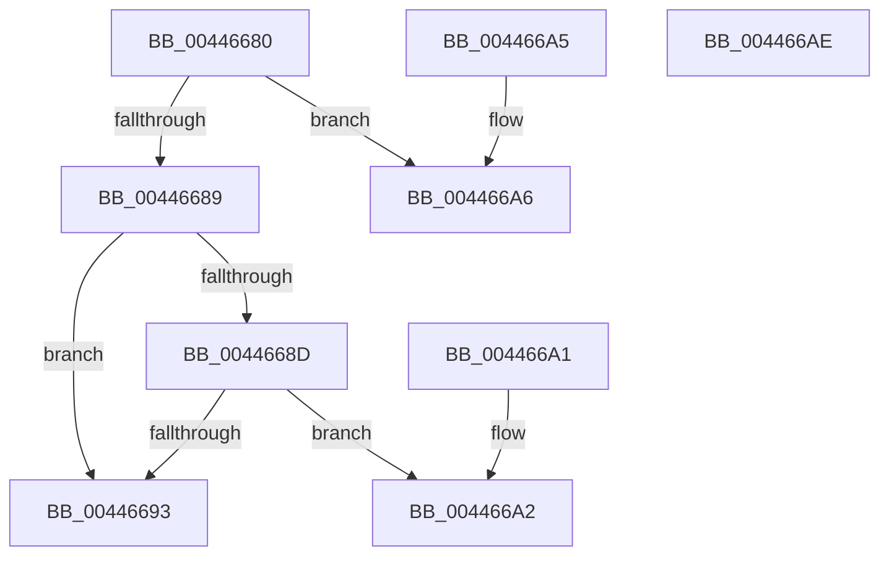

# KiSelectActiveTimerTable

- RVA: `0x00446680`–`0x004466AF` (길이 `47` bytes)
- VA: `0x0000000140446680`
- 실행 섹션: `.text`
- PDB 이름 있음: `예`; PDB Function 태그: `아니요`
- unwind 정보 RVA: `0x000DB714`
- 디코드: `16`개 명령, `47/47` bytes 표시
- 미해석 바이트: `0` (있으면 어셈블리에 `.byte`로 보존)

> 이 문서는 커널 이미지의 기계어와 PDB 기호를 분석해 생성했습니다. 4번과 5번은 함수 원형과 자료형을 바이너리 사용 방식에서 추정한 C 해석이며 원본 소스 복구 결과는 아닙니다.

## 1. Dependencies

- 직접 호출 지점: **0**; 고유 호출 대상: **0**
- 직접 호출자로 확인된 함수: **2**
- RIP 상대 이미지 참조: **2**

### Outgoing calls
- 직접 디코드된 call 명령이 없습니다.

### Direct callers
- [KiRetireDpcList](../21/KiRetireDpcList_function_0021A0B0.md) at `0x0021AC87`
- [KiAdjustTimersAfterDripsExit](../5B/KiAdjustTimersAfterDripsExit_function_005BB490.md) at `0x005BB530`

### Static image references
- `0x00446680` → RVA `0x00FC5030` (`ALMOSTRO`; read)
- `0x00446693` → RVA `0x00FC8C40` (`ALMOSTRO`; read)

## 2. Other-region calls and transfers

- 다른 실행 섹션으로 향하는 call: **0**
- 별도 외부 분기/꼬리 이동을 확인하지 못했습니다.

## 3. Assembly (complete function range)

```asm
00446680  83 3D A9 E9 B7 00 00            cmp dword ptr [rip + 0xb7e9a9], 0
00446687  74 1D                           je 0x1404466a6
00446689  84 D2                           test dl, dl
0044668B  74 06                           je 0x140446693
0044668D  80 79 21 00                     cmp byte ptr [rcx + 0x21], 0
00446691  74 0F                           je 0x1404466a2
00446693  48 8B 05 A6 25 B8 00            mov rax, qword ptr [rip + 0xb825a6]
0044669A  48 05 00 41 00 00               add rax, 0x4100
004466A0  C3                              ret
004466A1  CC                              int3
004466A2  33 C0                           xor eax, eax
004466A4  C3                              ret
004466A5  CC                              int3
004466A6  48 8D 81 00 41 00 00            lea rax, [rcx + 0x4100]
004466AD  C3                              ret
004466AE  CC                              int3
```

## 4. C-style interpretation (structured pseudocode)

```c
__int64 __fastcall KiSelectActiveTimerTable(__int64 a1, unsigned __int8 a2)
{
    __int64 result;

    if ((*(unsigned int *)(v_rip + 12052905)) == 0) goto loc_004466A6;
    if (a2 == 0) goto loc_00446693;
    if ((*(unsigned __int8 *)(a1 + 33)) == 0) goto loc_004466A2;
loc_00446693:
    result = (*(unsigned __int64 *)(v_rip + 12068262)) + (0x4100ULL);
    return result;
loc_004466A2:
    result = 0;
    return result;
loc_004466A6:
    return a1 + 16640;
}
```

## 5. (Beta) C Style

```c
int64_t KiSelectActiveTimerTable(void *Arg1, uint8_t Arg2)
{
    uint8_t *arg1 = (uint8_t *)Arg1;

    int64_t result;

    if ((*(uint32_t *)(v_rip + 0xB7E9A9)) == 0) goto loc_004466A6;
    if (Arg2 == 0) goto loc_00446693;
    if ((*(uint8_t *)(arg1 + 0x21)) == 0) goto loc_004466A2;
loc_00446693:
    result = (*(uint64_t *)(v_rip + 0xB825A6)) + (0x4100ULL);
    return result;
loc_004466A2:
    result = 0;
    return result;
loc_004466A6:
    return Arg1 + 16640;
}
```

### 관측된 메모리 오프셋

구조체 형식이 확인되지 않은 접근은 인자 기준의 오프셋으로만 기록했습니다.

| 기준 인자 | 오프셋 표현 | 폭 (bit) | 접근 |
|---|---:|---:|---|
| `Arg1` | `+ 0x21` | `8` | `R` |
| `Arg1` | `+ 0x4100` | `64` | `R` |

## 6. Execution-region graph

[열기: 2D/3D 그래프와 함수 탐색 컨트롤 패널](../../../control-panel.html?section=text&rva=0x00446680&view=graph)

- 2D 그래프는 위에서 아래로 흐르고, 3D 그래프는 빈 공간을 드래그해 회전합니다. Shift+드래그는 이동, 휠은 확대·축소, 함수 노드 선택은 대상 보고서 이동입니다.

### Static fallback


