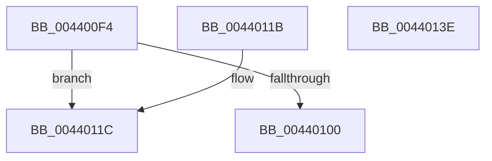

# KiSetPendingTick

- RVA: `0x004400F4`–`0x0044013F` (길이 `75` bytes)
- VA: `0x00000001404400F4`
- 실행 섹션: `.text`
- PDB 이름 있음: `예`; PDB Function 태그: `아니요`
- unwind 정보 RVA: `0x000DB714`
- 디코드: `23`개 명령, `75/75` bytes 표시
- 미해석 바이트: `0` (있으면 어셈블리에 `.byte`로 보존)

> 이 문서는 커널 이미지의 기계어와 PDB 기호를 분석해 생성했습니다. 4번과 5번은 함수 원형과 자료형을 바이너리 사용 방식에서 추정한 C 해석이며 원본 소스 복구 결과는 아닙니다.

## 1. Dependencies

- 직접 호출 지점: **0**; 고유 호출 대상: **0**
- 직접 호출자로 확인된 함수: **6**
- RIP 상대 이미지 참조: **3**

### Outgoing calls
- 직접 디코드된 call 명령이 없습니다.

### Direct callers
- [KiSetClockTickRate](../43/KiSetClockTickRate_function_0043FEA0.md) at `0x0043FF17`
- [KiRestoreClockTickRate](../4D/KiRestoreClockTickRate_function_004D2780.md) at `0x004D28F4`
- [KePrepareClockTimerForPlatformIdle](../5B/KePrepareClockTimerForPlatformIdle_function_005BA820.md) at `0x005BAB58`
- [KeResumeClockTimerFromIdle](../5B/KeResumeClockTimerFromIdle_function_005BACC4.md) at `0x005BB2F1`
- [KeInitializeClockOtherProcessors](../../pagelk/B6/KeInitializeClockOtherProcessors_function_00B678FC.md) at `0x00B6793F`
- [KeInitializeClockOtherProcessors](../../pagelk/B6/KeInitializeClockOtherProcessors_function_00B678FC.md) at `0x00B67979`
- [KeInitializeClock](../../init/C7/KeInitializeClock_function_00C70C30.md) at `0x00C70EC1`
- [KeInitializeClock](../../init/C7/KeInitializeClock_function_00C70C30.md) at `0x00C7100C`

### Static image references
- `0x004400F4` → RVA `0x00FC6ABF` (`ALMOSTRO`; read)
- `0x0044011C` → RVA `0x00F21FB0` (`.data`; read)
- `0x00440122` → RVA `0x00FC8C40` (`ALMOSTRO`; read)

## 2. Other-region calls and transfers

- 다른 실행 섹션으로 향하는 call: **0**
- 별도 외부 분기/꼬리 이동을 확인하지 못했습니다.

## 3. Assembly (complete function range)

```asm
004400F4  80 3D C4 69 B8 00 00            cmp byte ptr [rip + 0xb869c4], 0
004400FB  44 8A C9                        mov r9b, cl
004400FE  74 1C                           je 0x14044011c
00440100  65 4C 8B 04 25 20 00 00 00      mov r8, qword ptr gs:[0x20]
00440109  41 8A 40 22                     mov al, byte ptr [r8 + 0x22]
0044010D  8A D0                           mov dl, al
0044010F  32 D1                           xor dl, cl
00440111  80 E2 01                        and dl, 1
00440114  32 D0                           xor dl, al
00440116  41 88 50 22                     mov byte ptr [r8 + 0x22], dl
0044011A  C3                              ret
0044011B  CC                              int3
0044011C  8B 05 8E 1E AE 00               mov eax, dword ptr [rip + 0xae1e8e]
00440122  48 8D 15 17 8B B8 00            lea rdx, [rip + 0xb88b17]
00440129  48 8B 14 C2                     mov rdx, qword ptr [rdx + rax*8]
0044012D  8A 42 22                        mov al, byte ptr [rdx + 0x22]
00440130  8A C8                           mov cl, al
00440132  41 32 C9                        xor cl, r9b
00440135  80 E1 01                        and cl, 1
00440138  32 C8                           xor cl, al
0044013A  88 4A 22                        mov byte ptr [rdx + 0x22], cl
0044013D  C3                              ret
0044013E  CC                              int3
```

## 4. C-style interpretation (structured pseudocode)

```c
__int64 __fastcall KiSetPendingTick(unsigned __int8 a1)
{
    if ((*(unsigned __int8 *)(v_rip + 12085700)) == 0) goto loc_0044011C;
    a2 = (unsigned __int8)(((unsigned __int8)(*(unsigned __int8 *)(*(unsigned __int64 *)(gs_base + (0 + 32)) + 34))) ^ (a1));
    a2 = (unsigned __int8)((a2) & (1));
    a2 = (unsigned __int8)((a2) ^ ((unsigned __int8)(*(unsigned __int8 *)(*(unsigned __int64 *)(gs_base + (0 + 32)) + 34))));
    *(unsigned __int8 *)(*(unsigned __int64 *)(gs_base + (0 + 32)) + 34) = (unsigned __int8)(a2);
    return *(unsigned __int8 *)(*(unsigned __int64 *)(gs_base + (0 + 32)) + 34);
loc_0044011C:
    a1 = (unsigned __int8)(((unsigned __int8)(*(unsigned __int8 *)(*(unsigned __int64 *)(v_rip + 12094231 + (unsigned int)(*(unsigned int *)(v_rip + 11411086)) * 8) + 34))) ^ (a1));
    a1 = (unsigned __int8)((a1) & (1));
    a1 = (unsigned __int8)((a1) ^ ((unsigned __int8)(*(unsigned __int8 *)(*(unsigned __int64 *)(v_rip + 12094231 + (unsigned int)(*(unsigned int *)(v_rip + 11411086)) * 8) + 34))));
    *(unsigned __int8 *)(*(unsigned __int64 *)(v_rip + 12094231 + (unsigned int)(*(unsigned int *)(v_rip + 11411086)) * 8) + 34) = a1;
    return *(unsigned __int8 *)(*(unsigned __int64 *)(v_rip + 12094231 + (unsigned int)(*(unsigned int *)(v_rip + 11411086)) * 8) + 34);
}
```

## 5. (Beta) C Style

```c
int64_t KiSetPendingTick(uint8_t Arg1)
{
    if ((*(uint8_t *)(v_rip + 0xB869C4)) == 0) goto loc_0044011C;
    a2 = (uint8_t)(((uint8_t)(*(uint8_t *)(*(uint64_t *)(gs_base + (0 + 0x20)) + 0x22))) ^ (Arg1));
    a2 = (uint8_t)((a2) & (1));
    a2 = (uint8_t)((a2) ^ ((uint8_t)(*(uint8_t *)(*(uint64_t *)(gs_base + (0 + 0x20)) + 0x22))));
    *(uint8_t *)(*(uint64_t *)(gs_base + (0 + 0x20)) + 0x22) = (uint8_t)(a2);
    return *(uint8_t *)(*(uint64_t *)(gs_base + (0 + 0x20)) + 0x22);
loc_0044011C:
    Arg1 = (uint8_t)(((uint8_t)(*(uint8_t *)(*(uint64_t *)(v_rip + 0xB88B17 + (uint32_t)(*(uint32_t *)(v_rip + 0xAE1E8E)) * 8) + 0x22))) ^ (Arg1));
    Arg1 = (uint8_t)((Arg1) & (1));
    Arg1 = (uint8_t)((Arg1) ^ ((uint8_t)(*(uint8_t *)(*(uint64_t *)(v_rip + 0xB88B17 + (uint32_t)(*(uint32_t *)(v_rip + 0xAE1E8E)) * 8) + 0x22))));
    *(uint8_t *)(*(uint64_t *)(v_rip + 0xB88B17 + (uint32_t)(*(uint32_t *)(v_rip + 0xAE1E8E)) * 8) + 0x22) = Arg1;
    return *(uint8_t *)(*(uint64_t *)(v_rip + 0xB88B17 + (uint32_t)(*(uint32_t *)(v_rip + 0xAE1E8E)) * 8) + 0x22);
}
```

## 6. Execution-region graph

[열기: 2D/3D 그래프와 함수 탐색 컨트롤 패널](../../../control-panel.html?section=text&rva=0x004400F4&view=graph)

- 2D 그래프는 위에서 아래로 흐르고, 3D 그래프는 빈 공간을 드래그해 회전합니다. Shift+드래그는 이동, 휠은 확대·축소, 함수 노드 선택은 대상 보고서 이동입니다.

### Static fallback


