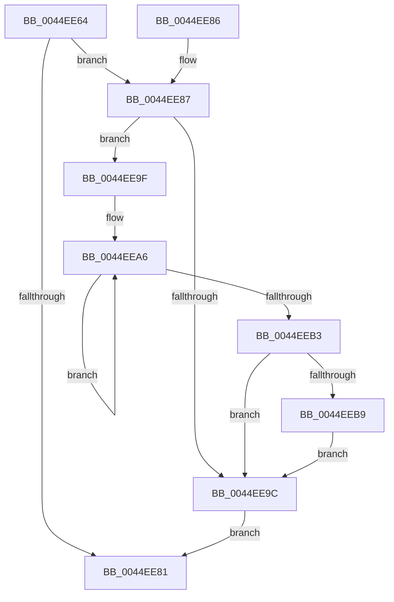

# KxReenterRetpolinedCode

- RVA: `0x0044EE64`–`0x0044EEC0` (길이 `92` bytes)
- VA: `0x000000014044EE64`
- 실행 섹션: `.text`
- PDB 이름 있음: `예`; PDB Function 태그: `아니요`
- unwind 정보 RVA: `0x0007FBE8`
- 디코드: `25`개 명령, `92/92` bytes 표시
- 미해석 바이트: `0` (있으면 어셈블리에 `.byte`로 보존)

> 이 문서는 커널 이미지의 기계어와 PDB 기호를 분석해 생성했습니다. 4번과 5번은 함수 원형과 자료형을 바이너리 사용 방식에서 추정한 C 해석이며 원본 소스 복구 결과는 아닙니다.

## 1. Dependencies

- 직접 호출 지점: **2**; 고유 호출 대상: **2**
- 직접 호출자로 확인된 함수: **2**
- RIP 상대 이미지 참조: **0**

### Outgoing calls
- `0x0044EE68` → [KeDisableInterrupts](../21/KeDisableInterrupts_function_00217BE0.md) (function, `0x00217BE0`)
- `0x0044EEB9` → [KiRemoveSystemWorkPriorityKick](../26/KiRemoveSystemWorkPriorityKick_function_002631D0.md) (function, `0x002631D0`)

### Direct callers
- [KeReenterRetpolinedCode](KeReenterRetpolinedCode_function_0044EE40.md) at `0x0044EE56`
- [ExpWorkerThread](../4E/ExpWorkerThread_function_004ECAF0.md) at `0x004ECD9B`

### Static image references
- 디코드된 RIP-relative 메모리 참조가 없습니다.

## 2. Other-region calls and transfers

- 다른 실행 섹션으로 향하는 call: **0**
- 별도 외부 분기/꼬리 이동을 확인하지 못했습니다.

## 3. Assembly (complete function range)

```asm
0044EE64  48 83 EC 28                     sub rsp, 0x28
0044EE68  E8 73 8D DC FF                  call 0x140217be0
0044EE6D  65 48 8B 0C 25 20 00 00 00      mov rcx, qword ptr gs:[0x20]
0044EE76  80 A1 DE 06 00 00 FE            and byte ptr [rcx + 0x6de], 0xfe
0044EE7D  84 C0                           test al, al
0044EE7F  75 06                           jne 0x14044ee87
0044EE81  48 83 C4 28                     add rsp, 0x28
0044EE85  C3                              ret
0044EE86  CC                              int3
0044EE87  65 48 8B 0C 25 20 00 00 00      mov rcx, qword ptr gs:[0x20]
0044EE90  4C 8B 81 B8 8E 00 00            mov r8, qword ptr [rcx + 0x8eb8]
0044EE97  4D 85 C0                        test r8, r8
0044EE9A  75 03                           jne 0x14044ee9f
0044EE9C  FB                              sti
0044EE9D  EB E2                           jmp 0x14044ee81
0044EE9F  41 0F 0D 08                     prefetchw byte ptr [r8]
0044EEA3  41 8B 00                        mov eax, dword ptr [r8]
0044EEA6  8B D0                           mov edx, eax
0044EEA8  0F BA F2 15                     btr edx, 0x15
0044EEAC  F0 41 0F B1 10                  lock cmpxchg dword ptr [r8], edx
0044EEB1  75 F3                           jne 0x14044eea6
0044EEB3  0F BA E0 15                     bt eax, 0x15
0044EEB7  73 E3                           jae 0x14044ee9c
0044EEB9  E8 12 43 E1 FF                  call 0x1402631d0
0044EEBE  EB DC                           jmp 0x14044ee9c
```

## 4. C-style interpretation (structured pseudocode)

```c
__int64 __fastcall KxReenterRetpolinedCode(void)
{
    __int64 result;
    __int64 v_rsp;

    v_rsp = (v_rsp) - (40);
    result = KeDisableInterrupts(a1, a2, a3, a4);
    if ((unsigned __int8)(result) != 0) goto loc_0044EE87;
loc_0044EE81:
    v_rsp = (v_rsp) + (40);
    return result;
loc_0044EE87:
    if (*(unsigned __int64 *)(*(unsigned __int64 *)(gs_base + (0 + 32)) + 36536) != 0) goto loc_0044EE9F;
loc_0044EE9C:
    goto loc_0044EE81;
loc_0044EE9F:
loc_0044EEA6:
    if (*(unsigned __int64 *)(*(unsigned __int64 *)(gs_base + (0 + 32)) + 36536) != 0) goto loc_0044EEA6;
    if (condition_is_above_or_equal) goto loc_0044EE9C;
    result = KiRemoveSystemWorkPriorityKick(*(unsigned __int64 *)(gs_base + (0 + 32)), (unsigned int)((unsigned int)((unsigned int)(*(unsigned int *)(*(unsigned __int64 *)(*(unsigned __int64 *)(gs_base + (0 + 32)) + 36536))))), *(unsigned __int64 *)(*(unsigned __int64 *)(gs_base + (0 + 32)) + 36536), a4);
    goto loc_0044EE9C;
}
```

## 5. (Beta) C Style

```c
void KxReenterRetpolinedCode(void)
{
    int64_t result;
    int64_t local_rsp;

    local_rsp = (local_rsp) - (40);
    result = KeDisableInterrupts(a1, a2, a3, a4);
    if ((uint8_t)(result) != 0) goto loc_0044EE87;
loc_0044EE81:
    local_rsp = (local_rsp) + (40);
    return result;
loc_0044EE87:
    if (*(uint64_t *)(*(uint64_t *)(gs_base + (0 + 0x20)) + 0x8EB8) != 0) goto loc_0044EE9F;
loc_0044EE9C:
    goto loc_0044EE81;
loc_0044EE9F:
loc_0044EEA6:
    if (*(uint64_t *)(*(uint64_t *)(gs_base + (0 + 0x20)) + 0x8EB8) != 0) goto loc_0044EEA6;
    if (condition_is_above_or_equal) goto loc_0044EE9C;
    result = KiRemoveSystemWorkPriorityKick(*(uint64_t *)(gs_base + (0 + 0x20)), (uint32_t)((uint32_t)((uint32_t)(*(uint32_t *)(*(uint64_t *)(*(uint64_t *)(gs_base + (0 + 0x20)) + 0x8EB8))))), *(uint64_t *)(*(uint64_t *)(gs_base + (0 + 0x20)) + 0x8EB8), a4);
    goto loc_0044EE9C;
}
```

## 6. Execution-region graph

[열기: 2D/3D 그래프와 함수 탐색 컨트롤 패널](../../../control-panel.html?section=text&rva=0x0044EE64&view=graph)

- 2D 그래프는 위에서 아래로 흐르고, 3D 그래프는 빈 공간을 드래그해 회전합니다. Shift+드래그는 이동, 휠은 확대·축소, 함수 노드 선택은 대상 보고서 이동입니다.

### Static fallback


