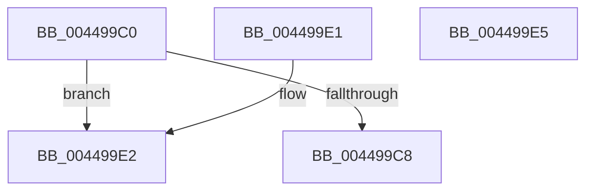

# LZ4_compressBound

- RVA: `0x004499C0`–`0x004499E6` (길이 `38` bytes)
- VA: `0x00000001404499C0`
- 실행 섹션: `.text`
- PDB 이름 있음: `예`; PDB Function 태그: `아니요`
- unwind 정보 RVA: `0x000DB714`
- 디코드: `16`개 명령, `38/38` bytes 표시
- 미해석 바이트: `0` (있으면 어셈블리에 `.byte`로 보존)

> 이 문서는 커널 이미지의 기계어와 PDB 기호를 분석해 생성했습니다. 4번과 5번은 함수 원형과 자료형을 바이너리 사용 방식에서 추정한 C 해석이며 원본 소스 복구 결과는 아닙니다.

## 1. Dependencies

- 직접 호출 지점: **0**; 고유 호출 대상: **0**
- 직접 호출자로 확인된 함수: **1**
- RIP 상대 이미지 참조: **0**

### Outgoing calls
- 직접 디코드된 call 명령이 없습니다.

### Direct callers
- [LZ4_compress_HC_extStateHC_fastReset](../5F/LZ4_compress_HC_extStateHC_fastReset_function_005FFBB0.md) at `0x005FFBEA`

### Static image references
- 디코드된 RIP-relative 메모리 참조가 없습니다.

## 2. Other-region calls and transfers

- 다른 실행 섹션으로 향하는 call: **0**
- 별도 외부 분기/꼬리 이동을 확인하지 못했습니다.

## 3. Assembly (complete function range)

```asm
004499C0  81 F9 00 00 00 7E               cmp ecx, 0x7e000000
004499C6  77 1A                           ja 0x1404499e2
004499C8  B8 81 80 80 80                  mov eax, 0x80808081
004499CD  F7 E9                           imul ecx
004499CF  03 D1                           add edx, ecx
004499D1  C1 FA 07                        sar edx, 7
004499D4  8B C2                           mov eax, edx
004499D6  C1 E8 1F                        shr eax, 0x1f
004499D9  83 C0 10                        add eax, 0x10
004499DC  03 C2                           add eax, edx
004499DE  03 C1                           add eax, ecx
004499E0  C3                              ret
004499E1  CC                              int3
004499E2  33 C0                           xor eax, eax
004499E4  C3                              ret
004499E5  CC                              int3
```

## 4. C-style interpretation (structured pseudocode)

```c
__int64 __fastcall LZ4_compressBound(int a1, int a2)
{
    __int64 result;

    if (a1 > 0x7E000000ULL) goto loc_004499E2;
    a2 = (unsigned int)((a2) + (a1));
    a2 = (unsigned int)((a2) >> (7));
    result = (unsigned int)(((unsigned int)(a2)) >> (31));
    result = (unsigned int)((result) + (16));
    result = (unsigned int)((result) + (a2));
    result = (unsigned int)((result) + (a1));
    return result;
loc_004499E2:
    result = 0;
    return result;
}
```

## 5. (Beta) C Style

```c
int64_t LZ4_compressBound(int32_t Arg1, int32_t Arg2)
{
    int64_t result;

    if (Arg1 > 0x7E000000ULL) goto loc_004499E2;
    Arg2 = (uint32_t)((Arg2) + (Arg1));
    Arg2 = (uint32_t)((Arg2) >> (7));
    result = (uint32_t)(((uint32_t)(Arg2)) >> (31));
    result = (uint32_t)((result) + (16));
    result = (uint32_t)((result) + (Arg2));
    result = (uint32_t)((result) + (Arg1));
    return result;
loc_004499E2:
    result = 0;
    return result;
}
```

## 6. Execution-region graph

[열기: 2D/3D 그래프와 함수 탐색 컨트롤 패널](../../../control-panel.html?section=text&rva=0x004499C0&view=graph)

- 2D 그래프는 위에서 아래로 흐르고, 3D 그래프는 빈 공간을 드래그해 회전합니다. Shift+드래그는 이동, 휠은 확대·축소, 함수 노드 선택은 대상 보고서 이동입니다.

### Static fallback


