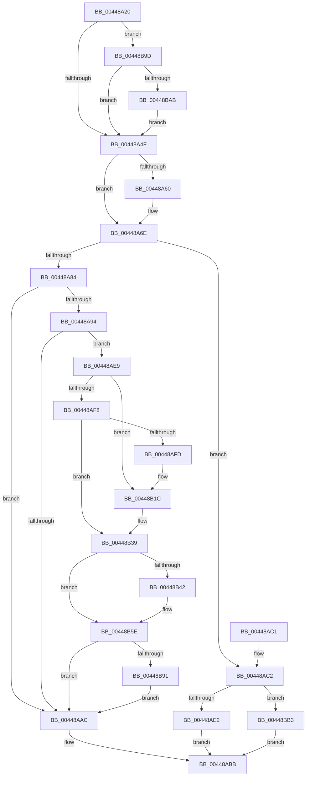

# LZNT1DecompressChunkWorkItem

- RVA: `0x00448A20`–`0x00448BBD` (길이 `413` bytes)
- VA: `0x0000000140448A20`
- 실행 섹션: `.text`
- PDB 이름 있음: `예`; PDB Function 태그: `아니요`
- unwind 정보 RVA: `0x000A62D4`
- 디코드: `98`개 명령, `413/413` bytes 표시
- 미해석 바이트: `0` (있으면 어셈블리에 `.byte`로 보존)

> 이 문서는 커널 이미지의 기계어와 PDB 기호를 분석해 생성했습니다. 4번과 5번은 함수 원형과 자료형을 바이너리 사용 방식에서 추정한 C 해석이며 원본 소스 복구 결과는 아닙니다.

## 1. Dependencies

- 직접 호출 지점: **9**; 고유 호출 대상: **7**
- 직접 호출자로 확인된 함수: **0**
- RIP 상대 이미지 참조: **10**

### Outgoing calls
- `0x00448A42` → [LZNT1DecompressChunk](../6B/LZNT1DecompressChunk_function_006BB050.md) (function, `0x006BB050`)
- `0x00448A69` → [KeSetEvent](../33/KeSetEvent_function_0033F310.md) (function, `0x0033F310`)
- `0x00448AB6` → [ExpInterlockedPushEntrySList](../6B/ExpInterlockedPushEntrySList_function_006BA5B0.md) (function, `0x006BA5B0`)
- `0x00448AE2` → [ExFreePool](../../poolcode/B8/ExFreePool_function_00B82850.md) (function, `0x00B82850`)
- `0x00448B16` → [KeBugCheckEx](../4F/KeBugCheckEx_function_004FD660.md) (function, `0x004FD660`)
- `0x00448B33` → [KeBugCheckEx](../4F/KeBugCheckEx_function_004FD660.md) (function, `0x004FD660`)
- `0x00448B58` → [KeBugCheckEx](../4F/KeBugCheckEx_function_004FD660.md) (function, `0x004FD660`)
- `0x00448B93` → [memset](../6C/memset_function_006C6C40.md) (function, `0x006C6C40`)
- `0x00448BB3` → [guard_dispatch_icall](../6B/guard_dispatch_icall_function_006BAAD0.md) (function, `0x006BAAD0`)

### Direct callers
- 이 함수 시작 RVA로 연결되는 직접 call은 확인되지 않았습니다. 간접 호출은 완전히 역산할 수 없습니다.

### Static image references
- `0x00448A6E` → RVA `0x00E2829C` (`.data`; read/write)
- `0x00448A74` → RVA `0x00E28290` (`.data`; read)
- `0x00448A7B` → RVA `0x00E28280` (`.data`; read)
- `0x00448A84` → RVA `0x00475D80` (`CmSiFreeMemory`; read)
- `0x00448A8B` → RVA `0x00E282B8` (`.data`; read)
- `0x00448A94` → RVA `0x00E282AC` (`.data`; read)
- `0x00448AA3` → RVA `0x00FCEC68` (`ALMOSTRO`; read)
- `0x00448AC2` → RVA `0x00E282A0` (`.data`; read/write)
- `0x00448AC8` → RVA `0x00B82850` (`ExFreePool`; read)
- `0x00448B7D` → RVA `0x00FC6ED8` (`ALMOSTRO`; read)

## 2. Other-region calls and transfers

- 다른 실행 섹션으로 향하는 call: **1**
  - `0x00448AE2` → [ExFreePool](../../poolcode/B8/ExFreePool_function_00B82850.md) (`.text` → `POOLCODE`)
- 별도 외부 분기/꼬리 이동을 확인하지 못했습니다.

## 3. Assembly (complete function range)

```asm
00448A20  40 53                           push rbx
00448A22  48 83 EC 30                     sub rsp, 0x30
00448A26  48 8B 41 40                     mov rax, qword ptr [rcx + 0x40]
00448A2A  48 8B D9                        mov rbx, rcx
00448A2D  4C 8B 49 38                     mov r9, qword ptr [rcx + 0x38]
00448A31  4C 8B 41 30                     mov r8, qword ptr [rcx + 0x30]
00448A35  48 8B 51 28                     mov rdx, qword ptr [rcx + 0x28]
00448A39  48 8B 49 20                     mov rcx, qword ptr [rcx + 0x20]
00448A3D  48 89 44 24 20                  mov qword ptr [rsp + 0x20], rax
00448A42  E8 09 26 27 00                  call 0x1406bb050
00448A47  85 C0                           test eax, eax
00448A49  0F 88 4E 01 00 00               js 0x140448b9d
00448A4F  48 8B 4B 50                     mov rcx, qword ptr [rbx + 0x50]
00448A53  83 C8 FF                        or eax, 0xffffffff
00448A56  F0 0F C1 41 18                  lock xadd dword ptr [rcx + 0x18], eax
00448A5B  83 F8 01                        cmp eax, 1
00448A5E  75 0E                           jne 0x140448a6e
00448A60  48 8B 4B 50                     mov rcx, qword ptr [rbx + 0x50]
00448A64  45 33 C0                        xor r8d, r8d
00448A67  33 D2                           xor edx, edx
00448A69  E8 A2 68 EF FF                  call 0x14033f310
00448A6E  FF 05 28 F8 9D 00               inc dword ptr [rip + 0x9df828]
00448A74  0F B7 05 15 F8 9D 00            movzx eax, word ptr [rip + 0x9df815]
00448A7B  66 39 05 FE F7 9D 00            cmp word ptr [rip + 0x9df7fe], ax
00448A82  73 3E                           jae 0x140448ac2
00448A84  48 8D 05 F5 D2 02 00            lea rax, [rip + 0x2d2f5]
00448A8B  48 39 05 26 F8 9D 00            cmp qword ptr [rip + 0x9df826], rax
00448A92  75 18                           jne 0x140448aac
00448A94  44 8B 05 11 F8 9D 00            mov r8d, dword ptr [rip + 0x9df811]
00448A9B  48 8D 4B 08                     lea rcx, [rbx + 8]
00448A9F  49 83 E8 08                     sub r8, 8
00448AA3  80 3D BE 61 B8 00 00            cmp byte ptr [rip + 0xb861be], 0
00448AAA  75 3D                           jne 0x140448ae9
00448AAC  48 8B D3                        mov rdx, rbx
00448AAF  48 8D 0D CA F7 9D 00            lea rcx, [rip + 0x9df7ca]
00448AB6  E8 F5 1A 27 00                  call 0x1406ba5b0
00448ABB  48 83 C4 30                     add rsp, 0x30
00448ABF  5B                              pop rbx
00448AC0  C3                              ret
00448AC1  CC                              int3
00448AC2  FF 05 D8 F7 9D 00               inc dword ptr [rip + 0x9df7d8]
00448AC8  48 8D 0D 81 9D 73 00            lea rcx, [rip + 0x739d81]
00448ACF  48 8B 05 E2 F7 9D 00            mov rax, qword ptr [rip + 0x9df7e2]
00448AD6  48 3B C1                        cmp rax, rcx
00448AD9  48 8B CB                        mov rcx, rbx
00448ADC  0F 85 D1 00 00 00               jne 0x140448bb3
00448AE2  E8 69 9D 73 00                  call 0x140b82850
00448AE7  EB D2                           jmp 0x140448abb
00448AE9  48 B8 00 00 00 00 00 80 FF FF   movabs rax, 0xffff800000000000
00448AF3  48 3B C8                        cmp rcx, rax
00448AF6  72 24                           jb 0x140448b1c
00448AF8  F6 C1 07                        test cl, 7
00448AFB  74 3C                           je 0x140448b39
00448AFD  BA 02 00 00 00                  mov edx, 2
00448B02  48 C7 44 24 20 08 00 00 00      mov qword ptr [rsp + 0x20], 8
00448B0B  4C 8B C9                        mov r9, rcx
00448B0E  44 8B C2                        mov r8d, edx
00448B11  B9 F1 01 00 00                  mov ecx, 0x1f1
00448B16  E8 45 4B 0B 00                  call 0x1404fd660
00448B1B  CC                              int3
00448B1C  48 83 64 24 20 00               and qword ptr [rsp + 0x20], 0
00448B22  BA 02 00 00 00                  mov edx, 2
00448B27  4C 8B C9                        mov r9, rcx
00448B2A  B9 F1 01 00 00                  mov ecx, 0x1f1
00448B2F  44 8D 42 FF                     lea r8d, [rdx - 1]
00448B33  E8 28 4B 0B 00                  call 0x1404fd660
00448B38  CC                              int3
00448B39  4A 8D 04 01                     lea rax, [rcx + r8]
00448B3D  48 3B C1                        cmp rax, rcx
00448B40  73 1C                           jae 0x140448b5e
00448B42  BA 02 00 00 00                  mov edx, 2
00448B47  4C 89 44 24 20                  mov qword ptr [rsp + 0x20], r8
00448B4C  4C 8B C9                        mov r9, rcx
00448B4F  B9 F1 01 00 00                  mov ecx, 0x1f1
00448B54  44 8D 42 01                     lea r8d, [rdx + 1]
00448B58  E8 03 4B 0B 00                  call 0x1404fd660
00448B5D  CC                              int3
00448B5E  49 8D 40 FF                     lea rax, [r8 - 1]
00448B62  83 E0 07                        and eax, 7
00448B65  4C 2B C0                        sub r8, rax
00448B68  48 B8 00 00 00 00 00 80 00 00   movabs rax, 0x800000000000
00448B72  48 03 C8                        add rcx, rax
00448B75  49 83 C0 07                     add r8, 7
00448B79  48 C1 E9 03                     shr rcx, 3
00448B7D  48 03 0D 54 E3 B7 00            add rcx, qword ptr [rip + 0xb7e354]
00448B84  49 C1 E8 03                     shr r8, 3
00448B88  4D 85 C0                        test r8, r8
00448B8B  0F 84 1B FF FF FF               je 0x140448aac
00448B91  B2 8C                           mov dl, 0x8c
00448B93  E8 A8 E0 27 00                  call 0x1406c6c40
00448B98  E9 0F FF FF FF                  jmp 0x140448aac
00448B9D  48 8B 4B 50                     mov rcx, qword ptr [rbx + 0x50]
00448BA1  83 79 1C 00                     cmp dword ptr [rcx + 0x1c], 0
00448BA5  0F 8C A4 FE FF FF               jl 0x140448a4f
00448BAB  89 41 1C                        mov dword ptr [rcx + 0x1c], eax
00448BAE  E9 9C FE FF FF                  jmp 0x140448a4f
00448BB3  E8 18 1F 27 00                  call 0x1406baad0
00448BB8  E9 FE FE FF FF                  jmp 0x140448abb
```

## 4. C-style interpretation (structured pseudocode)

```c
__int64 __fastcall LZNT1DecompressChunkWorkItem(__int64 a1)
{
    __int64 result;
    __int64 v_rsp;
    unsigned __int64 v_stack_m18;
    unsigned __int64 v_stack_p20;

    v_rsp = (v_rsp) - (48);
    v_stack_m18 = *(unsigned __int64 *)(a1 + 64);
    result = LZNT1DecompressChunk(*(unsigned __int64 *)(a1 + 32), *(unsigned __int64 *)(a1 + 40), *(unsigned __int64 *)(a1 + 48), *(unsigned __int64 *)(a1 + 56));
    if (sign_flag) goto loc_00448B9D;
loc_00448A4F:
    result = (unsigned int)((result) | (0xFFFFFFFFULL));
    if (((unsigned int)(result)) == 1) {
        a1 = *(unsigned __int64 *)(a1 + 80);
        a3 = 0;
        a2 = 0;
        result = KeSetEvent(a1, a2, a3, *(unsigned __int64 *)(a1 + 56));
    }
    if ((*(unsigned __int16 *)(v_rip + 10352638)) >= ((unsigned __int16)(*(unsigned __int16 *)(v_rip + 10352661)))) goto loc_00448AC2;
    if ((*(unsigned __int64 *)(v_rip + 10352678)) != (v_rip + 185077)) goto loc_00448AAC;
    a3 = ((unsigned int)(*(unsigned int *)(v_rip + 10352657))) - (8);
    if ((*(unsigned __int8 *)(v_rip + 12083646)) != 0) goto loc_00448AE9;
loc_00448AAC:
    result = ExpInterlockedPushEntrySList(v_rip + 10352586, a1, a3, *(unsigned __int64 *)(a1 + 56));
loc_00448ABB:
    v_rsp = (v_rsp) + (48);
    return result;
loc_00448AC2:
    if ((*(unsigned __int64 *)(v_rip + 10352610)) != (v_rip + 7576961)) goto loc_00448BB3;
    result = ExFreePool(a1, a1, a3, *(unsigned __int64 *)(a1 + 56));
    goto loc_00448ABB;
loc_00448AE9:
    if (a1 < result) goto loc_00448B1C;
    if ((((unsigned __int8)(a1)) & (7)) == 0) goto loc_00448B39;
    v_stack_p20 = 8;
    result = KeBugCheckEx(497, 2, 2, a1);
loc_00448B1C:
    result = KeBugCheckEx(497, 2, 2 - 1, 497);
loc_00448B39:
    result = 497 + 2 - 1 * 1;
    if ((497 + 2 - 1 * 1) < 497) {
        a2 = 2;
        v_stack_p20 = 2 - 1;
        a4 = 497;
        a1 = 497;
        a3 = a2 + 1;
        result = KeBugCheckEx(a1, a2, a3, a4);
    }
    result = (unsigned int)((a3 - 1) & (7));
    a3 = (a3) - (result);
    a1 = (a1) + (result);
    a3 = (a3) + (7);
    a1 = (a1) >> (3);
    a1 = (a1) + (*(unsigned __int64 *)(v_rip + 12051284));
    a3 = (a3) >> (3);
    if (a3 == 0) goto loc_00448AAC;
    result = memset(a1, 140, a3, a4);
    goto loc_00448AAC;
loc_00448B9D:
    if ((*(unsigned int *)(*(unsigned __int64 *)(a1 + 80) + 28)) < 0) goto loc_00448A4F;
    *(unsigned int *)(*(unsigned __int64 *)(a1 + 80) + 28) = (unsigned int)(result);
    goto loc_00448A4F;
loc_00448BB3:
    result = guard_dispatch_icall(*(unsigned __int64 *)(a1 + 80), 140, a3, a4);
    goto loc_00448ABB;
}
```

## 5. (Beta) C Style

```c
int64_t LZNT1DecompressChunkWorkItem(void *Arg1)
{
    uint8_t *arg1 = (uint8_t *)Arg1;

    int64_t result;
    int64_t local_rsp;
    uint64_t v_stack_m18;
    uint64_t v_stack_p20;

    local_rsp = (local_rsp) - (48);
    v_stack_m18 = *(uint64_t *)(arg1 + 0x40);
    result = LZNT1DecompressChunk(*(uint64_t *)(arg1 + 0x20), *(uint64_t *)(arg1 + 0x28), *(uint64_t *)(arg1 + 0x30), *(uint64_t *)(arg1 + 0x38));
    if (sign_flag) goto loc_00448B9D;
loc_00448A4F:
    result = (uint32_t)((result) | (0xFFFFFFFFULL));
    if (((uint32_t)(result)) == 1) {
        Arg1 = *(uint64_t *)(arg1 + 0x50);
        a3 = 0;
        a2 = 0;
        result = KeSetEvent(Arg1, a2, a3, *(uint64_t *)(arg1 + 0x38));
    }
    if ((*(uint16_t *)(v_rip + 0x9DF7FE)) >= ((uint16_t)(*(uint16_t *)(v_rip + 0x9DF815)))) goto loc_00448AC2;
    if ((*(uint64_t *)(v_rip + 0x9DF826)) != (v_rip + 185077)) goto loc_00448AAC;
    a3 = ((uint32_t)(*(uint32_t *)(v_rip + 0x9DF811))) - (8);
    if ((*(uint8_t *)(v_rip + 0xB861BE)) != 0) goto loc_00448AE9;
loc_00448AAC:
    result = ExpInterlockedPushEntrySList(v_rip + 10352586, Arg1, a3, *(uint64_t *)(arg1 + 0x38));
loc_00448ABB:
    local_rsp = (local_rsp) + (48);
    return result;
loc_00448AC2:
    if ((*(uint64_t *)(v_rip + 0x9DF7E2)) != (v_rip + 7576961)) goto loc_00448BB3;
    result = ExFreePool(Arg1, Arg1, a3, *(uint64_t *)(arg1 + 0x38));
    goto loc_00448ABB;
loc_00448AE9:
    if (Arg1 < result) goto loc_00448B1C;
    if ((((uint8_t)(Arg1)) & (7)) == 0) goto loc_00448B39;
    v_stack_p20 = 8;
    result = KeBugCheckEx(497, 2, 2, Arg1);
loc_00448B1C:
    result = KeBugCheckEx(497, 2, 2 - 1, 497);
loc_00448B39:
    result = 497 + 2 - 1 * 1;
    if ((497 + 2 - 1 * 1) < 497) {
        a2 = 2;
        v_stack_p20 = 2 - 1;
        a4 = 497;
        Arg1 = 497;
        a3 = a2 + 1;
        result = KeBugCheckEx(Arg1, a2, a3, a4);
    }
    result = (uint32_t)((a3 - 1) & (7));
    a3 = (a3) - (result);
    Arg1 = (Arg1) + (result);
    a3 = (a3) + (7);
    Arg1 = (Arg1) >> (3);
    Arg1 = (Arg1) + (*(uint64_t *)(v_rip + 0xB7E354));
    a3 = (a3) >> (3);
    if (a3 == 0) goto loc_00448AAC;
    result = memset(Arg1, 140, a3, a4);
    goto loc_00448AAC;
loc_00448B9D:
    if ((*(uint32_t *)(*(uint64_t *)(arg1 + 0x50) + 0x1C)) < 0) goto loc_00448A4F;
    *(uint32_t *)(*(uint64_t *)(arg1 + 0x50) + 0x1C) = (uint32_t)(result);
    goto loc_00448A4F;
loc_00448BB3:
    result = guard_dispatch_icall(*(uint64_t *)(arg1 + 0x50), 140, a3, a4);
    goto loc_00448ABB;
}
```

### 관측된 메모리 오프셋

구조체 형식이 확인되지 않은 접근은 인자 기준의 오프셋으로만 기록했습니다.

| 기준 인자 | 오프셋 표현 | 폭 (bit) | 접근 |
|---|---:|---:|---|
| `Arg1` | `+ 0x8` | `64` | `R` |
| `Arg1` | `+ 0x20` | `64` | `R` |
| `Arg1` | `+ 0x28` | `64` | `R` |
| `Arg1` | `+ 0x30` | `64` | `R` |
| `Arg1` | `+ 0x38` | `64` | `R` |
| `Arg1` | `+ 0x40` | `64` | `R` |
| `Arg1` | `+ 0x50` | `64` | `R` |

## 6. Execution-region graph

[열기: 2D/3D 그래프와 함수 탐색 컨트롤 패널](../../../control-panel.html?section=text&rva=0x00448A20&view=graph)

- 2D 그래프는 위에서 아래로 흐르고, 3D 그래프는 빈 공간을 드래그해 회전합니다. Shift+드래그는 이동, 휠은 확대·축소, 함수 노드 선택은 대상 보고서 이동입니다.

### Static fallback


