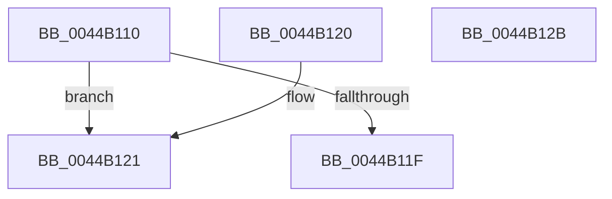

# MI_IS_PTE_SHADOW_STACK

- RVA: `0x0044B110`–`0x0044B12C` (길이 `28` bytes)
- VA: `0x000000014044B110`
- 실행 섹션: `.text`
- PDB 이름 있음: `예`; PDB Function 태그: `아니요`
- unwind 정보 RVA: `0x000DB714`
- 디코드: `10`개 명령, `28/28` bytes 표시
- 미해석 바이트: `0` (있으면 어셈블리에 `.byte`로 보존)

> 이 문서는 커널 이미지의 기계어와 PDB 기호를 분석해 생성했습니다. 4번과 5번은 함수 원형과 자료형을 바이너리 사용 방식에서 추정한 C 해석이며 원본 소스 복구 결과는 아닙니다.

## 1. Dependencies

- 직접 호출 지점: **0**; 고유 호출 대상: **0**
- 직접 호출자로 확인된 함수: **2**
- RIP 상대 이미지 참조: **1**

### Outgoing calls
- 직접 디코드된 call 명령이 없습니다.

### Direct callers
- [MiValidFault](../32/MiValidFault_function_003280B4.md) at `0x00328176`
- [MiInitializeShadowPageTable](../../page/80/MiInitializeShadowPageTable_function_0080778C.md) at `0x00807852`

### Static image references
- `0x0044B112` → RVA `0x00FC6A88` (`ALMOSTRO`; read)

## 2. Other-region calls and transfers

- 다른 실행 섹션으로 향하는 call: **0**
- 별도 외부 분기/꼬리 이동을 확인하지 못했습니다.

## 3. Assembly (complete function range)

```asm
0044B110  33 C0                           xor eax, eax
0044B112  48 F7 05 6B B9 B7 00 00 00 00 01  test qword ptr [rip + 0xb7b96b], 0x1000000
0044B11D  75 02                           jne 0x14044b121
0044B11F  C3                              ret
0044B120  CC                              int3
0044B121  80 E1 42                        and cl, 0x42
0044B124  80 F9 40                        cmp cl, 0x40
0044B127  0F 94 C0                        sete al
0044B12A  C3                              ret
0044B12B  CC                              int3
```

## 4. C-style interpretation (structured pseudocode)

```c
__int64 __fastcall MI_IS_PTE_SHADOW_STACK(unsigned __int8 a1)
{
    __int64 result;

    result = 0;
    if (((*(unsigned __int64 *)(v_rip + 12040555)) & (0x1000000ULL)) != 0) goto loc_0044B121;
    return result;
loc_0044B121:
    a1 = (unsigned __int8)((a1) & (66));
    result = (a1 == 64) ? 1 : 0;
    return result;
}
```

## 5. (Beta) C Style

```c
int64_t MI_IS_PTE_SHADOW_STACK(uint8_t Arg1)
{
    int64_t result;

    result = 0;
    if (((*(uint64_t *)(v_rip + 0xB7B96B)) & (0x1000000ULL)) != 0) goto loc_0044B121;
    return result;
loc_0044B121:
    Arg1 = (uint8_t)((Arg1) & (66));
    result = (Arg1 == 64) ? 1 : 0;
    return result;
}
```

## 6. Execution-region graph

[열기: 2D/3D 그래프와 함수 탐색 컨트롤 패널](../../../control-panel.html?section=text&rva=0x0044B110&view=graph)

- 2D 그래프는 위에서 아래로 흐르고, 3D 그래프는 빈 공간을 드래그해 회전합니다. Shift+드래그는 이동, 휠은 확대·축소, 함수 노드 선택은 대상 보고서 이동입니다.

### Static fallback


