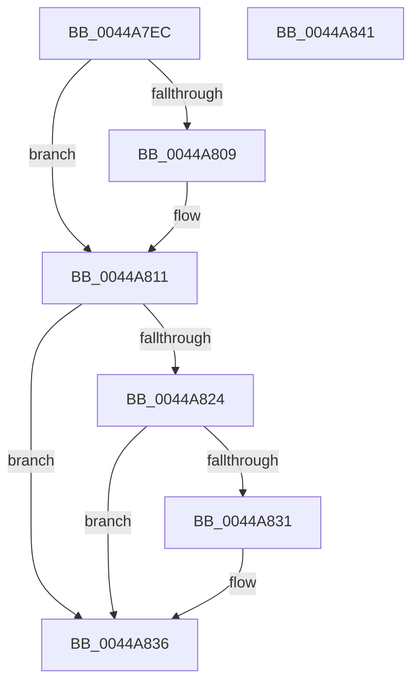

# MI_UNLOCK_RELOCATIONS_SHARED

- RVA: `0x0044A7EC`–`0x0044A842` (길이 `86` bytes)
- VA: `0x000000014044A7EC`
- 실행 섹션: `.text`
- PDB 이름 있음: `예`; PDB Function 태그: `아니요`
- unwind 정보 RVA: `0x0005CAAC`
- 디코드: `26`개 명령, `86/86` bytes 표시
- 미해석 바이트: `0` (있으면 어셈블리에 `.byte`로 보존)

> 이 문서는 커널 이미지의 기계어와 PDB 기호를 분석해 생성했습니다. 4번과 5번은 함수 원형과 자료형을 바이너리 사용 방식에서 추정한 C 해석이며 원본 소스 복구 결과는 아닙니다.

## 1. Dependencies

- 직접 호출 지점: **3**; 고유 호출 대상: **3**
- 직접 호출자로 확인된 함수: **1**
- RIP 상대 이미지 참조: **0**

### Outgoing calls
- `0x0044A80C` → [ExfReleasePushLockShared](../26/ExfReleasePushLockShared_function_00263440.md) (function, `0x00263440`)
- `0x0044A814` → [KeAbPostRelease](../2E/KeAbPostRelease_function_002E1600.md) (function, `0x002E1600`)
- `0x0044A831` → [KiCheckForKernelApcDelivery](../2E/KiCheckForKernelApcDelivery_function_002E2C80.md) (function, `0x002E2C80`)

### Direct callers
- [MiUpdateImagePfnImportRelocations](MiUpdateImagePfnImportRelocations_function_00449E84.md) at `0x00449F94`

### Static image references
- 디코드된 RIP-relative 메모리 참조가 없습니다.

## 2. Other-region calls and transfers

- 다른 실행 섹션으로 향하는 call: **0**
- 별도 외부 분기/꼬리 이동을 확인하지 못했습니다.

## 3. Assembly (complete function range)

```asm
0044A7EC  48 89 5C 24 08                  mov qword ptr [rsp + 8], rbx
0044A7F1  57                              push rdi
0044A7F2  48 83 EC 20                     sub rsp, 0x20
0044A7F6  48 8B F9                        mov rdi, rcx
0044A7F9  48 8D 5A 18                     lea rbx, [rdx + 0x18]
0044A7FD  33 C9                           xor ecx, ecx
0044A7FF  8D 41 11                        lea eax, [rcx + 0x11]
0044A802  F0 48 0F B1 0B                  lock cmpxchg qword ptr [rbx], rcx
0044A807  74 08                           je 0x14044a811
0044A809  48 8B CB                        mov rcx, rbx
0044A80C  E8 2F 8C E1 FF                  call 0x140263440
0044A811  48 8B CB                        mov rcx, rbx
0044A814  E8 E7 6D E9 FF                  call 0x1402e1600
0044A819  90                              nop
0044A81A  66 83 87 E6 01 00 00 01         add word ptr [rdi + 0x1e6], 1
0044A822  75 12                           jne 0x14044a836
0044A824  48 8D 87 98 00 00 00            lea rax, [rdi + 0x98]
0044A82B  90                              nop
0044A82C  48 39 00                        cmp qword ptr [rax], rax
0044A82F  74 05                           je 0x14044a836
0044A831  E8 4A 84 E9 FF                  call 0x1402e2c80
0044A836  48 8B 5C 24 30                  mov rbx, qword ptr [rsp + 0x30]
0044A83B  48 83 C4 20                     add rsp, 0x20
0044A83F  5F                              pop rdi
0044A840  C3                              ret
0044A841  CC                              int3
```

## 4. C-style interpretation (structured pseudocode)

```c
__int64 __fastcall MI_UNLOCK_RELOCATIONS_SHARED(__int64 a1, __int64 a2)
{
    __int64 result;
    __int64 v_rsp;
    unsigned __int64 v_stack_p8;

    v_stack_p8 = v_rbx;
    v_rsp = (v_rsp) - (32);
    a1 = 0;
    result = a1 + 17;
    if (!(condition_is_equal)) {
        a1 = a2 + 24;
        result = ExfReleasePushLockShared(a1, a2, a3, a4);
    }
    result = KeAbPostRelease(a2 + 24, a2, a3, a4);
    if (condition_is_not_equal) goto loc_0044A836;
    result = a1 + 152;
    if ((*(unsigned __int64 *)(a1 + 152)) != (a1 + 152)) {
        result = KiCheckForKernelApcDelivery(a2 + 24, a2, a3, a4);
    }
    v_rsp = (v_rsp) + (32);
    return result;
}
```

## 5. (Beta) C Style

```c
int64_t MI_UNLOCK_RELOCATIONS_SHARED(void *Arg1, void *Arg2)
{
    uint8_t *arg1 = (uint8_t *)Arg1;
    uint8_t *arg2 = (uint8_t *)Arg2;

    int64_t result;
    int64_t local_rsp;
    uint64_t v_stack_p8;

    v_stack_p8 = local_rbx;
    local_rsp = (local_rsp) - (32);
    Arg1 = 0;
    result = Arg1 + 17;
    if (!(condition_is_equal)) {
        Arg1 = Arg2 + 24;
        result = ExfReleasePushLockShared(Arg1, Arg2, a3, a4);
    }
    result = KeAbPostRelease(Arg2 + 24, Arg2, a3, a4);
    if (condition_is_not_equal) goto loc_0044A836;
    result = Arg1 + 152;
    if ((*(uint64_t *)(arg1 + 0x98)) != (Arg1 + 152)) {
        result = KiCheckForKernelApcDelivery(Arg2 + 24, Arg2, a3, a4);
    }
    local_rsp = (local_rsp) + (32);
    return result;
}
```

### 관측된 메모리 오프셋

구조체 형식이 확인되지 않은 접근은 인자 기준의 오프셋으로만 기록했습니다.

| 기준 인자 | 오프셋 표현 | 폭 (bit) | 접근 |
|---|---:|---:|---|
| `Arg1` | `+ 0x0` | `64` | `R` |
| `Arg1` | `+ 0x98` | `64` | `R` |
| `Arg1` | `+ 0x1E6` | `16` | `R/W` |
| `Arg2` | `+ 0x0` | `64` | `R` |
| `Arg2` | `+ 0x18` | `64` | `R` |

## 6. Execution-region graph

[열기: 2D/3D 그래프와 함수 탐색 컨트롤 패널](../../../control-panel.html?section=text&rva=0x0044A7EC&view=graph)

- 2D 그래프는 위에서 아래로 흐르고, 3D 그래프는 빈 공간을 드래그해 회전합니다. Shift+드래그는 이동, 휠은 확대·축소, 함수 노드 선택은 대상 보고서 이동입니다.

### Static fallback


