# MapCmDevicePropertyToRegValue

- RVA: `0x004466E0`–`0x0044687C` (길이 `412` bytes)
- VA: `0x00000001404466E0`
- 실행 섹션: `.text`
- PDB 이름 있음: `예`; PDB Function 태그: `아니요`
- unwind 정보 RVA: `0x000DB714`
- 디코드: `124`개 명령, `412/412` bytes 표시
- 미해석 바이트: `2` (있으면 어셈블리에 `.byte`로 보존)

> 이 문서는 커널 이미지의 기계어와 PDB 기호를 분석해 생성했습니다. 4번과 5번은 함수 원형과 자료형을 바이너리 사용 방식에서 추정한 C 해석이며 원본 소스 복구 결과는 아닙니다.

## 1. Dependencies

- 직접 호출 지점: **0**; 고유 호출 대상: **0**
- 직접 호출자로 확인된 함수: **1**
- RIP 상대 이미지 참조: **24**

### Outgoing calls
- 직접 디코드된 call 명령이 없습니다.

### Direct callers
- [_CmSetDeviceRegPropWorker](../../page/8F/_CmSetDeviceRegPropWorker_function_008FD804.md) at `0x008FD8FB`

### Static image references
- `0x004466FD` → RVA `0x00000000` (`image boundary/outside`; read)
- `0x00446714` → RVA `0x006D1300` (` ?? ::FNODOBFM::`string'`; read)
- `0x0044671D` → RVA `0x006D1320` (` ?? ::FNODOBFM::`string'`; read)
- `0x00446726` → RVA `0x006D1150` (` ?? ::FNODOBFM::`string'`; read)
- `0x0044672F` → RVA `0x006D1160` (` ?? ::FNODOBFM::`string'`; read)
- `0x00446738` → RVA `0x006CB420` (` ?? ::FNODOBFM::`string'`; read)
- `0x00446741` → RVA `0x006D1190` (` ?? ::FNODOBFM::`string'`; read)
- `0x0044674A` → RVA `0x006D1220` (` ?? ::FNODOBFM::`string'`; read)
- `0x00446753` → RVA `0x006D1110` (` ?? ::FNODOBFM::`string'`; read)
- `0x0044675C` → RVA `0x006D1240` (` ?? ::FNODOBFM::`string'`; read)
- `0x00446765` → RVA `0x006D1180` (` ?? ::FNODOBFM::`string'`; read)
- `0x0044676E` → RVA `0x006D1390` (` ?? ::FNODOBFM::`string'`; read)
- `0x00446777` → RVA `0x006D1200` (` ?? ::FNODOBFM::`string'`; read)
- `0x00446780` → RVA `0x006D11E0` (` ?? ::FNODOBFM::`string'`; read)
- `0x00446789` → RVA `0x006D11B0` (` ?? ::FNODOBFM::`string'`; read)
- `0x00446792` → RVA `0x006D12F0` (` ?? ::FNODOBFM::`string'`; read)
- `0x0044679B` → RVA `0x006D12A0` (` ?? ::FNODOBFM::`string'`; read)
- `0x004467A4` → RVA `0x006D12C0` (` ?? ::FNODOBFM::`string'`; read)
- `0x004467AD` → RVA `0x006D1370` (` ?? ::FNODOBFM::`string'`; read)
- `0x004467B6` → RVA `0x006D1260` (` ?? ::FNODOBFM::`string'`; read)
- `0x004467BF` → RVA `0x006D1280` (` ?? ::FNODOBFM::`string'`; read)
- `0x004467C8` → RVA `0x006D1130` (` ?? ::FNODOBFM::`string'`; read)
- `0x004467D1` → RVA `0x006CB400` (` ?? ::FNODOBFM::`string'`; read)
- `0x004467DA` → RVA `0x006D1340` (` ?? ::FNODOBFM::`string'`; read)

## 2. Other-region calls and transfers

- 다른 실행 섹션으로 향하는 call: **0**
- 별도 외부 분기/꼬리 이동을 확인하지 못했습니다.

## 3. Assembly (complete function range)

```asm
004466E0  83 FA 02                        cmp edx, 2
004466E3  74 38                           je 0x14044671d
004466E5  83 FA 0A                        cmp edx, 0xa
004466E8  74 3C                           je 0x140446726
004466EA  83 FA 0B                        cmp edx, 0xb
004466ED  74 40                           je 0x14044672f
004466EF  FF CA                           dec edx
004466F1  83 FA 24                        cmp edx, 0x24
004466F4  0F 87 E9 00 00 00               ja 0x1404467e3
004466FA  48 63 C2                        movsxd rax, edx
004466FD  48 8D 15 FC 98 BB FF            lea rdx, [rip - 0x446704]
00446704  8B 8C 82 E8 67 44 00            mov ecx, dword ptr [rdx + rax*4 + 0x4467e8]
0044670B  48 03 CA                        add rcx, rdx
0044670E  FF E1                           jmp rcx
00446710  CC                              int3
00446711  CC                              int3
00446712  CC                              int3
00446713  CC                              int3
00446714  48 8D 05 E5 AB 28 00            lea rax, [rip + 0x28abe5]
0044671B  C3                              ret
0044671C  CC                              int3
0044671D  48 8D 05 FC AB 28 00            lea rax, [rip + 0x28abfc]
00446724  C3                              ret
00446725  CC                              int3
00446726  48 8D 05 23 AA 28 00            lea rax, [rip + 0x28aa23]
0044672D  C3                              ret
0044672E  CC                              int3
0044672F  48 8D 05 2A AA 28 00            lea rax, [rip + 0x28aa2a]
00446736  C3                              ret
00446737  CC                              int3
00446738  48 8D 05 E1 4C 28 00            lea rax, [rip + 0x284ce1]
0044673F  C3                              ret
00446740  CC                              int3
00446741  48 8D 05 48 AA 28 00            lea rax, [rip + 0x28aa48]
00446748  C3                              ret
00446749  CC                              int3
0044674A  48 8D 05 CF AA 28 00            lea rax, [rip + 0x28aacf]
00446751  C3                              ret
00446752  CC                              int3
00446753  48 8D 05 B6 A9 28 00            lea rax, [rip + 0x28a9b6]
0044675A  C3                              ret
0044675B  CC                              int3
0044675C  48 8D 05 DD AA 28 00            lea rax, [rip + 0x28aadd]
00446763  C3                              ret
00446764  CC                              int3
00446765  48 8D 05 14 AA 28 00            lea rax, [rip + 0x28aa14]
0044676C  C3                              ret
0044676D  CC                              int3
0044676E  48 8D 05 1B AC 28 00            lea rax, [rip + 0x28ac1b]
00446775  C3                              ret
00446776  CC                              int3
00446777  48 8D 05 82 AA 28 00            lea rax, [rip + 0x28aa82]
0044677E  C3                              ret
0044677F  CC                              int3
00446780  48 8D 05 59 AA 28 00            lea rax, [rip + 0x28aa59]
00446787  C3                              ret
00446788  CC                              int3
00446789  48 8D 05 20 AA 28 00            lea rax, [rip + 0x28aa20]
00446790  C3                              ret
00446791  CC                              int3
00446792  48 8D 05 57 AB 28 00            lea rax, [rip + 0x28ab57]
00446799  C3                              ret
0044679A  CC                              int3
0044679B  48 8D 05 FE AA 28 00            lea rax, [rip + 0x28aafe]
004467A2  C3                              ret
004467A3  CC                              int3
004467A4  48 8D 05 15 AB 28 00            lea rax, [rip + 0x28ab15]
004467AB  C3                              ret
004467AC  CC                              int3
004467AD  48 8D 05 BC AB 28 00            lea rax, [rip + 0x28abbc]
004467B4  C3                              ret
004467B5  CC                              int3
004467B6  48 8D 05 A3 AA 28 00            lea rax, [rip + 0x28aaa3]
004467BD  C3                              ret
004467BE  CC                              int3
004467BF  48 8D 05 BA AA 28 00            lea rax, [rip + 0x28aaba]
004467C6  C3                              ret
004467C7  CC                              int3
004467C8  48 8D 05 61 A9 28 00            lea rax, [rip + 0x28a961]
004467CF  C3                              ret
004467D0  CC                              int3
004467D1  48 8D 05 28 4C 28 00            lea rax, [rip + 0x284c28]
004467D8  C3                              ret
004467D9  CC                              int3
004467DA  48 8D 05 5F AB 28 00            lea rax, [rip + 0x28ab5f]
004467E1  C3                              ret
004467E2  CC                              int3
004467E3  33 C0                           xor eax, eax
004467E5  C3                              ret
004467E6  CC                              int3
004467E7  90                              nop
004467E8  14 67                           adc al, 0x67
004467EA  44 00 E3                        add bl, r12b
004467ED  67 44 00 53 67                  add byte ptr [ebx + 0x67], r10b
004467F2  44 00 E3                        add bl, r12b
004467F5  67 44 00 38                     add byte ptr [eax], r15b
004467F9  67 44 00 E3                     add bl, r12b
004467FD  67 44 00 E3                     add bl, r12b
00446801  67 44 00 D1                     add cl, r10b
00446805  67 44 00 C8                     add al, r9b
00446809  67 44 00 E3                     add bl, r12b
0044680D  67 44 00 E3                     add bl, r12b
00446811  67 44 00 65 67                  add byte ptr [ebp + 0x67], r12b
00446816  44 00 41 67                     add byte ptr [rcx + 0x67], r8b
0044681A  44 00 89 67 44 00 E3            add byte ptr [rcx - 0x1cffbb99], r9b
00446821  67 44 00 80 67 44 00 77         add byte ptr [eax + 0x77004467], r8b
00446829  67 44 00 4A 67                  add byte ptr [edx + 0x67], r9b
0044682E  44 00 5C 67 44                  add byte ptr [rdi + riz*2 + 0x44], r11b
00446833  00 E3                           add bl, ah
00446835  67 44 00 E3                     add bl, r12b
00446839  67 44 00 E3                     add bl, r12b
0044683D  67 44 00 E3                     add bl, r12b
00446841  67 44 00 B6 67 44 00 E3         add byte ptr [esi - 0x1cffbb99], r14b
00446849  67 44 00 BF 67 44 00 9B         add byte ptr [edi - 0x64ffbb99], r15b
00446851  67 44 00 A4 67 44 00 92 67      add byte ptr [edi + 0x67920044], r12b
0044685A  44 00 DA                        add dl, r11b
0044685D  67 44 00 E3                     add bl, r12b
00446861  67 44 00 E3                     add bl, r12b
00446865  67 44 00 E3                     add bl, r12b
00446869  67 44 00 AD 67 44 00 E3         add byte ptr [ebp - 0x1cffbb99], r13b
00446871  67 44 00 E3                     add bl, r12b
00446875  67 44 00 6E 67                  add byte ptr [esi + 0x67], r13b
0044687A  44                              .byte 0x44
0044687B  00                              .byte 0x00
```

## 4. C-style interpretation (structured pseudocode)

```c
__int64 __fastcall MapCmDevicePropertyToRegValue(__int64 a1, int a2, unsigned __int8 a3, unsigned __int8 a4)
{
    __int64 result;

    if (a2 == 2) goto loc_0044671D;
    if (a2 == 10) goto loc_00446726;
    if (a2 == 11) goto loc_0044672F;
    a2 = (unsigned int)((a2) - 1);
    if (a2 > 36) goto loc_004467E3;
    a1 = ((unsigned int)(*(unsigned int *)(v_rip - 4482820 + (int)(a2) * 4 + 4483048))) + (v_rip - 4482820);
loc_0044671D:
    return v_rip + 2665468;
loc_00446726:
    return v_rip + 2664995;
loc_0044672F:
    return v_rip + 2665002;
loc_004467E3:
    result = 0;
    return result;
}
```

## 5. (Beta) C Style

```c
int64_t MapCmDevicePropertyToRegValue(int64_t Arg1, int32_t Arg2, uint8_t Arg3, uint8_t Arg4)
{
    int64_t result;

    if (Arg2 == 2) goto loc_0044671D;
    if (Arg2 == 10) goto loc_00446726;
    if (Arg2 == 11) goto loc_0044672F;
    Arg2 = (uint32_t)((Arg2) - 1);
    if (Arg2 > 36) goto loc_004467E3;
    Arg1 = ((uint32_t)(*(uint32_t *)(v_rip - 0x446704 + (int32_t)(Arg2) * 4 + 0x4467E8))) + (v_rip - 4482820);
loc_0044671D:
    return v_rip + 2665468;
loc_00446726:
    return v_rip + 2664995;
loc_0044672F:
    return v_rip + 2665002;
loc_004467E3:
    result = 0;
    return result;
}
```

## 6. Execution-region graph

[열기: 2D/3D 그래프와 함수 탐색 컨트롤 패널](../../../control-panel.html?section=text&rva=0x004466E0&view=graph)

- 2D 그래프는 위에서 아래로 흐르고, 3D 그래프는 빈 공간을 드래그해 회전합니다. Shift+드래그는 이동, 휠은 확대·축소, 함수 노드 선택은 대상 보고서 이동입니다.

### Static fallback

```mermaid
flowchart TD
  bb_004466E0[BB_004466E0]
  bb_004466E5[BB_004466E5]
  bb_004466EA[BB_004466EA]
  bb_004466EF[BB_004466EF]
  bb_004466FA[BB_004466FA]
  bb_00446710[BB_00446710]
  bb_0044671C[BB_0044671C]
  bb_0044671D[BB_0044671D]
  bb_00446725[BB_00446725]
  bb_00446726[BB_00446726]
  bb_0044672E[BB_0044672E]
  bb_0044672F[BB_0044672F]
  bb_00446737[BB_00446737]
  bb_00446740[BB_00446740]
  bb_00446749[BB_00446749]
  bb_00446752[BB_00446752]
  bb_0044675B[BB_0044675B]
  bb_00446764[BB_00446764]
  bb_0044676D[BB_0044676D]
  bb_00446776[BB_00446776]
  bb_0044677F[BB_0044677F]
  bb_00446788[BB_00446788]
  bb_00446791[BB_00446791]
  bb_0044679A[BB_0044679A]
  bb_004467A3[BB_004467A3]
  bb_004467AC[BB_004467AC]
  bb_004467B5[BB_004467B5]
  bb_004467BE[BB_004467BE]
  bb_004467C7[BB_004467C7]
  bb_004467D0[BB_004467D0]
  bb_004467D9[BB_004467D9]
  bb_004467E2[BB_004467E2]
  bb_004467E3[BB_004467E3]
  bb_004467E6[BB_004467E6]
  bb_004466E0 -->|branch| bb_0044671D
  bb_004466E0 -->|fallthrough| bb_004466E5
  bb_004466E5 -->|branch| bb_00446726
  bb_004466E5 -->|fallthrough| bb_004466EA
  bb_004466EA -->|branch| bb_0044672F
  bb_004466EA -->|fallthrough| bb_004466EF
  bb_004466EF -->|branch| bb_004467E3
  bb_004466EF -->|fallthrough| bb_004466FA
  bb_0044671C -->|flow| bb_0044671D
  bb_00446725 -->|flow| bb_00446726
  bb_0044672E -->|flow| bb_0044672F
  bb_004467E2 -->|flow| bb_004467E3
```


