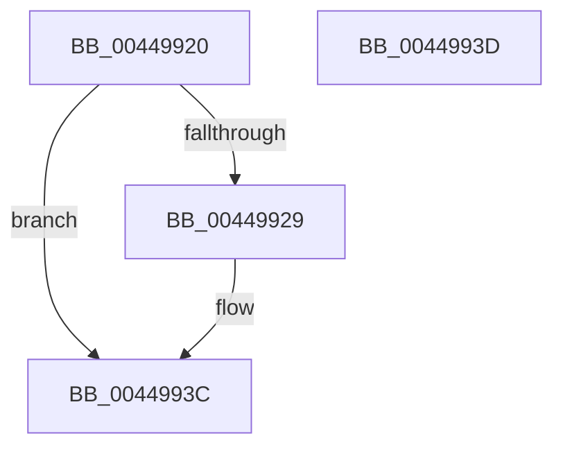

# MiAddMdlPageToTradeBlock

- RVA: `0x00449920`–`0x0044993E` (길이 `30` bytes)
- VA: `0x0000000140449920`
- 실행 섹션: `.text`
- PDB 이름 있음: `예`; PDB Function 태그: `아니요`
- unwind 정보 RVA: `0x000DB714`
- 디코드: `9`개 명령, `30/30` bytes 표시
- 미해석 바이트: `0` (있으면 어셈블리에 `.byte`로 보존)

> 이 문서는 커널 이미지의 기계어와 PDB 기호를 분석해 생성했습니다. 4번과 5번은 함수 원형과 자료형을 바이너리 사용 방식에서 추정한 C 해석이며 원본 소스 복구 결과는 아닙니다.

## 1. Dependencies

- 직접 호출 지점: **0**; 고유 호출 대상: **0**
- 직접 호출자로 확인된 함수: **1**
- RIP 상대 이미지 참조: **0**

### Outgoing calls
- 직접 디코드된 call 명령이 없습니다.

### Direct callers
- [MiTradePage](../28/MiTradePage_function_0028D160.md) at `0x0028D35B`
- [MiTradePage](../28/MiTradePage_function_0028D160.md) at `0x0028D8AB`

### Static image references
- 디코드된 RIP-relative 메모리 참조가 없습니다.

## 2. Other-region calls and transfers

- 다른 실행 섹션으로 향하는 call: **0**
- 별도 외부 분기/꼬리 이동을 확인하지 못했습니다.

## 3. Assembly (complete function range)

```asm
00449920  48 8B 41 38                     mov rax, qword ptr [rcx + 0x38]
00449924  48 85 C0                        test rax, rax
00449927  74 13                           je 0x14044993c
00449929  8B 48 28                        mov ecx, dword ptr [rax + 0x28]
0044992C  48 C1 E9 0C                     shr rcx, 0xc
00449930  48 89 54 C8 30                  mov qword ptr [rax + rcx*8 + 0x30], rdx
00449935  81 40 28 00 10 00 00            add dword ptr [rax + 0x28], 0x1000
0044993C  C3                              ret
0044993D  CC                              int3
```

## 4. C-style interpretation (structured pseudocode)

```c
__int64 __fastcall MiAddMdlPageToTradeBlock(__int64 a1, __int64 a2)
{
    if (*(unsigned __int64 *)(a1 + 56) != 0) {
        a1 = *(unsigned int *)(*(unsigned __int64 *)(a1 + 56) + 40);
        a1 = (a1) >> (12);
        *(unsigned __int64 *)(*(unsigned __int64 *)(a1 + 56) + a1 * 8 + 48) = a2;
    }
    return *(unsigned __int64 *)(a1 + 56);
}
```

## 5. (Beta) C Style

```c
int64_t MiAddMdlPageToTradeBlock(void *Arg1, int64_t Arg2)
{
    uint8_t *arg1 = (uint8_t *)Arg1;

    if (*(uint64_t *)(arg1 + 0x38) != 0) {
        Arg1 = *(uint32_t *)(*(uint64_t *)(arg1 + 0x38) + 0x28);
        Arg1 = (Arg1) >> (12);
        *(uint64_t *)(*(uint64_t *)(arg1 + 0x38) + arg1 * 8 + 0x30) = Arg2;
    }
    return *(uint64_t *)(arg1 + 0x38);
}
```

### 관측된 메모리 오프셋

구조체 형식이 확인되지 않은 접근은 인자 기준의 오프셋으로만 기록했습니다.

| 기준 인자 | 오프셋 표현 | 폭 (bit) | 접근 |
|---|---:|---:|---|
| `Arg1` | `+ 0x38` | `64` | `R` |

## 6. Execution-region graph

[열기: 2D/3D 그래프와 함수 탐색 컨트롤 패널](../../../control-panel.html?section=text&rva=0x00449920&view=graph)

- 2D 그래프는 위에서 아래로 흐르고, 3D 그래프는 빈 공간을 드래그해 회전합니다. Shift+드래그는 이동, 휠은 확대·축소, 함수 노드 선택은 대상 보고서 이동입니다.

### Static fallback


