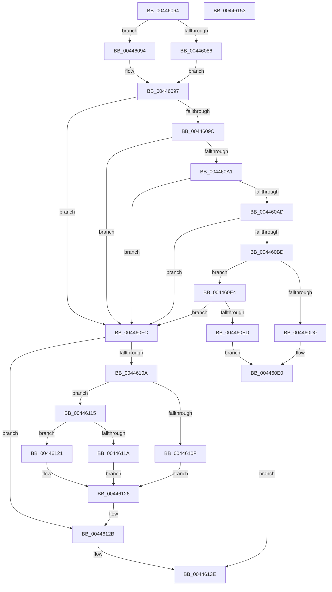

# MiAddPageToHeatRanges

- RVA: `0x00446064`–`0x00446154` (길이 `240` bytes)
- VA: `0x0000000140446064`
- 실행 섹션: `.text`
- PDB 이름 있음: `예`; PDB Function 태그: `아니요`
- unwind 정보 RVA: `0x000A5A38`
- 디코드: `74`개 명령, `240/240` bytes 표시
- 미해석 바이트: `0` (있으면 어셈블리에 `.byte`로 보존)

> 이 문서는 커널 이미지의 기계어와 PDB 기호를 분석해 생성했습니다. 4번과 5번은 함수 원형과 자료형을 바이너리 사용 방식에서 추정한 C 해석이며 원본 소스 복구 결과는 아닙니다.

## 1. Dependencies

- 직접 호출 지점: **0**; 고유 호출 대상: **0**
- 직접 호출자로 확인된 함수: **4**
- RIP 상대 이미지 참조: **0**

### Outgoing calls
- 직접 디코드된 call 명령이 없습니다.

### Direct callers
- [MmSetPfnListInfo](../31/MmSetPfnListInfo_function_0031D61C.md) at `0x0031D927`
- [MiMakeTransitionHeatBatch](../40/MiMakeTransitionHeatBatch_function_00409A94.md) at `0x00409DBE`
- [MiAddPageToHeatList](MiAddPageToHeatList_function_0044603C.md) at `0x00446045`
- [sub_006E182C](../6E/Unknown_function_006E182C.md) at `0x006E1849`

### Static image references
- 디코드된 RIP-relative 메모리 참조가 없습니다.

## 2. Other-region calls and transfers

- 다른 실행 섹션으로 향하는 call: **0**
- 별도 외부 분기/꼬리 이동을 확인하지 못했습니다.

## 3. Assembly (complete function range)

```asm
00446064  48 8B C4                        mov rax, rsp
00446067  48 89 58 08                     mov qword ptr [rax + 8], rbx
0044606B  48 89 68 10                     mov qword ptr [rax + 0x10], rbp
0044606F  48 89 70 18                     mov qword ptr [rax + 0x18], rsi
00446073  48 89 78 20                     mov qword ptr [rax + 0x20], rdi
00446077  8B 71 04                        mov esi, dword ptr [rcx + 4]
0044607A  33 DB                           xor ebx, ebx
0044607C  41 8B F8                        mov edi, r8d
0044607F  4C 8B D1                        mov r10, rcx
00446082  85 F6                           test esi, esi
00446084  74 0E                           je 0x140446094
00446086  44 8D 5E FF                     lea r11d, [rsi - 1]
0044608A  4D 8D 5B 02                     lea r11, [r11 + 2]
0044608E  4E 8D 1C D9                     lea r11, [rcx + r11*8]
00446092  EB 03                           jmp 0x140446097
00446094  4C 8B DB                        mov r11, rbx
00446097  83 FF 03                        cmp edi, 3
0044609A  75 60                           jne 0x1404460fc
0044609C  4D 85 DB                        test r11, r11
0044609F  74 5B                           je 0x1404460fc
004460A1  49 8B 0B                        mov rcx, qword ptr [r11]
004460A4  48 F7 C1 00 0C 00 00            test rcx, 0xc00
004460AB  75 4F                           jne 0x1404460fc
004460AD  BD FF 03 00 00                  mov ebp, 0x3ff
004460B2  4C 8B C1                        mov r8, rcx
004460B5  4C 23 C5                        and r8, rbp
004460B8  4C 3B C5                        cmp r8, rbp
004460BB  73 3F                           jae 0x1404460fc
004460BD  49 FF C0                        inc r8
004460C0  4C 8B C9                        mov r9, rcx
004460C3  49 C1 E9 0C                     shr r9, 0xc
004460C7  4B 8D 04 08                     lea rax, [r8 + r9]
004460CB  48 3B D0                        cmp rdx, rax
004460CE  75 14                           jne 0x1404460e4
004460D0  49 33 C8                        xor rcx, r8
004460D3  48 81 E1 00 FC FF FF            and rcx, 0xfffffffffffffc00
004460DA  49 33 C8                        xor rcx, r8
004460DD  49 89 0B                        mov qword ptr [r11], rcx
004460E0  33 C0                           xor eax, eax
004460E2  EB 5A                           jmp 0x14044613e
004460E4  49 8D 41 FF                     lea rax, [r9 - 1]
004460E8  48 3B D0                        cmp rdx, rax
004460EB  75 0F                           jne 0x1404460fc
004460ED  48 C1 E2 0C                     shl rdx, 0xc
004460F1  4C 23 C5                        and r8, rbp
004460F4  49 0B D0                        or rdx, r8
004460F7  49 89 13                        mov qword ptr [r11], rdx
004460FA  EB E4                           jmp 0x1404460e0
004460FC  48 C1 E2 0C                     shl rdx, 0xc
00446100  49 89 54 F2 10                  mov qword ptr [r10 + rsi*8 + 0x10], rdx
00446105  83 FF 03                        cmp edi, 3
00446108  74 21                           je 0x14044612b
0044610A  83 FF 02                        cmp edi, 2
0044610D  75 06                           jne 0x140446115
0044610F  48 83 CA 0F                     or rdx, 0xf
00446113  EB 11                           jmp 0x140446126
00446115  83 FF 01                        cmp edi, 1
00446118  75 07                           jne 0x140446121
0044611A  48 0F BA EA 0A                  bts rdx, 0xa
0044611F  EB 05                           jmp 0x140446126
00446121  48 0F BA EA 0B                  bts rdx, 0xb
00446126  49 89 54 F2 10                  mov qword ptr [r10 + rsi*8 + 0x10], rdx
0044612B  41 8B 0A                        mov ecx, dword ptr [r10]
0044612E  41 FF 42 04                     inc dword ptr [r10 + 4]
00446132  C1 E9 03                        shr ecx, 3
00446135  41 39 4A 04                     cmp dword ptr [r10 + 4], ecx
00446139  0F 94 C3                        sete bl
0044613C  8B C3                           mov eax, ebx
0044613E  48 8B 5C 24 08                  mov rbx, qword ptr [rsp + 8]
00446143  48 8B 6C 24 10                  mov rbp, qword ptr [rsp + 0x10]
00446148  48 8B 74 24 18                  mov rsi, qword ptr [rsp + 0x18]
0044614D  48 8B 7C 24 20                  mov rdi, qword ptr [rsp + 0x20]
00446152  C3                              ret
00446153  CC                              int3
```

## 4. C-style interpretation (structured pseudocode)

```c
__int64 __fastcall MiAddPageToHeatRanges(__int64 a1, __int64 a2, int a3)
{
    __int64 result;
    __int64 v_rbx;
    unsigned __int64 v_stack_p10;
    unsigned __int64 v_stack_p18;
    unsigned __int64 v_stack_p20;
    unsigned __int64 v_stack_p8;

    *(unsigned __int64 *)(v_rsp + 8) = v_rbx;
    *(unsigned __int64 *)(v_rsp + 16) = v_rbp;
    *(unsigned __int64 *)(v_rsp + 24) = v_rsi;
    *(unsigned __int64 *)(v_rsp + 32) = v_rdi;
    v_rbx = 0;
    if ((unsigned int)((unsigned int)(*(unsigned int *)(a1 + 4))) == 0) goto loc_00446094;
    goto loc_00446097;
loc_00446094:
loc_00446097:
    if (((unsigned int)((unsigned int)(a3))) != 3) goto loc_004460FC;
    if (0 == 0) goto loc_004460FC;
    if (((*(unsigned __int64 *)(0)) & (0xC00ULL)) != 0) goto loc_004460FC;
    a3 = (*(unsigned __int64 *)(0)) & ((unsigned int)(0x3FFULL));
    if (a3 >= ((unsigned int)(0x3FFULL))) goto loc_004460FC;
    a3 = (a3) + 1;
    a4 = (*(unsigned __int64 *)(0)) >> (12);
    if (a2 != (a3 + a4 * 1)) goto loc_004460E4;
    a1 = (*(unsigned __int64 *)(0)) ^ (a3);
    a1 = (a1) & (0xFFFFFFFFFFFFFC00ULL);
    a1 = (a1) ^ (a3);
    *(unsigned __int64 *)(0) = a1;
loc_004460E0:
    result = 0;
    goto loc_0044613E;
loc_004460E4:
    if (a2 != (a4 - 1)) goto loc_004460FC;
    a2 = (a2) << (12);
    a3 = (a3) & ((unsigned int)(0x3FFULL));
    a2 = (a2) | (a3);
    *(unsigned __int64 *)(0) = a2;
    goto loc_004460E0;
loc_004460FC:
    a2 = (a2) << (12);
    *(unsigned __int64 *)(a1 + (unsigned int)(*(unsigned int *)(a1 + 4)) * 8 + 16) = a2;
    if (((unsigned int)((unsigned int)(a3))) == 3) goto loc_0044612B;
    if (((unsigned int)((unsigned int)(a3))) != 2) goto loc_00446115;
    a2 = (a2) | (15);
    goto loc_00446126;
loc_00446115:
    if (((unsigned int)((unsigned int)(a3))) != 1) goto loc_00446121;
    goto loc_00446126;
loc_00446121:
loc_00446126:
    *(unsigned __int64 *)(a1 + (unsigned int)(*(unsigned int *)(a1 + 4)) * 8 + 16) = a2;
loc_0044612B:
    a1 = (unsigned int)(((unsigned int)(*(unsigned int *)(a1))) >> (3));
    v_rbx = ((*(unsigned int *)(a1 + 4)) == ((unsigned int)(a1))) ? 1 : 0;
loc_0044613E:
    return (unsigned int)((unsigned int)(v_rbx));
}
```

## 5. (Beta) C Style

```c
int64_t MiAddPageToHeatRanges(void *Arg1, int64_t Arg2, int32_t Arg3)
{
    uint8_t *arg1 = (uint8_t *)Arg1;

    int64_t result;
    int64_t local_rbx;
    uint64_t v_stack_p10;
    uint64_t v_stack_p18;
    uint64_t v_stack_p20;
    uint64_t v_stack_p8;

    *(uint64_t *)(local_rsp + 0x8) = local_rbx;
    *(uint64_t *)(local_rsp + 0x10) = local_rbp;
    *(uint64_t *)(local_rsp + 0x18) = local_rsi;
    *(uint64_t *)(local_rsp + 0x20) = local_rdi;
    local_rbx = 0;
    if ((uint32_t)((uint32_t)(*(uint32_t *)(arg1 + 0x4))) == 0) goto loc_00446094;
    goto loc_00446097;
loc_00446094:
loc_00446097:
    if (((uint32_t)((uint32_t)(Arg3))) != 3) goto loc_004460FC;
    if (0 == 0) goto loc_004460FC;
    if (((*(uint64_t *)(0)) & (0xC00ULL)) != 0) goto loc_004460FC;
    Arg3 = (*(uint64_t *)(0)) & ((uint32_t)(0x3FFULL));
    if (Arg3 >= ((uint32_t)(0x3FFULL))) goto loc_004460FC;
    Arg3 = (Arg3) + 1;
    a4 = (*(uint64_t *)(0)) >> (12);
    if (Arg2 != (Arg3 + a4 * 1)) goto loc_004460E4;
    Arg1 = (*(uint64_t *)(0)) ^ (Arg3);
    Arg1 = (Arg1) & (0xFFFFFFFFFFFFFC00ULL);
    Arg1 = (Arg1) ^ (Arg3);
    *(void **)(0) = Arg1;
loc_004460E0:
    result = 0;
    goto loc_0044613E;
loc_004460E4:
    if (Arg2 != (a4 - 1)) goto loc_004460FC;
    Arg2 = (Arg2) << (12);
    Arg3 = (Arg3) & ((uint32_t)(0x3FFULL));
    Arg2 = (Arg2) | (Arg3);
    *(uint64_t *)(0) = Arg2;
    goto loc_004460E0;
loc_004460FC:
    Arg2 = (Arg2) << (12);
    *(uint64_t *)(arg1 + (uint32_t)(*(uint32_t *)(arg1 + 0x4)) * 8 + 0x10) = Arg2;
    if (((uint32_t)((uint32_t)(Arg3))) == 3) goto loc_0044612B;
    if (((uint32_t)((uint32_t)(Arg3))) != 2) goto loc_00446115;
    Arg2 = (Arg2) | (15);
    goto loc_00446126;
loc_00446115:
    if (((uint32_t)((uint32_t)(Arg3))) != 1) goto loc_00446121;
    goto loc_00446126;
loc_00446121:
loc_00446126:
    *(uint64_t *)(arg1 + (uint32_t)(*(uint32_t *)(arg1 + 0x4)) * 8 + 0x10) = Arg2;
loc_0044612B:
    Arg1 = (uint32_t)(((uint32_t)(*(uint32_t *)(arg1))) >> (3));
    local_rbx = ((*(uint32_t *)(arg1 + 0x4)) == ((uint32_t)(Arg1))) ? 1 : 0;
loc_0044613E:
    return (uint32_t)((uint32_t)(local_rbx));
}
```

### 관측된 메모리 오프셋

구조체 형식이 확인되지 않은 접근은 인자 기준의 오프셋으로만 기록했습니다.

| 기준 인자 | 오프셋 표현 | 폭 (bit) | 접근 |
|---|---:|---:|---|
| `Arg1` | `+ 0x0` | `32` | `R` |
| `Arg1` | `+ 0x0 + r11*8` | `64` | `R` |
| `Arg1` | `+ 0x4` | `32` | `R` |
| `Arg1` | `+ 0x4` | `32` | `R/W` |
| `Arg1` | `+ 0x10 + rsi*8` | `64` | `W` |

## 6. Execution-region graph

[열기: 2D/3D 그래프와 함수 탐색 컨트롤 패널](../../../control-panel.html?section=text&rva=0x00446064&view=graph)

- 2D 그래프는 위에서 아래로 흐르고, 3D 그래프는 빈 공간을 드래그해 회전합니다. Shift+드래그는 이동, 휠은 확대·축소, 함수 노드 선택은 대상 보고서 이동입니다.

### Static fallback


