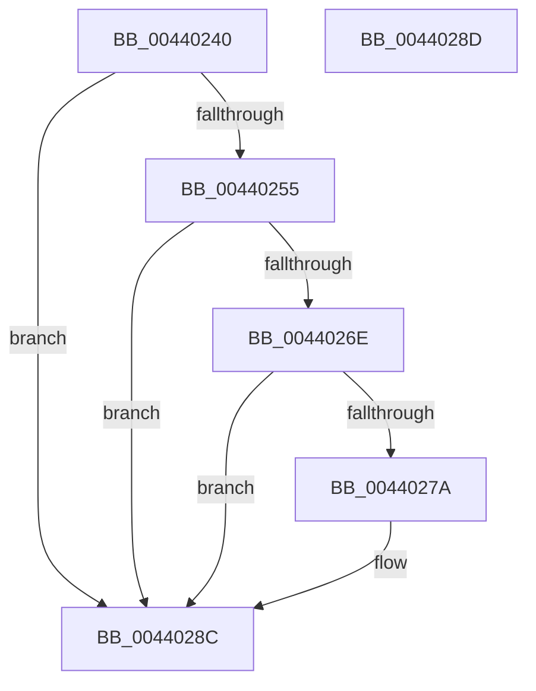

# MiAdjustFaultList

- RVA: `0x00440240`–`0x0044028E` (길이 `78` bytes)
- VA: `0x0000000140440240`
- 실행 섹션: `.text`
- PDB 이름 있음: `예`; PDB Function 태그: `아니요`
- unwind 정보 RVA: `0x000DB714`
- 디코드: `23`개 명령, `78/78` bytes 표시
- 미해석 바이트: `0` (있으면 어셈블리에 `.byte`로 보존)

> 이 문서는 커널 이미지의 기계어와 PDB 기호를 분석해 생성했습니다. 4번과 5번은 함수 원형과 자료형을 바이너리 사용 방식에서 추정한 C 해석이며 원본 소스 복구 결과는 아닙니다.

## 1. Dependencies

- 직접 호출 지점: **0**; 고유 호출 대상: **0**
- 직접 호출자로 확인된 함수: **1**
- RIP 상대 이미지 참조: **0**

### Outgoing calls
- 직접 디코드된 call 명령이 없습니다.

### Direct callers
- [sub_00320866](../32/Unknown_function_00320866.md) at `0x00320A14`

### Static image references
- 디코드된 RIP-relative 메모리 참조가 없습니다.

## 2. Other-region calls and transfers

- 다른 실행 섹션으로 향하는 call: **0**
- 별도 외부 분기/꼬리 이동을 확인하지 못했습니다.

## 3. Assembly (complete function range)

```asm
00440240  4C 8B 41 10                     mov r8, qword ptr [rcx + 0x10]
00440244  48 8B C1                        mov rax, rcx
00440247  49 83 E0 FE                     and r8, 0xfffffffffffffffe
0044024B  49 8B 48 18                     mov rcx, qword ptr [r8 + 0x18]
0044024F  49 3B 48 10                     cmp rcx, qword ptr [r8 + 0x10]
00440253  73 37                           jae 0x14044028c
00440255  48 8B 00                        mov rax, qword ptr [rax]
00440258  48 C1 E1 04                     shl rcx, 4
0044025C  48 25 00 F0 FF FF               and rax, 0xfffffffffffff000
00440262  49 03 48 08                     add rcx, qword ptr [r8 + 8]
00440266  4C 8B 09                        mov r9, qword ptr [rcx]
00440269  49 3B C1                        cmp rax, r9
0044026C  72 1E                           jb 0x14044028c
0044026E  48 8B 51 08                     mov rdx, qword ptr [rcx + 8]
00440272  49 03 D1                        add rdx, r9
00440275  48 3B C2                        cmp rax, rdx
00440278  73 12                           jae 0x14044028c
0044027A  49 81 E1 00 F0 FF FF            and r9, 0xfffffffffffff000
00440281  49 2B C1                        sub rax, r9
00440284  48 C1 E8 0C                     shr rax, 0xc
00440288  49 89 40 20                     mov qword ptr [r8 + 0x20], rax
0044028C  C3                              ret
0044028D  CC                              int3
```

## 4. C-style interpretation (structured pseudocode)

```c
__int64 __fastcall MiAdjustFaultList(__int64 a1)
{
    __int64 result;

    a3 = (*(unsigned __int64 *)(a1 + 16)) & (-2);
    if ((*(unsigned __int64 *)(a3 + 24)) >= (*(unsigned __int64 *)(a3 + 16))) goto loc_0044028C;
    a1 = (*(unsigned __int64 *)(a3 + 24)) << (4);
    result = (*(unsigned __int64 *)(a1)) & (0xFFFFFFFFFFFFF000ULL);
    a1 = (a1) + (*(unsigned __int64 *)(a3 + 8));
    if (result < (*(unsigned __int64 *)(a1))) goto loc_0044028C;
    a2 = (*(unsigned __int64 *)(a1 + 8)) + (*(unsigned __int64 *)(a1));
    if (result < a2) {
        a4 = (*(unsigned __int64 *)(a1)) & (0xFFFFFFFFFFFFF000ULL);
        result = (result) - (a4);
        result = (result) >> (12);
        *(unsigned __int64 *)(a3 + 32) = result;
    }
    return result;
}
```

## 5. (Beta) C Style

```c
int64_t MiAdjustFaultList(void *Arg1)
{
    uint8_t *arg1 = (uint8_t *)Arg1;

    int64_t result;

    a3 = (*(uint64_t *)(arg1 + 0x10)) & (-2);
    if ((*(uint64_t *)(a3 + 0x18)) >= (*(uint64_t *)(a3 + 0x10))) goto loc_0044028C;
    Arg1 = (*(uint64_t *)(a3 + 0x18)) << (4);
    result = (*(uint64_t *)(arg1)) & (0xFFFFFFFFFFFFF000ULL);
    Arg1 = (Arg1) + (*(uint64_t *)(a3 + 0x8));
    if (result < (*(uint64_t *)(arg1))) goto loc_0044028C;
    a2 = (*(uint64_t *)(arg1 + 0x8)) + (*(uint64_t *)(arg1));
    if (result < a2) {
        a4 = (*(uint64_t *)(arg1)) & (0xFFFFFFFFFFFFF000ULL);
        result = (result) - (a4);
        result = (result) >> (12);
        *(uint64_t *)(a3 + 0x20) = result;
    }
    return result;
}
```

### 관측된 메모리 오프셋

구조체 형식이 확인되지 않은 접근은 인자 기준의 오프셋으로만 기록했습니다.

| 기준 인자 | 오프셋 표현 | 폭 (bit) | 접근 |
|---|---:|---:|---|
| `Arg1` | `+ 0x0` | `64` | `R` |
| `Arg1` | `+ 0x10` | `64` | `R` |

## 6. Execution-region graph

[열기: 2D/3D 그래프와 함수 탐색 컨트롤 패널](../../../control-panel.html?section=text&rva=0x00440240&view=graph)

- 2D 그래프는 위에서 아래로 흐르고, 3D 그래프는 빈 공간을 드래그해 회전합니다. Shift+드래그는 이동, 휠은 확대·축소, 함수 노드 선택은 대상 보고서 이동입니다.

### Static fallback


