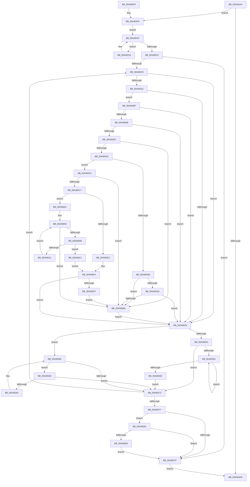

# MiAgeAweRegions

- RVA: `0x004464A4`–`0x0044666C` (길이 `456` bytes)
- VA: `0x00000001404464A4`
- 실행 섹션: `.text`
- PDB 이름 있음: `예`; PDB Function 태그: `아니요`
- unwind 정보 RVA: `0x000A5A50`
- 디코드: `131`개 명령, `456/456` bytes 표시
- 미해석 바이트: `0` (있으면 어셈블리에 `.byte`로 보존)

> 이 문서는 커널 이미지의 기계어와 PDB 기호를 분석해 생성했습니다. 4번과 5번은 함수 원형과 자료형을 바이너리 사용 방식에서 추정한 C 해석이며 원본 소스 복구 결과는 아닙니다.

## 1. Dependencies

- 직접 호출 지점: **4**; 고유 호출 대상: **4**
- 직접 호출자로 확인된 함수: **1**
- RIP 상대 이미지 참조: **1**

### Outgoing calls
- `0x00446506` → [ExAcquireSpinLockShared](../24/ExAcquireSpinLockShared_function_0024DCE0.md) (function, `0x0024DCE0`)
- `0x00446585` → [MiReleaseSpinLockShared](../34/MiReleaseSpinLockShared_function_00348BF0.md) (function, `0x00348BF0`)
- `0x0044663E` → [ObfReferenceObjectWithTag](../21/ObfReferenceObjectWithTag_function_00210710.md) (function, `0x00210710`)
- `0x00446662` → [ExQueueWorkItem](../2F/ExQueueWorkItem_function_002F9520.md) (function, `0x002F9520`)

### Direct callers
- [MiTrimOrAgeWorkingSet](../34/MiTrimOrAgeWorkingSet_function_0034EFC0.md) at `0x0034F23B`

### Static image references
- `0x00446653` → RVA `0x006884B0` (`MiDeleteAwePageTables`; read)

## 2. Other-region calls and transfers

- 다른 실행 섹션으로 향하는 call: **0**
- 별도 외부 분기/꼬리 이동을 확인하지 못했습니다.

## 3. Assembly (complete function range)

```asm
004464A4  48 8B C4                        mov rax, rsp
004464A7  48 89 58 08                     mov qword ptr [rax + 8], rbx
004464AB  48 89 68 10                     mov qword ptr [rax + 0x10], rbp
004464AF  48 89 70 18                     mov qword ptr [rax + 0x18], rsi
004464B3  48 89 78 20                     mov qword ptr [rax + 0x20], rdi
004464B7  41 56                           push r14
004464B9  48 83 EC 20                     sub rsp, 0x20
004464BD  65 48 8B 04 25 88 01 00 00      mov rax, qword ptr gs:[0x188]
004464C6  48 8B B8 B8 00 00 00            mov rdi, qword ptr [rax + 0xb8]
004464CD  48 8B 9F 10 04 00 00            mov rbx, qword ptr [rdi + 0x410]
004464D4  48 83 BB 50 04 00 00 00         cmp qword ptr [rbx + 0x450], 0
004464DC  75 1C                           jne 0x1404464fa
004464DE  48 8B 5C 24 30                  mov rbx, qword ptr [rsp + 0x30]
004464E3  48 8B 6C 24 38                  mov rbp, qword ptr [rsp + 0x38]
004464E8  48 8B 74 24 40                  mov rsi, qword ptr [rsp + 0x40]
004464ED  48 8B 7C 24 48                  mov rdi, qword ptr [rsp + 0x48]
004464F2  48 83 C4 20                     add rsp, 0x20
004464F6  41 5E                           pop r14
004464F8  C3                              ret
004464F9  CC                              int3
004464FA  48 8D AB 68 04 00 00            lea rbp, [rbx + 0x468]
00446501  33 F6                           xor esi, esi
00446503  48 8B CD                        mov rcx, rbp
00446506  E8 D5 77 E0 FF                  call 0x14024dce0
0044650B  48 8B 8B 50 04 00 00            mov rcx, qword ptr [rbx + 0x450]
00446512  44 8A F0                        mov r14b, al
00446515  33 D2                           xor edx, edx
00446517  EB 06                           jmp 0x14044651f
00446519  48 8B D1                        mov rdx, rcx
0044651C  48 8B 09                        mov rcx, qword ptr [rcx]
0044651F  48 85 C9                        test rcx, rcx
00446522  75 F5                           jne 0x140446519
00446524  48 85 D2                        test rdx, rdx
00446527  74 56                           je 0x14044657f
00446529  4C 8B 42 30                     mov r8, qword ptr [rdx + 0x30]
0044652D  4D 85 C0                        test r8, r8
00446530  74 07                           je 0x140446539
00446532  8A 42 40                        mov al, byte ptr [rdx + 0x40]
00446535  3C FF                           cmp al, 0xff
00446537  72 56                           jb 0x14044658f
00446539  48 8B 42 08                     mov rax, qword ptr [rdx + 8]
0044653D  48 8B CA                        mov rcx, rdx
00446540  48 85 C0                        test rax, rax
00446543  74 23                           je 0x140446568
00446545  48 8B 08                        mov rcx, qword ptr [rax]
00446548  48 8B D0                        mov rdx, rax
0044654B  48 85 C9                        test rcx, rcx
0044654E  74 22                           je 0x140446572
00446550  48 8B 01                        mov rax, qword ptr [rcx]
00446553  48 8B D1                        mov rdx, rcx
00446556  48 8B C8                        mov rcx, rax
00446559  48 85 C0                        test rax, rax
0044655C  75 F2                           jne 0x140446550
0044655E  EB 12                           jmp 0x140446572
00446560  48 39 0A                        cmp qword ptr [rdx], rcx
00446563  74 0D                           je 0x140446572
00446565  48 8B CA                        mov rcx, rdx
00446568  48 8B 52 10                     mov rdx, qword ptr [rdx + 0x10]
0044656C  48 83 E2 FC                     and rdx, 0xfffffffffffffffc
00446570  75 EE                           jne 0x140446560
00446572  48 85 D2                        test rdx, rdx
00446575  75 B2                           jne 0x140446529
00446577  85 F6                           test esi, esi
00446579  0F 85 A9 00 00 00               jne 0x140446628
0044657F  41 8A D6                        mov dl, r14b
00446582  48 8B CD                        mov rcx, rbp
00446585  E8 66 26 F0 FF                  call 0x140348bf0
0044658A  E9 4F FF FF FF                  jmp 0x1404464de
0044658F  FE C0                           inc al
00446591  88 42 40                        mov byte ptr [rdx + 0x40], al
00446594  85 F6                           test esi, esi
00446596  75 A1                           jne 0x140446539
00446598  3C 3F                           cmp al, 0x3f
0044659A  72 9D                           jb 0x140446539
0044659C  48 8B 42 30                     mov rax, qword ptr [rdx + 0x30]
004465A0  48 85 C0                        test rax, rax
004465A3  74 13                           je 0x1404465b8
004465A5  49 83 F8 01                     cmp r8, 1
004465A9  77 17                           ja 0x1404465c2
004465AB  75 0B                           jne 0x1404465b8
004465AD  48 8B 42 38                     mov rax, qword ptr [rdx + 0x38]
004465B1  48 0F BA 20 00                  bt qword ptr [rax], 0
004465B6  73 81                           jae 0x140446539
004465B8  BE 01 00 00 00                  mov esi, 1
004465BD  E9 77 FF FF FF                  jmp 0x140446539
004465C2  49 3B C0                        cmp rax, r8
004465C5  72 F1                           jb 0x1404465b8
004465C7  48 8B 4A 38                     mov rcx, qword ptr [rdx + 0x38]
004465CB  4D 8D 58 FF                     lea r11, [r8 - 1]
004465CF  49 8B C3                        mov rax, r11
004465D2  48 C1 E8 06                     shr rax, 6
004465D6  4C 8B 09                        mov r9, qword ptr [rcx]
004465D9  4C 8D 14 C1                     lea r10, [rcx + rax*8]
004465DD  49 3B CA                        cmp rcx, r10
004465E0  75 1F                           jne 0x140446601
004465E2  48 83 C8 FF                     or rax, 0xffffffffffffffff
004465E6  B9 40 00 00 00                  mov ecx, 0x40
004465EB  41 2A C8                        sub cl, r8b
004465EE  48 D3 E8                        shr rax, cl
004465F1  4C 85 C8                        test rax, r9
004465F4  0F 94 C0                        sete al
004465F7  84 C0                           test al, al
004465F9  0F 85 3A FF FF FF               jne 0x140446539
004465FF  EB B7                           jmp 0x1404465b8
00446601  4D 85 C9                        test r9, r9
00446604  75 B2                           jne 0x1404465b8
00446606  48 83 C1 08                     add rcx, 8
0044660A  4C 8B 01                        mov r8, qword ptr [rcx]
0044660D  49 3B CA                        cmp rcx, r10
00446610  74 05                           je 0x140446617
00446612  4D 85 C0                        test r8, r8
00446615  EB ED                           jmp 0x140446604
00446617  48 83 C8 FF                     or rax, 0xffffffffffffffff
0044661B  41 8A CB                        mov cl, r11b
0044661E  F6 D1                           not cl
00446620  48 D3 E8                        shr rax, cl
00446623  4C 85 C0                        test rax, r8
00446626  EB CC                           jmp 0x1404465f4
00446628  48 83 BB 80 04 00 00 00         cmp qword ptr [rbx + 0x480], 0
00446630  0F 85 49 FF FF FF               jne 0x14044657f
00446636  BA 4D 6D 50 68                  mov edx, 0x68506d4d
0044663B  48 8B CF                        mov rcx, rdi
0044663E  E8 CD A0 DC FF                  call 0x140210710
00446643  48 8D 8B 70 04 00 00            lea rcx, [rbx + 0x470]
0044664A  BA 04 00 00 00                  mov edx, 4
0044664F  48 83 21 00                     and qword ptr [rcx], 0
00446653  48 8D 05 56 1E 24 00            lea rax, [rip + 0x241e56]
0044665A  48 89 41 10                     mov qword ptr [rcx + 0x10], rax
0044665E  48 89 79 18                     mov qword ptr [rcx + 0x18], rdi
00446662  E8 B9 2E EB FF                  call 0x1402f9520
00446667  E9 13 FF FF FF                  jmp 0x14044657f
```

## 4. C-style interpretation (structured pseudocode)

```c
__int64 __fastcall MiAgeAweRegions(__int64 a1, int a2)
{
    __int64 result;
    __int64 v_rsi;
    __int64 v_rsp;
    unsigned __int64 v_stack_p10;
    unsigned __int64 v_stack_p18;
    unsigned __int64 v_stack_p20;
    unsigned __int64 v_stack_p8;

    *(unsigned __int64 *)(v_rsp + 8) = v_rbx;
    *(unsigned __int64 *)(v_rsp + 16) = v_rbp;
    *(unsigned __int64 *)(v_rsp + 24) = v_rsi;
    *(unsigned __int64 *)(v_rsp + 32) = v_rdi;
    v_rsp = (v_rsp) - (32);
    if ((*(unsigned __int64 *)(*(unsigned __int64 *)(*(unsigned __int64 *)(*(unsigned __int64 *)(gs_base + (0 + 392)) + 184) + 1040) + 1104)) != 0) goto loc_004464FA;
loc_004464DE:
    v_rsp = (v_rsp) + (32);
    return *(unsigned __int64 *)(gs_base + (0 + 392));
loc_004464FA:
    v_rsi = 0;
    result = ExAcquireSpinLockShared(v_stack_p8 + 1128, a2, a3, a4);
    a2 = 0;
    goto loc_0044651F;
loc_00446519:
loc_0044651F:
    if (*(unsigned __int64 *)(*(unsigned __int64 *)(v_stack_p8 + 1104)) != 0) goto loc_00446519;
    if (*(unsigned __int64 *)(v_stack_p8 + 1104) == 0) goto loc_0044657F;
loc_00446529:
    if (*(unsigned __int64 *)(*(unsigned __int64 *)(v_stack_p8 + 1104) + 48) == 0) goto loc_00446539;
    if (((unsigned __int8)(*(unsigned __int8 *)(*(unsigned __int64 *)(v_stack_p8 + 1104) + 64))) < 255) goto loc_0044658F;
loc_00446539:
    if (*(unsigned __int64 *)(*(unsigned __int64 *)(v_stack_p8 + 1104) + 8) == 0) goto loc_00446568;
    if (*(unsigned __int64 *)(*(unsigned __int64 *)(*(unsigned __int64 *)(v_stack_p8 + 1104) + 8)) == 0) goto loc_00446572;
loc_00446550:
    if (*(unsigned __int64 *)(*(unsigned __int64 *)(*(unsigned __int64 *)(*(unsigned __int64 *)(v_stack_p8 + 1104) + 8))) != 0) goto loc_00446550;
    goto loc_00446572;
loc_00446560:
    if ((*(unsigned __int64 *)(*(unsigned __int64 *)(*(unsigned __int64 *)(*(unsigned __int64 *)(v_stack_p8 + 1104) + 8)))) == (*(unsigned __int64 *)(*(unsigned __int64 *)(*(unsigned __int64 *)(*(unsigned __int64 *)(v_stack_p8 + 1104) + 8))))) goto loc_00446572;
loc_00446568:
    a2 = (*(unsigned __int64 *)(*(unsigned __int64 *)(*(unsigned __int64 *)(*(unsigned __int64 *)(v_stack_p8 + 1104) + 8)) + 16)) & (-4);
    if (condition_is_not_equal) goto loc_00446560;
loc_00446572:
    if (a2 != 0) goto loc_00446529;
    if (0 != 0) goto loc_00446628;
loc_0044657F:
    result = MiReleaseSpinLockShared(v_stack_p8 + 1128, (unsigned __int8)((unsigned __int8)(result)), *(unsigned __int64 *)(*(unsigned __int64 *)(v_stack_p8 + 1104) + 48), a4);
    goto loc_004464DE;
loc_0044658F:
    result = (unsigned __int8)((result) + 1);
    *(unsigned __int8 *)((unsigned __int8)((unsigned __int8)(result)) + 64) = (unsigned __int8)(result);
    if (0 != 0) goto loc_00446539;
    if (((unsigned __int8)(result)) < 63) goto loc_00446539;
    if (*(unsigned __int64 *)((unsigned __int8)((unsigned __int8)(result)) + 48) == 0) goto loc_004465B8;
    if ((*(unsigned __int64 *)(*(unsigned __int64 *)(v_stack_p8 + 1104) + 48)) > 1) goto loc_004465C2;
    if ((*(unsigned __int64 *)(*(unsigned __int64 *)(v_stack_p8 + 1104) + 48)) != 1) goto loc_004465B8;
    if ((*(unsigned __int64 *)(*(unsigned __int64 *)(v_stack_p8 + 1104) + 48)) >= 1) goto loc_00446539;
loc_004465B8:
    goto loc_00446539;
loc_004465C2:
    if ((*(unsigned __int64 *)((unsigned __int8)((unsigned __int8)(result)) + 56)) < (*(unsigned __int64 *)(*(unsigned __int64 *)(v_stack_p8 + 1104) + 48))) goto loc_004465B8;
    result = (*(unsigned __int64 *)(*(unsigned __int64 *)(v_stack_p8 + 1104) + 48) - 1) >> (6);
    if ((*(unsigned __int64 *)((unsigned __int8)((unsigned __int8)(result)) + 56)) != (*(unsigned __int64 *)((unsigned __int8)((unsigned __int8)(result)) + 56) + result * 8)) goto loc_00446601;
    result = (result) | (-1);
    a1 = (unsigned __int8)((64) - ((unsigned __int8)(*(unsigned __int64 *)(*(unsigned __int64 *)(v_stack_p8 + 1104) + 48))));
    result = (result) >> ((unsigned __int8)(a1));
loc_004465F4:
    result = (((result) & (*(unsigned __int64 *)(*(unsigned __int64 *)((unsigned __int8)((unsigned __int8)(result)) + 56)))) == 0) ? 1 : 0;
    if ((unsigned __int8)(result) != 0) goto loc_00446539;
    goto loc_004465B8;
loc_00446601:
loc_00446604:
    if (*(unsigned __int64 *)(*(unsigned __int64 *)((unsigned __int8)((unsigned __int8)(result)) + 56)) != 0) goto loc_004465B8;
    a1 = (a1) + (8);
    if (a1 == (*(unsigned __int64 *)((unsigned __int8)((unsigned __int8)(result)) + 56) + result * 8)) goto loc_00446617;
    goto loc_00446604;
loc_00446617:
    result = (result) | (-1);
    a1 = (unsigned __int8)(~((unsigned __int8)(*(unsigned __int64 *)(*(unsigned __int64 *)(v_stack_p8 + 1104) + 48) - 1)));
    result = (result) >> ((unsigned __int8)(a1));
    goto loc_004465F4;
loc_00446628:
    if ((*(unsigned __int64 *)(v_stack_p8 + 1152)) != 0) goto loc_0044657F;
    result = ObfReferenceObjectWithTag(v_stack_p20, (unsigned int)(0x68506D4DULL), *(unsigned __int64 *)(a1), *(unsigned __int64 *)(*(unsigned __int64 *)((unsigned __int8)((unsigned __int8)(result)) + 56)));
    *(unsigned __int64 *)(v_stack_p8 + 1136 + 16) = v_rip + 2367062;
    *(unsigned __int64 *)(v_stack_p8 + 1136 + 24) = v_stack_p20;
    result = ExQueueWorkItem(v_stack_p8 + 1136, 4, *(unsigned __int64 *)(a1), *(unsigned __int64 *)(*(unsigned __int64 *)((unsigned __int8)((unsigned __int8)(result)) + 56)));
    goto loc_0044657F;
}
```

## 5. (Beta) C Style

```c
int64_t MiAgeAweRegions(int64_t Arg1, int32_t Arg2)
{
    int64_t result;
    int64_t local_rsi;
    int64_t local_rsp;
    uint64_t v_stack_p10;
    uint64_t v_stack_p18;
    uint64_t v_stack_p20;
    uint64_t v_stack_p8;

    *(uint64_t *)(local_rsp + 0x8) = local_rbx;
    *(uint64_t *)(local_rsp + 0x10) = local_rbp;
    *(uint64_t *)(local_rsp + 0x18) = local_rsi;
    *(uint64_t *)(local_rsp + 0x20) = local_rdi;
    local_rsp = (local_rsp) - (32);
    if ((*(uint64_t *)(*(uint64_t *)(*(uint64_t *)(*(uint64_t *)(gs_base + (0 + 0x188)) + 0xB8) + 0x410) + 0x450)) != 0) goto loc_004464FA;
loc_004464DE:
    local_rsp = (local_rsp) + (32);
    return *(uint64_t *)(gs_base + (0 + 0x188));
loc_004464FA:
    local_rsi = 0;
    result = ExAcquireSpinLockShared(v_stack_p8 + 1128, Arg2, a3, a4);
    Arg2 = 0;
    goto loc_0044651F;
loc_00446519:
loc_0044651F:
    if (*(uint64_t *)(*(uint64_t *)(v_stack_p8 + 0x450)) != 0) goto loc_00446519;
    if (*(uint64_t *)(v_stack_p8 + 0x450) == 0) goto loc_0044657F;
loc_00446529:
    if (*(uint64_t *)(*(uint64_t *)(v_stack_p8 + 0x450) + 0x30) == 0) goto loc_00446539;
    if (((uint8_t)(*(uint8_t *)(*(uint64_t *)(v_stack_p8 + 0x450) + 0x40))) < 255) goto loc_0044658F;
loc_00446539:
    if (*(uint64_t *)(*(uint64_t *)(v_stack_p8 + 0x450) + 0x8) == 0) goto loc_00446568;
    if (*(uint64_t *)(*(uint64_t *)(*(uint64_t *)(v_stack_p8 + 0x450) + 0x8)) == 0) goto loc_00446572;
loc_00446550:
    if (*(uint64_t *)(*(uint64_t *)(*(uint64_t *)(*(uint64_t *)(v_stack_p8 + 0x450) + 0x8))) != 0) goto loc_00446550;
    goto loc_00446572;
loc_00446560:
    if ((*(uint64_t *)(*(uint64_t *)(*(uint64_t *)(*(uint64_t *)(v_stack_p8 + 0x450) + 0x8)))) == (*(uint64_t *)(*(uint64_t *)(*(uint64_t *)(*(uint64_t *)(v_stack_p8 + 0x450) + 0x8))))) goto loc_00446572;
loc_00446568:
    Arg2 = (*(uint64_t *)(*(uint64_t *)(*(uint64_t *)(*(uint64_t *)(v_stack_p8 + 0x450) + 0x8)) + 0x10)) & (-4);
    if (condition_is_not_equal) goto loc_00446560;
loc_00446572:
    if (Arg2 != 0) goto loc_00446529;
    if (0 != 0) goto loc_00446628;
loc_0044657F:
    result = MiReleaseSpinLockShared(v_stack_p8 + 1128, (uint8_t)((uint8_t)(result)), *(uint64_t *)(*(uint64_t *)(v_stack_p8 + 0x450) + 0x30), a4);
    goto loc_004464DE;
loc_0044658F:
    result = (uint8_t)((result) + 1);
    *(uint8_t *)((uint8_t)((uint8_t)(result)) + 0x40) = (uint8_t)(result);
    if (0 != 0) goto loc_00446539;
    if (((uint8_t)(result)) < 63) goto loc_00446539;
    if (*(uint64_t *)((uint8_t)((uint8_t)(result)) + 0x30) == 0) goto loc_004465B8;
    if ((*(uint64_t *)(*(uint64_t *)(v_stack_p8 + 0x450) + 0x30)) > 1) goto loc_004465C2;
    if ((*(uint64_t *)(*(uint64_t *)(v_stack_p8 + 0x450) + 0x30)) != 1) goto loc_004465B8;
    if ((*(uint64_t *)(*(uint64_t *)(v_stack_p8 + 0x450) + 0x30)) >= 1) goto loc_00446539;
loc_004465B8:
    goto loc_00446539;
loc_004465C2:
    if ((*(uint64_t *)((uint8_t)((uint8_t)(result)) + 0x38)) < (*(uint64_t *)(*(uint64_t *)(v_stack_p8 + 0x450) + 0x30))) goto loc_004465B8;
    result = (*(uint64_t *)(*(uint64_t *)(v_stack_p8 + 0x450) + 0x30) - 1) >> (6);
    if ((*(uint64_t *)((uint8_t)((uint8_t)(result)) + 0x38)) != (*(uint64_t *)((uint8_t)((uint8_t)(result)) + 0x38) + result * 8)) goto loc_00446601;
    result = (result) | (-1);
    Arg1 = (uint8_t)((64) - ((uint8_t)(*(uint64_t *)(*(uint64_t *)(v_stack_p8 + 0x450) + 0x30))));
    result = (result) >> ((uint8_t)(Arg1));
loc_004465F4:
    result = (((result) & (*(uint64_t *)(*(uint64_t *)((uint8_t)((uint8_t)(result)) + 0x38)))) == 0) ? 1 : 0;
    if ((uint8_t)(result) != 0) goto loc_00446539;
    goto loc_004465B8;
loc_00446601:
loc_00446604:
    if (*(uint64_t *)(*(uint64_t *)((uint8_t)((uint8_t)(result)) + 0x38)) != 0) goto loc_004465B8;
    Arg1 = (Arg1) + (8);
    if (Arg1 == (*(uint64_t *)((uint8_t)((uint8_t)(result)) + 0x38) + result * 8)) goto loc_00446617;
    goto loc_00446604;
loc_00446617:
    result = (result) | (-1);
    Arg1 = (uint8_t)(~((uint8_t)(*(uint64_t *)(*(uint64_t *)(v_stack_p8 + 0x450) + 0x30) - 1)));
    result = (result) >> ((uint8_t)(Arg1));
    goto loc_004465F4;
loc_00446628:
    if ((*(uint64_t *)(v_stack_p8 + 0x480)) != 0) goto loc_0044657F;
    result = ObfReferenceObjectWithTag(v_stack_p20, (uint32_t)(0x68506D4DULL), *(uint64_t *)(Arg1), *(uint64_t *)(*(uint64_t *)((uint8_t)((uint8_t)(result)) + 0x38)));
    *(uint64_t *)(v_stack_p8 + 0x470 + 0x10) = v_rip + 2367062;
    *(uint64_t *)(v_stack_p8 + 0x470 + 0x18) = v_stack_p20;
    result = ExQueueWorkItem(v_stack_p8 + 1136, 4, *(uint64_t *)(Arg1), *(uint64_t *)(*(uint64_t *)((uint8_t)((uint8_t)(result)) + 0x38)));
    goto loc_0044657F;
}
```

## 6. Execution-region graph

[열기: 2D/3D 그래프와 함수 탐색 컨트롤 패널](../../../control-panel.html?section=text&rva=0x004464A4&view=graph)

- 2D 그래프는 위에서 아래로 흐르고, 3D 그래프는 빈 공간을 드래그해 회전합니다. Shift+드래그는 이동, 휠은 확대·축소, 함수 노드 선택은 대상 보고서 이동입니다.

### Static fallback


