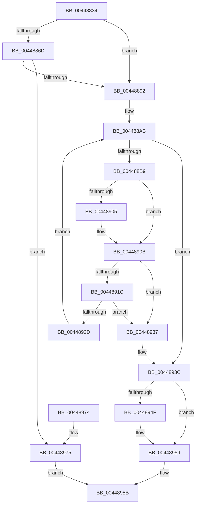

# MiAllowProtectionChange

- RVA: `0x00448834`–`0x0044897C` (길이 `328` bytes)
- VA: `0x0000000140448834`
- 실행 섹션: `.text`
- PDB 이름 있음: `예`; PDB Function 태그: `아니요`
- unwind 정보 RVA: `0x000A6180`
- 디코드: `92`개 명령, `328/328` bytes 표시
- 미해석 바이트: `0` (있으면 어셈블리에 `.byte`로 보존)

> 이 문서는 커널 이미지의 기계어와 PDB 기호를 분석해 생성했습니다. 4번과 5번은 함수 원형과 자료형을 바이너리 사용 방식에서 추정한 C 해석이며 원본 소스 복구 결과는 아닙니다.

## 1. Dependencies

- 직접 호출 지점: **4**; 고유 호출 대상: **4**
- 직접 호출자로 확인된 함수: **3**
- RIP 상대 이미지 참조: **0**

### Outgoing calls
- `0x0044889B` → [MiLockWorkingSetShared](../27/MiLockWorkingSetShared_function_0027CBF0.md) (function, `0x0027CBF0`)
- `0x004488F7` → [MiQueryAddressState](../32/MiQueryAddressState_function_0032C380.md) (function, `0x0032C380`)
- `0x00448946` → [MiUnlockWorkingSetShared](../27/MiUnlockWorkingSetShared_function_0027D690.md) (function, `0x0027D690`)
- `0x00448952` → [MiArbitraryCodeBlocked](../../page/97/MiArbitraryCodeBlocked_function_0097D7CC.md) (function, `0x0097D7CC`)

### Direct callers
- [MiResetVirtualMemory](MiResetVirtualMemory_function_004486F0.md) at `0x004487DA`
- [MmProtectVirtualMemory](../../page/88/MmProtectVirtualMemory_function_00881050.md) at `0x008814DC`
- [MiAllocateVirtualMemory](../../page/88/MiAllocateVirtualMemory_function_00883B40.md) at `0x0088400C`

### Static image references
- 디코드된 RIP-relative 메모리 참조가 없습니다.

## 2. Other-region calls and transfers

- 다른 실행 섹션으로 향하는 call: **1**
  - `0x00448952` → [MiArbitraryCodeBlocked](../../page/97/MiArbitraryCodeBlocked_function_0097D7CC.md) (`.text` → `PAGE`)
- 별도 외부 분기/꼬리 이동을 확인하지 못했습니다.

## 3. Assembly (complete function range)

```asm
00448834  48 8B C4                        mov rax, rsp
00448837  48 89 58 08                     mov qword ptr [rax + 8], rbx
0044883B  48 89 68 10                     mov qword ptr [rax + 0x10], rbp
0044883F  56                              push rsi
00448840  57                              push rdi
00448841  41 54                           push r12
00448843  41 56                           push r14
00448845  41 57                           push r15
00448847  48 83 EC 60                     sub rsp, 0x60
0044884B  33 DB                           xor ebx, ebx
0044884D  41 8B F1                        mov esi, r9d
00448850  48 89 58 D0                     mov qword ptr [rax - 0x30], rbx
00448854  4D 8B F8                        mov r15, r8
00448857  89 58 CC                        mov dword ptr [rax - 0x34], ebx
0044885A  4C 8B E2                        mov r12, rdx
0044885D  89 58 C8                        mov dword ptr [rax - 0x38], ebx
00448860  48 8B E9                        mov rbp, rcx
00448863  66 89 58 20                     mov word ptr [rax + 0x20], bx
00448867  41 F6 C1 02                     test r9b, 2
0044886B  74 25                           je 0x140448892
0044886D  45 8B 40 30                     mov r8d, dword ptr [r8 + 0x30]
00448871  B9 00 0C 00 00                  mov ecx, 0xc00
00448876  41 8B C0                        mov eax, r8d
00448879  23 C1                           and eax, ecx
0044887B  3B C1                           cmp eax, ecx
0044887D  0F 94 C1                        sete cl
00448880  41 F7 C0 80 03 00 00            test r8d, 0x380
00448887  0F 95 C0                        setne al
0044888A  84 C8                           test al, cl
0044888C  0F 85 E3 00 00 00               jne 0x140448975
00448892  48 8D 8D 00 04 00 00            lea rcx, [rbp + 0x400]
00448899  8B FB                           mov edi, ebx
0044889B  E8 50 43 E3 FF                  call 0x14027cbf0
004488A0  48 8B 8C 24 B0 00 00 00         mov rcx, qword ptr [rsp + 0xb0]
004488A8  44 8A F0                        mov r14b, al
004488AB  48 3B 8C 24 B8 00 00 00         cmp rcx, qword ptr [rsp + 0xb8]
004488B3  0F 87 83 00 00 00               ja 0x14044893c
004488B9  48 8B 94 24 B8 00 00 00         mov rdx, qword ptr [rsp + 0xb8]
004488C1  48 8D 44 24 58                  lea rax, [rsp + 0x58]
004488C6  48 89 44 24 40                  mov qword ptr [rsp + 0x40], rax
004488CB  4D 8B CF                        mov r9, r15
004488CE  48 8D 84 24 A8 00 00 00         lea rax, [rsp + 0xa8]
004488D6  45 8A C6                        mov r8b, r14b
004488D9  48 89 44 24 38                  mov qword ptr [rsp + 0x38], rax
004488DE  48 8D 44 24 54                  lea rax, [rsp + 0x54]
004488E3  48 89 44 24 30                  mov qword ptr [rsp + 0x30], rax
004488E8  48 8D 44 24 50                  lea rax, [rsp + 0x50]
004488ED  48 89 44 24 28                  mov qword ptr [rsp + 0x28], rax
004488F2  48 89 5C 24 20                  mov qword ptr [rsp + 0x20], rbx
004488F7  E8 84 3A EE FF                  call 0x14032c380
004488FC  8B 54 24 50                     mov edx, dword ptr [rsp + 0x50]
00448900  83 FA FF                        cmp edx, -1
00448903  75 06                           jne 0x14044890b
00448905  8B D3                           mov edx, ebx
00448907  89 5C 24 50                     mov dword ptr [rsp + 0x50], ebx
0044890B  F6 C2 02                        test dl, 2
0044890E  0F 94 C1                        sete cl
00448911  40 F6 C6 02                     test sil, 2
00448915  0F 95 C0                        setne al
00448918  84 C8                           test al, cl
0044891A  75 1B                           jne 0x140448937
0044891C  F6 C2 02                        test dl, 2
0044891F  0F 95 C1                        setne cl
00448922  40 F6 C6 04                     test sil, 4
00448926  0F 95 C0                        setne al
00448929  84 C8                           test al, cl
0044892B  75 0A                           jne 0x140448937
0044892D  48 8B 4C 24 58                  mov rcx, qword ptr [rsp + 0x58]
00448932  E9 74 FF FF FF                  jmp 0x1404488ab
00448937  BF 01 00 00 00                  mov edi, 1
0044893C  41 8A D6                        mov dl, r14b
0044893F  48 8D 8D 00 04 00 00            lea rcx, [rbp + 0x400]
00448946  E8 45 4D E3 FF                  call 0x14027d690
0044894B  85 FF                           test edi, edi
0044894D  74 0A                           je 0x140448959
0044894F  49 8B CC                        mov rcx, r12
00448952  E8 75 4E 53 00                  call 0x14097d7cc
00448957  8B D8                           mov ebx, eax
00448959  8B C3                           mov eax, ebx
0044895B  4C 8D 5C 24 60                  lea r11, [rsp + 0x60]
00448960  49 8B 5B 30                     mov rbx, qword ptr [r11 + 0x30]
00448964  49 8B 6B 38                     mov rbp, qword ptr [r11 + 0x38]
00448968  49 8B E3                        mov rsp, r11
0044896B  41 5F                           pop r15
0044896D  41 5E                           pop r14
0044896F  41 5C                           pop r12
00448971  5F                              pop rdi
00448972  5E                              pop rsi
00448973  C3                              ret
00448974  CC                              int3
00448975  B8 45 00 00 C0                  mov eax, 0xc0000045
0044897A  EB DF                           jmp 0x14044895b
```

## 4. C-style interpretation (structured pseudocode)

```c
__int64 __fastcall MiAllowProtectionChange(__int64 a1, __int64 a2, __int64 a3, int a4, __int64 a5, __int64 a6)
{
    __int64 result;
    __int64 v_rbx;
    __int64 v_rsp;
    unsigned __int64 v_stack_m28;
    unsigned __int64 v_stack_m30;
    unsigned __int64 v_stack_m34;
    unsigned __int64 v_stack_m38;
    unsigned __int64 v_stack_m48;
    unsigned __int64 v_stack_m50;
    unsigned __int64 v_stack_m58;
    unsigned __int64 v_stack_m60;
    unsigned __int64 v_stack_m68;
    unsigned __int64 v_stack_p20;

    *(unsigned __int64 *)(v_rsp + 8) = v_rbx;
    *(unsigned __int64 *)(v_rsp + 16) = v_rbp;
    v_rsp = (v_rsp) - (96);
    v_rbx = 0;
    *(unsigned __int64 *)(v_rsp - 48) = 0;
    *(unsigned int *)(v_rsp - 52) = 0;
    *(unsigned int *)(v_rsp - 56) = 0;
    *(unsigned __int16 *)(v_rsp + 32) = 0;
    if ((((unsigned __int8)(a4)) & (2)) == 0) goto loc_00448892;
    result = (unsigned int)(((unsigned int)((unsigned int)((unsigned int)(*(unsigned int *)(a3 + 48))))) & ((unsigned int)((unsigned int)(0xC00ULL))));
    a1 = (((unsigned int)(result)) == ((unsigned int)((unsigned int)(0xC00ULL)))) ? 1 : 0;
    result = ((((unsigned int)((unsigned int)(*(unsigned int *)(a3 + 48)))) & (896)) != 0) ? 1 : 0;
    if ((((unsigned __int8)(result)) & ((unsigned __int8)(a1))) != 0) goto loc_00448975;
loc_00448892:
    result = MiLockWorkingSetShared(a1 + 1024, a2, (unsigned int)(*(unsigned int *)(a3 + 48)), a4);
loc_004488AB:
    if (a5 > a6) goto loc_0044893C;
    v_stack_m48 = v_stack_m30;
    v_stack_m50 = v_stack_p20;
    v_stack_m58 = v_stack_m34;
    v_stack_m60 = v_stack_m38;
    v_stack_m68 = 0;
    result = MiQueryAddressState(a5, a6, (unsigned __int8)((unsigned __int8)(result)), a3);
    if (((unsigned int)((unsigned int)(v_stack_m38))) == -1) {
        a2 = 0;
        v_stack_m38 = 0;
    }
    a1 = ((((unsigned __int8)(a2)) & (2)) == 0) ? 1 : 0;
    result = ((((unsigned __int8)((unsigned int)(a4))) & (2)) != 0) ? 1 : 0;
    if ((((unsigned __int8)(result)) & ((unsigned __int8)(a1))) != 0) goto loc_00448937;
    a1 = ((((unsigned __int8)(a2)) & (2)) != 0) ? 1 : 0;
    result = ((((unsigned __int8)((unsigned int)(a4))) & (4)) != 0) ? 1 : 0;
    if ((((unsigned __int8)(result)) & ((unsigned __int8)(a1))) != 0) goto loc_00448937;
    goto loc_004488AB;
loc_00448937:
loc_0044893C:
    result = MiUnlockWorkingSetShared(a1 + 1024, (unsigned __int8)((unsigned __int8)(result)), (unsigned __int8)((unsigned __int8)(result)), a3);
    if (1 != 0) {
        a1 = a2;
        result = MiArbitraryCodeBlocked(a1, (unsigned __int8)((unsigned __int8)(result)), (unsigned __int8)((unsigned __int8)(result)), a3);
        v_rbx = (unsigned int)(result);
    }
loc_0044895B:
    return (unsigned int)((unsigned int)(v_rbx));
loc_00448975:
    goto loc_0044895B;
}
```

## 5. (Beta) C Style

```c
int64_t MiAllowProtectionChange(void *Arg1, int64_t Arg2, void *Arg3, int32_t Arg4, int64_t Arg5, int64_t Arg6)
{
    uint8_t *arg1 = (uint8_t *)Arg1;
    uint8_t *arg3 = (uint8_t *)Arg3;

    int64_t result;
    int64_t local_rbx;
    int64_t local_rsp;
    uint64_t v_stack_m28;
    uint64_t v_stack_m30;
    uint64_t v_stack_m34;
    uint64_t v_stack_m38;
    uint64_t v_stack_m48;
    uint64_t v_stack_m50;
    uint64_t v_stack_m58;
    uint64_t v_stack_m60;
    uint64_t v_stack_m68;
    uint64_t v_stack_p20;

    *(uint64_t *)(local_rsp + 0x8) = local_rbx;
    *(uint64_t *)(local_rsp + 0x10) = local_rbp;
    local_rsp = (local_rsp) - (96);
    local_rbx = 0;
    *(uint64_t *)(local_rsp - 0x30) = 0;
    *(uint32_t *)(local_rsp - 0x34) = 0;
    *(uint32_t *)(local_rsp - 0x38) = 0;
    *(uint16_t *)(local_rsp + 0x20) = 0;
    if ((((uint8_t)(Arg4)) & (2)) == 0) goto loc_00448892;
    result = (uint32_t)(((uint32_t)((uint32_t)((uint32_t)(*(uint32_t *)(arg3 + 0x30))))) & ((uint32_t)((uint32_t)(0xC00ULL))));
    Arg1 = (((uint32_t)(result)) == ((uint32_t)((uint32_t)(0xC00ULL)))) ? 1 : 0;
    result = ((((uint32_t)((uint32_t)(*(uint32_t *)(arg3 + 0x30)))) & (896)) != 0) ? 1 : 0;
    if ((((uint8_t)(result)) & ((uint8_t)(Arg1))) != 0) goto loc_00448975;
loc_00448892:
    result = MiLockWorkingSetShared(Arg1 + 1024, Arg2, (uint32_t)(*(uint32_t *)(arg3 + 0x30)), Arg4);
loc_004488AB:
    if (Arg5 > Arg6) goto loc_0044893C;
    v_stack_m48 = v_stack_m30;
    v_stack_m50 = v_stack_p20;
    v_stack_m58 = v_stack_m34;
    v_stack_m60 = v_stack_m38;
    v_stack_m68 = 0;
    result = MiQueryAddressState(Arg5, Arg6, (uint8_t)((uint8_t)(result)), Arg3);
    if (((uint32_t)((uint32_t)(v_stack_m38))) == -1) {
        Arg2 = 0;
        v_stack_m38 = 0;
    }
    Arg1 = ((((uint8_t)(Arg2)) & (2)) == 0) ? 1 : 0;
    result = ((((uint8_t)((uint32_t)(Arg4))) & (2)) != 0) ? 1 : 0;
    if ((((uint8_t)(result)) & ((uint8_t)(Arg1))) != 0) goto loc_00448937;
    Arg1 = ((((uint8_t)(Arg2)) & (2)) != 0) ? 1 : 0;
    result = ((((uint8_t)((uint32_t)(Arg4))) & (4)) != 0) ? 1 : 0;
    if ((((uint8_t)(result)) & ((uint8_t)(Arg1))) != 0) goto loc_00448937;
    goto loc_004488AB;
loc_00448937:
loc_0044893C:
    result = MiUnlockWorkingSetShared(Arg1 + 1024, (uint8_t)((uint8_t)(result)), (uint8_t)((uint8_t)(result)), Arg3);
    if (1 != 0) {
        Arg1 = Arg2;
        result = MiArbitraryCodeBlocked(Arg1, (uint8_t)((uint8_t)(result)), (uint8_t)((uint8_t)(result)), Arg3);
        local_rbx = (uint32_t)(result);
    }
loc_0044895B:
    return (uint32_t)((uint32_t)(local_rbx));
loc_00448975:
    goto loc_0044895B;
}
```

### 관측된 메모리 오프셋

구조체 형식이 확인되지 않은 접근은 인자 기준의 오프셋으로만 기록했습니다.

| 기준 인자 | 오프셋 표현 | 폭 (bit) | 접근 |
|---|---:|---:|---|
| `Arg1` | `+ 0x400` | `64` | `R` |
| `Arg3` | `+ 0x30` | `32` | `R` |

## 6. Execution-region graph

[열기: 2D/3D 그래프와 함수 탐색 컨트롤 패널](../../../control-panel.html?section=text&rva=0x00448834&view=graph)

- 2D 그래프는 위에서 아래로 흐르고, 3D 그래프는 빈 공간을 드래그해 회전합니다. Shift+드래그는 이동, 휠은 확대·축소, 함수 노드 선택은 대상 보고서 이동입니다.

### Static fallback


