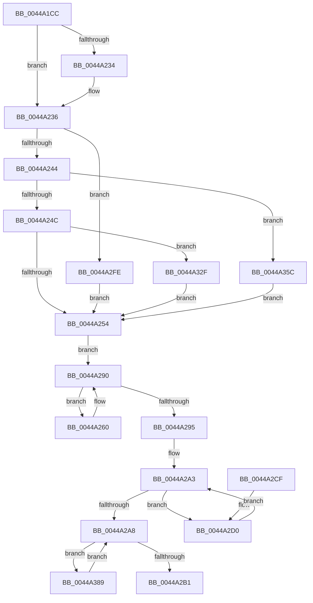

# MiApplyDynamicRelocationFixups

- RVA: `0x0044A1CC`–`0x0044A3BA` (길이 `494` bytes)
- VA: `0x000000014044A1CC`
- 실행 섹션: `.text`
- PDB 이름 있음: `예`; PDB Function 태그: `아니요`
- unwind 정보 RVA: `0x0007E068`
- 디코드: `128`개 명령, `494/494` bytes 표시
- 미해석 바이트: `0` (있으면 어셈블리에 `.byte`로 보존)

> 이 문서는 커널 이미지의 기계어와 PDB 기호를 분석해 생성했습니다. 4번과 5번은 함수 원형과 자료형을 바이너리 사용 방식에서 추정한 C 해석이며 원본 소스 복구 결과는 아닙니다.

## 1. Dependencies

- 직접 호출 지점: **6**; 고유 호출 대상: **3**
- 직접 호출자로 확인된 함수: **2**
- RIP 상대 이미지 참조: **2**

### Outgoing calls
- `0x0044A287` → [RtlApplyImportRelocationToPage](RtlApplyImportRelocationToPage_function_0044A3C0.md) (function, `0x0044A3C0`)
- `0x0044A2F3` → [RtlApplyIndirectRelocationToPage](RtlApplyIndirectRelocationToPage_function_0044A8A8.md) (function, `0x0044A8A8`)
- `0x0044A325` → [RtlApplyImportRelocationToPage](RtlApplyImportRelocationToPage_function_0044A3C0.md) (function, `0x0044A3C0`)
- `0x0044A352` → [RtlApplySwitchJumpRelocationToPage](../4C/RtlApplySwitchJumpRelocationToPage_function_004CC980.md) (function, `0x004CC980`)
- `0x0044A37F` → [RtlApplyIndirectRelocationToPage](RtlApplyIndirectRelocationToPage_function_0044A8A8.md) (function, `0x0044A8A8`)
- `0x0044A3AC` → [RtlApplySwitchJumpRelocationToPage](../4C/RtlApplySwitchJumpRelocationToPage_function_004CC980.md) (function, `0x004CC980`)

### Direct callers
- [MiReapplyImportOptimizationWorker](../68/MiReapplyImportOptimizationWorker_function_00682720.md) at `0x006828E6`
- [MiPerformFixups](../../page/93/MiPerformFixups_function_0093F5F4.md) at `0x0093F93E`

### Static image references
- `0x0044A20D` → RVA `0x00FC6B48` (`ALMOSTRO`; read)
- `0x0044A260` → RVA `0x00E2D830` (`.data`; read)

## 2. Other-region calls and transfers

- 다른 실행 섹션으로 향하는 call: **0**
- 별도 외부 분기/꼬리 이동을 확인하지 못했습니다.

## 3. Assembly (complete function range)

```asm
0044A1CC  48 89 5C 24 08                  mov qword ptr [rsp + 8], rbx
0044A1D1  48 89 6C 24 10                  mov qword ptr [rsp + 0x10], rbp
0044A1D6  48 89 74 24 18                  mov qword ptr [rsp + 0x18], rsi
0044A1DB  57                              push rdi
0044A1DC  41 54                           push r12
0044A1DE  41 55                           push r13
0044A1E0  41 56                           push r14
0044A1E2  41 57                           push r15
0044A1E4  48 83 EC 40                     sub rsp, 0x40
0044A1E8  44 8B 9C 24 90 00 00 00         mov r11d, dword ptr [rsp + 0x90]
0044A1F0  44 8B E2                        mov r12d, edx
0044A1F3  45 8B D3                        mov r10d, r11d
0044A1F6  BA 01 00 00 00                  mov edx, 1
0044A1FB  41 83 E2 10                     and r10d, 0x10
0044A1FF  49 8B F1                        mov rsi, r9
0044A202  41 8B C2                        mov eax, r10d
0044A205  4D 8B F8                        mov r15, r8
0044A208  F7 D8                           neg eax
0044A20A  4C 8B E9                        mov r13, rcx
0044A20D  48 8B 05 34 C9 B7 00            mov rax, qword ptr [rip + 0xb7c934]
0044A214  1B ED                           sbb ebp, ebp
0044A216  41 C1 EB 03                     shr r11d, 3
0044A21A  45 33 F6                        xor r14d, r14d
0044A21D  83 E5 02                        and ebp, 2
0044A220  41 F7 D3                        not r11d
0044A223  44 23 DA                        and r11d, edx
0044A226  45 85 D2                        test r10d, r10d
0044A229  45 0F 44 F3                     cmove r14d, r11d
0044A22D  48 0F BA E0 29                  bt rax, 0x29
0044A232  72 02                           jb 0x14044a236
0044A234  0B EA                           or ebp, edx
0044A236  41 0F B7 49 06                  movzx ecx, word ptr [r9 + 6]
0044A23B  83 E9 03                        sub ecx, 3
0044A23E  0F 84 BA 00 00 00               je 0x14044a2fe
0044A244  2B CA                           sub ecx, edx
0044A246  0F 84 10 01 00 00               je 0x14044a35c
0044A24C  3B CA                           cmp ecx, edx
0044A24E  0F 84 DB 00 00 00               je 0x14044a32f
0044A254  0F B7 3E                        movzx edi, word ptr [rsi]
0044A257  48 8D 5E 0C                     lea rbx, [rsi + 0xc]
0044A25B  48 03 FB                        add rdi, rbx
0044A25E  EB 30                           jmp 0x14044a290
0044A260  4C 8B 0D C9 35 9E 00            mov r9, qword ptr [rip + 0x9e35c9]
0044A267  4D 8B C7                        mov r8, r15
0044A26A  89 6C 24 38                     mov dword ptr [rsp + 0x38], ebp
0044A26E  49 83 C1 04                     add r9, 4
0044A272  83 64 24 30 00                  and dword ptr [rsp + 0x30], 0
0044A277  41 8B D4                        mov edx, r12d
0044A27A  44 89 74 24 28                  mov dword ptr [rsp + 0x28], r14d
0044A27F  49 8B CD                        mov rcx, r13
0044A282  48 89 5C 24 20                  mov qword ptr [rsp + 0x20], rbx
0044A287  E8 34 01 00 00                  call 0x14044a3c0
0044A28C  48 83 C3 04                     add rbx, 4
0044A290  48 3B DF                        cmp rbx, rdi
0044A293  72 CB                           jb 0x14044a260
0044A295  0F B7 5E 02                     movzx ebx, word ptr [rsi + 2]
0044A299  0F B7 76 04                     movzx esi, word ptr [rsi + 4]
0044A29D  48 03 DF                        add rbx, rdi
0044A2A0  48 03 F3                        add rsi, rbx
0044A2A3  48 3B FB                        cmp rdi, rbx
0044A2A6  72 28                           jb 0x14044a2d0
0044A2A8  48 3B DE                        cmp rbx, rsi
0044A2AB  0F 82 D8 00 00 00               jb 0x14044a389
0044A2B1  4C 8D 5C 24 40                  lea r11, [rsp + 0x40]
0044A2B6  49 8B 5B 30                     mov rbx, qword ptr [r11 + 0x30]
0044A2BA  49 8B 6B 38                     mov rbp, qword ptr [r11 + 0x38]
0044A2BE  49 8B 73 40                     mov rsi, qword ptr [r11 + 0x40]
0044A2C2  49 8B E3                        mov rsp, r11
0044A2C5  41 5F                           pop r15
0044A2C7  41 5E                           pop r14
0044A2C9  41 5D                           pop r13
0044A2CB  41 5C                           pop r12
0044A2CD  5F                              pop rdi
0044A2CE  C3                              ret
0044A2CF  CC                              int3
0044A2D0  4C 8B 0D 59 35 9E 00            mov r9, qword ptr [rip + 0x9e3559]
0044A2D7  4D 8B C7                        mov r8, r15
0044A2DA  83 64 24 30 00                  and dword ptr [rsp + 0x30], 0
0044A2DF  49 83 C1 04                     add r9, 4
0044A2E3  44 89 74 24 28                  mov dword ptr [rsp + 0x28], r14d
0044A2E8  41 8B D4                        mov edx, r12d
0044A2EB  49 8B CD                        mov rcx, r13
0044A2EE  48 89 7C 24 20                  mov qword ptr [rsp + 0x20], rdi
0044A2F3  E8 B0 05 00 00                  call 0x14044a8a8
0044A2F8  48 83 C7 02                     add rdi, 2
0044A2FC  EB A5                           jmp 0x14044a2a3
0044A2FE  49 8D 41 08                     lea rax, [r9 + 8]
0044A302  89 6C 24 38                     mov dword ptr [rsp + 0x38], ebp
0044A306  4C 8B 0D 23 35 9E 00            mov r9, qword ptr [rip + 0x9e3523]
0044A30D  49 8B CD                        mov rcx, r13
0044A310  89 54 24 30                     mov dword ptr [rsp + 0x30], edx
0044A314  49 83 C1 04                     add r9, 4
0044A318  44 89 74 24 28                  mov dword ptr [rsp + 0x28], r14d
0044A31D  41 8B D4                        mov edx, r12d
0044A320  48 89 44 24 20                  mov qword ptr [rsp + 0x20], rax
0044A325  E8 96 00 00 00                  call 0x14044a3c0
0044A32A  E9 25 FF FF FF                  jmp 0x14044a254
0044A32F  49 8D 41 08                     lea rax, [r9 + 8]
0044A333  89 54 24 30                     mov dword ptr [rsp + 0x30], edx
0044A337  4C 8B 0D F2 34 9E 00            mov r9, qword ptr [rip + 0x9e34f2]
0044A33E  41 8B D4                        mov edx, r12d
0044A341  49 83 C1 04                     add r9, 4
0044A345  44 89 74 24 28                  mov dword ptr [rsp + 0x28], r14d
0044A34A  49 8B CD                        mov rcx, r13
0044A34D  48 89 44 24 20                  mov qword ptr [rsp + 0x20], rax
0044A352  E8 29 26 08 00                  call 0x1404cc980
0044A357  E9 F8 FE FF FF                  jmp 0x14044a254
0044A35C  49 8D 41 08                     lea rax, [r9 + 8]
0044A360  89 54 24 30                     mov dword ptr [rsp + 0x30], edx
0044A364  4C 8B 0D C5 34 9E 00            mov r9, qword ptr [rip + 0x9e34c5]
0044A36B  41 8B D4                        mov edx, r12d
0044A36E  49 83 C1 04                     add r9, 4
0044A372  44 89 74 24 28                  mov dword ptr [rsp + 0x28], r14d
0044A377  49 8B CD                        mov rcx, r13
0044A37A  48 89 44 24 20                  mov qword ptr [rsp + 0x20], rax
0044A37F  E8 24 05 00 00                  call 0x14044a8a8
0044A384  E9 CB FE FF FF                  jmp 0x14044a254
0044A389  4C 8B 0D A0 34 9E 00            mov r9, qword ptr [rip + 0x9e34a0]
0044A390  4D 8B C7                        mov r8, r15
0044A393  83 64 24 30 00                  and dword ptr [rsp + 0x30], 0
0044A398  49 83 C1 04                     add r9, 4
0044A39C  44 89 74 24 28                  mov dword ptr [rsp + 0x28], r14d
0044A3A1  41 8B D4                        mov edx, r12d
0044A3A4  49 8B CD                        mov rcx, r13
0044A3A7  48 89 5C 24 20                  mov qword ptr [rsp + 0x20], rbx
0044A3AC  E8 CF 25 08 00                  call 0x1404cc980
0044A3B1  48 83 C3 02                     add rbx, 2
0044A3B5  E9 EE FE FF FF                  jmp 0x14044a2a8
```

## 4. C-style interpretation (structured pseudocode)

```c
__int64 __fastcall MiApplyDynamicRelocationFixups(__int64 a1, int a2, __int64 a3, __int64 a4, unsigned int a5)
{
    __int64 result;
    __int64 v_r10;
    __int64 v_r11;
    __int64 v_r14;
    __int64 v_rbp;
    __int64 v_rbx;
    __int64 v_rdi;
    __int64 v_rsi;
    __int64 v_rsp;
    unsigned int v_stack_m10;
    unsigned int v_stack_m18;
    unsigned __int64 v_stack_m20;
    unsigned __int64 v_stack_m28;
    unsigned int v_stack_m30;
    unsigned int v_stack_m38;
    unsigned int v_stack_m40;
    unsigned __int64 v_stack_m48;
    unsigned int v_stack_m8;
    unsigned __int64 v_stack_p10;
    unsigned __int64 v_stack_p18;
    unsigned __int64 v_stack_p8;

    v_stack_p8 = v_rbx;
    v_stack_p10 = v_rbp;
    v_stack_p18 = v_rsi;
    v_rsp = (v_rsp) - (64);
    v_r10 = (unsigned int)(((unsigned int)((unsigned int)((unsigned int)(a5)))) & (16));
    result = (unsigned int)(-((unsigned int)((unsigned int)(v_r10))));
    v_r11 = (unsigned int)(((unsigned int)(a5)) >> (3));
    v_r14 = 0;
    v_rbp = (unsigned int)((v_rbp) & (2));
    v_r11 = (unsigned int)(~(v_r11));
    v_r11 = (unsigned int)((v_r11) & (1));
    if ((unsigned int)(v_r10) == 0) { v_r14 = (unsigned int)(v_r11); }
    if (!(condition_is_below)) {
        v_rbp = (unsigned int)((v_rbp) | (1));
    }
    a1 = (unsigned int)((*(unsigned __int16 *)(a4 + 6)) - (3));
    if (condition_is_equal) goto loc_0044A2FE;
    a1 = (unsigned int)((a1) - (1));
    if (condition_is_equal) goto loc_0044A35C;
    if (((unsigned int)(a1)) == 1) goto loc_0044A32F;
loc_0044A254:
    v_rdi = (*(unsigned __int16 *)(a4)) + (a4 + 12);
    goto loc_0044A290;
loc_0044A260:
    v_stack_m30 = (unsigned int)(v_rbp);
    a4 = (*(unsigned __int64 *)(v_rip + 10368457)) + (4);
    v_stack_m40 = (unsigned int)(v_r14);
    v_stack_m48 = a4 + 12;
    result = RtlApplyImportRelocationToPage(a1, (unsigned int)((unsigned int)((unsigned int)(a2))), a3, a4);
    v_rbx = (a4 + 12) + (4);
loc_0044A290:
    if (v_rbx < v_rdi) goto loc_0044A260;
    v_rbx = (*(unsigned __int16 *)(a4 + 2)) + (v_rdi);
    v_rsi = (*(unsigned __int16 *)(a4 + 4)) + (v_rbx);
loc_0044A2A3:
    if (v_rdi < v_rbx) goto loc_0044A2D0;
loc_0044A2A8:
    if (v_rbx < v_rsi) goto loc_0044A389;
    return result;
loc_0044A2D0:
    a4 = (*(unsigned __int64 *)(v_rip + 10368345)) + (4);
    v_stack_m18 = (unsigned int)(v_r14);
    v_stack_m20 = v_rdi;
    result = RtlApplyIndirectRelocationToPage(a1, (unsigned int)((unsigned int)((unsigned int)(a2))), a3, a4);
    v_rdi = (v_rdi) + (2);
    goto loc_0044A2A3;
loc_0044A2FE:
    v_stack_m8 = (unsigned int)(*(unsigned __int64 *)(v_stack_m28 + 56));
    v_stack_m10 = (unsigned int)((unsigned int)((unsigned int)((unsigned int)(a2))));
    a4 = (*(unsigned __int64 *)(v_rip + 10368291)) + (4);
    v_stack_m18 = (unsigned int)(v_r14);
    v_stack_m20 = a4 + 8;
    result = RtlApplyImportRelocationToPage(a1, (unsigned int)((unsigned int)((unsigned int)(a2))), a3, a4);
    goto loc_0044A254;
loc_0044A32F:
    v_stack_m10 = (unsigned int)((unsigned int)((unsigned int)((unsigned int)(a2))));
    a4 = (*(unsigned __int64 *)(v_rip + 10368242)) + (4);
    v_stack_m18 = (unsigned int)(v_r14);
    v_stack_m20 = a4 + 8;
    result = RtlApplySwitchJumpRelocationToPage(a1, (unsigned int)((unsigned int)((unsigned int)(a2))), a3, a4);
    goto loc_0044A254;
loc_0044A35C:
    v_stack_m10 = (unsigned int)((unsigned int)((unsigned int)((unsigned int)(a2))));
    a4 = (*(unsigned __int64 *)(v_rip + 10368197)) + (4);
    v_stack_m18 = (unsigned int)(v_r14);
    v_stack_m20 = a4 + 8;
    result = RtlApplyIndirectRelocationToPage(a1, (unsigned int)((unsigned int)((unsigned int)(a2))), a3, a4);
    goto loc_0044A254;
loc_0044A389:
    a4 = (*(unsigned __int64 *)(v_rip + 10368160)) + (4);
    v_stack_m18 = (unsigned int)(v_r14);
    v_stack_m20 = *(unsigned __int64 *)(v_stack_m28 + 48);
    result = RtlApplySwitchJumpRelocationToPage(a1, (unsigned int)((unsigned int)((unsigned int)(a2))), a3, a4);
    v_rbx = (*(unsigned __int64 *)(v_stack_m28 + 48)) + (2);
    goto loc_0044A2A8;
}
```

## 5. (Beta) C Style

```c
int64_t MiApplyDynamicRelocationFixups(int64_t Arg1, int32_t Arg2, int64_t Arg3, void *Arg4, uint32_t Arg5)
{
    uint8_t *arg4 = (uint8_t *)Arg4;

    int64_t result;
    int64_t local_r10;
    int64_t local_r11;
    int64_t local_r14;
    int64_t local_rbp;
    int64_t local_rbx;
    int64_t local_rdi;
    int64_t local_rsi;
    int64_t local_rsp;
    uint32_t v_stack_m10;
    uint32_t v_stack_m18;
    uint64_t v_stack_m20;
    uint64_t v_stack_m28;
    uint32_t v_stack_m30;
    uint32_t v_stack_m38;
    uint32_t v_stack_m40;
    uint64_t v_stack_m48;
    uint32_t v_stack_m8;
    uint64_t v_stack_p10;
    uint64_t v_stack_p18;
    uint64_t v_stack_p8;

    v_stack_p8 = local_rbx;
    v_stack_p10 = local_rbp;
    v_stack_p18 = local_rsi;
    local_rsp = (local_rsp) - (64);
    local_r10 = (uint32_t)(((uint32_t)((uint32_t)((uint32_t)(Arg5)))) & (16));
    result = (uint32_t)(-((uint32_t)((uint32_t)(local_r10))));
    local_r11 = (uint32_t)(((uint32_t)(Arg5)) >> (3));
    local_r14 = 0;
    local_rbp = (uint32_t)((local_rbp) & (2));
    local_r11 = (uint32_t)(~(local_r11));
    local_r11 = (uint32_t)((local_r11) & (1));
    if ((uint32_t)(local_r10) == 0) { local_r14 = (uint32_t)(local_r11); }
    if (!(condition_is_below)) {
        local_rbp = (uint32_t)((local_rbp) | (1));
    }
    Arg1 = (uint32_t)((*(uint16_t *)(arg4 + 0x6)) - (3));
    if (condition_is_equal) goto loc_0044A2FE;
    Arg1 = (uint32_t)((Arg1) - (1));
    if (condition_is_equal) goto loc_0044A35C;
    if (((uint32_t)(Arg1)) == 1) goto loc_0044A32F;
loc_0044A254:
    local_rdi = (*(uint16_t *)(arg4)) + (Arg4 + 12);
    goto loc_0044A290;
loc_0044A260:
    v_stack_m30 = (uint32_t)(local_rbp);
    Arg4 = (*(uint64_t *)(v_rip + 0x9E35C9)) + (4);
    v_stack_m40 = (uint32_t)(local_r14);
    v_stack_m48 = Arg4 + 12;
    result = RtlApplyImportRelocationToPage(Arg1, (uint32_t)((uint32_t)((uint32_t)(Arg2))), Arg3, Arg4);
    local_rbx = (Arg4 + 12) + (4);
loc_0044A290:
    if (local_rbx < local_rdi) goto loc_0044A260;
    local_rbx = (*(uint16_t *)(arg4 + 0x2)) + (local_rdi);
    local_rsi = (*(uint16_t *)(arg4 + 0x4)) + (local_rbx);
loc_0044A2A3:
    if (local_rdi < local_rbx) goto loc_0044A2D0;
loc_0044A2A8:
    if (local_rbx < local_rsi) goto loc_0044A389;
    return result;
loc_0044A2D0:
    Arg4 = (*(uint64_t *)(v_rip + 0x9E3559)) + (4);
    v_stack_m18 = (uint32_t)(local_r14);
    v_stack_m20 = local_rdi;
    result = RtlApplyIndirectRelocationToPage(Arg1, (uint32_t)((uint32_t)((uint32_t)(Arg2))), Arg3, Arg4);
    local_rdi = (local_rdi) + (2);
    goto loc_0044A2A3;
loc_0044A2FE:
    v_stack_m8 = (uint32_t)(*(uint64_t *)(v_stack_m28 + 0x38));
    v_stack_m10 = (uint32_t)((uint32_t)((uint32_t)((uint32_t)(Arg2))));
    Arg4 = (*(uint64_t *)(v_rip + 0x9E3523)) + (4);
    v_stack_m18 = (uint32_t)(local_r14);
    v_stack_m20 = Arg4 + 8;
    result = RtlApplyImportRelocationToPage(Arg1, (uint32_t)((uint32_t)((uint32_t)(Arg2))), Arg3, Arg4);
    goto loc_0044A254;
loc_0044A32F:
    v_stack_m10 = (uint32_t)((uint32_t)((uint32_t)((uint32_t)(Arg2))));
    Arg4 = (*(uint64_t *)(v_rip + 0x9E34F2)) + (4);
    v_stack_m18 = (uint32_t)(local_r14);
    v_stack_m20 = Arg4 + 8;
    result = RtlApplySwitchJumpRelocationToPage(Arg1, (uint32_t)((uint32_t)((uint32_t)(Arg2))), Arg3, Arg4);
    goto loc_0044A254;
loc_0044A35C:
    v_stack_m10 = (uint32_t)((uint32_t)((uint32_t)((uint32_t)(Arg2))));
    Arg4 = (*(uint64_t *)(v_rip + 0x9E34C5)) + (4);
    v_stack_m18 = (uint32_t)(local_r14);
    v_stack_m20 = Arg4 + 8;
    result = RtlApplyIndirectRelocationToPage(Arg1, (uint32_t)((uint32_t)((uint32_t)(Arg2))), Arg3, Arg4);
    goto loc_0044A254;
loc_0044A389:
    Arg4 = (*(uint64_t *)(v_rip + 0x9E34A0)) + (4);
    v_stack_m18 = (uint32_t)(local_r14);
    v_stack_m20 = *(uint64_t *)(v_stack_m28 + 0x30);
    result = RtlApplySwitchJumpRelocationToPage(Arg1, (uint32_t)((uint32_t)((uint32_t)(Arg2))), Arg3, Arg4);
    local_rbx = (*(uint64_t *)(v_stack_m28 + 0x30)) + (2);
    goto loc_0044A2A8;
}
```

### 관측된 메모리 오프셋

구조체 형식이 확인되지 않은 접근은 인자 기준의 오프셋으로만 기록했습니다.

| 기준 인자 | 오프셋 표현 | 폭 (bit) | 접근 |
|---|---:|---:|---|
| `Arg4` | `+ 0x0` | `16` | `R` |
| `Arg4` | `+ 0x2` | `16` | `R` |
| `Arg4` | `+ 0x4` | `16` | `R` |
| `Arg4` | `+ 0x6` | `16` | `R` |
| `Arg4` | `+ 0x8` | `64` | `R` |
| `Arg4` | `+ 0xC` | `64` | `R` |

## 6. Execution-region graph

[열기: 2D/3D 그래프와 함수 탐색 컨트롤 패널](../../../control-panel.html?section=text&rva=0x0044A1CC&view=graph)

- 2D 그래프는 위에서 아래로 흐르고, 3D 그래프는 빈 공간을 드래그해 회전합니다. Shift+드래그는 이동, 휠은 확대·축소, 함수 노드 선택은 대상 보고서 이동입니다.

### Static fallback


